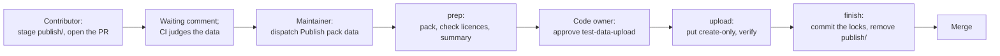

# Contributing to Rerail

Thank you for helping. This guide covers trusted contributors, how work starts, how to set up a checkout, what a pull
request needs, and the rules that keep the project open source and its licensing clean.

Everyone taking part follows the [Code of Conduct](CODE_OF_CONDUCT.md). Report a security vulnerability privately, as
[SECURITY.md](SECURITY.md) describes, never in a public issue or pull request.

## Trusted contributors

Anyone can open an issue. Pull requests come from trusted contributors, each from their own fork. That keeps the
project's CI, its secrets and its release workflows away from code nobody on the team has read, without closing the
project to outside work.

### What trust gives you

| | Trusted contributor | Anyone else |
| --- | --- | --- |
| Open and comment on issues | Yes | Yes |
| Claim a `good first issue` or `help wanted` issue | Yes | Ask to become trusted ([below](#becoming-a-trusted-contributor)) |
| Open a pull request from a fork | Yes | Closed with a link to this section |
| Write access, merging, triage, the project's secrets | No | No |

CI on a pull request from a fork runs once a maintainer has approved the run, without the project's secrets; the jobs
that need them skip the pull request and run when the change reaches `main`. A trusted contributor's pull request is
reviewed like anyone else's.

### Becoming a trusted contributor

Ask in the issue you want to work on, or open one: say what you want to change and how you would go about it. For
anything in [Start with an issue](#start-with-an-issue), that is the conversation a maintainer has with you anyway.

Maintainers look at:

- the issue itself: a reproduction, a failing case, or an approach that holds up;
- whether the change fits where Rerail is going, at a size you can finish;
- how you have worked in the issues so far, under the [Code of Conduct](CODE_OF_CONDUCT.md).

A maintainer answers in the issue. If it's a yes, they add you to the list below and assign you the issue. If it's not
yet, they say why and what would change it.

### The list

The list changes only through a maintainer's pull request that links the issue where it was agreed, so every name on
it has a public reason.

Trusted contributors: none yet.

### Leaving the list

- Ask, in any issue or at [opensource@nera.software](mailto:opensource@nera.software), and you are taken off.
- Twelve months without a pull request, issue or comment here takes you off. Ask again any time.
- Breaking the Code of Conduct can take you off, as its enforcement steps describe.

### Pull requests from anyone else

A maintainer closes them with a link to this section. That says nothing about the change itself: ask in an issue,
linking the closed pull request, and once you are trusted, open it again from your fork.

## Start with an issue

Open an issue before you start on:

- a new feature, or a change to how Rerail behaves;
- a new rule, rule pack, language or coding-agent integration;
- a change to the rule-file format, the API, or what a pack publishes;
- anything that spans several parts of the repository.

Agree on the approach with a maintainer in the issue before you write the code. A pull request for work nobody agreed
on may be closed, however good it is.

A trusted contributor can take these straight to a pull request, with no issue:

- typo and documentation fixes;
- a bug fix with a test that fails without it;
- a rule's false positive or false negative, with the code that triggers it added as a test.

### Claiming an issue

Issues labelled `good first issue` or `help wanted` are open to any trusted contributor, and asking for one is a good
way to become one ([Becoming a trusted contributor](#becoming-a-trusted-contributor)). Check that the issue is not
assigned, then comment on it to claim it; a maintainer assigns it to you. If there is no pull request or update from
you within two weeks, the issue is open to others again.

## Contribution flow

1. Find an issue, or open one ([Start with an issue](#start-with-an-issue)).
2. Claim it ([Becoming a trusted contributor](#becoming-a-trusted-contributor) the first time), and agree on the
   approach with a maintainer when the issue needs one.
3. Fork the repository and create a branch from `main`.
4. Set up your checkout ([Development setup](#development-setup)), make the change, and add tests for the behavior it
   changes.
5. Run the checks in [Before you open a pull request](#before-you-open-a-pull-request).
6. Open a pull request against `main` that links the issue (`Fixes #123`) and says how you tested the change.
7. A maintainer reviews it. Push fixes to the same branch. Pack data the pull request stages is published by a
   maintainer first ([How pack data is published](#how-pack-data-is-published)); once it is approved and CI passes, it
   is squash-merged.

## Getting help

Ask in the issue you are working on, or open an issue with your question.

### Response times

Rerail is maintained by a small team. These are the times we aim to reply in, counted in business days; they are
not times to a fix, a merge or a release.

| You sent | We reply within |
| --- | --- |
| A vulnerability report ([SECURITY.md](SECURITY.md)) | 2 business days |
| A conduct report ([CODE_OF_CONDUCT.md](CODE_OF_CONDUCT.md#reporting)) | 3 business days |
| A bug report | 5 business days: triaged, labelled, or asked for a reproduction |
| A feature request | 10 business days: accepted, declined, or "not now" with a reason |
| A request to become a trusted contributor | 10 business days |
| A pull request, as a trusted contributor | 10 business days to its first review |
| A question | Best effort |

If an issue or pull request gets no reply within its window, comment on it to bring it back up.

## Development setup

One repository holds everything: the core package at the root, rule packs under [`packs/`](packs/), and the engine's
language conformance fixtures under [`fixtures/`](fixtures/) (test data, never published).

Install [Git LFS](https://git-lfs.com) before you clone, and run `git lfs install` once. The embedding model's weights
(`model/model.safetensors`) and the engine's Unicode names table (`native/src/code_rule_dsl/value/names/names.bin`,
compiled into the engine) are stored in LFS (`.gitattributes`); without it a checkout holds pointer files, and neither
the engine build nor the model works. In a checkout made without it, run `git lfs pull`.

```sh
git clone https://github.com/neralabs/rerail.git
```

`RERAIL_ORACLES_DIR` points the build and tests at another fixtures directory.

Prerequisites: Node.js 24+, npm, Rust through [rustup](https://rustup.rs/), and [`just`](https://github.com/casey/just)
for the dev recipes (`just rerail-dev`, `just nuke-rerail`). `rust-toolchain.toml` pins the toolchain, so `cargo`
installs and selects it on first use.

```sh
npm ci
npm run build:native      # compile the native kernel into native/
npm run build             # clean build: native kernel, runtime, host bundles, UI
npm run check:all         # TypeScript, rustfmt + clippy, UI token and reference checks
npm run test:all          # build, unit, conformance, reference, native, and integration suites
npm run test:conformance  # the language conformance gate, offline
npm run package:check     # build and dry-run the npm pack
```

The pack tests also need the pack test data: run `npm run fixtures:pull` ([Pack test data](#pack-test-data)).

`npm run build:native` needs `cargo` on `PATH`; after a fresh rustup install, `export PATH="$HOME/.cargo/bin:$PATH"`.

### Each component

| Component | Where | Build | Check and test |
| --- | --- | --- | --- |
| Runtime, CLI and coding-agent hosts | `src/` | `npm run build` | `npm run check`, `npm test` |
| Native engine (Rust) | `native/` | `npm run build:native` | `npm run check:native`, `npm run test:native` |
| Rule packs | `packs/` | none | `npm test` (the pack validation, `test/engine/catalog/packs.test.ts`), `npm run conformance:languages -- --pack <id>` |
| Dashboard | `ui/` | `npm run build:ui` | `npm run check:ui-tokens` |
| Integration suites | `integration/` | `npm run build` | `npm run test:integration:built` (needs a real OMP, below) |
| Repository scripts | `scripts/` | none | `npm run test:scripts` |

Generated files are listed, with the command that rewrites each, in
[scripts/generate/README.md](scripts/generate/README.md); edit the generator, not its output.

### Development builds

Everything run from a checkout (tests, benchmarks, `node dist/cli/cli.js`) is a development build: its policy content
store is `<checkout>/.rerail/content-v1.sqlite`, private to that checkout or worktree. Only the managed installation
under `~/.rerail/versions/` opens the machine-wide `~/.cache/rerail/content-v1.sqlite`, so a checkout on a newer store
schema cannot break the installed Rerail. `RERAIL_CONTENT_STORE_PATH` overrides the location; the test setup gives
every test file its own store that way. See [Installing Rerail](docs/installation.md#after-setup).

To run a checkout's build in your harnesses instead of the published package, run `just rerail-dev --install-bridge`.
It builds the checkout, activates the checkout as `~/.rerail/current`, the way `setup` activates a published version,
writes the launcher, and registers the harnesses; run `npx @neralabs/rerail setup` again to return to the published
package.

Rerail's own toolchain is Node only. OMP remains an external Bun-hosted runtime; its integration suites
(`integration/omp-*.test.ts`, `integration/host-auth.test.ts`) use Vitest to drive a real standalone OMP executable.
Set `RERAIL_OMP_EXECUTABLE` to its absolute path, or provision the release pinned to the SDK dependency with
`node scripts/host/install-omp-host.mjs` (checksum-verified; uses a private local cache and prints the executable path).
CI uses the same host. `npm run test:integration:built` skips the build step when `dist/` is current.

`scripts/generate/model/prepare_model.py` reproduces the bundled INT8 artifact from the revision and checksums recorded
in `model/manifest.json`.

`npm run conformance:languages -- --pack <pack>` scores a language pack's ported linter rules (`packs/<pack>/`) through
the production workspace against the tool's expected findings in the pack's `upstream/` and, with `--samples`, on the
tool-packs' labelled real-code samples (`samples.lock`, [docs/upstream.md](docs/upstream.md#samples));
`--write` saves the report under `.rerail/reports/`. `npm run conformance:languages:check` is the gate over the fixtures,
their rename variants and the samples ([conformance/README.md](conformance/README.md#the-gate)); it runs offline in
`npm run test:conformance`, part of `test:all` in CI.

### Operational commands (`just`)

The root [`Justfile`](Justfile) wraps the day-to-day operations; `just` lists them. Each recipe runs a script under
`scripts/` (or `playground/`, `conformance/`, `benchmark/`), so the same command works without `just`.

| Recipe | Does |
| --- | --- |
| `just rerail [--tag next] [setup args]` | Installs the published package on this machine (`npx @neralabs/rerail setup`). `RERAIL_TAG` selects the dist-tag; `--restore [dir]` then restores a `nuke-rerail` backup. |
| `just nuke-rerail [--dry-run \| --yes]` | Removes Rerail from this machine (daemon, coding-agent registrations, `~/.rerail`, every checkout's dev daemon), moving it all to `~/.rerail-clean-YYYYMMDD[-HHMMSS]/` for `just rerail --restore`. |
| `just rerail-native` | Installs rustup and the pinned toolchain if needed, then builds the native engine. |
| `just rerail-setup` | Reserves this checkout's dev instance (`.rerail/dev/instance.json`: a stable loopback port in 35000–35999 and the home `.rerail/dev/home`) without starting anything. |
| `just rerail-dev [--install-bridge] [--restore [dir]]` | Rebuilds whatever is stale and (re)starts this checkout's dev daemon on its own home and port, serving `ui/` live. `--install-bridge` registers this checkout's build with every coding agent (`rerail install --root`); hooks always use the default home, so a bridged checkout's dev daemon runs on `~/.rerail` until another `rerail setup` replaces the bridge. `--restore` loads a `nuke-rerail` backup's database. |
| `just rerail-status`, `just rerail-down`, `just rerail-reset` | Shows the dev instance and build freshness; stops its daemon (state kept); deletes this repository's session history from the dev database (rules kept). |
| `just rerail-playground` | The development rule playground beside the dev daemon (attended macOS only; see [playground/README.md](playground/README.md)). |
| `just rerail-smoke` | Packs this checkout, publishes it to a throwaway authenticated local registry, and drives install, update, `nuke-rerail`/`--restore` and `install --remove` in a sandbox `HOME` (`KEEP=1` keeps it). |
| `just rerail-env-matrix run --tarball <file> [--env <ids>]` | Installs a package on throwaway Azure VMs (Linux and Windows, x64 and arm64) and checks it there as a user meets it; `--npm <spec>` installs from npmjs instead, `list` names the environments, `sweep` deletes leftovers. Needs `az login` ([docs/environment-matrix.md](docs/environment-matrix.md)). |
| `just rerail-language-conformance` | Language-pack conformance (`--pack <id>`, `--check`). |
| `just rerail-query-parity --corpus <dir> --manifest <paths.json>` | Compares a reference native addon (`RERAIL_QUERY_PARITY_REFERENCE_ADDON`) with this checkout's on a corpus. |

`npm run test:scripts` runs the recipes' tests.

### Live harness smoke (macOS)

Run the real-provider smoke as the final acceptance step, after the deterministic regression suite:

```sh
npm run test:e2e:host -- --host all
npm run test:e2e:host -- --host codex
```

The command builds the complete package first. Each harness gets a temporary workspace, private profile, resident
daemon, and a probed `sandbox-exec` write boundary. The smoke's conversation rule and code rule are stored in the daemon
database's rule library and added to the workspace's repository, which is set up and started as `rerail start` leaves
it. The smoke uses actual installed CLIs and providers—not scripted models or hook substitutes. It requires a committed
violating edit with a matching native tool result, an executable-policy diagnostic, restoration of the transaction
helper, exactly one cosine delivery containing a private nonce, and an assistant reply quoting that nonce and
diagnostic.

`RERAIL_SMOKE_ACCEPTANCE=transport` narrows a run to the hook transport contract; the default is `full`. Transport mode
remains a real CLI/provider session and still gates sandboxing, one lifecycle session, the completed violating tool
result, in-budget evaluation, the single cosine delivery, and the executable-policy delivery. It deliberately excludes
the model's subsequent file restoration and final prose because those are provider sampling behavior rather than the
hook transport contract. Full mode retains every assertion above.

Prerequisites:

- macOS with `sandbox-exec`, and the selected harness CLIs installed. `RERAIL_CLAUDE_BIN` and `RERAIL_CURSOR_AGENT_BIN`
  can select non-PATH executables.
- Provider credentials for each selected harness. `scripts/host/host-smoke.ts` documents the environment variables it
  reads; a missing credential or endpoint is a failure, never a skipped pass. OAuth tokens copied from a harness login
  must remain valid for at least ten minutes; refresh credentials are not copied.

Each provider-backed session has a 180-second limit by default; `RERAIL_SMOKE_TIMEOUT_MS` can raise that hard limit for a slower provider. `RERAIL_SMOKE_ATTEMPTS` (default 1; CI uses 3) reruns a harness in a fresh sandbox while its attempt is inconclusive: the session timed out or the violation never reached `api/route.py`, and nothing Rerail is accountable for failed. A violation that reached the file without Rerail's record of it or its diagnostic, an extension error, a lost or duplicated delivery, or any other harness exit is a failure on the first attempt. Output is bounded and redacted; disposable profiles and workspaces are removed after each run. The command emits one JSON evidence record per harness attempt (`attempt`, `status` `PASSED`, `FAILED` or `INCONCLUSIVE`) and exits nonzero for any missing prerequisite or failed assertion. The existing user daemon and harness profiles are not replaced.

The Codex session makes its violation through the shell rather than an edit tool, with a workspace helper
(`python3 tools/set_call.py cursor.execute`, later `transaction.fetch_value`) so the command has no quoting for the
model to get wrong. For every harness, whether the violation reached `api/route.py` is judged by reading that file
every 100 ms while the session runs, not from Rerail's records, so a violation Rerail failed to record still counts as
landed. Against Azure, the smoke lowers Codex's stream idle timeout to 60 seconds so a stalled response is retried
inside the attempt.

Claude's internal temporary directory is explicitly kept inside the sandbox with `CLAUDE_CODE_TMPDIR`; API retries are
disabled so authentication failures surface promptly instead of consuming the smoke timeout.

### UI

The browser view lives in `ui/` and has no toolchain: `index.html`, stylesheets under `ui/css/`, and native ES modules
(`app.js`, `shell.js`, `state.js`, `poll.js`, `frame/`, `views/`, `render/`; [ui/README.md](ui/README.md) maps them),
served as bytes. No React, no Vite, no Tailwind, no TypeScript, not even as dev dependencies. Colours come from the
committed `ui/tokens.generated.css` (and the terminal brand colour from `src/presentation/terminal-brand.generated.ts`);
`npm run check:ui-tokens` fails when the UI references a `var(--…)` that neither the token sheet nor the page's own CSS
declares.

The dashboard is a sidebar navigator. Its routes: `#overview` (the default: the repository's tiles, Most violations
logged and Recent sessions), `#pack/<packId>` (one added rule pack's rules, with a switch for the whole pack),
`#created` (rules created by you), `#packs` (the rule pack catalog), `#packs?review=1` (the packs set-up recommended,
reviewed before Rerail starts), `#create` (how to create a rule with your coding agent), `#history` (History by rule;
`?rule=<id>` opens it on one rule), `#sessions` (History by session, with `?sessionId=<id>` for one session),
`#settings`, and `#rule/<id>` (one rule's sheet over the current view, the link a steer carries). Links written before
v8 still resolve: `#rules` opens Overview, `#activity` History by rule, `#rule-packs` the catalog and
`#rule-packs?review=1` the review. Every route carries the `?repository=<key>&checkout=<path>` scope; without one the
dashboard lists the repositories to pick from.

`npm run build:ui` copies `ui/` to `dist/ui`, which the daemon serves. A daemon started with `--dev`, or with
`RERAIL_DEV=1` in its environment, serves `ui/` itself instead, so an edit needs only a browser reload; `rerail status`
and `/healthz` report it as `dev` rather than `bundled`.

## Before you open a pull request

Open a pull request against `main` that links its issue, if it has one. Changes are squash-merged after review.

- `npm run check` passes: the type check, the layer boundaries, the repository structure gate, Windows-safe paths and
  no internal ticket IDs. While the pull request stages pack data in a `publish/`, structure metric #3 fails for each
  such tool-pack until the data is published.
- `npm test` passes, with `npm run build` run first (several suites run the built package from `dist/`).
- `npm run check:licenses` and `reuse lint` pass (`uvx --from 'reuse[charset-normalizer]==6.2.0' reuse lint`, as CI
  runs it).
- A change to a pack under `packs/` adds a changeset ([.changeset/README.md](.changeset/README.md)), and stages the
  pack data it adds, changes or removes ([Adding or changing a pack](#adding-or-changing-a-pack)).
- A change to what the core package ships adds an entry under `## Unreleased` in `CHANGELOG.md`
  ([release notes](docs/release.md#release)).
- Tests cover the behavior you changed, and docs that describe it are updated.

## Reporting a bug

Open an issue with:

- your Rerail version: the `Current:` line of `rerail update status`;
- the coding agent and its version (Claude Code, Codex, Cursor, OMP or Pi);
- your operating system and architecture, and whether you run it in WSL;
- what you did, what happened, and what you expected;
- for a rule: its id, its pack and the pack's version (`rerail packs list` prints `<pack>@<version>`), its mode (`log`
  or `steer`), and the steer text or the dashboard entry;
- the smallest code or steps that reproduce it.

Leave out secrets and code you cannot share; a smaller reproduction is better than a redacted one.

## Requesting a feature

Open an issue with the problem you have, the solution you would like, the alternatives you considered, and your
context: the coding agent, the language and the kind of repository.

## Large changes

For a change that spans components, changes the rule-file format or the API, or adds a language or a coding agent:

- write a short design in the issue first: the problem, the approach, the alternatives, and what it changes for
  existing rules, packs and installations (compatibility and upgrade);
- once it is agreed, split it into pull requests that each build and pass on their own;
- keep refactoring and behavior changes in separate pull requests.

## Pack test data

A pack that ports another tool's rules is judged on that tool's test cases and on real code, and none of that data is
in git. Each tool-pack (one `packs/<pack>/upstream/<tool>/`) has:

- **test data**: the tool's cases (`fixtures/`, `tests/`, the case lists), the expected findings the pinned tool
  reported on them (`*.expected.json`), Rerail's own cases, and, for audit only, `provenance.json` and `LICENSES.md`.
  It is one archive in S3, which the tracked `test-data.lock` names by sha256.
- **real-code samples**, when it has a `samples.lock`: whole files from open-source repositories, labelled per rule
  with the lines it should report or as clean for it. They are one archive in S3 too, which `samples.lock` names and
  the tracked `SAMPLES.md` describes (repositories, licences, commits).

Everything else in the tool directory is in git: `gates.yaml`, the generators, `UPSTREAM.md`, the locks and
`SAMPLES.md`. Test data is of two kinds:

- **Authored**: what Rerail wrote for the tool to score, which nothing can regenerate: the files the tool's own
  `upstream/<tool>/UPSTREAM.md` lists as Rerail's, one row per file, and everything under `upstream/<tool>/authored/`
  (a code corpus and its ground truth, when the corpus is no public repository a pin can name).
- **Derived**: upstream's tests, copied or derived (with the ECMA tool-packs' rename variants under
  `fixtures/renamed/`), and the expected findings on them, which `npm run fixtures:derive` makes from the pins. Derive
  is paused for now ([While derive and bumps are paused](#while-derive-and-bumps-are-paused)).

What each archive holds, the lock format and what a pull checks are in
[docs/pack-format.md, "Pack data"](docs/pack-format.md#pack-data); how data is snapshotted, published and read in CI
is in [docs/upstream.md](docs/upstream.md).

### Getting the data

```sh
aws sso login           # or any AWS credentials with read access to s3://nera-test-fixtures/rerail/archives/
npm run fixtures:pull   # every tool-pack; -- --pack <id> [--tool <tool>] for some; -- --dry-run to see what it would fetch
```

`fixtures:pull` keeps every archive it fetches in `.rerail/pack-data/archives/`, so it needs the
[AWS CLI v2](https://aws.amazon.com/cli/) and read access to the bucket only for archives it has not fetched before;
ask a maintainer for access. It verifies each archive against its lock before it extracts anything, puts the samples
under `.rerail/pack-data/samples/`, and lays each tool-pack's `publish/` (below) over what it extracted, so the
checkout holds what publishing would make. Pulled data is ignored by git. Pull again after a checkout or merge that
changes a lock: without the data, the pack tests (`npm test`, `npm run test:conformance`, `cargo test`) and the
generators fail, saying to pull. To see what any commit was judged on, check it out and pull
([docs/upstream.md, "Replay a commit"](docs/upstream.md#replay-a-commit)).

### How pack data is published

Nobody needs S3 credentials to change pack data. A tool-pack's `packs/<pack>/upstream/<tool>/publish/` is a tracked
directory, absent on `main`, and anything in it is a publish request: `publish/<path>` becomes the test data archive's
file `<path>` (`publish/fixtures/AL04/x.sql` becomes `fixtures/AL04/x.sql`), and `publish/samples/<path>` the samples
archive's. A pull request that removes an authored file's row from its tool's `UPSTREAM.md` is a publish request too,
with nothing in `publish/`.



| Step | Who | What happens |
| --- | --- | --- |
| 1 | Contributor | Stages the data in `publish/` ([Adding or changing a pack](#adding-or-changing-a-pack)) and opens the pull request. |
| 2 | `pack-data-publish-request.yml` | Keeps one comment, **Pack data waiting to publish**, listing each tool-pack's files in `publish/` and authored rows removed, with the publish steps by hand and with the `gh` CLI. It runs on `pull_request_target`, so for forks too, and checks out and runs nothing of the pull request. |
| 3 | CI | Judges the data as it would be published: `publish/` over the locked archive, `publish/samples/` over the locked samples (not on a fork's pull request: [From a fork](#adding-or-changing-a-pack)). Structure metric #3 (`npm run check`) fails while any `publish/` is tracked, so the pull request cannot merge yet. |
| 4 | Maintainer | Dispatches **Publish pack data** on `main` with the pull request's number ([Merging](#merging-maintainers)). |
| 5 | prep | Packs every `publish/` from the pull request head's git blobs with main's code, never checking it out or running it. It refuses a closed pull request, a head on this repository's `main` or another protected branch, a path in `publish/` that is no pack data, a sample set that fails validation, and any file whose licence the allowlist does not take, before anyone is asked to approve, and writes the approver's summary. |
| 6 | Code owner | Reads the summary and approves the `test-data-upload` deployment ([Approving a data upload](#approving-a-data-upload-code-owners)). |
| 7 | upload | Fails unless an approval is on record. Puts each archive create-only (an object is never overwritten), tagged with the commit, pull request, run and approver, then downloads each again and verifies it against its lock. |
| 8 | finish | Commits the new locks and removes `publish/` in one commit on the pull request's branch, pushed with the `neralabs-ci` app's token so CI runs again, and only as a fast-forward. On a fork, or when the branch moved, the comment gives the locks to commit instead. |
| 9 | CI | **Pack test data is in S3** checks that S3 holds every archive the locks name (on `main`, for a fork's pull request), and the pull request merges like any other. |

The workflow's jobs, its guarantees and the comment's states are described in
[docs/upstream.md, "Publishing pack data"](docs/upstream.md#publishing-pack-data).

### Adding or changing a pack

Each change below is one pull request, with a changeset for the pack ([.changeset/README.md](.changeset/README.md)).

**A rule.** A pack ships the rules in `packs/<id>/rules/` that `pack.json` lists; `candidates/` holds ports under
evaluation, which are scored and reported but never shipped. Start a new port as a candidate
([docs/language-packs.md, "Start a pack"](docs/language-packs.md#start-a-pack)). For a false positive or a false
negative, add the code that triggers it with the fix, as a sample or an authored case (below). Score the pack locally
with `npm run conformance:languages -- --pack <id>` (`--samples` adds the samples) and run the gate with
`npm run test:conformance`. Where the rule disagrees with the tool on purpose, declare each disagreement in the pack's
`divergences.json`, with the evidence you checked
([conformance/README.md, "Divergences"](conformance/README.md#divergences)).

**The conformance comment.** On a pull request from a branch of this repository, CI keeps one comment headed
**Conformance**: whether every shipped rule passes, the shipped rules' blocking failures, the candidates ready to
promote, the shipped rules whose `pack.json` `on` disagrees with upstream-status, the checks that pass without
evidence (a vacuous `holds-under-rename`, for one), and where each other candidate stops. A shipped rule that fails a
blocking check fails CI: fix it, or move it back to `candidates/`. Everything else in the comment is reported only. On
a pull request from a fork the conformance check does not run (below); run `npm run test:conformance` yourself and say
so in the pull request. What each check needs is in [conformance/README.md](conformance/README.md#the-gate), and the
comment in [its own section](conformance/README.md#the-pull-request-comment).

**Promoting a candidate.** "Ready to promote" means the candidate passes every check; it is necessary, not
sufficient, and the reviewer decides. Move its document from `candidates/rules/<id>.json` to `rules/<id>.json`, point
its port's `policy` in `conformance.json` at the new path, add it to `pack.json` with the `on` the comment's *Starts*
column gives, and list it in the pack's `README.md`. The pull request carries the evidence: the rule's results against
the tool's expected findings, its rename variants and its samples, and any divergence it declares
([conformance/README.md, "Candidates and promotion"](conformance/README.md#candidates-and-promotion)).

**Test data.** Pull first (`npm run fixtures:pull`), then write the cases in the pulled layout: a code corpus with its
ground truth under `upstream/<tool>/authored/`, or a case file under the tool directory with its row in the tool's
`UPSTREAM.md`. A case file's expected findings are recorded by running the tool through its generator, which waits
while derive is paused ([below](#while-derive-and-bumps-are-paused)). Then stage what changed and commit `publish/`:

```sh
npm run fixtures:stage -- --pack <id> --tool <tool>   # every file the locked archive lacks or holds differently
git add packs/<id>/upstream/<tool>/publish
```

Review sees the bytes in the diff (`*.expected.json` stays collapsed), and the pull request's CI judges them. Every
file must be under a licence the allowlist takes, as [Third-party material](#third-party-material) describes; prep
refuses the publish otherwise.

**Samples.** A sample set changes (samples added, relabelled or dropped, or a rule's key renamed or dropped) through
the sample builders in `scripts/samples/`, a library API with no command of its own: a script loads the set, changes
it, and writes it into the tool-pack's `publish/samples/` with `writeSampleSet` (`scripts/samples/pack.ts`). Publish
takes a sample only whole (its file and its labels, with the file's sha256), and only from a repository with an entry
in `scripts/samples/licences.ts` whose licence the sample declares. A copyleft repository is refused. To take samples
from a new repository, read its licence file at the samples' commits and add its entry in the same pull request
([docs/upstream.md, "Sample licences"](docs/upstream.md#sample-licences)).

**Removing a file.** A file the archive holds is in no diff. To remove a file the tool's `UPSTREAM.md` lists as
Rerail's, delete its row: the waiting comment counts the removed row, and an overlay publish drops the file from the
archive. To remove any other file (one under `authored/` included), delete it on disk after a pull, stage the whole
set with `npm run fixtures:stage -- --pack <id> --tool <tool> --all`, and ask for a `replace` publish, which makes the
archive exactly what `publish/` holds. The old archive stays in S3 for the commits that name it
([docs/upstream.md, "Removing data"](docs/upstream.md#removing-data)).

**From a fork.** Pull requests from forks run CI without the repository's OIDC token, so the jobs that read pack test
data (the unit and Rust tests, the conformance check and its comment, and **Pack test data is in S3**) skip, and run
when the change reaches `main`. Structure metric #3 still blocks the merge while `publish/` is tracked. The publish
works the same, except that finish cannot push to your branch: the comment changes to **Pack data published: action
needed** and gives each new lock. Commit those locks, delete `publish/` and push
([docs/upstream.md, "Forks"](docs/upstream.md#forks)).

#### While derive and bumps are paused

`npm run fixtures:derive` refuses every tool-pack, `npm run upstream:bump` only plans a bump (`--dry-run`),
`upstream-bump.yml` fails at its first step, and the nightly release check reports tool-packs behind but starts no
bump, until the generators write per-repository provenance
([docs/upstream.md, "Derive and bumps are paused"](docs/upstream.md#derive-and-bumps-are-paused)). Until then:

- rule changes (scored on the locked data), candidates and promotions, samples, corpora with their ground truth under
  `upstream/<tool>/authored/`, and removing authored rows go ahead as above;
- anything a generator makes waits: upstream's cases taken again, expected findings (on Rerail's own cases too, which
  the generator records by running the tool), a change to a pin, a generator or a recipe under
  `scripts/pack-data/recipes/`, and a new ported tool-pack's data. Running a generator directly is no way round it: it
  writes the per-file rows that pack check 6 rejects. Open the issue or the pull request without the data, and say
  that it waits on the pause.

When the pause lifts, derived data changes again through a pull request that changes the pins, a generator or a
recipe, derived by a maintainer ([docs/upstream.md, "Take a new snapshot"](docs/upstream.md#take-a-new-snapshot)) or
by the nightly bump ([docs/upstream.md, "Bump pull requests"](docs/upstream.md#bump-pull-requests)), and published
like any other pack data.

### Merging (maintainers)

A pull request with pack data to publish has the **Pack data waiting to publish** comment. Read the pull request
first: its pack data is reviewed like its code ([REVIEW.md](REVIEW.md#what-blocks-a-merge-here)). Then:

1. Dispatch **Publish pack data** on `main` with the pull request's number, from the workflow's page (**Run workflow**)
   or with `gh`:

   ```sh
   gh workflow run pack-data-publish.yml -R neralabs/rerail -f pr=<n> [-f replace=true]
   ```

   Leave `replace` off to lay `publish/` over the locked archive (the files the pull request's `UPSTREAM.md` stopped
   listing are dropped). Turn it on when the pull request stages a whole set with `--all`, to remove files or
   regenerate the set.
2. If prep fails, nothing is asked of the approver: its log says what it refused. Fix the pull request and dispatch
   again.
3. A code owner approves the `test-data-upload` deployment
   ([Approving a data upload](#approving-a-data-upload-code-owners)).
4. The comment says how the run ended:
   - **Pack data published**: the branch has the new locks and no `publish/`, and CI runs again on it;
   - **Pack data published: action needed**: S3 holds the data, but the locks were not committed, and the comment says
     why (the branch is on a fork, or it moved since prep). Commit the locks the comment gives, delete `publish/` and
     push (the contributor does this on a fork), or pull the branch and dispatch again;
   - **Pack data publish failed**: not every object was put and confirmed, or the approval was rejected. Nothing was
     committed. Re-running is safe: puts are create-only, and an object S3 already holds is accepted once it
     verifies.
5. Merge once CI passes. **CI result** is the required check; on a fork's pull request, the pack data jobs skip, so
   pull the head and run `npm run fixtures:pull`, `npm test` and `npm run test:conformance` before you merge.

`npm run fixtures:push -- --pack <id> --tool <tool>` (and `node scripts/s3/pack-fixtures.mjs samples push` for a
samples archive) uploads with a maintainer's own write credentials, tagged with their `gh` login. It skips prep's
licence check and the approval, so it is for maintainers only, to repair S3 outside a pull request, such as a lock
whose archive S3 lacks; new data goes through the publish workflow
([docs/upstream.md, "fixtures:push"](docs/upstream.md#fixturespush)).

While derive is paused, no bump pull requests are opened and `fixtures:derive` refuses. Once it lifts, a maintainer
derives a pull request's data again in a sandbox without credentials
([docs/upstream.md, "Derive in a sandbox"](docs/upstream.md#derive-in-a-sandbox)), and reviews and merges the nightly
bump pull requests ([docs/upstream.md, "Bump pull requests"](docs/upstream.md#bump-pull-requests)).

### Approving a data upload (code owners)

The code owners are the `test-data-upload` environment's required reviewers, and the approver is recorded on every
object uploaded. Approving puts bytes in S3 that no CI job derives again, so read the run's prep summary against the
pull request's diff before you approve, as [REVIEW.md, "Approving a pack data upload"](REVIEW.md#approving-a-pack-data-upload)
lists, and reject the deployment when anything in it does not follow from the pull request.

## Licence of contributions

Rerail is licensed under the Apache License 2.0. By submitting a contribution you agree that it is licensed under
the same terms, as described in section 5 of the licence. There is no contributor licence agreement and no
sign-off to add.

## Third-party material

Do not paste code, data or rules from another project without recording it. Only permissively licensed material is
accepted, anywhere in the repository: every licence must be on the allowlist in
[scripts/check/licence-allowlist.json](scripts/check/licence-allowlist.json) (Apache-2.0, MIT, BSD-2-Clause,
BSD-3-Clause, CC0-1.0, ISC, Zlib, 0BSD, Unicode-3.0, PostgreSQL), so no copyleft file can be committed or published.
An SPDX licence expression passes when some way to satisfy it uses only listed licences: `A OR B` when either side is
on the list, `A AND B` only when both are, with `AND` binding tighter than `OR`; a malformed one is refused.

Anywhere outside a pack:

1. Add an `UPSTREAM.md` beside the material, per upstream repository: the source project, its version or revision
   and commit, the paths taken, and whether each is verbatim, derived or an excerpt.
2. Add the upstream licence text, to `LICENSES/` or beside the material.
3. Annotate the path in `REUSE.toml`. `reuse lint` must pass.

In a pack (`packs/<id>/`), the record is per upstream repository and covers the pack test data that is not in git:

- `licenses/<project>/` holds the repository's licence text, verbatim, and its `UPSTREAM.md`: a `License:` line with
  the SPDX expression, a `Source` table (repository, tag, commit and licence), a `Taken from it` table mapping each
  pack-path glob of copied files to its upstream path and how it was copied, and a `Not copied` line for each part of
  the repository that must not be copied, with the pack-path glob it would land under.
- The tool's own `upstream/<tool>/UPSTREAM.md` lists, one row per file, the files in the tool directory that Rerail
  wrote. They are Apache-2.0, like everything else Rerail writes.
- Each test data archive holds `provenance.json` (every file, its upstream path and how it was made) and `LICENSES.md`
  (the licence texts), for audit. Nothing reads them.
- `REUSE.toml` annotates the rule documents with the pack's licence expression, and the pulled and staged copies of
  the copied files with the upstream licence.

Pack check 6 (`npm test`) and the publish licence check classify every file the same way: a file matching a
`Not copied` glob is refused; a file the tool's `UPSTREAM.md` lists, or one under `upstream/<tool>/authored/`, is
Rerail's; any other file in a subdirectory of the tool directory takes the licence of the longest `Taken from it` glob
covering it, and is refused when none covers it or equal-length globs disagree. Removing a row is a publish request
([Adding or changing a pack](#adding-or-changing-a-pack)). The formats are in
[docs/pack-format.md, "UPSTREAM.md"](docs/pack-format.md#upstreammd) and
[docs/pack-format.md, "provenance.json and LICENSES.md"](docs/pack-format.md#provenancejson-and-licensesmd).

Real-code samples are whole files of other repositories. Each sample's labels declare its repository's licence, and
publish takes it only when `scripts/samples/licences.ts` records that licence for the repository: a repository with
no entry, a declared licence that is not its entry, and a copyleft repository are refused. A samples archive's
`LICENSES.md` lists every file with its repository's licence, and holds a licence text only where one was read at the
samples' commits (samples from the ESLint test set carry the licence it recorded, and no text); `SAMPLES.md` says which
([docs/upstream.md, "Sample licences"](docs/upstream.md#sample-licences)).

The checks confirm that licences are declared, permitted and cover every file; they cannot confirm that an
`UPSTREAM.md` or a `licences.ts` entry is true. That is the reviewer's job ([REVIEW.md](REVIEW.md)). Fixtures
(`fixtures/`) follow the same rules; see [fixtures/README.md](fixtures/README.md).

## Dependencies

New dependencies must be permissively licensed if they end up in anything Rerail distributes:
`npm run check:licenses` fails on a copyleft production dependency. Copyleft is acceptable only in
development-only dependencies and tools, which are never committed or distributed.
