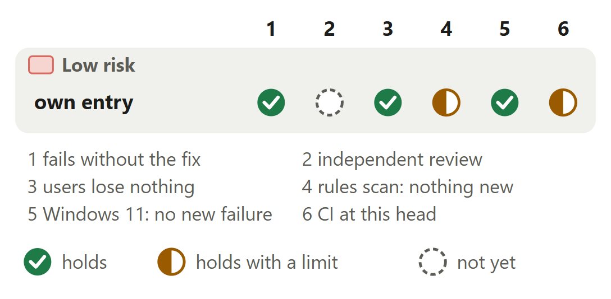

# A damaged library rule or rule setting costs only itself

For [pull request #1222](https://github.com/neralabs/rerail/pull/1222), head 7a2cdf4ac1. [report.html](report.html) is the same report as one page: download it and open it.

## 1. The decision

**Should one damaged library rule or rule setting cost only its own entry, while every other rule of the repository runs?**

**We recommend:** approve it: every other rule runs, every page answers, the damaged row is named once, and a store that reads costs what it did.

| Size | Risk and review | Waits on | Not verified |
|---|---|---|---|
| 850 lines in 17 files: 575 ship, 275 are tests and text | Automated. No high-risk path in `REVIEW.md`; the reviewer may approve. | Nothing. No CI run at this head yet: not pushed. | 4 |

## 2. Intent, and the gap

| Change | Intended | Found | Now |
|---|---|---|---|
| One row stops everything | A bad row is quarantined _(code comment)_ | One bad row stops all _(CLI runs, #1219)_ | Closes the gap. |

Found on 28 November 2026 through the built CLI, a real daemon and the Claude Code hook on Linux x64, one byte damaged.

Sources at main, and causes

| Change | Where main states the intent | The cause, and what was measured |
|---|---|---|
| One row stops everything | `readLibraryRow` in `src/engine/catalog/rule-library.ts` at fde444236a. | The library and settings readers used the ORM's JSON columns, which parse `document_json` and `config_json` before `readLibraryRow` can quarantine the row. |

## 3. Where to look

1. **Read first**, 10 min: `rule-configuration.ts`: `readSettings`, `#unreadOptionsOf`, `optionsText`, `readRows`. Can a configuration that reads get another rule set or signature than at `main`?
2. 10 min: `rule-library.ts`, `rule-quarantine.ts`, `rule-bootstrap.ts`, `packs-calibrate.ts`, `repository-operations.ts`, `show-me.ts`, `rule-approval-cli.ts`: the other readers.

**Then skim**, 8 min: Twelve cases change one stored text by a byte and read through each reader: the library, the configuration, the export, approve, calibrate, the Rules page, show-me.

## 4. Risk against verification

One change, low risk: a mistake quarantines one more row, or names one twice. Start at `readSettings`.

Each limit, and each check that does not hold yet

| Change | Check | Its limit, or why it does not hold yet |
|---|---|---|
| own entry | independent review | No independent review of this head yet. |
| own entry | rules scan: nothing new | The reviewer's rules built from `main` fde444236a over the diff: no new finding; every added or edited function at 6 or less. The scan with the published Rerail could not load the rule pack. |
| own entry | CI at this head | No CI run at this head on GitHub yet: the branch is not pushed. The commit hook's lint and type-check pass. |

## 5. The changes

**Damaged rule rows cost themselves**, low risk: One damaged library rule stopped every rule of its repository in 5 of 5 runs; now 0 of 5.

<b>6. The decisions</b>

**How do the two readers read the stored JSON?**

**We chose** the text parsed in the row decoder, where the ORM's JSON column parsed it. **Would change our mind:** A measure where the decoder costs a store that reads more than the noise.

| Option | What a user gets | Cost | What it breaks |
|---|---|---|---|
| The text parsed in the row decoder **(chosen)** | Every page answers; one read path; a store that reads costs what it did. | None measured on Linux x64 or Windows 11. | Nothing a person had at `main`. |
| The query as before, read again as text where it throws | The same; a store that reads runs `main`'s query. | Two read paths to keep, for no measured gain. | Nothing. |
| `json_valid` in the query | The same. | SQLite checks every text, then `JSON.parse` reads it again. | Nothing. |

**Evidence.** Four ways in turn in one process, 10 to 1,000 library rules, on Linux x64 and Windows 11: each within the rounds' spread of `main` for a store that reads; `main` fails every call on a damaged one.

**What does a setting whose options are no JSON give its rule?**

**We chose** a `configError`: the rule runs nowhere until a change sets its options; a mode change alone keeps it so. **Would change our mind:** A maintainer wanting the rule to keep steering with its default options.

| Option | What a user gets | Cost | What it breaks |
|---|---|---|---|
| A `configError`, the setting's other fields kept **(chosen)** | The Rules page says why; every other rule runs. | That rule steers nothing until a person sets its options. | Nothing a person had at `main`: no rule ran there. |
| Run it with its default options, now or after any setting change | It keeps steering. | Not as the person set it. | Options that narrowed the rule are lost silently. |

**Evidence.** The configuration cases: the damaged setting's rule carries the reason, keeps its mode, and runs again once its options are written. The settings API case: a mode change keeps the options as stored; `config: null` writes them and the rule runs.

<b>7. How it fits</b>

It stands alone on `main` fde444236a. The issue's other part, `rerail scrub`, is its own pull request; they share no source file. #1201 adds `storedValue` to the stored-list module; the second to land makes `storedObject` call it.

<b>8. What is not covered</b>: 4 not verified, 1 limit that stays

1. **`SqliteRuleStore`** still fails whole on one damaged rule row; no command or page reads its table.
2. **Memory at each code rule read** grows 35 to 62 KB a call in the engine's compile check, at `main` as here; left for its own report.
3. **The dashboard in a browser** was not opened: the runs read the pages it polls.
4. **macOS** never ran.

**Limits that stay**

- A daemon names a row once per process: a restarted daemon names it again.

## 9. What we ask of you

We ask no ruling.

<b>10. Evidence</b>

The description on GitHub is the record: "How you tested it" holds the runs over `main`'s source and here, the issue's runs and the cost of each read.

**Sources.** The branch at 73c17644a7 and its diff against `main` fde444236a, read on 28 November 2026; runs on Linux x64 machines and Windows 11 machines.

