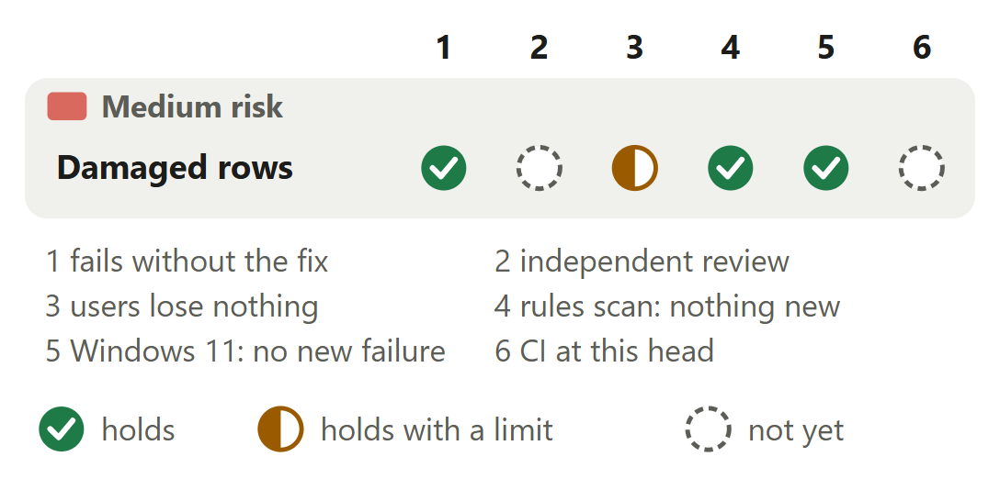

# A damaged scan request or audit no longer stops an upgrade

For [pull request #1174](https://github.com/neralabs/rerail/pull/1174), head 06b6bccb65. [report.html](report.html) is the same report as one page: download it and open it.

## 1. The decision

**Should an upgrade leave out a scan request or audit whose stored JSON does not parse, and name it, rather than refuse to open?**

1. A file 0.1.4 or earlier last opened opens despite one damaged row.

**We recommend:** approve it: Rerail works again with no step from the person, the line names the row, and the one lasting cost is a damaged request's audits counted as history.

| Size | Risk and review | Waits on | Not verified |
|---|---|---|---|
| 205 lines in 4 files: 108 ship, 97 are tests and text | Person review. It touches `src/engine/storage/`, a high-risk path. | Nothing. It stands alone on `main` aebf06d0be. | 3 |

## 2. Intent, and the gap

| Change | Intended | Found | Now |
|---|---|---|---|
| Damaged scan request | A step upgrades the file _(docs)_ | No Rerail at all _(the issue's runs)_ | Closes the gap, changes answer 1. |
| Damaged audit | A step upgrades the file _(docs)_ | No Rerail at all _(a run of ours)_ | Closes the gap. |

Reported on 26 November 2026 on Linux x64 at `main` e29282a55f; still shows at `main` aebf06d0be.

Sources at main, and causes

| Change | Where main states the intent | The cause, and what was measured |
|---|---|---|
| Damaged scan request | `docs/how-setup-works.md` at `main`: "runs the pending migration steps in one transaction. A failing step leaves the file as it was." Nothing says a damaged row fails the step for good. | `MARK_REQUESTED_SCANS` joins every request with `json_each(request.audit_ids_json)`; one value that is not JSON fails the statement, the step and the open's transaction, and every later open runs the step again. |
| Damaged audit | `migrations.ts` at `main`, `audits-origin`: `addColumn(database, "audits", "origin", ... CHECK(...))`; the backfill: `json_each(audit.violations_json)` and `json_each(rule_set.rule_revisions_json)`. | SQLite checks every row against every CHECK of the table when it adds a column with a CHECK, and `json_type` fails on text that is not JSON; the backfill's `json_each` and `json_extract` fail the same way. |

## 3. Where to look

1. **Read first**, 8 min: `migrations.ts`: `markRequestedScans`, `isJsonArray`, `listOrNone`, `addColumn`, `withoutRowChecks`, `sayHistoryLeftOut`, the backfill. Should a step leave a damaged row out and name it, rather than fail the open?

**Then skim**, 3 min: Two cases of `audit-history.test.ts` gain damaged variants; one doc paragraph and a release note say what an upgrade does with a damaged row.

## 4. Risk against verification

One change. Start at `markRequestedScans` and `addColumn` in `migrations.ts`.

Each limit, and each check that does not hold yet

| Change | Check | Its limit, or why it does not hold yet |
|---|---|---|
| Damaged rows | independent review | No reader outside the author has read this head yet. |
| Damaged rows | users lose nothing | A damaged request's audits stay counted as the session's history for good; a damaged audit's violations or rules are missing from the derived history. Rows that parse read as before. |
| Damaged rows | CI at this head | GitHub's CI has no result at this head yet. |

## 5. The changes

**Schema steps read damaged rows**, medium risk: One damaged scan request: no Rerail at all at `main` (5 of 5); here it opens and names the row.

<b>6. The decisions</b>

**A damaged row in a step: leave it out and name it, or refuse?** (ask 1)

**We chose** leave it out, name it once and record the step, so Rerail runs again with no step from the person. **Would change our mind:** A maintainer preferring a lasting record of what a step left out, which `rerail status` and the support bundle read.

| Option | What a user gets | Cost | What it breaks |
|---|---|---|---|
| Leave it out, name it once, record the step **(chosen)** | The daemon, `rerail status` and every hook work again; the line names the table, the row and the column. | A damaged request's audits stay counted as history for good. The line reaches only the error output of the process that ran the step. | Nothing found. |
| Refuse the open with a line naming the row and the way out | The step runs whole once the row is mended; nothing stays miscounted. | No Rerail until a person mends a SQLite row by hand; Rerail has no command for it, and a hook's line reaches no one. | Every session, as at `main`, until then. |
| Leave it out but keep the step pending, so a mend is picked up | A mended request's audits become scans. | Every open is a writer that runs the step and its history repair again, and every read-only open writes first. | Opens that only read a current file. |

**Evidence.** At `main` the daemon start, `rerail status` and the hook failed 5 of 5 on the issue's file; here 5 of 5 work, and `daemon.log` holds one line naming the request (Linux x64, built CLI and a real daemon).

**Where should the CHECK guard for an added column live?**

**We chose** in `addColumn`, which every step adding a column calls, so no later CHECK fails on a damaged row. **Would change our mind:** A maintainer preferring SQLite's check of a new column's default against existing rows.

| Option | What a user gets | Cost | What it breaks |
|---|---|---|---|
| In `addColumn`, for every column **(chosen)** | No later step's column with a CHECK fails on a damaged row. | SQLite no longer checks a new column's default against its own CHECK on existing rows; `addColumn` says the default must meet it. | Nothing found. |
| In the `audits-origin` step alone | The guard sits where the one CHECKed column is added. | The next step that adds a column with a CHECK meets the same failure. | Nothing today. |

**Evidence.** A case cuts one audit's `paths_json`, which no step reads: at `main` the open fails on `ALTER TABLE audits ADD COLUMN origin`; here it opens. A mutant that keeps CHECKs on fails it.

<b>7. How it fits</b>

It stands alone on `main` aebf06d0be and follows #1113's rule: one damaged stored row costs its own entry, never the page. #1076, #1126, #1133 and #1165 merge with it alone; #1126 also edits `docs/how-setup-works.md`, another paragraph.

**Where it meets the open work.** #1133, still open, reads the same `audit_ids_json` per request and leaves out one that is not a JSON array of strings; the step leaves out one that is not a JSON array, so every request the step leaves out the store leaves out too, and each names it in its own line. #1126 makes an open of a current file read only; the step runs only while it is pending. #1110 and #1143 are in `main` already.

<b>8. What is not covered</b>: 3 not verified, 2 limits that stay

1. **Telling the person** only the error output of the process that ran the step names the row: `daemon.log` for the daemon, the terminal for a command, nothing for a hook. `rerail status` says nothing.
2. **A published 0.1.4 file** the cases model one; no file the published 0.1.4 wrote was opened.
3. **macOS** never ran.

**Limits that stay**

- The step runs once: the audits a damaged request names stay counted as the session's history even once the row is mended.
- The support bundle holds the line only while it is among the last 200 lines of `daemon.log`.

## 9. What we ask of you

Ask 1 rules on answer 1.

1. **May an upgrade leave out a damaged scan request or audit, naming it, rather than refuse to open?** We recommend yes: Rerail works again, and the cost is named.

<b>10. Evidence</b>

The description on GitHub is the record: "How you tested it" holds the runs at `main` and here.

| Where | What ran | Result |
|---|---|---|
| Linux x64 | The issue's file and two older files with one audit cut short, through the built CLI and a real daemon, over `main`'s `migrations.ts` | 0 of 5, 0 of 3 and 0 of 3: daemon start exits 1 on the step's query, on the backfill's, on `ALTER TABLE audits ADD COLUMN origin`. |
| Linux x64 | The same at this head | 5 of 5, 3 of 3 and 3 of 3: the daemon starts, `rerail status` answers, the hook gives its start note; `daemon.log` names the row it left out. |
| Linux x64 | The new cases over `main`'s source; 12 mutants of the deciding lines | The 6 damaged cases fail over `main`; every mutant caught. |
| Linux x64 | The 7 test files that import the changed module or read the migration path, here and over `main` | 185 passed here; over `main` only the 6 damaged cases fail. |
| Windows 11 | The 7 test files at this head; the case file over `main`'s source; `main`'s own 7 files | 184 passed, 1 skipped; 6 damaged variants fail, 14 pass; 178 passed at `main`. |

**Sources.** The branch at 53f1a45e6e, four commits on `main` aebf06d0be, and its diff against that `main`, read on 26 November 2026; runs on Linux x64 and Windows 11 x64 machines.

