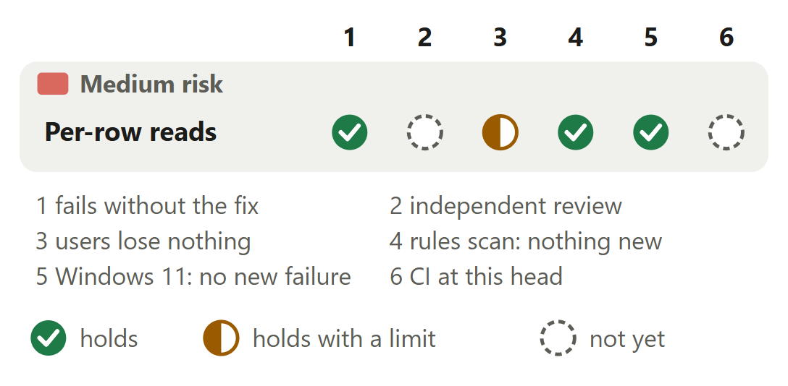

# One damaged scan settings row or scan request no longer stops Rerail

For [pull request #1201](https://github.com/neralabs/rerail/pull/1201), head 310a328a9c. [report.html](report.html) is the same report as one page: download it and open it.

## 1. The decision

**Should a checkout whose saved scan settings do not read run with the defaults, named once in `daemon.log`, rather than run no rule at all?**

1. A session in that checkout starts, and its rules run with the defaults.
2. A damaged scan request is left out of its session's scans.

**We recommend:** approve it: rows that parse read as before, `rerail settings` can save over the damaged row, and `daemon.log` names the table and the row once, as #1113 does for the history.

| Size | Risk and review | Waits on | Not verified |
|---|---|---|---|
| 423 lines in 5 files: 177 ship, 246 are tests and text | Person review. It touches `src/engine/storage/`, a high-risk path. | Nothing. It stands alone on `main` cce09e3c36. | 4 |

## 2. Intent, and the gap

| Change | Intended | Found | Now |
|---|---|---|---|
| Scan settings | Saved settings, else defaults _(code comment)_ | No rule runs there _(the issue's runs)_ | Closes the gap, changes answer 1. |
| Scan requests | List the session's scans _(docs)_ | Whole list 500 _(the issue's runs)_ | Closes the gap, changes answer 2. |

Reported on 26 November 2026 at `main` 8d62b17476 on Linux x64; still shows over `main` cce09e3c36's two source files.

Sources at main, and causes

| Change | Where main states the intent | The cause, and what was measured |
|---|---|---|
| Scan settings | `audit-control.ts` at `main`: `#saveSettings` "Merges `patch` over the checkout's saved settings, else the defaults"; the runtime reads `getWorkspaceSettings(...) ?? this.#auditSettings`. | `#settingsRow` selected `settings_json` through Drizzle's JSON mode, whose `JSON.parse` throws out of every read of the row, the session's start among them. |
| Scan requests | `docs/reference.md`, `audit_requests_list`: "`{ auditRequests }` with their `auditIds`." | `listAuditRequests` selected `paths_json` and `audit_ids_json` through Drizzle's JSON mode, so one row that does not parse threw out of the whole list, and a new request reads the list back. |

## 3. Where to look

1. **Read first**, 5 min: `audit-control.ts`: `storedSettings`, `#settings`, `#saveSettings`; `storedRequest`, `listAuditRequests`, `#claimOldest`. Should a damaged settings row read as the defaults, and a damaged queued request fail?
2. 2 min: `stored-list.ts`: `storedValue`, the parse `storedArray` now builds on.

**Then skim**, 2 min: Two reference rows and a release note say what a damaged row does.

## 4. Risk against verification

One change. Start at `#settings` in `audit-control.ts`.

Each limit, and each check that does not hold yet

| Change | Check | Its limit, or why it does not hold yet |
|---|---|---|
| Per-row reads | independent review | No reader outside the author has read this head yet. |
| Per-row reads | users lose nothing | Rows that parse read as before. A checkout whose row does not read runs with the defaults, which a person may not have chosen: `rerail settings` shows them, and only `daemon.log` says why. |
| Per-row reads | CI at this head | GitHub's CI has no result at this head yet. |

## 5. The changes

**Settings and requests read per row**, medium risk: One damaged settings row: no rule runs there at `main`; here the defaults run, the row named in `daemon.log`.

<b>6. The decisions</b>

**Saved settings that do not read: run with the defaults, or run nothing until mended?**

**We chose** run with the defaults and name the row in `daemon.log`, as a checkout with no saved settings runs. **Would change our mind:** A maintainer preferring that `rerail settings` itself say the saved row did not read: a field in its answer.

| Option | What a user gets | Cost | What it breaks |
|---|---|---|---|
| Read as the defaults, name the row once **(chosen)** | Sessions start and rules run; `rerail settings` can save over the row. | The checkout runs the defaults' scope and mode, perhaps not the person's. | Nothing found. |
| Refuse until mended, as at `main` | Nothing runs that the person did not choose. | No rule runs in the checkout, and Rerail cannot mend the row. | Every session there, until a SQLite shell mends it. |
| Also mark it in the settings answer | `rerail settings` and the dashboard can say why. | A new field in the exported `AuditControls` schema and the API document. | Nothing; left for a later change. |

**Evidence.** At `main` the settings read and write, the dashboard's read and a new session's start failed in 5 of 5 runs; here all answer, and the log names the row.

**A queued scan request that does not read: fail it, skip it, or throw?**

**We chose** fail it in the claim and claim the next. **Would change our mind:** A maintainer preferring that a damaged request stay queued for a person to mend.

| Option | What a user gets | Cost | What it breaks |
|---|---|---|---|
| Fail it and claim the next **(chosen)** | The queue moves on, and the session can close while quiet. | The request ends without running; its paths could not be read anyway. | Nothing found. |
| Skip it, leave it queued | Nothing is written. | It stays first in the queue for good. | The session owes a scan for good and never closes while quiet. |
| Throw, as at `main` | Nothing changes. | Each claim fails. | Every scan queued behind it. |

**Evidence.** A case cuts the oldest queued request: the claim fails it and returns the next two in turn.

<b>7. How it fits</b>

It stands on `main` cce09e3c36. Git stopped at one import block, where #1165 met it; the merge keeps both lines, and both changes hold. #1174, open, lets a database holding such a row upgrade; this change fixes the daemon's reads. #1076, #1186, #1187 and #1194 share no file.

**The shared parse.** `stored-list.ts` gains `storedValue` for a column that stores one JSON value; `storedArray` builds on it, so the parse and its catch stay in one place.

<b>8. What is not covered</b>: 4 not verified, 2 limits that stay

1. **Telling the person** `rerail settings` shows the defaults but not why; only `daemon.log` names the row.
2. **Old databases** a database from before the `audits-origin` migration with a damaged `audit_ids_json` still fails that migration; #1174 changes that.
3. **A save beside a held lock** a save of scan settings still fails at once while another process holds the write lock, as at `main`.
4. **macOS** never ran.

**Limits that stay**

- A scan request left out is counted in `daemon.log`, one line per request; the list answer carries no count.
- The damaged text stays where it lies until a write replaces it.

## 9. What we ask of you

Ask 1 rules on answer 1.

1. **May a checkout whose saved settings do not read run with the defaults, the row named in `daemon.log`?** We recommend yes: as with no saved settings, and `rerail settings` can mend it.

Answer 2 asks no ruling. Internal testing only; a queued one fails rather than stall the queue.

<b>10. Evidence</b>

The description on GitHub is the record: "How you tested it" holds the runs at `main` and here.

| Where | What ran | Result |
|---|---|---|
| Linux x64 | The issue's steps through the built CLI, hook and daemon, over `main`'s two source files, 5 runs of each damage | Settings: read and write exit 1, dashboard 500, new session's start fails; scan list and new request 500. |
| Linux x64 | The same at this head's source, 5 runs of each | Every read answers, the new session gets its start note, the write saves over the row; the log names the row. |
| Linux x64 | The 8 cases over `main`'s source; 11 mutants of the deciding lines | 8 of 8 fail over `main`; every mutant caught. |
| Linux x64, Windows 11 | The 24 test files that import a changed module, read the settings and scan list, or hold #1165's cases, here and over `main` | No failure here (551 passed on Linux x64, 572 on Windows 11); over `main` only the 8 cases fail. |
| Linux x64, Windows 11 | The test file 30 times at this head on each system, beside its shard neighbours | 30 of 30 on each. |

**Sources.** The branch at 310a328a9c, which merges `main` cce09e3c36, and its diff against that `main`, read on 27 November 2026; runs on Linux x64 and Windows 11 x64 machines.

