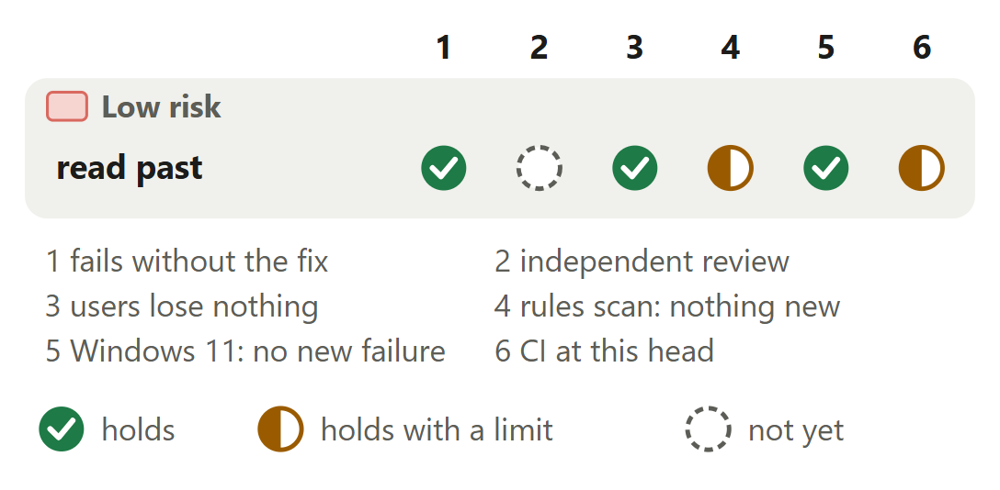

# A damaged session event no longer fails its page or rules activity

For [pull request #1218](https://github.com/neralabs/rerail/pull/1218), head ac2556e1dd. [report.html](report.html) is the same report as one page: download it and open it.

## 1. The decision

**Should a session event whose stored text is no JSON cost only itself, left out and named once, wherever Rerail reads it?**

**We recommend:** approve it: the pages answer 200 with what reads, a damaged steer is not counted, and a history that reads costs what it did.

| Size | Risk and review | Waits on | Not verified |
|---|---|---|---|
| 598 lines in 12 files: 302 ship, 296 are tests and text | Automated. No high-risk path in `REVIEW.md`; the reviewer may approve. | Nothing. No CI run at this head yet: not pushed. | 4 |

## 2. Intent, and the gap

| Change | Intended | Found | Now |
|---|---|---|---|
| One row fails page | A bad row keeps its place _(code comment)_ | One bad row fails the page _(CLI runs, #1214)_ | Closes the gap. |

Found on 28 November 2026 through the built CLI and a real daemon on Linux x64, with a file damaged by one byte.

Sources at main, and causes

| Change | Where main states the intent | The cause, and what was measured |
|---|---|---|
| One row fails page | `events()` in `src/runtime/session-store.ts` at 4e22417229, through `parsedRow`: 'a read takes that row as one with no payload and fails on none'. #1113 made audits and repositories read the same way. | `hud`, `gaps` and `steersByRule` read the stored JSON with `json_extract`, `json_array_length` and `json_each`, which fail the whole query on one text that is no JSON; `hud` parsed the owner paths with a bare `JSON.parse`. Four commands read receipts and events the same way. |

## 3. Where to look

1. **Read first**, 10 min: `session-store.ts`: `readPastDamage`, `steeringCount`, `gaps`, `steersByRule`, `hudRules`, `storedPayload`. Can a history whose texts all read get a figure other than at `main`?
2. 6 min: `support-bundle.ts`, `scrub-cli.ts`, `repository-start.ts`, `feedback-cli.ts`: the commands read past a damaged event.

**Then skim**, 8 min: Six store cases change one event's stored text and read every figure; five command cases do the same through each command, two of them feedback's.

## 4. Risk against verification

One change, low risk: a mistake leaves one more event out of a count, or names it twice. Start at `readPastDamage`.

Each limit, and each check that does not hold yet

| Change | Check | Its limit, or why it does not hold yet |
|---|---|---|
| read past | independent review | No independent review of this head yet. |
| read past | rules scan: nothing new | The reviewer's rules built from `main` 4e22417229 over the diff: no new finding; every added or edited function at 6 or less. The scan with the published Rerail could not load the rule pack. |
| read past | CI at this head | No CI run at this head on GitHub yet: the branch is not pushed. The commit hook's lint and type-check pass. |

## 5. The changes

**Session readers read past damage**, low risk: One damaged event made 6 of 20 page polls answer 500; now none, 5 of 5 runs.

<b>6. The decisions</b>

**Where does each stored text get tested?**

**We chose** only where a query fails: it runs again with `json_valid` on each row, then names the rows left out. **Would change our mind:** A measure where the second query costs a damaged history more than a person would wait for a poll.

| Option | What a user gets | Cost | What it breaks |
|---|---|---|---|
| Run the query as before, again with each text tested where it fails **(chosen)** | Every page answers; a history that reads costs what it did at `main`, within the noise. | A damaged history pays the failed query, the tested one and one scan to name the rows. | Nothing a person had at `main`. |
| `json_valid` on each row in the one query | Every page answers with one query. | Over 200,000 events the rules activity took 42% to 60% more time, the steered count 13% more. | Every dashboard poll pays it. |
| Read each text once and parse it in the reader | Every page answers; every shape checked. | The steered count took 55% more time over 200,000 events. | Every dashboard poll pays it. |

**Evidence.** A probe timed each form over 200,000 events on a Linux x64 machine, 15 calls each, two rounds; the head against `main` with the same probe: the steered count +2.5%, the gaps +3.2%, the rules activity -0.7%.

**What does a steer whose receipt is no JSON count?**

**We chose** nothing: its record no longer says which rules it steered, and `daemon.log` names it. **Would change our mind:** A maintainer wanting the session's count to keep it as a steer naming no rule.

| Option | What a user gets | Cost | What it breaks |
|---|---|---|---|
| Not counted, named once **(chosen)** | The session count and the rules activity agree on what they read. | A delivered steer whose record was damaged is missing from the count. | Nothing a person had at `main`: the page failed there. |
| Counted as a steer naming no rule | The session's count keeps it. | None. | The two figures disagree on one record. |

**Evidence.** The issue's steps: after `damage.mjs receipt` the session shows 1 of its 2 steers and `daemon.log` names the receipt once per daemon start.

<b>7. How it fits</b>

Nothing has to merge first: it stands on `main` 4e22417229. #1201 adds `storedValue` to the stored-list module; the second to land makes `rerail scrub` call it and drops its local copy.

<b>8. What is not covered</b>: 4 not verified, 1 smaller gap, 1 limit that stays

1. **A receipt whose rule ids are no list** reads as a steer naming no rule, as at `main`, and is not named.
2. **An audit whose findings are no JSON** still stops `rerail scrub`: it reads audits, not session events.
3. **The dashboard in a browser** was not opened: the runs read the pages it polls.
4. **macOS** never ran.

**Smaller gaps**

- **`rerail feedback` and `rerail scrub` write no line for a damaged event** feedback reads receipts only to find the session a note belongs to; scrub scrubs such a text as text.

**Limits that stay**

- A daemon names an event once per process: a restarted daemon names it again.

## 9. What we ask of you

We ask no ruling.

<b>10. Evidence</b>

The description on GitHub is the record: "How you tested it" holds the runs over `main`'s source and here, and the cost of each read.

**Sources.** The branch at ac2556e1dd and its diff against `main` 4e22417229, read on 28 November 2026; runs on Linux x64 machines and Windows 11 machines.

