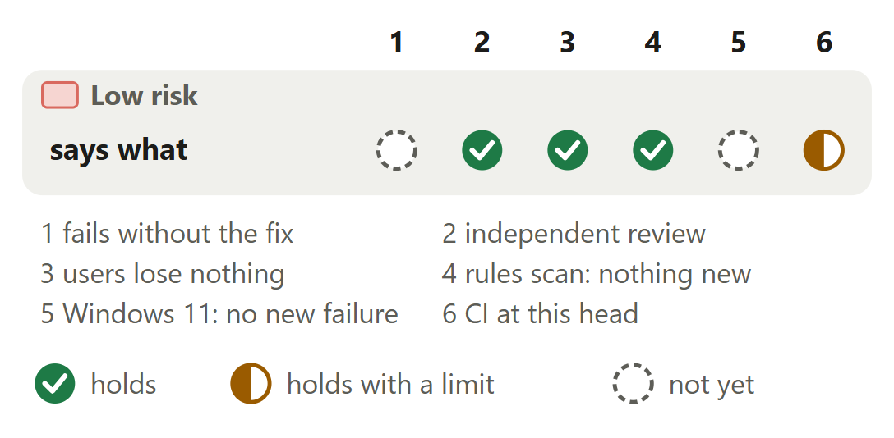

# A failed set-up Git says what happened

For [pull request #1116](https://github.com/neralabs/rerail/pull/1116), head 0eb1741b7c. [report.html](report.html) is the same report as one page: download it and open it.

## 1. The decision

**May five test files start their set-up Gits through one helper that, when a Git fails, says its exit status, signal, time and output?**

**We recommend:** approve it: test code only, no assertion changes, and the next chance failure of a set-up Git on the Windows runner shows its status and output in its own message.

| Size | Risk and review | Waits on | Not verified |
|---|---|---|---|
| 168 lines in 8 files: 0 ship, 163 are the tests it changes, 5 are other tests and text | Fast. Test code only, no product code. | Nothing. CI on GitHub runs at this head. | 3 |

## 2. Intent, and the gap

| Change | Intended | Found | Now |
|---|---|---|---|
| A set-up Git's failure | A set-up failure says what _(the helper's comment)_ | It said only Command failed _(CI runs, #1115)_ | Closes the gap. |

Found on 25 and 26 November 2026: `Unit tests (Windows, 2/5)` failed on set-up Gits that said only `Command failed` (#1115).

Sources at main, and causes

| Change | Where main states the intent | The cause, and what was measured |
|---|---|---|
| A set-up Git's failure | `test/engine/catalog/outside-git.test.ts:48` and `:82` at `main` 3d1646e34f: `execFileSync("git", [...], { cwd, stdio: "ignore" })`. | `stdio: "ignore"` drops what Git wrote, and the message of `execFileSync`'s error holds no exit status; the test report keeps only the message. |

## 3. Where to look

1. **Read first**, 4 min: `run-program.ts`: `runProgram` and its message. Does each failure name its command, status, signal, time and output, and a start that fails throw its own error?
2. 1 min: `run-program.test.ts`, then `outside-git.test.ts`, `registered-worktrees.test.ts`, `worktree-pack.test.ts`, `repository-registry.test.ts`, `submodule-state.test.ts`.

**Then skim**, 1 min: `test/README.md` gains one sentence; nothing else changes.

## 4. Risk against verification

One change, low risk: one test helper and five callers; the product and every assertion are as they were.

Each limit, and each check that does not hold yet

| Change | Check | Its limit, or why it does not hold yet |
|---|---|---|
| says what | fails without the fix | `main`'s CI and our fork's failed `Unit tests (Windows, 2/5)` on set-up Gits that said only `Command failed`; `runProgram` now names the command, folder, exit status in decimal and hex, signal, milliseconds and first lines of output. |
| says what | Windows 11: no new failure | `submodules.test.ts`, which #1114 edits, and other files' bare `execFileSync` helpers are left as they are. |
| says what | CI at this head | CI on GitHub runs at this head; the failures it addresses come by chance, about one run in 15 of one job. |

## 5. The changes

**Set-up Git failures say what happened**, low risk: A set-up Git that failed said `Command failed` and nothing more; now it says its status and output.

<b>6. The decisions</b>

**Keep the output and name the status, or retry a set-up Git that fails?**

**We chose** one helper that keeps the output and names status, signal and time: the next failure shows what happened. **Would change our mind:** A cause found and fixed elsewhere.

| Option | What a user gets | Cost | What it breaks |
|---|---|---|---|
| `runProgram` keeps output, names status **(chosen)** | A failure that says what happened. | Output goes through pipes, not the null device. | Nothing found. |
| Catch `execFileSync`'s error and add its status | The status. | A catch in each file. | With `stdio: "ignore"` no output is kept, and no time. |
| Retry a set-up Git that fails | A green job. | A loop per helper. | Hides the next failure and its cause. |

**Evidence.** The one status read so far, 0xC0000142, came from a test's assertion on a product call; the four set-up failures in our fork's records said `Command failed` and nothing more.

**Change every helper of the suite, or the five of the two folders that failed?**

**We chose** the five that drop all of Git's output in `test/engine/catalog/` and `test/engine/git-guard/`. **Would change our mind:** A failure of the same kind in another file before this lands.

| Option | What a user gets | Cost | What it breaks |
|---|---|---|---|
| The five helpers of the two folders **(chosen)** | The files that failed, and their neighbours, say what happened. | Five calls. | Nothing found. |
| Every helper of the suite | Every set-up failure says what happened. | 74 calls that drop all output and 337 bare calls, each file run 30 times on Windows. | Not known: hundreds of files at once. |

**Evidence.** Across `test/`, `integration/` and `e2e/`, 74 calls drop all of a program's output and 337 bare `execFileSync` calls keep stderr but no status.

<b>7. How it fits</b>

Nothing has to merge first: one commit on `main` 3d1646e34f, test code only. #1110 adds a case to `repository-registry.test.ts` on other lines, and Git merges the two alone; `submodules.test.ts`, which #1114 edits, is left as it is.

<b>8. What is not covered</b>: 3 not verified, 1 limit that stays

1. **The cause** is not found here: the records show neither a full desktop heap nor a closing window station.
2. **Other helpers** `submodules.test.ts` and the bare `execFileSync` helpers of other files keep stderr but no status; they are named in the description.
3. **macOS** never ran.

**Limits that stay**

- A failure still fails the case: no retry, no longer limit.

## 9. What we ask of you

We ask no ruling.

<b>10. Evidence</b>

The description on GitHub is the record: "How you tested it" holds the runs.

| Where | What ran | Result |
|---|---|---|
| Windows 11 | The six changed test files, 30 runs on two machines at this head | 30 of 30, 176 cases passed and 3 skipped each run. |
| Linux x64 | The six changed test files once at this head | 169 passed, 5 skipped. |
| Linux x64 | A mutant of each of the helper's five deciding lines | Each fails a case of `run-program.test.ts`. |

**Sources.** The branch at 0eb1741b7c and its diff against `main` 3d1646e34f, read on 26 November 2026; CI logs of `main` at 2a7a2b776 and e9d9020b48 and our fork's kept results; runs on Windows 11 x64 and Linux x64 machines.

