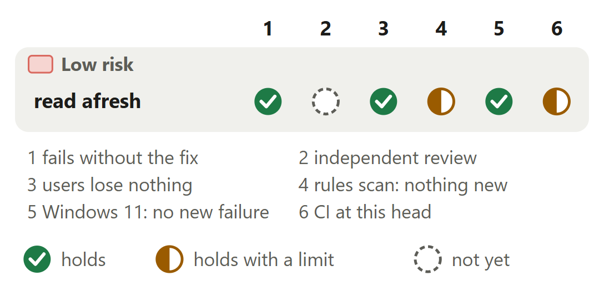

# The daemon reads a new repository and a failed remote read afresh

For [pull request #1202](https://github.com/neralabs/rerail/pull/1202), head 00edc2ec43. [report.html](report.html) is the same report as one page: download it and open it.

## 1. The decision

**Should the daemon re-read a folder once a `.git` appears between it and its top level, and re-ask Git after an unanswered remote read?**

**We recommend:** approve it: each case failed on `main` and passes here on Linux x64 and Windows 11, and an unchanged folder starts no Git process.

| Size | Risk and review | Waits on | Not verified |
|---|---|---|---|
| 615 lines in 9 files: 158 ship, 457 are tests and text | Automated. No high-risk path in `REVIEW.md`; the reviewer may approve. | Nothing. No CI run at this head yet: not pushed. | 3 |

## 2. Intent, and the gap

| Change | Intended | Found | Now |
|---|---|---|---|
| Folder made a repository | Kept while the clone is the same _(code comment)_ | A new repository inside reads as outer _(CLI runs, #1189)_ | Closes the gap. |
| Remote read without answer | A failed read is asked again _(code comment)_ | A failed read is kept as none _(CLI runs, #1190)_ | Closes the gap. |

Found on 27 November 2026 through the built CLI, a real daemon and the built Claude Code hook on Linux x64.

Sources at main, and causes

| Change | Where main states the intent | The cause, and what was measured |
|---|---|---|
| Folder made a repository | `createCheckoutResolver` in `src/engine/catalog/repository-registry.ts` at cce09e3c36: "each workspace's Git location is kept while the clone there is the one it was read with (stillPlaces) ... a folder outside Git is located again each time, so a later `git init` is seen." | `stillPlaces` checked the clone id at the identity path and the top level's `.git` alone. A `.git` made in a folder between the asked folder and that top level changed neither, so the kept location, and the outer repository's started state, stayed. |
| Remote read without answer | `answeredRemote` in `src/engine/catalog/repository-identity.ts` at cce09e3c36: "The remote the answers give, kept under the source's facts only when Git answered every question: a Git that failed answers no remote, as before, and is asked again next time." | `readRemoteAddress` returned undefined both for no remote and for a Git that gave no answer, and `keptRemoteKey` kept whatever it returned while the config files read the same, so the next lookup never asked Git again. |

## 3. Where to look

1. **Read first**, 8 min: `folders-below-top.ts`: `foldersBelowTop`, `belowOrTop`, `noneBecameRepository`. Can a folder that became a repository below the top level ever be kept as unchanged?
2. 6 min: `repository-registry.ts`, `repository-identity.ts` and `git-placement.ts`: the kept levels, the answered remote, the presence check.

**Then skim**, 6 min: Two daemon cases, one with a Git stand-in for each system; unit cases at the resolver for each layout, the count, and the remote with its counts.

## 4. Risk against verification

One change, low risk: a wrong answer reads a folder or a remote once more, or keeps it as `main` does. Start at `foldersBelowTop`.

Each limit, and each check that does not hold yet

| Change | Check | Its limit, or why it does not hold yet |
|---|---|---|
| read afresh | independent review | No independent review of this head yet. |
| read afresh | rules scan: nothing new | The reviewer's rules built from `main` cce09e3c36 over the diff: no new finding; every added or edited function at 6 or less (`stillPlaces` and `remoteKeyAnswer` at 6). The scan with the published Rerail could not load the rule pack. |
| read afresh | CI at this head | No CI run at this head on GitHub yet: the branch is not pushed. The commit hook's lint and type-check pass. |

## 5. The changes

**A folder and remote read afresh**, low risk: A `git init` in a read folder, or one unanswered remote read, no longer lasts until a restart.

<b>6. The decisions</b>

**How does the daemon notice a new repository inside a folder it read?**

**We chose** one `lstat` per folder between it and its top level at each lookup: a fact, no Git process. **Would change our mind:** A layout where the folders between are many and the lookups frequent enough that the `lstat` calls show in a profile.

| Option | What a user gets | Cost | What it breaks |
|---|---|---|---|
| Keep the folders between and check each with one `lstat` **(chosen)** | The new repository at the next lookup. | One `lstat` per level a lookup, for a folder below its top level; none for a top level. | Nothing. |
| Read every folder afresh at each lookup | The same. | A synchronous Git process per lookup for any folder without a `.git` of its own, on the dashboard's and the status line's path. | The cost the resolver's kept locations exist to avoid. |
| A time limit on kept locations | The new repository once the limit runs out. | A Git process at each expiry. | The wrong answer stays until the clock runs out. |

**Evidence.** The count case reads the `lstat` calls and the processes of an unchanged lookup at 1, 3 and 10 levels on Linux x64 and Windows 11: 1, 3 and 10, no process. The daemon case shows the new repository at the next read.

**How does the resolver tell no remote from no answer?**

**We chose** a new `readRemoteAnswer` that says whether Git answered, beside `readRemoteAddress`, which keeps its signature. **Would change our mind:** A maintainer preferring `readRemoteAddress` to throw, as the legacy id read does.

| Option | What a user gets | Cost | What it breaks |
|---|---|---|---|
| `readRemoteAnswer` beside `readRemoteAddress` **(chosen)** | The resolver keeps only an answered read; every other caller is unchanged. | One more function inside the engine. | Nothing. |
| `readRemoteAddress` throws when Git gave no answer | Every caller learns of it. | Each caller must catch it. | The package's exported `readRemoteAddress` and recording, which would fail where it now records a clone-keyed repository. |

**Evidence.** `readRemoteAddress` is in the package's exports (`src/index.ts`). Its own kept answers already counted only reads where every Git exited 0; the flag reuses that rule.

<b>7. How it fits</b>

Nothing has to merge first: it builds on #1164, #1180 and #1181, all on `main` cce09e3c36. #1076 edits `kept-remote.ts` and `git.ts`, which this change does not; Git merges the two.

<b>8. What is not covered</b>: 3 not verified, 1 limit that stays

1. **A bare repository** made in the folder itself (`git init --bare`) keeps the outer checkout: the check reads `.git` entries, as said on #1189.
2. **The MCP bridge** started in a folder later made a repository keeps the outer checkout until a checkout is recorded; `src/api/mcp.ts` keeps its own answer.
3. **macOS** never ran; a spelling of the top level other than Git's is covered by a fallback that compares stored paths.

**Limits that stay**

- A folder whose walk never reaches the top level Git named (`core.worktree` elsewhere) checks every folder Git's search would read: more `lstat` calls, never fewer.

## 9. What we ask of you

We ask no ruling.

<b>10. Evidence</b>

The description on GitHub is the record: "How you tested it" holds the runs over `main`'s source and here.

**Sources.** The branch at 00edc2ec43 and its diff against `main` cce09e3c36, read on 27 November 2026; runs on Linux x64 machines and Windows 11 machines.

