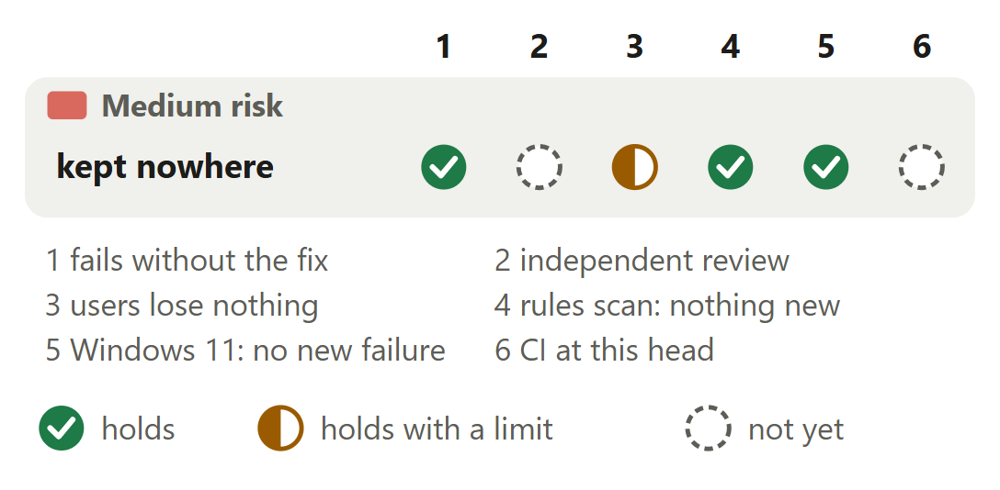

# A checkout whose Git could not run is not recorded outside Git

For [pull request #1143](https://github.com/neralabs/rerail/pull/1143), head 7d3d6cfa4. [report.html](report.html) is the same report as one page: download it and open it.

## 1. The decision

**Should an answer Git did not give be recorded and kept by nothing, while each lookup reads it as before?**

1. A start whose record meets such an ask fails with the line; the next records.
2. A lookup still reads that folder as outside Git for the ask, as at `main`.

**We recommend:** approve it once you agree to answers 1 and 2: a start while the daemon's Git could not run recorded its checkout as a plain folder, and now nothing wrong is recorded or kept.

| Size | Risk and review | Waits on | Not verified |
|---|---|---|---|
| 508 lines in 8 files: 189 ship, 319 are tests and text | Standard. The automated reviewer can approve. | Nothing. No CI run at this head yet: not pushed. | 3 |

## 2. Intent, and the gap

| Change | Intended | Found | Now |
|---|---|---|---|
| Recording | Outside Git when Git finds none _(code comment)_ | Failed starts recorded a plain folder _(real daemon, Linux x64)_ | Closes the gap, changes answer 1. |
| Lookups | A lookup finds its checkout _(our reading)_ | Found by its path at `main` _(real daemon, Linux x64)_ | Closes the gap, changes answer 2. |

Found on 26 November 2026 in Windows CI on a loaded runner, then through a real daemon and hook on Linux x64.

Sources at main, and causes

| Change | Where main states the intent | The cause, and what was measured |
|---|---|---|
| Recording | `src/engine/catalog/repository-identity.ts` at `main`: "`.rerail/repository-id` outside Git (or when Git is not installed)", and each of the three reads answers `nonGitLocation` when `result.status !== 0`. | `resolveCloneId` writes `.rerail/repository-id` for a folder the read placed outside Git, and `recordCheckout` moves its row; the record's read is a start's seventh ask, so only a start whose asks all fail reaches it. |
| Lookups | `lookupAt` in `src/engine/catalog/repository-registry.ts` at `main` finds a checkout by the row recorded at its path. | A start's first asks are the presentation's lookup, an API lookup and the start state's reads; at `main` each read the folder as outside Git and found the checkout by its path. |

## 3. Where to look

1. **Read first**, 5 min: `repository-identity.ts`: `locatedFrom`, `resolveCloneId`, `gitCloneId`. Does every reader that writes or keeps refuse an `unanswered` location, and every lookup read as at `main`?
2. 5 min: `git-locate.ts`, `checkout-owner.ts` and `git.ts`.

**Then skim**, 5 min: The case file starts this Node in place of the one Git asked. One troubleshooting entry, one release note.

## 4. Risk against verification

Start with `locatedFrom`: a read keeps `main`'s answer, and only the record and the owners map refuse it.

Each limit, and each check that does not hold yet

| Change | Check | Its limit, or why it does not hold yet |
|---|---|---|
| kept nowhere | independent review | No review by another reader yet: our own reading against the repository's review points only. |
| kept nowhere | users lose nothing | Through a real daemon, one to three failed asks open the session with its 8 rules, as at `main`. A start whose record meets such an ask gives no start note; the next start opens with the rules. |
| kept nowhere | CI at this head | No CI run at this head yet. |

## 5. The changes

**Answers Git never gave, kept nowhere**, medium risk: Every ask of a start failing: a plain folder recorded at `main` in 10 of 10 runs, nothing here.

**6. The decisions:** we made no choice here that a maintainer could have made differently.

<b>7. How it fits</b>

It stands on `main` alone. #1076 edits `git.ts` on other lines, and Git merges the two either way.

<b>8. What is not covered</b>: 3 not verified, 2 limits that stay

1. **A real daemon on Windows 11** was not run: Rerail runs `git.exe` from `PATH` there, and a stand-in would be a program of its own.
2. **The rule catalog** keeps a recorded checkout's location for its entry's life, as at `main`.
3. **macOS** never ran.

**Limits that stay**

- A repository Git finds and cannot read still reads as outside Git, as at `main`.
- About 38 other reads take any status but 0 for an answer; each keeps nothing from it.

## 9. What we ask of you

Asks 1 and 2 rule on answers 1 and 2.

1. **May a start whose record meets an ask Git gave no answer to fail with the line?** We recommend yes: at `main` it recorded a plain folder.
2. **May a lookup keep reading such a folder as outside Git for that ask?** We recommend yes: failing it lost the start note.

<b>10. Evidence</b>

The description on GitHub is the record. "How you tested it" holds the runs at `main` and at this head.

| Where | What ran | Result |
|---|---|---|
| Linux x64 | A real daemon and hook, every ask of a start failing, 10 runs | `main`: 10 of 10 recorded a plain folder. Here: 10 of 10 recorded nothing; the next start opened with the 8 rules. |
| Linux x64 | The same, one to three failed asks, 30 runs | Both: 30 of 30 opened with the 8 rules; here the line was written once. |
| Linux x64 | The case file at `main` and here | `main`: 22 of 29 fail. Here: 29 of 29. |
| Windows 11 | The case file, 30 runs beside its shard neighbours | 30 of 30 for the case file; `git-placement.test.ts`, 30 of 30. |
| Linux x64 | 20 mutants of the deciding lines | Each fails the case file. |

**Sources.** The pull request and its diff, read on 26 November 2026. Rerail at `main` 17245df6d for the quoted intent.

