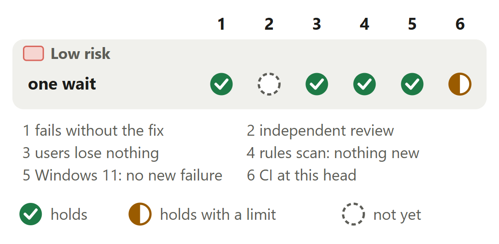

# A submodule read Git gives no answer to holds the daemon once

For [pull request #1221](https://github.com/neralabs/rerail/pull/1221), head 923d4319fa. [report.html](report.html) is the same report as one page: download it and open it.

## 1. The decision

**Should a checkout's submodule read that ran past Git's limit be kept as no answer, and asked again off the daemon's thread?**

**We recommend:** approve it: in the issue's steps the reads no longer hold the daemon, the other session's worst hook goes from 30 s to 0.67 s, nothing is lost, and lookups decide as on `main`.

| Size | Risk and review | Waits on | Not verified |
|---|---|---|---|
| 473 lines in 6 files: 151 ship, 322 are tests and text | Automated. No high-risk path in `REVIEW.md`; the reviewer may approve. | Nothing. No CI run at this head yet: not pushed. | 3 |

## 2. Intent, and the gap

| Change | Intended | Found | Now |
|---|---|---|---|
| Each listing waits again | Git's answer kept per checkout _(code comment)_ | Each listing waits 10 s again _(CLI runs, #1216)_ | Closes the gap. |

Found on 28 November 2026 through the built CLI and a real daemon on Linux x64 and Windows 11, with those reads slowed.

Sources at main, and causes

| Change | Where main states the intent | The cause, and what was measured |
|---|---|---|
| Each listing waits again | The header of `src/engine/catalog/checkouts/declared-submodules.ts` at fde444236a; `keep()` there keeps the paths only when every read answered (`answeredToItsEnd`), else deletes the kept entry. | `declaredSubmodulePaths` runs `git config` and `git ls-files` with `runGit`, a blocking start with the 10 s limit, and keeps nothing when Git ran past it. `CheckoutOwners.declaredSubmodules` passes that on with no keep, and the code-rule router's `#nestedCheckoutsOf` calls it at each listing. |

## 3. Where to look

1. **Read first**, 10 min: `declared-submodules.ts`: `keptPaths`, `answeredMeanwhile`, `askedAgain`, `keptAfter`, `pastLimitAfter`, `stopAskingSubmodules`. Can a listing wait on Git again, or keep an older index's answer, while one ask runs?
2. 3 min: `git.ts` and `daemon.ts`: the `ETIMEDOUT` code of `runGitAsync`, and the stop in the daemon's close.

**Then skim**, 8 min: Twelve cases with Git stand-ins, each ending by a fact; two of them through the code-rule router pass over `main`'s source too.

## 4. Risk against verification

One change, low risk: a mistake asks Git once more, or lists no submodule until Git answers, as `main` does after its wait. Start at `keptPaths`.

Each limit, and each check that does not hold yet

| Change | Check | Its limit, or why it does not hold yet |
|---|---|---|
| one wait | independent review | No independent review of this head yet. |
| one wait | CI at this head | No CI run at this head on GitHub yet: the branch is not pushed. The commit hook's lint and type-check pass. |

## 5. The changes

**Keep no answer, ask off thread**, low risk: These reads held the daemon 291 s of a 352 s session; now 0 s, 5 of 5 runs.

<b>6. The decisions</b>

**What does a listing answer while Git gives no answer?**

**We chose** no submodules, as `main` answers after its wait, so a lookup decides as on `main`. **Would change our mind:** A maintainer wanting the nested checkout listed from Git's last answer while Git is slow.

| Option | What a user gets | Cost | What it breaks |
|---|---|---|---|
| No submodules, at once **(chosen)** | Each listing answers at once; what a lookup decides is as on `main`. | A submodule Git declared before the slow read is not listed until Git answers. | Nothing a person had at `main`: it answered the same after 10 s. |
| The paths Git gave before the read | The nested checkout stays listed. | An answer from an older index: a submodule removed since stays listed. | A lookup could judge a file by a submodule that no longer exists. |
| Wait for the ask in flight | Git's answer on the listing that waited. | Every listing waits up to 10 s again while Git stays slow. | The fix itself. |

**Evidence.** The issue's steps, 5 runs at `main` and here on one Linux x64 machine within the hour: the thread held 291 s at `main`, 0 s here; R 54 of 54 and B all events recorded at both.

**When is Git asked again, and what does a failed Git keep?**

**We chose** at the next listing, one ask at a time, off the thread; a Git that cannot start is not kept. **Would change our mind:** A run where the starts of a Git that cannot start reach a person's hooks.

| Option | What a user gets | Cost | What it breaks |
|---|---|---|---|
| At a listing, one ask at a time **(chosen)** | Git's answer taken at the next listing once Git answers; no clock. | A checkout no one lists is not asked again. | Nothing a person had at `main`. |
| On a timer | Git's answer kept before the next listing. | Gits started with no one asking; a clock where a listing decides. | Nothing, at a steady cost. |
| Keep a Git that cannot start too | 29 fewer starts of 3 to 7 ms a run. | A Git mended meanwhile waits for the next ask. | Nothing a person met: no hook past 0.81 s either way. |

**Evidence.** Git that cannot start in the issue's steps: 29 starts of 3 to 7 ms a run and no hook past 0.81 s, at `main` and here.

<b>7. How it fits</b>

Nothing has to merge first: it stands on `main` fde444236a. The fix for #1207, not open yet, makes the same `runGitAsync` change; the second to land keeps one copy and both daemon stops.

<b>8. What is not covered</b>: 3 not verified, 2 smaller gaps, 1 limit that stays

1. **What a lookup decides meanwhile** stays as `main` decides it: a submodule Rerail never recorded does not own its files while the read gives no answer (#1158).
2. **A Git that cannot start** is asked again at each listing on the thread, 3 to 7 ms a start, as on `main`.
3. **macOS** never ran.

**Smaller gaps**

- **A checkout whose facts cannot be read** (another index through `GIT_INDEX_FILE`, another account's checkout) keeps no answer and no "no answer": each listing there waits as on `main`.
- **The first read** still waits its 10 s on the thread when a listing asks before the placement; once Git has answered, a changed index is read on the thread again.

**Limits that stay**

- While Git gives no answer the listings name no submodule, as `main`'s did after each wait, so walks and audits treat the submodule's folder as `main` did then.

## 9. What we ask of you

We ask no ruling.

<b>10. Evidence</b>

The description on GitHub is the record: "How you tested it" holds the runs over `main`'s source and here, and the cost of a listing.

**Sources.** The branch at 923d4319fa and its diff against `main` fde444236a, read on 28 November 2026; runs on Linux x64 machines and Windows 11 machines.

