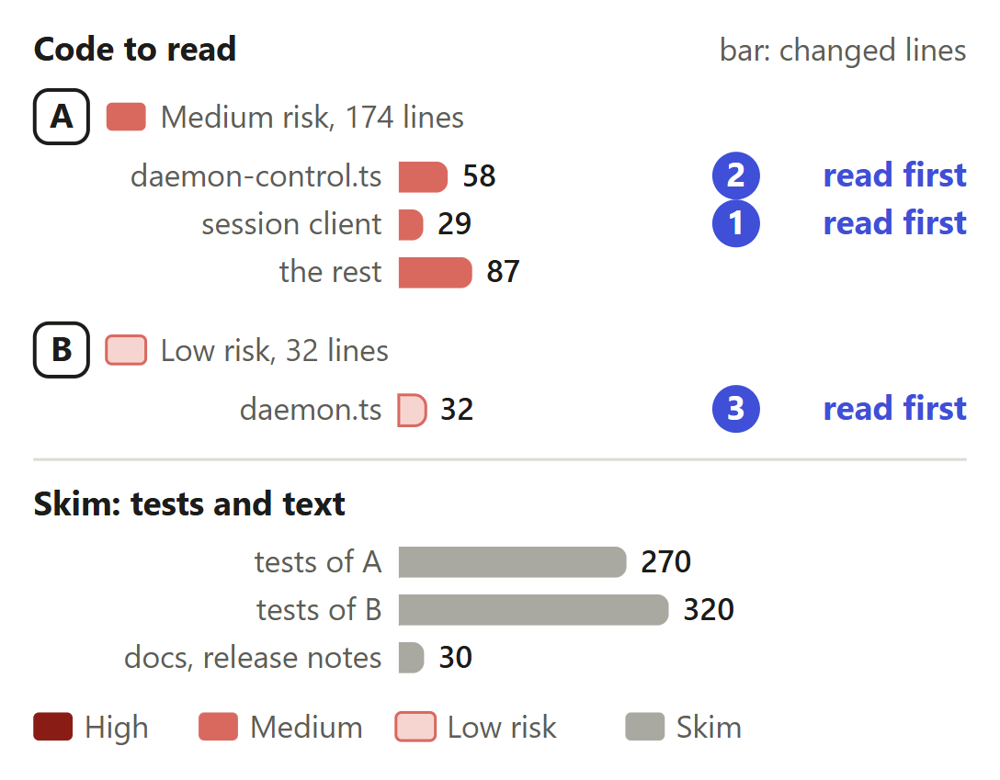
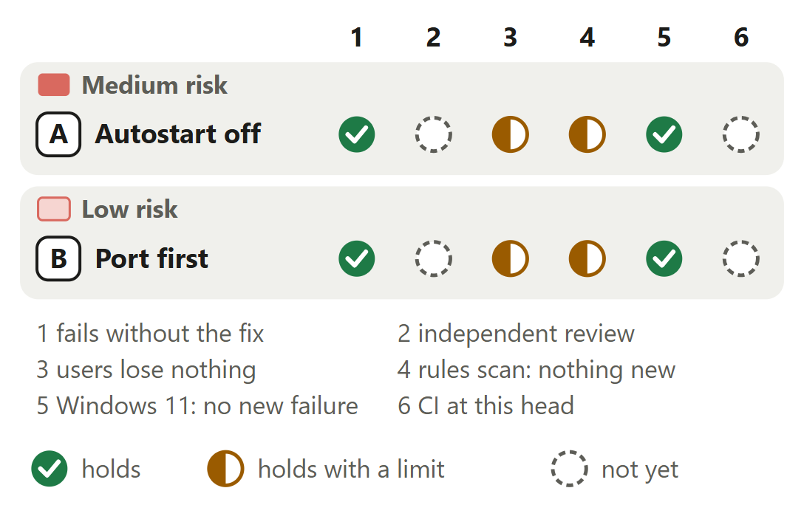

# OMP and Pi keep autostart off; a replacement daemon keeps the port

For [pull request #1209](https://github.com/neralabs/rerail/pull/1209), head dfc38400e4. [report.html](report.html) is the same report as one page: download it and open it.

## 1. The decision

**May OMP and Pi sessions under `RERAIL_AUTOSTART=0` start and replace no daemon, and a daemon started in place of another first try its port?**

1. Under `RERAIL_AUTOSTART=0`, OMP and Pi sessions start and replace no daemon, and say why.
2. A daemon started in place of another first tries the port the old one held.

**We recommend:** approve it: both fixes follow what the docs and our issue comments say, and with autostart on only the port a replacement tries first changes.

| Size | Risk and review | Waits on | Not verified |
|---|---|---|---|
| 826 lines in 30 files: 206 ship, 620 are tests and text | Reviewer approval. REVIEW.md lists no high-risk path among the files that ship. | Nothing. No CI run at this head yet: not pushed. | 3 |

## 2. Intent, and the gap

| Change | Intended | Found | Now |
|---|---|---|---|
| A. Sessions under the setting | Sessions start none under it _(docs)_ | They started and replaced _(the issue's runs)_ | Closes the gap, changes answer 1. |
| B. A replacement's port | Links outlive a restart _(code comment)_ | The link refused after it _(the issue's runs)_ | Closes the gap, changes answer 2. |

Reported on 27 November 2026 at `main` c3be173fe4 on Linux x64; still shows over `main` 53cf91066e's `src/`.

Sources at main, and causes

| Change | Where main states the intent | The cause, and what was measured |
|---|---|---|
| A. Sessions under the setting | `docs/how-setup-works.md`, "What goes through the daemon": "The Claude Code, Codex and Cursor hooks, OMP and Pi sessions ... send events to it, starting it when it is not running ... (unless `RERAIL_AUTOSTART=0`)." | `createNativeSession` called `startDaemonForPackage` with port 0 for every attach and never asked `autostartOff`; the hooks reach the daemon through `daemonEngineEndpoint`, which only looks it up under the setting. |
| B. A replacement's port | `src/daemon/daemon.ts`, `RerailDaemonOptions.portFile`: "Where the port the daemon listens on is remembered, so dashboard links outlive a restart." | `keptOrReplaced` launched the replacement with the hook's options, no port, so it took the remembered port or 4737; a daemon started with port 0 remembers none. The restart relaunched with the same arguments. |

## 3. Where to look

1. **Read first**, 5 min: `native-session-client.ts`: `attachedDaemon`. Should the attach under the setting only look the daemon up, as a hook's session start does?
2. **Read first**, 5 min: `daemon-control.ts`: `usableDaemon`, `sessionDaemonAutostartOff`, `autostartOffLine`, `keptOrReplaced`. Is `usableDaemon` the one rule both a hook's start and the attach apply?
3. **Read first**, 4 min: `daemon.ts`: `remembersPort`, `listenPreferred`, `candidatePorts`, `relaunchArguments`. Does the preferred port come first, and is it never written as the remembered port?
4. 4 min: `attach-retry.ts`, `hook-host.ts`, `setup-cli.ts`, `repository-setup.ts`, `setup-screens.ts`, `omp/extension.ts`, `pi-host-adapter.ts`, `runtime/index.ts`.

**Then skim**, 5 min: The integration cases load the built extensions and hook against a real daemon; three unit files turn autostart on where an attach starts a daemon.

## 4. Risk against verification

Start at `attachedDaemon`, then `usableDaemon`; the port change is small and stands apart.

Each limit, and each check that does not hold yet

| Change | Check | Its limit, or why it does not hold yet |
|---|---|---|
| A. Autostart off | independent review | No reader outside the author has read this head yet. |
| A. Autostart off | users lose nothing | With autostart on nothing changes. Under the setting, `/rerail-start` in a stopped repository shows the not-running line twice: once from `rerail start`, once from the session. |
| A. Autostart off | rules scan: nothing new | Rules scan against `main` 53cf91066e with Rerail built from it: no new finding; every function added or reshaped 5 or under; three edited functions keep their base complexity over 6. The published 0.1.1 cannot load `main`'s pack: no verdict there. |
| B. Port first | independent review | No reader outside the author has read this head yet. |
| B. Port first | users lose nothing | The restart's relaunch itself was not run: its heap ceiling waits 10 minutes, and the tray needs a display. Its arguments and a daemon given `--prefer-port` are cases. |
| B. Port first | rules scan: nothing new | Rules scan against `main` 53cf91066e with Rerail built from it: no new finding; every function added or reshaped 5 or under; three edited functions keep their base complexity over 6. The published 0.1.1 cannot load `main`'s pack: no verdict there. |
| A and B | CI at this head | No CI run at this head on GitHub yet: the branch is not pushed. |

<b>5. The changes</b>

**A. Sessions keep autostart off**, medium risk. Under the setting, an OMP session's start started a daemon in each of 5 runs; here in none.

- **Problem:** A person who runs the daemon themselves gets one started, or theirs ended, by an OMP or Pi session, and `/rerail-start` shows a link that refuses the connection.
- **Who meets it:** Anyone with `RERAIL_AUTOSTART=0` in OMP, or in Pi from a managed install; the defects round showed each case 5 of 5 on Linux x64.
- **What it does:** `attachedDaemon` looks the daemon up under the setting through `usableDaemon`, the check a hook's session start makes; `AttachRetry.attach` shows the hooks' line (`autostartOffLine`) and keeps trying; `rerail start` prints that line, marked △, in place of the link and its reason.
- **Risk:** Medium: every OMP and Pi attach goes through `attachedDaemon`; with autostart on it calls `startDaemonForPackage` as before.
- **Check:** That `attachedDaemon` starts nothing under the setting, that `usableDaemon` is the one rule both callers apply, and that `AttachRetry.attach` resolves only for the two autostart errors and rethrows every other failure.
- **Picture:** Under RERAIL_AUTOSTART=0, an OMP session's start started a daemon in 5 of 5 runs before and 0 of 5 here, and replaced another package's daemon in 5 of 5 before and 0 of 5 here.
- **Method:** The integration cases through the built OMP and Pi extensions in a stand-in for the extension API, a real daemon, on Linux x64 and Windows 11; the defects round's probe, 5 runs of each case.

**B. A replacement keeps the port**, low risk. After a hook's replacement, the link `rerail start` showed answered in none of 5 runs; here in all.

- **Problem:** When a hook replaces another package's daemon that took a free port, the new one moves, and the link `rerail start` just showed refuses the connection.
- **Who meets it:** Homes shared by two Rerail packages, as after an update, or OMP or Pi of one install beside Claude Code, Codex or Cursor of another; 5 of 5 on Linux x64.
- **What it does:** `--prefer-port`: a daemon started in place of another tries that daemon's port first, then the remembered port, 4737 and a free one as before, and never remembers the port it tried first (`remembersPort`). `keptOrReplaced`, `replacedOlderDaemon` and `relaunchArguments` pass it.
- **Risk:** Low: one more listen before the ports tried today; an explicit port still wins, and a port another program took costs no failed start.
- **Check:** `listenPreferred` and `candidatePorts`: the preferred port first, the order after it as before; `remembersPort`: the port tried first is never written, a port given with `--port` always is.
- **Picture:** After a coding agent's hook replaced another package's daemon on a free port, the link rerail start showed answered in 0 of 5 runs before and 5 of 5 here.
- **Method:** The hook case through the built hook and a real daemon on Linux x64 and Windows 11; the defects round's probe, 5 runs of each case; unit cases of the daemon's start.

<b>6. The decisions</b>

**How should a session's start answer when the setting keeps it from a daemon?**

**We chose** show the hooks' line and keep trying quietly, so the session attaches once the daemon runs. **Would change our mind:** A maintainer who wants such a session to stop trying until the person restarts it.

| Option | What a user gets | Cost | What it breaks |
|---|---|---|---|
| Show the hooks' line; keep trying in the background **(chosen)** | The person learns why nothing is recorded; the session attaches once they start the daemon. | One lookup per try, at most every 30 s. | Nothing found. |
| Fail the session's start, as any attach failure does | No new path. | The person's own choice shows as an error. | The hooks' rule: the setting is not a failure. |
| Show the line; stop trying | No tries. | The session never attaches until it restarts. | What a hook's next event does: it finds the daemon once it runs. |

**Evidence.** The hooks' answer (`answerAutostartOff`) and `AttachRetry` since #1161; the integration cases show the line once per start, and no daemon after it.

**Which port should a daemon started in place of another take?**

**We chose** the old daemon's port first, then as before, as our comment on #1192 said. **Would change our mind:** A maintainer who wants a replacement to bind the old port or fail.

| Option | What a user gets | Cost | What it breaks |
|---|---|---|---|
| The old port first, then as before **(chosen)** | The link shown for the old daemon still answers; no start fails over a port. | One more listen. | Nothing found. |
| The old port, bound or failing | The link answers or the start says why. | A start fails when another program takes the port in between. | OMP's and Pi's attach in that moment, as #1140's change did. |
| The remembered port, as before | No change. | A link shown for a daemon on a free port stops answering. | #1192. |

**Evidence.** The defects round's probe: 0 of 5 links answered before, 5 of 5 here; the daemon's start cases on both systems, the preferred port held and free.

<b>7. How it fits</b>

It stands alone on `main` 53cf91066e, which holds #1200; nothing waits on it. Git merges it with each open pull request; five share files with it, in other lines.

This change stands on main 53cf91066e, which holds #1200. Git merges it with each open pull request of ours and with #1152 with no conflict.

<b>8. What is not covered</b>: 3 not verified, 2 limits that stay

1. **macOS** never ran.
2. **The restart's relaunch** not run itself: its heap ceiling waits 10 minutes and the tray needs a display; its arguments and a daemon given the port are cases.
3. **Windows in CI** the integration cases run in CI's Linux integration job only; on Windows they ran in our runs.

**Limits that stay**

- First-time set-up under the setting still ends on a link on port 4737, as before.
- `rerail update`'s refresh and set-up's own replacement bind the old port or fail, as before.

## 9. What we ask of you

Asks 1 and 2 rule on answers 1 and 2.

1. **Under `RERAIL_AUTOSTART=0`, may OMP and Pi sessions start and replace no daemon, as hooks do?** We recommend yes: the docs give the setting one meaning.
2. **May a daemon started in place of another try the old daemon's port first?** We recommend yes: the link shown before keeps answering.

<b>10. Evidence</b>

The description on GitHub is the record: "How you tested it" holds the runs at this head.

**Sources.** The branch at dfc38400e4, the merge of `main` 53cf91066e and one case on top, and its diff against `main`, read on 28 November 2026; runs on Linux x64 and Windows 11 x64 machines.

