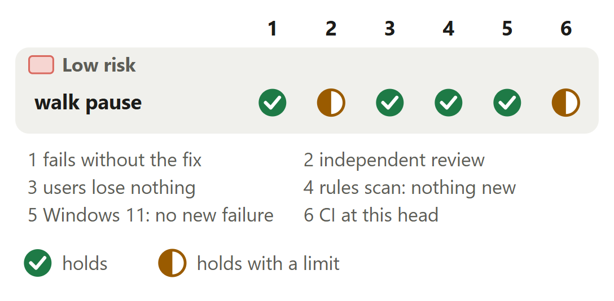

# A suspend on Linux or a clock change no longer holds walks

For [pull request #1118](https://github.com/neralabs/rerail/pull/1118), head e773446162. [report.html](report.html) is the same report as one page: download it and open it.

## 1. The decision

**May the walks time a session's pause on the clock its own timer runs on, and a settle start a walk only that pause holds?**

**We recommend:** approve it: on Linux a suspend, and anywhere a clock change, no longer holds a session's walks (a Windows or macOS sleep still does); the three cases of #1108 no longer pay a stop twice.

| Size | Risk and review | Waits on | Not verified |
|---|---|---|---|
| 181 lines in 6 files: 44 ship, 137 are tests and text | Fast. Clock reads swapped; a path only tests take. | Nothing. CI on GitHub runs at this head. | 3 |

## 2. Intent, and the gap

| Change | Intended | Found | Now |
|---|---|---|---|
| The pause after walks | Wait as long as the walk took _(code comment)_ | Waited the suspend's length too _(a case at main)_ | Closes the gap. |

Found on 25 November 2026: three cases failed by chance on GitHub's Linux runner (#1108); the suspend follows from the same line.

Sources at main, and causes

| Change | Where main states the intent | The cause, and what was measured |
|---|---|---|
| The pause after walks | `src/engine/code-rule/worktree-walks.ts:722` at `main` 3d1646e34f: `watching.nextWalkAt = end + Math.max(this.#gapMs, end - startedAt)`, both read from `Date.now()`, and every check of the pause too (lines 686, 710, 711). | `Date.now()` is the time of day: it counts a suspend, and moves when the clock is set. The pause's timer runs on libuv's clock, which on Linux stands still during a suspend, so the next walk waits the suspend's length after the wake. |

## 3. Where to look

1. **Read first**, 4 min: `worktree-walks.ts`: `pacingNow`, `#schedule`, `#walkWhenDue`, `#settled`, `#walkNowFor`. Does every read of `nextWalkAt` use one clock, and does a settle leave a session that asked nothing its pause?
2. 1 min: `code-rule-bridge.ts`: the comment of `settleWorktreeWalk`.

**Then skim**, 1 min: The four new pacing cases move the time of day alone; five bridge cases start their settle before the gate; one docs sentence says which systems still count a sleep.

## 4. Risk against verification

One change, low risk: the pause's rule stays, read on another clock; start at `#walkWhenDue`.

Each half mark's limit

| Change | Check | It holds with this limit |
|---|---|---|
| walk pause | independent review | No second reader has looked at this change yet; our own review is next. |
| walk pause | CI at this head | CI on GitHub runs at this head; the three cases failed there once in 30 runs each before. |

## 5. The changes

**The pause on the timers' clock**, low risk: After an hour inside a 300 ms walk, `main` timed the next walk 3,600,300 ms out; this change, 300 ms.

<b>6. The decisions</b>

**Which clock should a walk's pause count?**

**We chose** the one its own timer runs on, `performance.now()`: a fact of the system, with no number typed in. **Would change our mind:** A clock Node offers that leaves out a sleep on Windows and macOS too.

| Option | What a user gets | Cost | What it breaks |
|---|---|---|---|
| The timers' clock, `performance.now()` **(chosen)** | On Linux a suspend inside a walk no longer counts; on every system a clock change no longer counts. | One clock read swapped. | Nothing found. Windows and macOS still count a sleep; a stopped or starved process counts everywhere. |
| Sum the walk's own steps as it takes them | The same as today. | A timer read around every step. | A stop falls inside one step, a Git process or a read, and counts whole. |
| Cap a pause that looks too long against the walk's work | Shorter pauses after a stop. | A rate of work per millisecond, typed in. | A slow disk or a busy machine passes the rate and loses its pause. |
| The process's CPU time | Every stop left out. | One call. | It leaves out the walk's waits on Git and the disk too, so walks would run more than half the time. |

**Evidence.** clock_gettime(2) says CLOCK_MONOTONIC, which libuv reads on Linux, does not count a suspend; Microsoft says QueryPerformanceCounter counts standby and hibernate; libuv reads mach_continuous_time on macOS, which counts sleep. On Windows 11 a stopped Node process moved both clocks and a timer 2.8 s alike.

**Should a settle wait out the walks' pause?**

**We chose** no: no product code calls it, and a case waits for what the walk finds, not the pace. **Would change our mind:** A product caller of `settled()` that needs the pace.

| Option | What a user gets | Cost | What it breaks |
|---|---|---|---|
| A settle starts a walk the pause alone holds **(chosen)** | Nothing changes for a person; the cases wait for their walk. | One method; the gap case reads the pause through `idle()`. | Nothing found. |
| An option that turns the pause off for these cases | Nothing. | A product option only tests use. | The cases would walk unlike a person's session. |
| A longer limit for the three cases | Nothing. | One number. | A longer stop fails them again. |

**Evidence.** With a gap of an hour, a settle at `main` ran into its 60 s limit and settles here once the walk ran. Case 2 of #1108 waited at its gate for a walk only the pause held; it now starts that walk through a settle. No product code calls `settled()`.

<b>7. How it fits</b>

Nothing has to merge first: three commits on `main` 3d1646e34f. #1110 edits the same two source files and the bridge test file in other lines; Git merges the two alone.

**Trial merges with the open pull requests.** Git merges this head alone with `main` and with each of #1076, #1103, #1110, #1113 and #1114; #1110's cases assert no pause through a settle.

<b>8. What is not covered</b>: 3 not verified, 1 limit that stays

1. **Windows and macOS sleep** their timers' clock counts a sleep, so a sleep inside a walk still holds the next one that long; an engine clock that leaves sleep out would cover them.
2. **A real suspend** was not run on any machine: the cases move the time of day alone, as clock_gettime(2) says a Linux suspend does.
3. **macOS** never ran.

**Limits that stay**

- A stopped or starved process still counts as the walk's own time on every system: no clock Node offers leaves it out. In use it delays the next background walk by its length.

## 9. What we ask of you

We ask no ruling.

<b>10. Evidence</b>

The description on GitHub is the record: "How you tested it" holds the runs.

| Where | What ran | Result |
|---|---|---|
| Linux x64 | The four new cases with main's worktree-walks.ts and with this one, one checkout | At main the hour case got 3,600,300 ms in place of 300, and the settle case ran into its 60 s limit; here all four pass. |
| Linux x64 | The three cases of #1108, every process stopped 2.8 s 0.1 s into the case, 20 runs each, at main and here | main 15, 11 and 10 failed; here 0, 0 and 0, and the four other gate cases 0 of 10 each. |
| Windows 11 | Case 2 traced, every process suspended 2.8 s inside its first walk, 10 runs each | With main's walks the case waited about 3 s more for its paced walk; here it waits none. |
| Linux x64 | Nine mutants of the lines that decide, the four cases each | Seven fail a case; two pass and change nothing, said in the description. |
| Windows 11 | worktree-walks.test.ts, 30 runs at fee2684d82, 29 beside another test run | 30 of 30, 65 passed and 1 skipped each run. |
| Windows 11 | code-rule-bridge.test.ts whole at this head; its eight cases this change or #1108 names, 30 times | 358 passed, 1 skipped; 30 of 30. |
| Windows 11 | A Node process stopped 2.8 s by NtSuspendProcess | A 12 s timer fired after 12,013 ms of the time of day and 12,012 ms of performance.now(): both count a stop. |

**Sources.** The branch at e773446162 and its diff against `main` 3d1646e34f, read on 26 November 2026; issue #1108; Linux's clock_gettime(2), Microsoft's pages on high-resolution time stamps and on interrupt time, and libuv's source; runs on Linux x64 and Windows 11 x64 machines.

