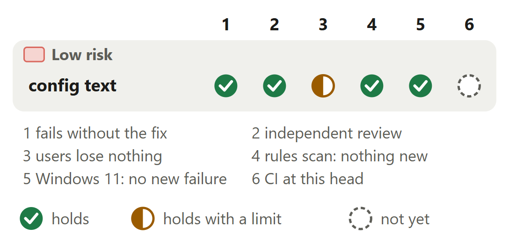

# A remote changed in place is read again at the next lookup

For [pull request #1180](https://github.com/neralabs/rerail/pull/1180), head 9335e71cbe. [report.html](report.html) is the same report as one page: download it and open it.

## 1. The decision

**Should the daemon read an unrecorded checkout's remote again once its repository's config files change, and keep it while they read the same?**

1. After `git remote set-url`, the next read names the new remote's repository.

**We recommend:** approve it: after `git remote set-url` the dashboard and status line named the old remote's repository until a restart, and now name the new one at the next read.

| Size | Risk and review | Waits on | Not verified |
|---|---|---|---|
| 328 lines in 6 files: 112 ship, 216 are tests and text | Standard. The automated reviewer can approve. | Nothing. No CI run at this head yet: not pushed. | 3 |

## 2. Intent, and the gap

| Change | Intended | Found | Now |
|---|---|---|---|
| The kept remote | A remote read once per folder _(code comment)_ | The old remote named for good _(real daemon, Linux x64)_ | Closes the gap, changes answer 1. |

Found on 27 November 2026 through a real daemon on Linux x64.

Sources at main, and causes

| Change | Where main states the intent | The cause, and what was measured |
|---|---|---|
| The kept remote | `KeptLocation` and `remoteRepository` in `src/engine/catalog/repository-registry.ts` at `main`: the remote read once per kept location. | The resolver kept its own copy of the remote and never asked `readRemoteAddress` again, whose answer follows the config files. |

## 3. Where to look

1. **Read first**, 5 min: `repository-registry.ts`: `keptRemoteKey`, `remoteFilesOf`, `lookupAt`. Is the text read before Git is asked, and does a file that cannot be read read as changed?
2. 3 min: `kept-remote.ts`: `remoteConfigFiles`, `configFilesText`; a comment in `repository-start.ts`.

**Then skim**, 3 min: An integration case with a real daemon, six cases over the daemon's own stores and API, one release note.

## 4. Risk against verification

Start with `keptRemoteKey`: the config files' text decides when the remote is read again.

Each limit, and each check that does not hold yet

| Change | Check | Its limit, or why it does not hold yet |
|---|---|---|
| config text | users lose nothing | A lookup of a checkout not recorded opens two files more; a recorded checkout's lookup is unchanged. |
| config text | CI at this head | No CI run at this head yet. |

## 5. The changes

**The kept remote carries its config**, low risk: A real daemon, the issue's steps: the old remote named 5 of 5 at `main`, the new one here.

**6. The decisions:** we made no choice here that a maintainer could have made differently.

<b>7. How it fits</b>

It stands on `main` 5b90523a0e and builds on #1164. #1165 merges alone either way.

<b>8. What is not covered</b>: 3 not verified, 2 limits that stay

1. **An included file** changed alone, or the global config alone, keeps the old remote's repository until a restart.
2. **A nested repository** made later in a subfolder already asked about keeps naming the outer checkout.
3. **macOS** never ran.

**Limits that stay**

- A linked worktree whose placement Git's files cannot describe carries its common `config` alone.
- A config file that cannot be read makes every lookup ask `readRemoteAddress`.

## 9. What we ask of you

Ask 1 rules on answer 1.

1. **May the daemon read an unrecorded checkout's remote again once its config files change?** We recommend yes: it named the old remote until a restart.

<b>10. Evidence</b>

The description on GitHub is the record. "How you tested it" holds the runs at `main` and at this head.

| Where | What ran | Result |
|---|---|---|
| Linux x64 | A real daemon, the issue's steps with the new remote's repository stopped, 5 runs | `main`: 5 of 5 named the old remote's repository, started. Here: 5 of 5 named the new one, stopped. |
| Linux x64 | The two case files, the source before and here | Before: 7 of 18 fail. Here: 18 of 18. |
| Windows 11 | The two case files, the cases alone and here | The cases alone: 7 of 18 fail. Here: 18 of 18. |
| Windows 11 | The two case files, 30 runs beside their CI shard neighbours; 5 mutants | 30 of 30 runs pass. Each mutant fails a case, as on Linux x64. |
| Linux x64 | One lookup of a checkout not recorded, counted | `main`: 1 open, 0 Git. Here: 3 opens, 0 Git; after `set-url` 1 Git process. |

**Sources.** The pull request and its diff, read on 27 November 2026. Rerail at `main` 5b90523a0e for the quoted intent.

