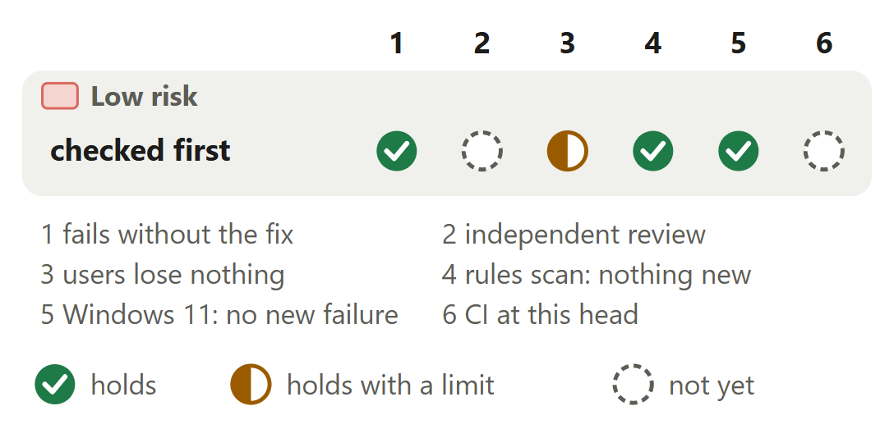

# A replaced checkout is read as the new one at once

For [pull request #1164](https://github.com/neralabs/rerail/pull/1164), head 549198b430. [report.html](report.html) is the same report as one page: download it and open it.

## 1. The decision

**Should the daemon read a folder afresh once another checkout takes its path, and a folder without a clone id drop a removed clone's row?**

1. A replaced checkout reads as the new one at the next read.
2. A new clone at a removed clone's path reads as its remote's repository.

**We recommend:** approve it once you agree to answers 1 and 2: the dashboard read a replaced checkout as the removed one until a session start or a restart, and now reads the new one at once.

| Size | Risk and review | Waits on | Not verified |
|---|---|---|---|
| 209 lines in 4 files: 92 ship, 117 are tests and text | Standard. The automated reviewer can approve. | Nothing. No CI run at this head yet: not pushed. | 3 |

## 2. Intent, and the gap

| Change | Intended | Found | Now |
|---|---|---|---|
| The kept location | A location read once _(code comment)_ | The removed clone named for good _(real daemon, Linux x64)_ | Closes the gap, changes answer 1. |
| A folder without id | A missing id keeps its row _(code comment)_ | A new clone read as removed _(our case, two systems)_ | Closes the gap, changes answer 2. |

Found on 26 November 2026 through a real daemon and hook on Linux x64.

Sources at main, and causes

| Change | Where main states the intent | The cause, and what was measured |
|---|---|---|
| The kept location | `createCheckoutResolver` in `src/engine/catalog/repository-registry.ts` at `main`: "each workspace's git location is read once". | The location was kept with nothing that forgets it; the id read there went with the removed clone, and a missing id took the row still recorded at the path. |
| A folder without id | `recordedRepositoryAt` in `src/engine/catalog/repository-registry.ts` at `main`; `refusedCheckoutCloneId` takes a recorded id only for such a worktree. | Recording always writes the id, so a folder without one was never recorded; the row at its path is a removed clone's. |

## 3. Where to look

1. **Read first**, 5 min: `repository-registry.ts`: `stillPlaces`, `locatedAfresh`, `recordedRepositoryAt`. Does every kept location fall back to a fresh read once another checkout takes its path?
2. 3 min: `repository-identity.ts`: `folderIdentity`, now exported.

**Then skim**, 3 min: Four cases over the daemon's own stores and API; `folderIdentity` exported; one release note.

## 4. Risk against verification

Start with `stillPlaces`: the id decides a main checkout, the `.git` entry every other kept location.

Each limit, and each check that does not hold yet

| Change | Check | Its limit, or why it does not hold yet |
|---|---|---|
| checked first | independent review | No review by another reader yet: our own reading against the repository's review points only. |
| checked first | users lose nothing | A linked worktree's read costs one `lstat` more, about 0.03 ms on Windows 11; a main checkout's read makes the same calls as at `main`. |
| checked first | CI at this head | No CI run at this head yet. |

## 5. The changes

**A kept location checked before use**, low risk: A real daemon, the issue's steps: the removed clone named 5 of 5 at `main`, the new one here.

**6. The decisions:** we made no choice here that a maintainer could have made differently.

<b>7. How it fits</b>

It stands on `main` ef885f6e1c: Git merged the two files #1110 also changed, and both hold. #1143 and #1127's fix merge alone either way.

<b>8. What is not covered</b>: 3 not verified, 2 limits that stay

1. **A read Git did not answer** names no repository for that read, where `main` took the recorded row (a test script on Linux x64).
2. **A remote changed in place** in a checkout not recorded is kept for its location's life, as at `main`.
3. **macOS** never ran.

**Limits that stay**

- A `.git` file rewritten in place to name another Git folder keeps the location until it is read afresh.
- A checkout whose id file was deleted by hand reads as a new clone, as recording makes it.

## 9. What we ask of you

Asks 1 and 2 rule on answers 1 and 2.

1. **May the daemon read a folder afresh once the checkout at its path changed?** We recommend yes: it named the removed clone until a restart.
2. **May a lookup stop taking the row at a path for a folder without an id?** We recommend yes: recording already treats it as a re-clone.

<b>10. Evidence</b>

The description on GitHub is the record. "How you tested it" holds the runs at `main` and at this head.

| Where | What ran | Result |
|---|---|---|
| Linux x64 | A real daemon and hook, the issue's replacement, 5 runs | `main`: 5 of 5 named the removed clone's repository at 0, 30 and 90 s. Here, before and after the merge of `main`: 5 of 5 named the new one. |
| Linux x64 | The case file and `outside-git.test.ts` at `main` and here | `main`: 4 of 75 fail. Here: 75 of 75. |
| Windows 11 | The case file at `main` and here | `main`: the four new cases fail. Here: 8 of 8. |
| Linux x64 | 7 mutants of the deciding lines | Each fails a case. |
| Windows 11 | 1,000 reads of a linked worktree, 15 times | `main`: 246.1 ms at the median. Here: 272.4 ms, one `lstat` more a read. |

**Sources.** The pull request and its diff, read on 26 November 2026. Rerail at `main` ef885f6e1c for the quoted intent.

