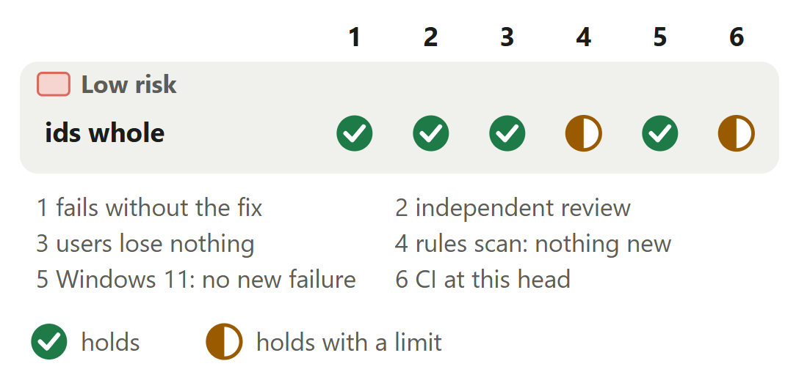

# Walks tell a replaced file by its file ids read whole

For [pull request #1150](https://github.com/neralabs/rerail/pull/1150), head 8dcda3b505. [report.html](report.html) is the same report as one page: download it and open it.

## 1. The decision

**Should a walk tell a file removed and made again from the one it found by their file ids read whole, not as numbers?**

**We recommend:** approve it: a replaced file is no longer recorded as a place the walk could not check; walks of 10,000 files took 5.2 ms (Linux x64) and 4.7 ms (Windows 11) more, inside `main`'s spread.

| Size | Risk and review | Waits on | Not verified |
|---|---|---|---|
| 268 lines in 4 files: 108 ship, 160 are tests and text | Fast. One source file of the walks; no high-risk path. | Nothing. It stands alone on `main` e29282a55f. | 3 |

## 2. Intent, and the gap

| Change | Intended | Found | Now |
|---|---|---|---|
| A file made again | A file made again is no gap _(code comment)_ | Two NTFS ids read as one _(Node alone, 64,000 tries)_ | Closes the gap. |

Found on 25 November 2026, when the case failed once on a Windows 11 machine and Node alone reproduced it there.

Sources at main, and causes

| Change | Where main states the intent | The cause, and what was measured |
|---|---|---|
| A file made again | `src/engine/code-rule/code-rule-bridge.ts:1682` at `main` 8d62b17476, `lookedAgain`'s comment; the comparison at `:1714`: `before.dev === now.dev && before.ino === now.ino`, both `Stats` read as numbers. | NTFS file ids are past 2^53, where a JavaScript number holds only some of the values: two files made one after the other can round to one number. `lstat` without `bigint` gives `ino` as such a number. |

## 3. Where to look

1. **Read first**, 5 min: `code-rule-bridge.ts`: `FoundEntry`, `msOf`, `lookAt`, `sameEntryNow`, `sameEntry`, `#realPathInPlace`. Is every number `FoundEntry` gives the one Node gives without `bigint`?

**Then skim**, 3 min: Stand-ins for the ids an `lstat` and an opened file's stat give; three rows beside the real-files case, a tool read's case and a stamp case.

## 4. Risk against verification

One change, low risk: the same comparison on ids read whole; start at `FoundEntry`.

Each half mark's limit

| Change | Check | It holds with this limit |
|---|---|---|
| ids whole | rules scan: nothing new | The rule pack's review against `main`, Rerail built from `main`, found nothing new; every added or edited function counts 5 or less. Rerail as published could not run the pack. |
| ids whole | CI at this head | CI on GitHub runs once the pull request opens. |

## 5. The changes

**Walks compare file ids whole**, low risk: Two files whose NTFS ids give one number: a place said at `main`, none here.

<b>6. The decisions</b>

**Where should the walk read the entry's ids whole?**

**We chose** in its own `lstat` of every entry: only that read names the entry the walk found. **Would change our mind:** A walk of many more files on a slower disk, where one `bigint` `lstat` per entry costs more.

| Option | What a user gets | Cost | What it breaks |
|---|---|---|---|
| Every entry's `lstat` with `bigint` **(chosen)** | The id of the entry the walk found, for every refusal. | +5.2 ms at the median on Linux x64 and +4.7 ms on Windows 11 on a walk of 10,000 files, inside `main`'s spread. | Nothing found: every stamp keeps its text. |
| One more `lstat` with `bigint` at each refusal | No cost on a walk with no refusal. | One read per refusal. | It reads the entry there at the refusal: a file renamed in before it compares with itself, as in the real-files case. |
| Compare size and times beside the ids | No new read. | Nothing. | Two files written in one clock tick share both: 304 of the 335 pairs gave one stamp too. |

**Evidence.** The walk timing above; the real-files case renames the second file in during the read, before the refusal, and the refusal-time read as a mutant fails four rows on Linux x64; Node alone on Windows 11, 64,000 tries: 335 pairs one number, 304 of them one stamp too, none one id whole.

<b>7. How it fits</b>

It stands alone on `main` 8d62b17476 and needs no other pull request. #1110 edits the same two files in other functions; Git merges both.

**Trial merges with the open pull requests.** Git merges this head alone with `main` e29282a55f and with each of #1076 and #1126, which share no file with it. With #1110 the nearest lines of the two changes in `code-rule-bridge.ts` are 43 apart, and Git merges both files.

<b>8. What is not covered</b>: 3 not verified, 1 limit that stays

1. **The file stamp** holds the id as a number: a same-size file replaced in one clock tick keeps its stamp when the ids give one number. Its own pull request.
2. **Other ids as numbers** `repository-identity.ts`'s folder identity is its own issue; `ignore-rule-files.ts`'s stamp has no change time. Three others are safe as they are.
3. **macOS** never ran.

**Limits that stay**

- A refusal still costs the look again it cost at `main`: its attributes and one `lstat`.

## 9. What we ask of you

We ask no ruling.

<b>10. Evidence</b>

The description on GitHub is the record: "How you tested it" holds the runs.

| Where | What ran | Result |
|---|---|---|
| Linux x64 | The case file over `main`'s bridge, with the new cases | The two id rows fail with the issue's `source-incomplete` failure for `src/x.py`, and the tool's read case takes `src/a.py`; 360 passed, 3 skipped |
| Linux x64 | The case file here | 363 passed, 3 skipped (the skips `main`'s) |
| Windows 11 | The case file at `main` 8d62b17476 (the same bridge) with the new cases | The two id rows fail with the issue's `source-incomplete` failure for `src/x.py`. |
| Windows 11 | The case file here beside the next file of its CI shard, 30 runs | 30 of 30; 427 passed and 1 skipped a round |
| Linux x64 | The 16 test files that import the bridge, at `main` and here | 326 passed and 2 skipped on each side. |
| Windows 11 | Node alone, the issue's steps, each look read with `bigint`, 64,000 tries | 335 pairs one number, 0 one id whole; 63,775 first ids past 2^53. |
| Linux x64 | A walk of 10,000 files, `main`'s bridge and this head's in one process, 20 each | Median 107.2 ms at `main`, 112.4 ms here; `main` spread 94.2 to 136.2 ms. |

**Sources.** The branch at 8dcda3b505 and its diff against `main` e29282a55f, read on 26 November 2026; runs on Linux x64 and Windows 11 x64 machines.

