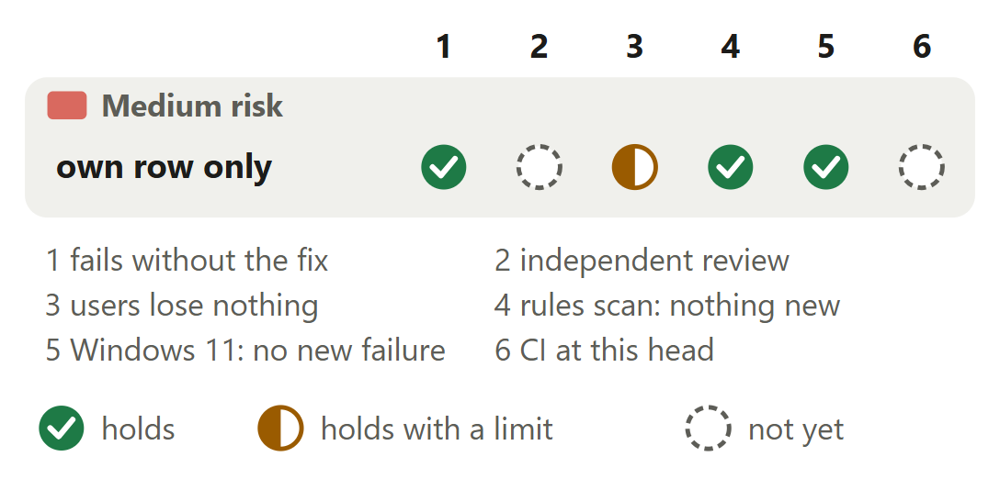

# A running session checks a replaced checkout with its new rules

For [pull request #1181](https://github.com/neralabs/rerail/pull/1181), head f00ecfcf97. [report.html](report.html) is the same report as one page: download it and open it.

## 1. The decision

**Should a running session's rule checks take a checkout's recorded row only while the folder is still that clone?**

1. The next edit in a replaced checkout is checked with the new clone's rules.

**We recommend:** approve it once you agree to answer 1: a running session checked a replaced checkout with the removed clone's rules until a new session started there.

| Size | Risk and review | Waits on | Not verified |
|---|---|---|---|
| 348 lines in 6 files: 136 ship, 212 are tests and text | Standard. The automated reviewer can approve. | Nothing. No CI run at this head yet: not pushed. | 3 |

## 2. Intent, and the gap

| Change | Intended | Found | Now |
|---|---|---|---|
| The row by path | The row at a path names it _(code comment)_ | The removed clone's rules steer _(real daemon, Linux x64)_ | Closes the gap, changes answer 1. |

Found on 27 November 2026 through a real daemon and hook on Linux x64.

Sources at main, and causes

| Change | Where main states the intent | The cause, and what was measured |
|---|---|---|
| The row by path | `CheckoutCatalogs.#read` in `src/engine/code-rule/code-rule-dsl-catalog.ts` at `main`: "Only a recorded checkout is eligible; its row names its repository, so Git is asked once per checkout." | `#read` took the row by path alone and `#apply` kept the first Git location (`entry.location ??=`), so the row's clone id was never compared with the folder's and the catalog's signature did not change. |

## 3. Where to look

1. **Read first**, 5 min: `code-rule-dsl-catalog.ts`: `ownRow`, `placedNow`, `#read`, `#signature`. Is every row a lane's rules come from weighed against the folder as it is now?
2. 3 min: `repository-registry.ts`: `isOwnRow`, `stillPlaces`, `locationNow`.

**Then skim**, 3 min: Two integration cases through a real daemon, six catalog cases, a cost count; one release note.

## 4. Risk against verification

Start with `ownRow`: a row with the clone id last weighed keeps its answer unless the rules are read.

Each limit, and each check that does not hold yet

| Change | Check | Its limit, or why it does not hold yet |
|---|---|---|
| own row only | independent review | No independent review of this head yet. |
| own row only | users lose nothing | The read of every known checkout's row asks no folder, as at `main`; reading one checkout's rules reads its clone id file, and a linked worktree's one `lstat` more. |
| own row only | CI at this head | No CI run at this head yet. |

## 5. The changes

**A folder's own row only**, medium risk: A real daemon, the issue's steps: the removed clone's rule steered 5 of 5 at `main`, none here.

**6. The decisions:** we made no choice here that a maintainer could have made differently.

<b>7. How it fits</b>

It stands on `main` 5b90523a0e, which holds #1164. #1165 merges alone; #1110 meets it at three places, where #1110's side reads as `main` does.

<b>8. What is not covered</b>: 3 not verified, 1 limit that stays

1. **A checkout no lane reads** keeps its last eligibility until a lane reads its rules or its row is written again.
2. **A Git that gives no answer** while a replaced folder is read afresh is asked again at each read of its rules.
3. **macOS** never ran.

**Limits that stay**

- Merge Assist's sign-in stamp and delivery settings still read the row at a path.

## 9. What we ask of you

Ask 1 rules on answer 1.

1. **May a running session's rule checks refuse a row recorded for another clone at the folder's path?** We recommend yes: it steered by the removed clone's rules.

<b>10. Evidence</b>

The description on GitHub is the record. "How you tested it" holds the runs at `main` and at this head.

| Where | What ran | Result |
|---|---|---|
| Linux x64 | A real daemon and hook, the issue's replacement, 5 runs | `main`: 5 of 5 steered by the removed clone's rule, at once and 30 s later. Here: 0 of 5. |
| Linux x64 | The case files, the source before and here | Before: 7 cases fail. Here: all pass. |
| Windows 11 | The case files, the source before and here | Before: 7 of 447 fail. Here: 447 of 447. |
| Linux x64 | 7 mutants of the deciding lines | Each fails a case. |
| Linux x64 | Folder questions per read, 1 and 20 recorded checkouts | Every row: 0 at `main` and here. One checkout's rules: 0 at `main`; here 1 id read, a linked worktree 1 `lstat` more. |

**Sources.** The change and its diff, read on 27 November 2026. Rerail at `main` 5b90523a0e for the quoted intent.

