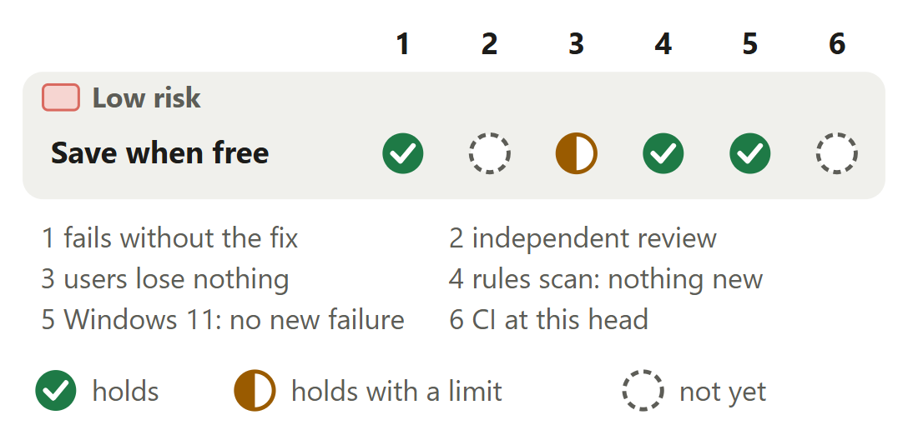

# A scan settings save waits for another process's write lock

For [pull request #1205](https://github.com/neralabs/rerail/pull/1205), head 78a158806c. [report.html](report.html) is the same report as one page: download it and open it.

## 1. The decision

**Should a scan settings save wait for another process's write lock off the daemon's thread, through `writtenWhenFree`, as the rule settings save does?**

1. `rerail settings` saves once the lock is given back.
2. Past SQLite's busy wait it answers `503 database-busy` and says why.

**We recommend:** approve it: the same merge and write, made once the lock is free within SQLite's 5 s; past them it answers `503 database-busy` with its reason, not `500 internal`.

| Size | Risk and review | Waits on | Not verified |
|---|---|---|---|
| 267 lines in 7 files: 55 ship, 212 are tests and text | Automated review. No high-risk path of `REVIEW.md`. | Nothing. It stands alone on `main` cce09e3c36. | 3 |

## 2. Intent, and the gap

| Change | Intended | Found | Now |
|---|---|---|---|
| Scan settings save | Wait, then save _(docs)_ | Fails at once, 500 _(the issue's runs)_ | Closes the gap, changes answer 1. |
| A save not made | Say why it was not made _(docs)_ | Internal error _(the issue's runs)_ | Closes the gap, changes answer 2. |

Reported on 27 November 2026 at `main` cce09e3c36 on Linux x64, 10 of 10 runs; `v0.2.2` has the same code.

Sources at main, and causes

| Change | Where main states the intent | The cause, and what was measured |
|---|---|---|
| Scan settings save | `docs/reference.md`: a change of rule settings "waits for another process's write lock ... the change is not made and answers `503 database-busy`". | `updateSettings` read the saved settings and then wrote them in one deferred transaction, whose write SQLite fails at once while another connection holds the lock. |
| A save not made | `docs/reference.md`: past 5 s "the change is not made and answers `503 database-busy`, whose message the dashboard shows". | The lock's `SqliteError` reached the API as an unknown error, which answers `500 internal`. |

## 3. Where to look

1. **Read first**, 3 min: `operations.ts`: `audit_settings_update`'s handler through `writtenWhenFree`. Is #1165's path the right one for this save too?
2. 3 min: `audit-control.ts`: `updateSettings`, `updateWorkspaceSettings`, `#savedOn`, `#saveSettings`, `#underEither`.

**Then skim**, 2 min: One reference sentence and a release note say what the save does beside a held lock.

## 4. Risk against verification

One change. Start at the handler in `operations.ts`.

Each limit, and each check that does not hold yet

| Change | Check | Its limit, or why it does not hold yet |
|---|---|---|
| Save when free | independent review | No reader outside the author has read this head yet. |
| Save when free | users lose nothing | A holder past 5 s still costs the save, as it costs the rule settings save; the person reads why and tries again. |
| Save when free | CI at this head | GitHub's CI has no result at this head yet. |

## 5. The changes

**The scan settings save through writtenWhenFree**, low risk: A held lock: `rerail settings` failed at once at `main`; here it saves once the lock is given back.

<b>6. The decisions</b>

**How should the scan settings save wait for another process's lock?**

**We chose** through `writtenWhenFree`, the path #1165 gave the rule settings save. **Would change our mind:** A maintainer preferring that the store wait by itself, so every caller of `updateSettings` waits.

| Option | What a user gets | Cost | What it breaks |
|---|---|---|---|
| Through `writtenWhenFree` **(chosen)** | Hooks answered while it waits; saved once the lock is free; past SQLite's wait, `503` and its reason. | The store's own form, which only tests and a benchmark call, still fails at once. | Nothing found. |
| An immediate transaction on the store's connection | The save waits for the lock too. | It waits on the thread that answers every session's hooks. | Every hook, up to 5 s, as #1165 found for the rule save. |
| The store waits on its own writer | Every caller of the store waits. | A second way to wait and a second `503`. | Nothing; more code for no caller. |

**Evidence.** Beside a 2 s lock at `main` the save failed 5 of 5 at once; here it saved 5 of 5 once the lock was given back.

<b>7. How it fits</b>

It stands on `main` cce09e3c36, uses #1165's `writtenWhenFree` unchanged, and takes in a test change opening first, which makes the daemon file read facts. The fix of #1133 edits `#settingsRow` and `#saveSettings` too: Git stops there, and the merge keeps both. #1076, #1126 and #1174 share no file.

**Where #1133 meets it.** The merge passes this change's `database` to #1133's reading of the row; two of #1133's test lines read `.settings` from `updateSettings`, which now returns the settings.

<b>8. What is not covered</b>: 3 not verified, 2 limits that stay

1. **The API's other writes** 13 of them wait and save beside a held lock, on the daemon's thread, as #1165 left them.
2. **The store's own form** `updateSettings` with no database, which only tests and a benchmark call, fails at once as before.
3. **macOS** never ran.

**Limits that stay**

- A save past 5 s is not made; the person runs it again once the holder ends.
- `updateSettings` returns the saved settings, not the session's controls.

## 9. What we ask of you

Ask 1 rules on answer 1.

1. **May the scan settings save wait for the lock through `writtenWhenFree`, answering `503 database-busy` past 5 s?** We recommend yes: the same path and bound as the rule settings save.

Answer 2 asks no ruling. It answered `500 internal` at once, whatever the hold.

<b>10. Evidence</b>

The description on GitHub is the record: "How you tested it" holds the runs at `main` and here.

| Where | What ran | Result |
|---|---|---|
| Linux x64 | The issue's steps through the built CLI, hook and daemon, a lock held 2 s, over `main`'s two source files, 5 runs | `rerail settings` exit 1 `internal` and `PATCH` 500, at once, 5 of 5. |
| Linux x64 | The same at this head, 5 runs | Saved once the lock was given back, 5 of 5. |
| Linux x64, Windows 11 | The new cases over `main`'s source on both systems, and 3 mutants of the deciding lines on Linux x64 | They fail over `main`; every mutant caught. |
| Linux x64, Windows 11 | The 27 test files that import a changed module, with the daemon file, here and at `main` | No failure here (495 passed on Linux x64, 518 on Windows 11). |
| Windows 11 | The three changed test files together, 30 times at this head | 30 of 30, 79 passed a run. |
| Linux x64 | #1165's 13 other API writes, each once beside a 2 s lock | 13 of 13 wait and save. |

**Sources.** The branch at 0b4e068f65 and its diff against `main` cce09e3c36, read on 27 November 2026; runs on Linux x64 and Windows 11 x64 machines.

