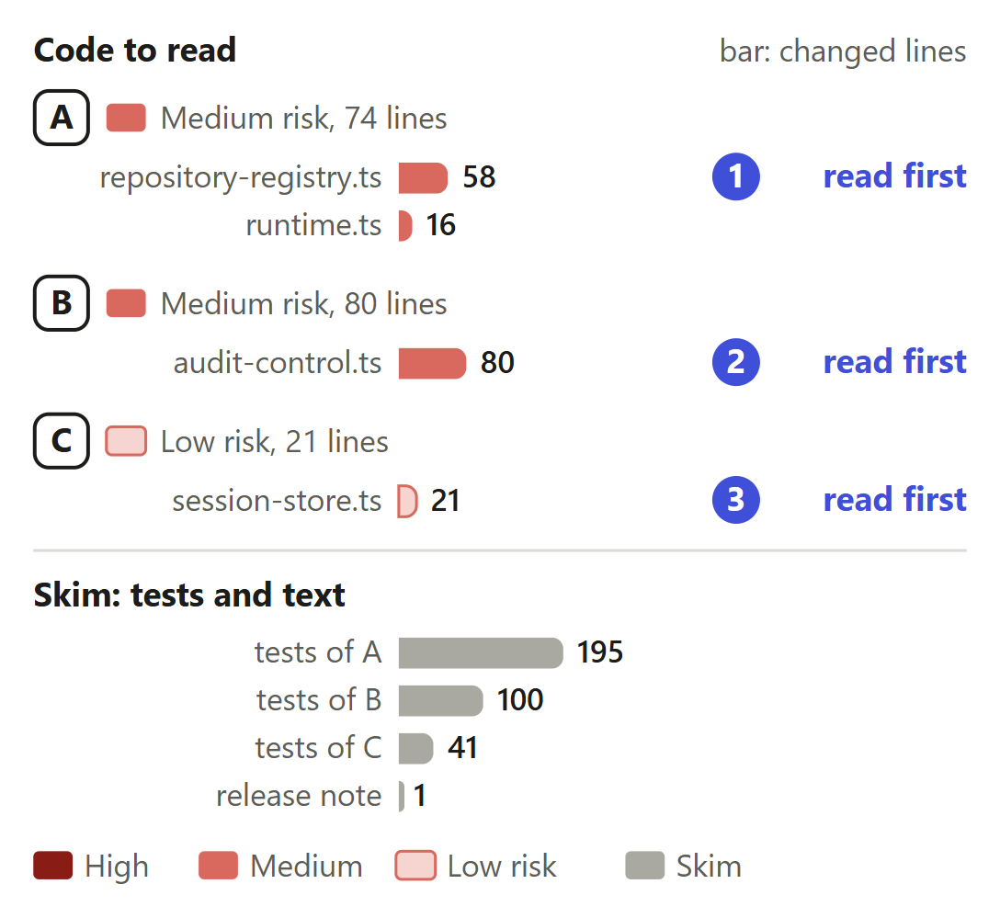
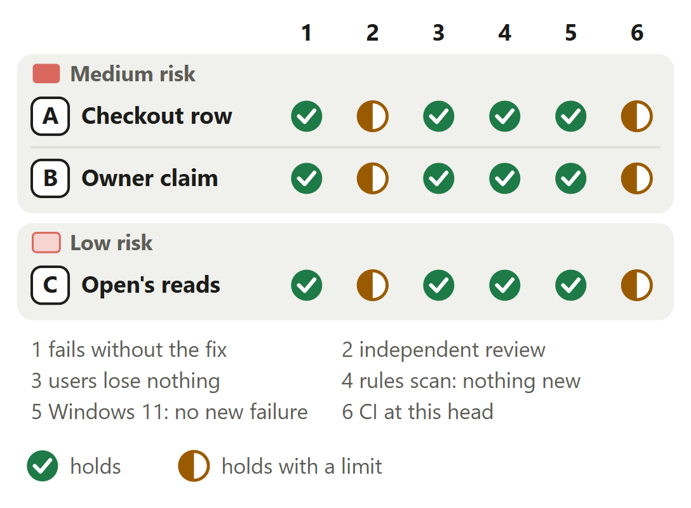

# A session started beside a held write lock gets its note

For [pull request #1165](https://github.com/neralabs/rerail/pull/1165), head 9c3d156cb1. [report.html](report.html) is the same report as one page: download it and open it.

## 1. The decision

**Should a session's start record a known checkout through the record writer, so it never waits on the daemon's thread for another process's lock?**

**We recommend:** approve it: a known checkout's record is the same statements made once the lock is free, and a first sight still takes the transaction.

| Size | Risk and review | Waits on | Not verified |
|---|---|---|---|
| 512 lines in 9 files: 175 ship, 337 are tests and text | Fast. No high-risk path in REVIEW.md. | Nothing. It stands alone on `main` ef885f6e1c. | 3 |

## 2. Intent, and the gap

| Change | Intended | Found | Now |
|---|---|---|---|
| A. Hooks never wait | Hooks never wait for another lock _(code comment)_ | The checkout's record waited for it _(a daemon stack, #1127)_ | Closes the gap. |
| B. The claim waits nowhere | The claim is made at the open _(code comment)_ | It threw while the row waited _(unit cases)_ | Closes the gap. |
| C. Reads answer at once | A read sees what was recorded _(code comment)_ | It held every session's hooks _(unit cases)_ | Closes the gap. |

Found on 26 November 2026, in runs on Linux x64 and Windows 11 machines.

Sources at main, and causes

| Change | Where main states the intent | The cause, and what was measured |
|---|---|---|
| A. Hooks never wait | `src/engine/storage/record-writes.ts` at `main` e29282a55f, line 2, the module's first line. `recordCheckout` in `src/engine/catalog/repository-registry.ts`, line 194, wrote the checkout's seen time in `db.transaction(..., { behavior: "immediate" })` at every session open. | The checkout's record ran `BEGIN IMMEDIATE` on the catalog's connection, whose busy timeout is 5 s, before the session's row was asked for. A stack taken at the 400 named `recordCheckout` under `openSession`. |
| B. The claim waits nowhere | `registerOwner` in `src/engine/audit/audit-control.ts` at `main` e29282a55f; it called `requireRecordWritesMade` before its transaction. | `requireRecordWritesMade` made the waiting writes on the thread and threw `SQLITE_BUSY` while any still waited. |
| C. Reads answer at once | `src/engine/storage/record-writes.ts` at `main` e29282a55f, lines 14 and 15; `lastRecordedEvent` and `discoveryGaps` in `src/runtime/session-store.ts` read through `#recorded()`. | `#recorded()` calls `flushRecordWrites`, which waits on the thread for the lock until the oldest waiting write is 5 s old. |

## 3. Where to look

1. **Read first**, 10 min: `repository-registry.ts`: `recordCheckout`, `seenCheckout`, `pruneCheckouts`, `seenTimesMade`. Does any checkout whose repository must come from the write still take the transaction?
2. **Read first**, 8 min: `audit-control.ts`: `registerOwner`, `releaseOwner`, `#recordWriter`. Can a release or a refusal be lost or reordered while the claim waits?
3. **Read first**, 3 min: `session-store.ts`: `lastRecordedEvent`, `discoveryGaps`. Does each caller cope with a row that still waits?
4. 3 min: `runtime.ts`: the runtime's record writer and the start's call.

**Then skim**, 6 min: The cases beside a held lock, and one engine-service case rewritten: it expected the start to wait where it records the checkout.

## 4. Risk against verification

Two medium changes on the start's path: start at `seenCheckout`, where a session's start now leaves its write waiting.

Each half mark's limit

| Change | Check | It holds with this limit |
|---|---|---|
| A. Checkout row | independent review | No independent review ran. Our own runs found one defect, fixed here: a forget of the hourly prune could beat a waiting seen time to the lock. |
| B. Owner claim | independent review | No independent review ran. |
| C. Open's reads | independent review | No independent review ran. |
| A to C | CI at this head | CI on GitHub runs once the pull request opens. |

<b>5. The changes</b>

**A. A known checkout without the lock**, medium risk. A start beside a held lock, Windows 11: no note after 5.8 s before; the note within 0.9 s here.

- **Problem:** A session that starts in a checkout the daemon serves while another process holds the write lock gets `{}` after 5 to 6 s and no session-start note; every other session's hooks wait meanwhile.
- **Who meets it:** Anyone who runs `rerail scrub`, `rerail reset` on a long history, or another Rerail's migration while a session starts (#1127).
- **What it does:** `recordCheckout` takes the runtime's record writer. `seenCheckout` reads the checkout's row with no lock; when its clone id matches, `recordCheckoutRow` goes through the writer, made at once or once the lock is free. `pruneCheckouts` waits off the thread for waiting record writes before its forget.
- **Risk:** Medium. The seen time lands later while the lock is held; the prune's forget waits for it, and a forgotten row is written again.
- **Check:** Does `seenCheckout` fall back to the transaction for any row of another clone id or none? Does the kept write do what the transaction would have done once the lock was free? Does `seenTimesMade` keep the prune from forgetting a checkout seen while it looked?
- **Picture:** On one Windows 11 machine, five session starts beside a held write lock took 5,766 to 5,795 ms with no note at main and 223 to 884 ms with the note here.
- **Method:** The issue's steps through the built CLI, `rerail daemon start` and the built Claude Code hook, a second process holding the lock 8 s, 5 runs at `main` and 5 here on one Windows 11 x64 machine.

**B. The claim through the writer**, medium risk. The owner claim beside a held lock: failed after 5.75 s before; kept, then made, here.

- **Problem:** Behind the checkout's record, the owner claim required this process's waiting writes made, and threw `database is locked` when they were not.
- **Who meets it:** The same people as A: anyone whose session starts beside a held lock (#1127).
- **What it does:** `registerOwner` reads the owner row, refuses a live runtime's claim at once, and writes the claim through the record writer behind the session's row. `releaseOwner` goes through the same writer, so it never lands ahead of its claim.
- **Risk:** Medium. A claim made later cannot report a refusal to its open; it reports it on stderr and leaves the other runtime's claim.
- **Check:** Is the claim's refusal checked both before it is kept and when it is made? Can a release reach the database before its claim?
- **Picture:** Beside a held write lock the owner claim failed after 5.75 s at main; here it is kept at once and made once the lock is free.
- **Method:** `record-writes.test.ts`'s claim cases with a connection holding the lock, on Windows 11 x64.

**C. Two reads without waiting**, low risk. The evaluator's read while a place waits: 5,554 ms before; 203 ms here.

- **Problem:** At a session's open, two reads made this process's waiting writes on the daemon's thread first, up to 5 s each, while every session's hooks waited.
- **Who meets it:** Every session open beside a held lock, after A and B.
- **What it does:** `lastRecordedEvent` and `discoveryGaps` read the database as it is now, without `flushRecordWrites`.
- **Risk:** Low. Each read's caller already copes with a row that still waits.
- **Check:** Does `recordLostEvents` count again inside its own write? Is a place told again written once?
- **Picture:** With a place's record waiting for the lock, the evaluator's read took 5,554 ms against main's behaviour and 203 ms here, on Windows 11.
- **Method:** The read case of `record-writes.test.ts` with a connection holding the lock, once against `main`'s behaviour and once here, on Windows 11 x64.

<b>6. The decisions</b>

**What should a session's start write for a checkout Rerail already knows?**

**We chose** its record through the record writer, the transaction's own statements, so a forgotten row is written again. **Would change our mind:** A reader that needs a checkout's seen time at once, which we did not find.

| Option | What a user gets | Cost | What it breaks |
|---|---|---|---|
| The transaction's statements through the record writer **(chosen)** | No wait at a known checkout's start; made later, it does what the transaction would have done. | One more read of the row on the writer's connection. | Nothing found: the prune waits for it. |
| A bare update of the seen time through the writer | A smaller write. | Nothing more. | A checkout another process forgot meanwhile stays with no row while its session runs. |
| Every checkout's record through the writer | No wait at any start. | A first sight has no repository key until its write is made. | The start's later steps read the checkout's repository. |

**Evidence.** The registry's cases: a forgotten row is back once the lock is free, and the prune keeps a checkout seen while it looked; a mutant with a bare update fails the first, one without the prune's wait the second.

<b>7. How it fits</b>

It stands alone on `main` ef885f6e1c, which Git merged into it with no conflict, and needs no other pull request. #1110, merged into `main`, changed three of its files, read at the merge: both sides hold. #1076, #1126 and #1143 share none.

The pull request stands on main at ef885f6e1c, which Git merged into it with no conflict; #1076, #1126 and #1143 share no file with it and merge with it with no conflict; nothing waits on it.

<b>8. What is not covered</b>: 3 not verified, 1 smaller gap, 1 limit that stays

1. **A first start in a new checkout** beside a held lock still waits and opens without the note, as on `main`: its repository comes from the write.
2. **A session's end and the dashboard's save** beside a held lock still wait for it (#1128).
3. **macOS** never ran.

**Smaller gaps**

- **Other hooks on a loaded machine** on one Windows 11 machine loaded by another team's test runs, 2 of 5 runs here held the second session's hooks 2.4 and 5.8 s; on the issue's machine none passed 0.51 s, with no flush and no plain write on the thread.

**Limits that stay**

- `requireRecordWritesMade` in `src/engine/storage/record-writes.ts` has no caller outside its test now and its comment names the claim; that folder is a high-risk path, so it is left as it is.

## 9. What we ask of you

We ask no ruling.

<b>10. Evidence</b>

The description on GitHub is the record: "How you tested it" holds the runs.

| Where | What ran | Result |
|---|---|---|
| Windows 11 and Linux x64 | At this head, the merge of `main` ef885f6e1c: the 33 test files of the changed files and their importers, the hook case with every statement logged, the issue's steps 5 times | All pass on both systems (777 and 723 passed); the start beside the held lock answered in 29 and 10 ms with only the record writer's one try on the thread; 5 of 5 with the note on each. |
| Windows 11 | The three changed files against `main`'s behaviour, and here | 5 failed against `main`'s behaviour, the hook case with `lock held: 5820 ms` and `database is locked`; 92 passed here. |
| Windows 11 | The hook case on a build that logs every statement | The start beside the held lock answered in 35 ms; only the record writer's one try for the lock ran on the thread. |
| Windows 11 | The issue's steps through the built CLI, 5 runs at `main` and here | 0 of 5 with the note at `main`, after 5,766 to 5,795 ms; 5 of 5 with the note here. |
| Windows 11 | Five mutants of the new lines, each alone | Each fails a case. |
| Windows 11 | The 55 test files importing a changed module, `main` and here | All pass at `main`; one case rewritten here, since it expected the start to wait. |
| Windows 11 | The four changed test files 30 times each, before the merge of `main` | 30 of 30 for each, at 142e315ddd and 75496a481b. |
| Linux x64 | The changed files, the importers, the statement log and the issue's steps, `main`'s source and here | Red over `main`'s source; all pass here; the start beside the held lock with the note in 126 to 164 ms; each of 12 mutants fails. |

**Sources.** The branch at 9c3d156cb1, Git's own merge of `main` ef885f6e1c into 142e315ddd, and its diff against that `main`, read on 26 November 2026; runs on Windows 11 x64 machines and one Linux x64 machine; a daemon stack at the 400.

