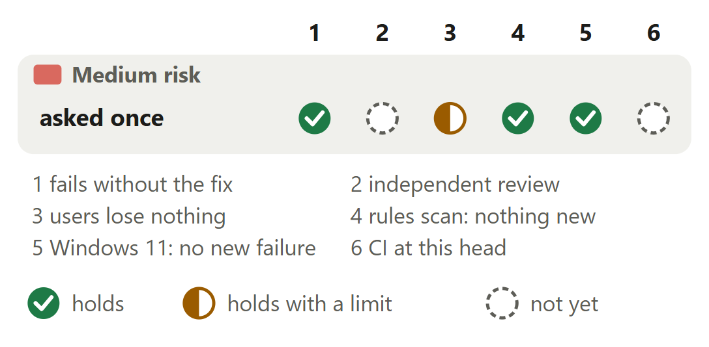

# A walk asks nothing of files it does not read

For [pull request #1162](https://github.com/neralabs/rerail/pull/1162), head fd3c41b3fc. [report.html](report.html) is the same report as one page: download it and open it.

## 1. The decision

**Should a walk of the other worktrees stop asking the disk, at every walk, about files a session saw there that it does not read?**

1. A walk records no deletion of a file it does not read.

**We recommend:** approve it once you agree to answer 1: the walk keeps those files as the session saw them, as it already does with their changes, and forgets a gone file no rule reads.

| Size | Risk and review | Waits on | Not verified |
|---|---|---|---|
| 382 lines in 5 files: 77 ship, 305 are tests and text | Standard. The automated reviewer can approve. | Nothing. No CI run at this head yet: not pushed. | 3 |

## 2. Intent, and the gap

| Change | Intended | Found | Now |
|---|---|---|---|
| Seen files kept | Gone only if gone now _(code comment)_ | Asked again at every walk _(CPU profile, Windows 11)_ | Closes the gap, changes answer 1. |
| Gone files forgotten | Gone files are forgotten _(our reading)_ | One no rule reads stayed _(counted, Linux x64)_ | Closes the gap. |

Found on 26 November 2026 in a CPU profile of the daemon on a Windows 11 machine, then counted on Linux x64 and Windows 11.

Sources at main, and causes

| Change | Where main states the intent | The cause, and what was measured |
|---|---|---|
| Seen files kept | `#readTakenTexts` in `src/engine/code-rule/code-rule-bridge.ts` at `main`: "A source the session saw that the walk's snapshot lacks is gone only if it is gone now"; `#keepSeenStill` asks `#stillThere` of each. | `#stillThere` reads the file through `acceptsPath` and `#readSource`: a full owner lookup on the main thread and an open. A file under `build/` or behind a link is in no snapshot, and a file gone while a command runs is left to the next walk, so each stays and is asked again. |
| Gone files forgotten | `#discoveredEdit` in `src/engine/code-rule/code-rule-bridge.ts` at `main` keeps `sameSource(before, after)` as no edit, and `sameSource` compares digests: a file never read has none. | For a gone file with no digest, `sameSource(before, undefined)` holds, so neither `#deletedEdit` nor `#observe` runs and the path stays in the session's view. |

## 3. Where to look

1. **Read first**, 10 min: `code-rule-bridge.ts`: `#unaskedOf`, `#keepSeenStill`, `#stillThere`, `#keepFound`. Does each file kept unasked get what a read would have given it, but a gone file no walk reads?
2. 3 min: `worktree-walks.ts`, `worktree-notices.ts`.

**Then skim**, 5 min: One new test file drives a real runtime and counts the disk calls naming the files. One release note.

## 4. Risk against verification

Start with `#unaskedOf`: what it names is kept without a read, and the rest is asked as at `main`.

Each limit, and each check that does not hold yet

| Change | Check | Its limit, or why it does not hold yet |
|---|---|---|
| asked once | independent review | No review by another reader yet: our own reading against the repository's review points only. |
| asked once | users lose nothing | A file no walk reads, deleted by another process, keeps its last observation in the session until a tool call names it; walks never recorded its changes either. |
| asked once | CI at this head | No CI run at this head yet. |

## 5. The changes

**Files no walk reads, asked once**, medium risk: Per walk, 4 files no walk reads: 24 disk looks and 4 opens at `main`, none here.

**6. The decisions:** we made no choice here that a maintainer could have made differently.

<b>7. How it fits</b>

It stands on `main` alone. #1110 edits the same three files on other lines, and Git merges the two either way. #1143 changes the owner lookups themselves, in files this one leaves alone.

<b>8. What is not covered</b>: 3 not verified, 1 limit that stays

1. **Each folder a walk reads** still costs two `lstat` calls per walk, of its `.git` entry and its `.gitignore`; the case pins both.
2. **A CPU profile at the head** was not taken; the counts come from the new cases.
3. **macOS** never ran.

**Limits that stay**

- A walk with no command running still asks once after each file made or gone since its worktree's last read; those no rule reads are asked in one turn.

## 9. What we ask of you

Ask 1 rules on answer 1.

1. **May a walk record no deletion of a file it does not read, as it records no change to one?** We recommend yes: the docs list such files as not recorded.

<b>10. Evidence</b>

The description on GitHub is the record. "How you tested it" holds the runs at `main` and at this head.

| Where | What ran | Result |
|---|---|---|
| Linux x64 | The new case file at `main`'s source and here | `main`: 3 of 4 fail. Here: 4 of 4. |
| Windows 11 | The same, with the head's own engine | `main`: 3 of 4 fail, with the same counts. Here: 4 of 4. |
| Windows 11 | The case file, 30 runs beside its shard neighbours | 30 of 30, 57 cases in each round, with the head's own engine. |
| Linux x64 | 4 mutants of the deciding lines | Each fails a case of the new file. |

**Sources.** The pull request and its diff, read on 26 November 2026. Rerail at `main` ef885f6e1c for the quoted intent.

