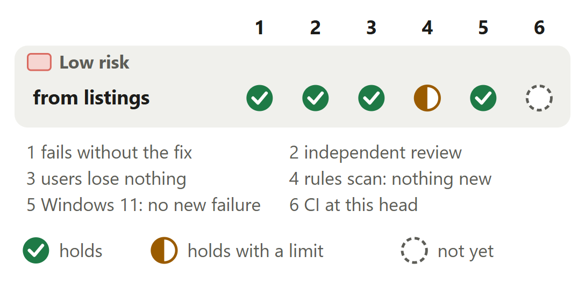

# A walk reads each folder's checkout from its own listing

For [pull request #1176](https://github.com/neralabs/rerail/pull/1176), head 33abe67ccd. [report.html](report.html) is the same report as one page: download it and open it.

## 1. The decision

**Should a walk read whether a folder is a checkout's top from the folder's own listing, instead of asking the disk once per folder?**

1. A folder that stopped being a worktree is read as plain at the next walk.

**We recommend:** approve it: each folder's checkout stays what a lookup made then gives, and a folder that stopped being a worktree is now read as such at the next walk.

| Size | Risk and review | Waits on | Not verified |
|---|---|---|---|
| 572 lines in 8 files: 171 ship, 401 are tests and text | Standard. The automated reviewer can approve. | Nothing. No CI run at this head yet: not pushed. | 3 |

## 2. Intent, and the gap

| Change | Intended | Found | Now |
|---|---|---|---|
| A lookup per folder | A lookup per folder _(code comment)_ | An lstat per folder _(CPU profile, Windows 11)_ | Closes the gap. |
| A removed worktree | What a lookup gives _(our reading)_ | The removed worktree kept _(counted, two systems)_ | Closes the gap, changes answer 1. |

Found on 26 November 2026 in a CPU profile of the daemon on a Windows 11 machine, then counted on Linux x64 and Windows 11.

Sources at main, and causes

| Change | Where main states the intent | The cause, and what was measured |
|---|---|---|
| A lookup per folder | `walkView` in `src/engine/code-rule/code-rule.ts` at `main`: "so a walk costs a lookup per folder where the auditor would make one per file". | `folderOwner` runs `#owner` for each folder as its parent's listing names it; `#rootOf` asks `holdsGitEntry`, an `lstat` of its `.git`, before the folder is listed. |
| A removed worktree | `CheckoutOwners` in `src/engine/catalog/checkout-owner.ts` at `main` keeps each folder's root in `#roots` until the recorded checkouts change. | `#gitRoot` returns the root kept for the folders below the removed worktree's top without looking at its `.git` again. |

## 3. Where to look

1. **Read first**, 8 min: `walk-folder-owners.ts`: `listed`, `ignored`, `#parents`. Does every folder with no `.git` get what its full lookup would give, plain roots included?
2. 4 min: `code-rule-bridge.ts`, `checkout-code-rule-router.ts`, `code-rule.ts`, `checkout-owner.ts`.

**Then skim**, 4 min: One new test file counts the disk calls and checks each file's checkout. One existing case writes a file to make the lookups walks no longer make.

## 4. Risk against verification

Start with `listed` and `ignored` in `walk-folder-owners.ts`; the walk's own change is the order it reads a listing in.

Each limit, and each check that does not hold yet

| Change | Check | Its limit, or why it does not hold yet |
|---|---|---|
| from listings | rules scan: nothing new | Each folder's `.gitignore` is still looked at once a walk; that is in Git's ignore answers. |
| from listings | CI at this head | No CI run at this head yet. |

## 5. The changes

**Checkouts read from each listing**, low risk: Per walk of 200 folders: 200 looks at their `.git` at `main`, none here.

**6. The decisions:** we made no choice here that a maintainer could have made differently.

<b>7. How it fits</b>

It merges with `main` as it stands, and with #1076, #1126 and #1162: `git merge-tree` exits 0 for each. #1162 edits other functions of `code-rule-bridge.ts`.

<b>8. What is not covered</b>: 3 not verified, 2 limits that stay

1. **Each folder's `.gitignore`** is still looked at once a walk on the main thread, in Git's ignore answers.
2. **A CPU profile at the head** was not taken; the counts come from the new cases.
3. **macOS** never ran.

**Limits that stay**

- Each lookup left still reads the recorded checkouts' version first.
- A session folder outside every checkout still looks each folder up.

## 9. What we ask of you

We ask no ruling.

Answer 1 asks no ruling. A router made then gives the same checkout; the case pins it.

<b>10. Evidence</b>

The description on GitHub is the record. "How you tested it" holds the runs at `main` and at this head.

| Where | What ran | Result |
|---|---|---|
| Linux x64 | The case file at `main`'s source and here | `main`: 3 of 6 fail. Here: 6 of 6. |
| Windows 11 | The case file at `main`'s source and here | `main`: 3 of 7 fail. Here: 7 of 7. |
| Windows 11 | The case file, 30 runs beside its shard neighbours | 30 of 30, 32 cases in each round. |
| Linux x64 | 5 mutants of the deciding lines | Four fail the cases they decide; the fifth matters only where `.GIT` is `.git`. |

**Sources.** The branch and its diff, read on 27 November 2026. Rerail at `main` 06b02ed311 for the quoted intent.

