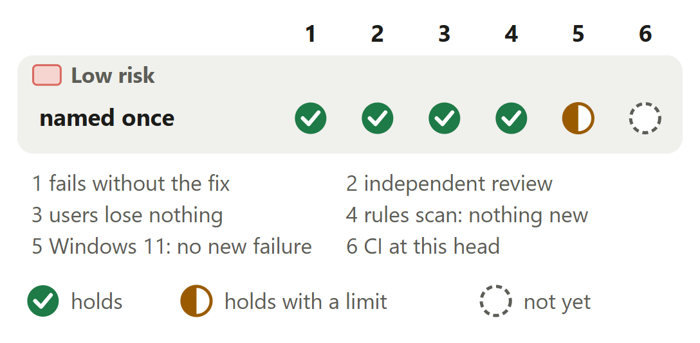

# A walk names each file without path.relative

For [pull request #1183](https://github.com/neralabs/rerail/pull/1183), head 0e0c99965b. [report.html](report.html) is the same report as one page: download it and open it.

## 1. The decision

**Should a walk name each file it finds by cutting the session folder off its path, instead of working the path out again with `path.relative`?**

**We recommend:** approve it: the paths are the same, and a path the walk did not build still goes through `path.relative`.

| Size | Risk and review | Waits on | Not verified |
|---|---|---|---|
| 264 lines in 3 files: 27 ship, 237 are tests and text | Standard. The automated reviewer can approve. | Nothing. No CI run at this head yet: not pushed. | 2 |

## 2. Intent, and the gap

| Change | Intended | Found | Now |
|---|---|---|---|
| A file's session path | The path from the root _(code comment)_ | Resolved again per file _(CPU profile, Windows 11)_ | Closes the gap. |

Found on 26 November 2026 in a CPU profile of the daemon on a Windows 11 machine, then counted on Linux x64.

Sources at main, and causes

| Change | Where main states the intent | The cause, and what was measured |
|---|---|---|
| A file's session path | `sessionPath` in `src/engine/code-rule/code-rule-bridge.ts` at `main`: "`absolute` relative to the walk's root (the session folder), `/`-separated, as the auditor names paths". | `#observeRegularFile` calls `sessionPath(walk.discovery.root, absolute)` for each file; `path.relative` resolves both paths again each time. |

## 3. Where to look

1. **Read first**, 4 min: `code-rule-bridge.ts`: `walkPath` and its seven callers. Is every path given to `walkPath` one the walk built from its root?

**Then skim**, 3 min: One test file counts the `path.relative` calls naming a file or a folder, and compares each path the walk hands on with what `path.relative` makes of it. One release note.

## 4. Risk against verification

Start with `walkPath`; the rest is its seven calls.

Each limit, and each check that does not hold yet

| Change | Check | Its limit, or why it does not hold yet |
|---|---|---|
| named once | Windows 11: no new failure | Other per-file costs of a walk, the file stamp and Git's ignore question, are left as they are. |
| named once | CI at this head | No CI run at this head yet. |

## 5. The changes

**Each file named once**, low risk: Per walk of 200 folders: 600 `path.relative` calls at `main`, none here.

**6. The decisions:** we made no choice here that a maintainer could have made differently.

<b>7. How it fits</b>

It merges with `main` as it stands, and with #1076, #1174, #1179, #1180 and #1181: `git merge-tree` exits 0 for each. It keeps #1176's read of each folder's listing and names that folder with `walkPath`; the cases of #1162 and #1176 pass here unedited.

<b>8. What is not covered</b>: 2 not verified, 1 limit that stays

1. **A CPU profile at the head** was not taken; the count comes from the new case.
2. **macOS** never ran.

**Limits that stay**

- Paths a walk did not build, such as the changes Git lists, still go through `path.relative`.

## 9. What we ask of you

We ask no ruling.

<b>10. Evidence</b>

The description on GitHub is the record. "How you tested it" holds the runs at `main` and at this head.

| Where | What ran | Result |
|---|---|---|
| Linux x64 | The case file at `main`'s source and here | `main`: the count case fails, the comparison passes. Here: 2 of 2. |
| Windows 11 | The case file at `main`'s source and here | `main`: the count case fails, the comparison passes. Here: 2 of 2. |
| Linux x64 | The 20 test files importing `code-rule-bridge.ts`, at `main` and here | `main`: 19 files, 730 passed. Here: 20 files, 732 passed. |
| Linux x64 | 4 mutants of the deciding lines | Three fail a case; the fourth matters only on Windows. |

**Sources.** The branch and its diff, read on 27 November 2026. Rerail at `main` f340b24d8d for the quoted intent.

