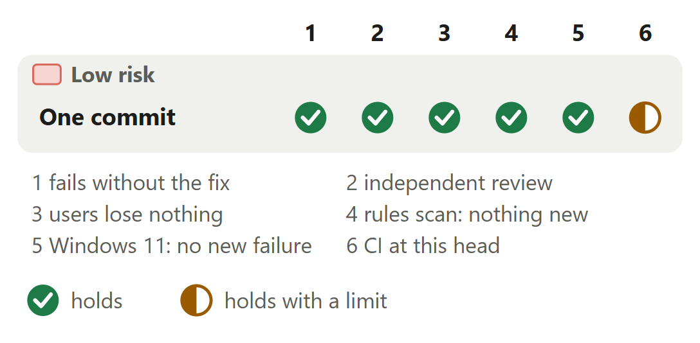

# The API's session gaps case passes on slow disks

For [pull request #917](https://github.com/neralabs/rerail/pull/917), head a9a9574c9. [report.html](report.html) is the same report as one page: download it and open it.

## 1. The decision

**May the API's session gaps case write its 600 later events in one transaction on its own connection, not 600 commits through the store?**

**We recommend:** approve it: on a Windows 11 hard disk the case then passed 40 of 40 where `main` failed every run, and it still has more than a transcript page of events after its gaps.

| Size | Risk and review | Waits on | Not verified |
|---|---|---|---|
| 13 lines in 1 file: 0 ship, 13 are the tests it changes, 0 are other tests and text | Fast. One test case, no product code. | Nothing. No CI run on GitHub yet: not pushed. | 1 |

## 2. Intent, and the gap

| Change | Intended | Found | Now |
|---|---|---|---|
| Gaps past a page | More than a page after gaps _(code comment)_ | 600 commits on the disk _(timed runs)_ | Closes the gap. |

Found on 19 November 2026: the case ran past its limit on busy Linux x64 machines and on Windows 11; its fixture took the time.

Sources at main, and causes

| Change | Where main states the intent | The cause, and what was measured |
|---|---|---|
| Gaps past a page | `test/api/api-http.test.ts` at cccb25a8d, the case's comment above its 600 appends. | Each `append` is its own commit, and with WAL and `synchronous = FULL` each waits for the disk: 7 to 12 ms on a busy SSD, over 100 ms on a hard disk. |

## 3. Where to look

1. **Read first**, 3 min: `api-http.test.ts`: the case's later events, and the `events` import. Do the rows match what `append` writes, and does the case keep more than a page after its gaps?

**Then skim**, 1 min: Nothing else changes.

## 4. Risk against verification

One change, low risk: a test's fixture; the session store and the API are as they were.

Each half mark's limit

| Change | Check | It holds with this limit |
|---|---|---|
| One commit | CI at this head | No CI run at this head on GitHub yet: the branch is not pushed. |

## 5. The changes

**Later events in one transaction**, low risk: Windows 11 hard disk: `main` failed the case in 23 of 23 runs; here it passed 40 of 40.

<b>6. The decisions</b>

**How does the case get more than a page of later events?**

**We chose** one transaction on the test's own connection, as the support bundle's tests seed theirs. **Would change our mind:** A maintainer who wants this case to append through the session store as the daemon does, at the cost of its time on slow disks.

| Option | What a user gets | Cost | What it breaks |
|---|---|---|---|
| One transaction on the test's connection **(chosen)** | One commit for the 600 events: 93 to 290 ms on the hard disk. | 9 added and 4 removed lines in one test file. | The later events skip `append`, which the session store's own tests cover. |
| 501 events through `append` | One page and one event. | One number. | Still 501 commits: past the 30 s limit on the hard disk at its measured rate. |

**Evidence.** On a Windows 11 hard disk `main` 0a3ce014c failed 23 of 23 runs and this head passed 40 of 40; on two Linux x64 machines with 4 cores kept busy `main` failed 2 of 80 and this head passed 80 of 80.

<b>7. How it fits</b>

Nothing has to merge first: `main` 0a3ce014c is merged in. No open pull request edits the test file; they overlap nowhere.

<b>8. What is not covered</b>: 1 not verified, 1 limit that stays

1. **macOS** never ran.

**Limits that stay**

- On a Windows 11 virtual machine the engine's first load in a process took 0.98 to 2.07 s at `main` against 0.29 to 0.31 s before #508; the case's first API read sets it off. Not changed here.

## 9. What we ask of you

We ask no ruling.

<b>10. Evidence</b>

The description on GitHub is the record: "How you tested it" holds the runs on `main` and here.

| Where | What ran | Result |
|---|---|---|
| Windows 11 | The case alone, temp folder on a hard disk, at `main` 0a3ce014c and here, side by side | `main`: 23 of 23 timed out. Here: 40 of 40 passed. |
| Linux x64 | The case alone, 40 runs each at `main` and here in turn, 4 cores kept busy, on two machines | SATA SSD: `main` 2 of 40 timed out, 2.37 to 8.55 s; here 40 passed. NVMe: `main` 3.41 to 3.78 s of 5 s; here 0.21 to 0.27 s. |
| Linux x64 | The case here with the dropped events' sum taken out of `SqliteSessionStore.gaps` | Failed on its assertion: the case checks the product's count. |
| Linux x64, Windows 11 | The test file whole here, and CI's lint and type-check job on Linux x64 | 27 passed on each; the lint job passed. |
| Linux x64 | The automated reviewer's rules at `main` 0a3ce014c over the diff | No new finding, with the published 0.1.5 and with Rerail built from `main`. |

**Sources.** The branch at a9a9574c9 and its diff against `main` 0a3ce014c, read on 20 November 2026; runs at a9a9574c9 and at `main` 0a3ce014c on a Windows 11 machine and two Linux x64 machines.

