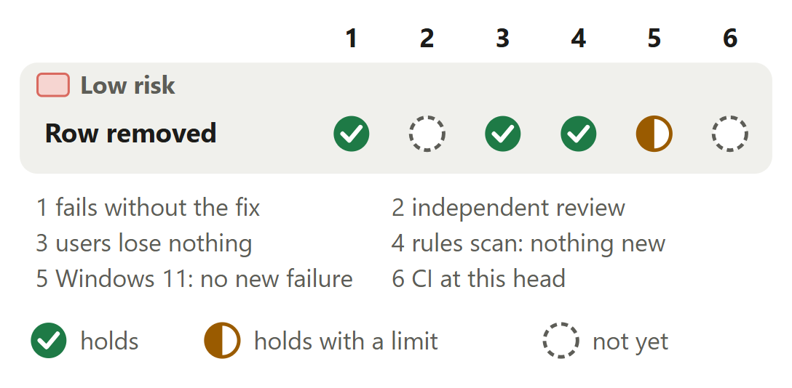

# The daemon survives a running session's row removed from the database

For [pull request #815](https://github.com/neralabs/rerail/pull/815), head 8cc76ca6d. [report.html](report.html) is the same report as one page: download it and open it.

## 1. The decision

**May the runtime read a session's saved settings without its row, and write its claim again when the row comes back?**

**We recommend:** approve it: the daemon no longer exits when another program removes a running session's row, that session's scans are claimed as on `main`, and settings read as on `main`.

| Size | Risk and review | Waits on | Not verified |
|---|---|---|---|
| 314 lines in 6 files: 85 ship, 229 are tests and text | Quick. 85 source lines, 40 of them comments; not high-risk. | Nothing. No CI result at this head yet. | 2 |

## 2. Intent, and the gap

| Change | Intended | Found | Now |
|---|---|---|---|
| The control timer's reads | A missing row is put back _(code comment)_ | The timer's throw ends the daemon _(real daemon runs)_ | Closes the gap. |
| The session's claim | Scans run in the session's owner _(code)_ | The claim never came back _(real daemon runs)_ | Closes the gap. |

Found on 18 November 2026 by reading `main`'s code after a test met it, then made through a real daemon on Linux x64.

Sources at main, and causes

| Change | Where main states the intent | The cause, and what was measured |
|---|---|---|
| The control timer's reads | `src/runtime/session-store.ts` at 890802859, `append`: "its row is gone, so put it back and keep going". `src/runtime/runtime.ts:2593`: `this.#controls.hasUserSettings(sessionId) ? this.#controls.getSettings(sessionId).settings : this.#auditSettings`. | `hasUserSettings` and `getSettings` look the session's row up first (`requireSession`), which throws `Unknown Rerail session` when it is gone. The timer calls them for each session the database's `data_version` has moved past, inside `setInterval`'s callback, which nothing catches; Node then ends the process with code 1. Each event of the session makes the same read before it is recorded. |
| The session's claim | `src/runtime/runtime.ts`, `#registerOwner`: the claim is written only at the open. `src/engine/audit/audit-control.ts`, `requestAudit`: `else if (!current.active) error = "Session has no live owning runtime"`. | A program that removes a session's rows removes its row in `policy_session_owners` with them. `main`'s daemon exited, and the next hook's daemon opened the session and claimed it; a daemon that runs on put back only the session's row. |

## 3. Where to look

1. **Read first**, 4 min: `runtime.ts`: `#scheduleAuditRequests`, `#claimAgain`, `#writeOwedClaim`. Folder and repository as the row held? Only held sessions claimed? A failed claim write kept off the event's write?
2. 3 min: `session-store.ts` and `audit-control.ts`: `append` calls `onRowPutBack`; `getWorkspaceSettings` takes the repository; `claimAgain`.

**Then skim**, 5 min: Cases remove a session's row: other sessions read on, its event recorded, its scan claimed, another runtime's claim kept, a closing session unclaimed, a refused claim retried.

## 4. Risk against verification

One change, low risk: the settings read without the row, and the claim written again with the row.

Each limit, and each check that does not hold yet

| Change | Check | Its limit, or why it does not hold yet |
|---|---|---|
| Row removed | independent review | No second reader has reviewed this round of the change yet. |
| Row removed | Windows 11: no new failure | Windows 11: the 36 importer files pass here (568, nothing outside `main`'s baseline); the follow-up's two cases pass in 20 of 20 runs, the earlier eight in 19 of 20 (one 20 s limit under load); every mutant caught. |
| Row removed | CI at this head | No CI run at this head on GitHub yet: the branch is not pushed. |

## 5. The changes

**Settings read and claim kept**, low risk: Rows removed under a running session: `main`'s daemon exits in 12 of 12 runs; here it runs on, scans complete.

<b>6. The decisions</b>

**Read the settings without the row, or skip a session whose row is gone?**

**We chose** the read without the row: nothing fails, so nothing is skipped and nothing needs saying. **Would change our mind:** A setting that must follow a session's row rather than its folder, such as one saved per session.

| Option | What a user gets | Cost | What it breaks |
|---|---|---|---|
| Read the settings without the row **(chosen)** | The daemon keeps running; that session keeps its settings, its events and its record. | One read where `main` made two to six. | Nothing found: every test file that imports a changed module fails nothing `main` passes. |
| Skip a session whose row is missing, said once | The daemon keeps running. | A store method or a catch by message, and a log line. | That session takes no settings change until its row is back; skipped in the timer only, its events still fail. |
| Catch whatever the timer throws, or handle uncaught exceptions in the daemon | The process keeps running. | A guard and its memory, or one handler. | That session's events still fail, the read repeats every tick, and other faults hide. |

**Evidence.** The new cases and the real daemon runs on Linux x64 and Windows 11. `SqliteSessionStore.openSession` writes the row from the session's descriptor and the runtime's repository key for it; the runtime holds both while the session is open.

**Read by the folder as spelt and its repository, or as the disk stores it?**

**We chose** the session's spelling and its repository, the facts the row read used. **Would change our mind:** A way 0.1.4's settings are tied to a folder other than its spelling and its repository.

| Option | What a user gets | Cost | What it breaks |
|---|---|---|---|
| The folder as the session spelt it and its repository **(chosen)** | Log mode 0.1.4 saved on Windows under that spelling is read, as on `main`. | One optional argument. | Nothing found. |
| The folder as the session spelt it, no repository | The same in every state the tests make. | Nothing. | Equal to `main` only by an argument about the checkout records. |
| The folder resolved to the spelling the disk stores | Steer where `main` records Log: a steer reaches the coding agent. | Nothing. | `main`'s own case for a folder spelt otherwise fails on Windows 11 in 3 of 3 runs. |

**Evidence.** Windows 11, 3 runs each: the last form fails `main`'s case and both new Windows cases; a store that drops the repository fails the store case.

**Write the held claim again, or make a new one as the open does?**

**We chose** the held claim, only where none is: nothing throws out of the event's write, and another runtime's claim stays. **Would change our mind:** A path that writes a held session's row again without the store's put-back while the daemon runs.

| Option | What a user gets | Cost | What it breaks |
|---|---|---|---|
| The runtime writes the claim it holds again, only where none is **(chosen)** | The removed session's scans are claimed from its next event, as on `main`; another runtime's live claim stays; a closing session gets none. | One constructor option; one insert on the put-back, and one at the next event when that one failed. | Nothing found. |
| Make a new claim there, as the open does (`registerOwner`) | The same scans. | A new token to keep. | It throws when another runtime holds a live claim; from a write made outside a request, that is a rejection nothing handles, which ends the daemon. |
| Write the claim again from the control timer when `claim` finds none | Also a claim removed on its own, which `main` loses too. | `claim` would need the delivery mode: a change to the claim's type and to a suspended session's record. | More than this fix needs. |

**Evidence.** Real daemon runs on Linux x64 at `main`, before this part and with it, three deletes and three restores each; the mutants of each line.

<b>7. How it fits</b>

Nothing has to merge first: it stands on `main` a58b35852. #812, #807 and #738 each edit one of its files elsewhere; trial merges show no conflict of its own.

**The trial merges.** `git merge-tree --write-tree` with the heads of 19 November, 00:25 UTC: #812 (ours, `runtime.ts`) and #807 (`session-store.ts`) merge cleanly; #738 (`runtime.ts`) has no merge conflict beyond its own with `main`. Any order works.

<b>8. What is not covered</b>: 2 not verified, 3 limits that stay

1. **How often** people remove a running session's row is not known: no Rerail command does.
2. **macOS** never ran.

**Limits that stay**

- A file copied over the live database while Rerail runs damages it, and the next start refuses the file: that is not this change's problem, and the documented restore stops Rerail first.
- A claim removed on its own, with the session's row left, stays gone until the session opens again, as on `main`.
- The runtime passing no repository is not caught by a case: in every state the tests make, the checkout recorded at the session's open names the session's repository, so both ties agree. The store's argument is caught on Windows 11.

## 9. What we ask of you

We ask no ruling.

<b>10. Evidence</b>

The description on GitHub is the record: "How you tested it" holds the runs at `main` and here.

| Where | What ran | Result |
|---|---|---|
| Linux x64 and Windows 11 | A real daemon and the Claude Code hook, `main` f41b8fe6c: a session's rows deleted, or a copy from before it began put back, 3 runs each; then `rerail scan --session` in each session; 0.1.5, a delete on Linux x64 | Code 1 after 43 to 291 ms in 12 of 12; the removed session's first edit unsteered in 12 of 12, a later edit steered 1.2 to 5.6 s after it; both scans completed. 0.1.5: code 1 after 213 ms. |
| Linux x64 and Windows 11 | The same before the claim is written again | The daemon ran on in 12 of 12; the removed session's scan failed in 12 of 12 (`Session has no live owning runtime`), and after a restore the other session's too, 6 of 6. |
| Linux x64 and Windows 11 | The same at this change | The daemon ran on in 12 of 12; first edit steered in 12 of 12; both scans completed in 12 of 12; at 54ce899bd again, 6 of 6 on each system. |
| Linux x64 and Windows 11 | `main` 890802859, the same removals, 5 runs each per system (earlier round) | Code 1 after 27 to 295 ms in 20 of 20; neither session's next edit steered. |
| Linux x64 and Windows 11 | The new cases, 20 runs at `main`'s source and 20 here on each system; before the claim part, 20 runs on Linux x64 and 3 on Windows 11 | `main`: 20 of 20 failed on each. Before the claim part: both claim cases failed every run. Here: 20 of 20 passed on Linux x64, 19 of 20 on Windows 11 (one 20 s limit under load; 10 more passed). Each line's mutant caught on both. |
| Linux x64 and Windows 11 | The database refuses the claim write while the next event puts the row back: at b5a9c118f, with 1f2cda899 alone, and here | b5a9c118f: the event's write rejected, 5 of 5 on Linux x64, 20 of 20 on Windows 11. 1f2cda899: no claim after the next event, 5 of 5 and 3 of 3. Here: 20 of 20 passed on each; five mutants caught 3 of 3 on each. |
| Windows 11 | The folder resolved to the spelling the disk stores; a store that drops the repository, 3 runs each (earlier round) | The first fails `main`'s case and both Windows cases; the second fails the store case. |
| Linux x64 and Windows 11 | The 36 test files that import a changed module, at `main` and here in turn; CI's integration job at 4ca6a50db | Windows 11 at 54ce899bd: 568 passed, 0 failed, nothing outside `main`'s baseline. Linux x64: two cases failed here under load; five rounds each, `main` failed them in 3 of 5, here 1 of 5. Integration: 89 passed, 1 failed under load; that file passed 5 of 5 on each side on a quieter machine. |

**Sources.** The branch at 8cc76ca6d (`main` 0cb70bb85 merged into 54ce899bd: b5a9c118f and two commits for the reviewer's follow-up) and its diff against `main` 7ff56e15e, read on 19 November 2026; earlier rounds ran at ea0317242, the tree of 4ca6a50db; runs on Linux x64 and Windows 11 lab machines.

