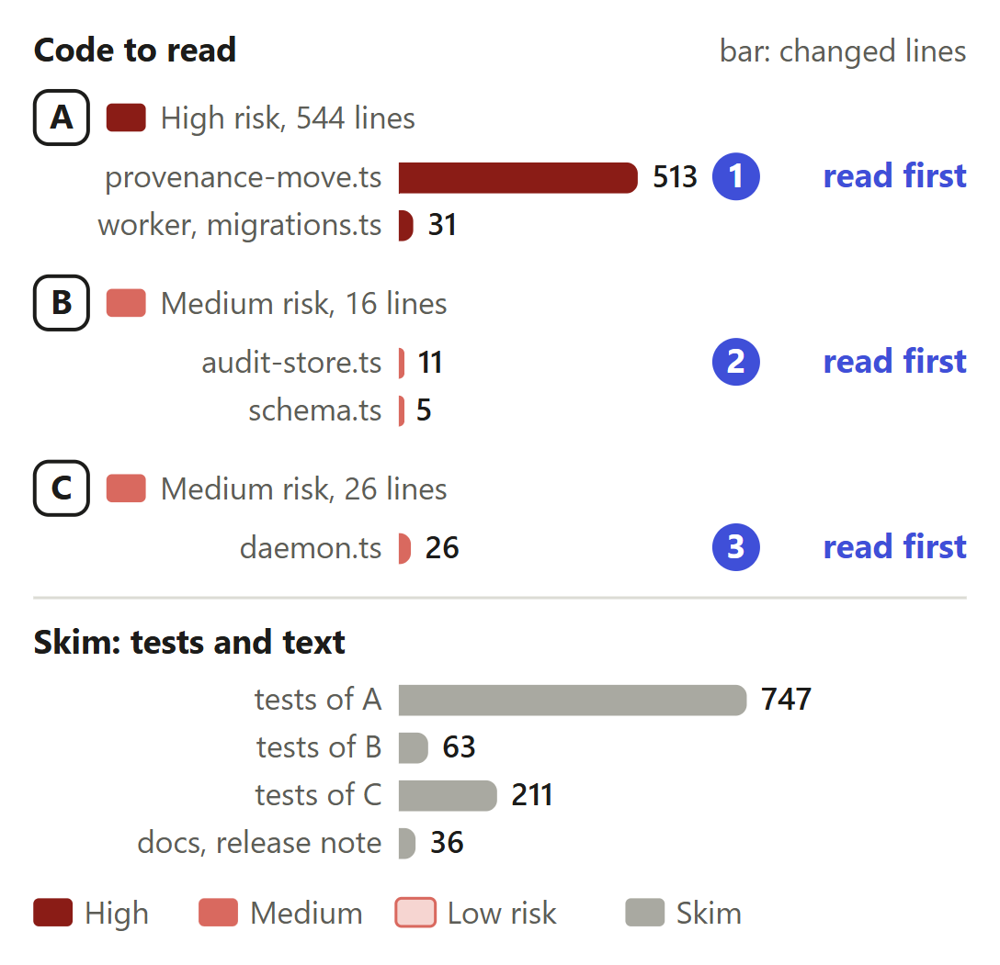
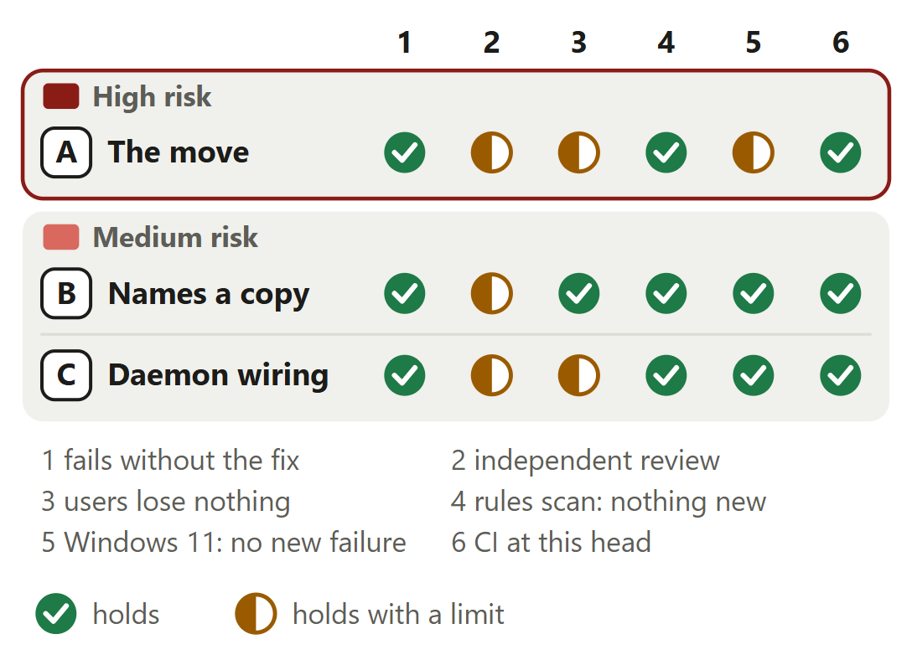

# Audits: recorded audits move to the shared rule provenance after a week

For [pull request #648](https://github.com/neralabs/rerail/pull/648), head e111a35b1. [report.html](report.html) is the same report as one page: download it and open it.

## 1. The decision

**Should recorded audits move to the shared rule provenance, when an older Rerail started again afterwards, or silent for 7 days, then reads `[]` for each?**

1. An older Rerail, restarted after the move or silent 7 days, reads `[]` for moved audits. **Changes the intent.**
2. An audit without rules names a stored `[]`: about 4 bytes more.
3. While the move waits, the daemon reads the file hourly.

**We recommend:** yes, with the 7-day wait, once a maintainer answers #646's question 1 and the [three places marked read first](#3-where-to-look) hold; main's `rerail scrub` gives back 1 MB of 1,438.

| Size | Lane | Waits on | Not verified |
|---|---|---|---|
| 1,643 lines in 11 files: 586 ship, 1,057 are tests and text | Careful. A code owner approves. | #646, question 1. No maintainer has answered. CI passed, 08:16 UTC. | 5 |

## 2. Intent, and the gap

| Change | Intended | Found | Now |
|---|---|---|---|
| A. Recorded audits' own copy | Recorded audits keep their own copy _(docs)_ | 1,279 of 1,438 MB are copies _(one file, Linux x64)_ | **CHANGES THE INTENT: ANSWER 1.** Moves them after a 7-day wait. A maintainer must agree. |
| A. Other writers keep writing | No long write lock on the file _(code comment)_ | No move: the file grows on _(run, Linux x64)_ | Closes the gap. |
| B. The null id | Null id: inline or empty _(code comment)_ | Older Rerail's rule-less audits unseen _(our check, 0.1.4)_ | Closes the gap, changes answer 2. |
| C. The daemon's own thread | Daemon answers a hook within 2 s _(our reading)_ | A move there holds each batch _(test, move inlined)_ | Closes the gap, changes answer 3. |

One 4,000-audit file, 767 rules on, Linux x64, 13 November 2026.

Sources at main, and causes

| Change | Where main states the intent | The cause, and what was measured |
|---|---|---|
| A. Recorded audits' own copy | `docs/how-setup-works.md` lines 580 and 581 at main, about an older Rerail: "The audits it writes, and those recorded before the update, keep their provenance in their own row, where both versions read it." `src/engine/storage/migrations.ts` lines 134 and 135: "The audits a file holds keep their provenance inline, where the audit store reads it". | #530 stores each new audit's provenance once and moves nothing already written. A recorded row keeps its text, and a `VACUUM` cannot free what a row still holds. One file of 4,000 audits with two provenances of 318 KB, written by a Rerail from before #530 on Linux x64: 1,438 MB, of which 159 MB is in use once each audit names the shared copy. |
| A. Other writers keep writing | `src/engine/storage/migrations.ts` lines 135 and 136 at main, in the comment of step `audit-rule-provenance-once`: "moving it here would hold the open's write lock for the whole history (about 10 s for 4,000 audits), and other writers fail once they have waited 5 s." | Every Rerail connection waits 5 s for the write lock (`busy_timeout`, `src/engine/storage/database.ts` line 44 at main), so a move must hold it far less. Each batch here aims at 100 ms, with a pause of 150 ms before it. During the move, 14 writes by another process: 0 failed, the longest wait 53.4 ms, the longest lock hold 250 ms (Linux x64 at the lowest CPU priority, 768027db1). |
| B. The null id | `src/engine/storage/schema.ts` line 411 at main: "The run's rule provenance in \`audit_rule_provenances\`; null when \`rule_provenance_json\` holds it, or it is empty." `src/engine/audit/audit-store.ts` line 668 at main writes `null` for an audit whose provenance is empty. | At d57eee7f3 the wait counted only rows that held a provenance other than `[]`. A 0.1.4 from npm that recorded audits without rules every 2 s read `[]` for 4,000 of 4,000 once the week ended; at main it reads them in full. Such audits come from a checkout with no rules on. At 768027db1 the same run moved 0 audits (Linux x64). |
| C. The daemon's own thread | `src/runtime/daemon-control.ts` line 275 at main: `const PROBE_TIMEOUT_MS = 2_000;`. `src/cli/support-bundle.ts` line 75 speaks of "a daemon that is alive but missed its first 2 s health probe". No text at main says what may run on the daemon's thread. | `moveRuleProvenancesInWorker` runs the batches and the checkpoint on a worker thread with a connection of its own. The daemon's thread only reads, on a read-only connection: at the start, after each pass of the wait and once the worker ends. The test injects a slow checkpoint; with the move inlined at d57eee7f3 it measured 3,013.2 ms (Linux x64). |

## 3. Where to look

1. **Read first**, 20 min: `rule-provenance-move.ts`: `moveBatch`, `stateAt`, `lastOlderWrite`, `whenFree`. Can a batch lose a provenance, or the wait miss an older Rerail's audit?
2. **Read first**, 3 min: `audit-store.ts`: `start`, `storedRuleProvenanceId`. Does every audit of this version name a stored copy?
3. **Read first**, 4 min: `daemon.ts`: `#startProvenanceMove`, `close`. Can the move hold the hooks' thread, or keep a stop waiting?
4. 3 min: A: `rule-provenance-move-worker.ts`, `migrations.ts`. B: `schema.ts`.

**Then skim**, 10 min: No assertion is removed. `main-audit-store.ts` copies main's read path. The docs state answer 1; the release note does not.

## 4. Risk against verification

Start at A: it rewrites recorded rows. No person has reviewed: check 2's half marks.

Each half mark's limit

| Change | Check | It holds with this limit |
|---|---|---|
| A. The move | independent review | Our independent check verified 768027db1, after three rounds that each found a blocker, all fixed. The automated reviewer read e111a35b1: 0 blockers, 0 follow-ups, 0 nits. It does not approve a high-risk path. No person on the team has reviewed. |
| A. The move | users lose nothing | This version reads 4,000 of 4,000 audits as main does before, during and after the move, and after 10 kills. An older Rerail that records weekly reads them in full. On purpose, one started again after the move, or silent for 7 days, reads `[]`: 0.1.4 did for all 4,000 (Linux x64, 768027db1). |
| A. The move | Windows 11: no new failure | The 22 test files of the change and of the modules that import it, at 2f9ea64e0: 479 passed, 17 skipped, 0 failed, nothing new against main's baseline. No Windows run had a real 0.1.4 beside the daemon; the tests that write audits as 0.1.4 does pass there. |
| B. Names a copy | independent review | Our independent check proposed this mark after it measured the loss at d57eee7f3, and verified it at 768027db1. The automated reviewer counts its blocker fixed with it. No person on the team has reviewed. |
| C. Daemon wiring | independent review | The automated reviewer found two nits here at e322936d3, a stop logged as a failure and a failure logged without its stack, and counts both fixed at 2f9ea64e0. Our independent check last read this file at 768027db1, before those two fixes. No person on the team has reviewed. |
| C. Daemon wiring | users lose nothing | A stop ends the move before its next batch and logs nothing, and the next start moves the rest: 20 runs of 20 on Linux x64, 10 of 10 on Windows 11. One limit: the move thread's writable open waits up to 5 s inside SQLite for the write lock, where a stop does not reach it. |

<b>5. The changes</b>

**A. The move, after a week's wait**, high risk. After `rerail scrub`: 1,437 MB at main, 158 MB here once moved.

- **Problem:** A database that grew before #530 keeps its size, and each recorded audit keeps its own copy of the rule provenance. At main `rerail scrub` gives nothing back while each audit keeps its copy.
- **Who meets it:** Everyone whose database grew under 0.1.3 or 0.1.4 and who updates: once, for as long as they keep the history. How many hold such a file is not known.
- **What it does:** `moveState` reads whether audits are left and whether to wait. `lastOlderWrite` finds the last audit of the past 7 days that names no stored copy. `moveBatch` moves up to 100 audits in one immediate transaction, and `moveInBatches` sizes each batch to hold the lock about 100 ms. `whenFree` tries again past another connection's lock. `olderPass` sleeps at most an hour.
- **Risk:** High. It rewrites every recorded audit row on a high-risk storage path, and it decides when an older Rerail starts reading `[]`, which its remote sink then sends. A wrong batch loses a provenance.
- **Check:** `moveBatch`: the insert stores the text the digest was taken of, and the update empties the row in the same transaction. `TAKEN` leaves rows that hold `[]` and audits an older Rerail wrote after the step. `lastOlderWrite` counts any audit with a null id in the window, those before the step included, and `postponed` runs it before each batch. `whenFree` gives up after 34 tries, about 5 s. `olderPass` rethrows a timer error that is no stop.
- **Picture:** One 4,000-audit file after `rerail scrub`: 1,437.2 MB at main, 158.2 MB with this change once the move has run. After 2,000 more audits and no scrub: main's file grows from 1,438.2 to 1,515.8 MB, and the moved file stays at 1,438.3 MB.
- **Method:** one file of 4,000 audits that a Rerail from before #530 wrote with 767 rules on, 1,438.2 MB, on Linux x64 machines of 16 and 32 cores, one run each. Main's scrub of it: main at 383fc99aa. This change's scrub and the 2,000 audits: d57eee7f3 against main at 6cf7e5663. The scrub code is main's, byte for byte.

**B. Every audit names a stored copy**, medium risk. An audit without rules: 410 bytes at main, 414.04 here.

- **Problem:** The wait must tell an older Rerail's audits from this version's. At main an audit without rules has a null id whoever wrote it, so an older Rerail that records only such audits could not hold the move back.
- **Who meets it:** Anyone who runs an older Rerail beside this version in a checkout with no rules on, or whose rule catalog could not be prepared. Found by our independent check with 0.1.4 from npm, on Linux x64.
- **What it does:** `start` calls `storedRuleProvenanceId` for every audit, an empty provenance included, so all audits without rules name one row of `audit_rule_provenances` that holds `[]`. The audit's own row still holds `[]`. The column's comment in `schema.ts` now says a null id marks a row an older Rerail wrote.
- **Risk:** Medium. One line on the path every audit takes. A wrong mark makes the wait miss an older Rerail, or count this version's own audits and never move.
- **Check:** The lookup and the insert run inside `start`'s immediate transaction, as for any provenance. Every reader takes the stored copy or the row's own through `coalesce`, so `[]` reads the same from either. The delete trigger drops the shared `[]` row with the last audit that names it. The package root exports `AuditRow`: a null `ruleProvenanceId` there no longer means an empty provenance.
- **Picture:** The payload of one audit that ran no rules: 410 bytes at main, 414.04 bytes with this change, when the shared copy of `[]` has id 301.
- **Method:** 4,000 audits without rules written after 300 audits with distinct rules, through each side's store, then read from SQLite's `dbstat`: 768027db1 against main at c89f068ed, Linux x64, 16 cores, one run. The shared row adds 72 bytes once, and 72 in its digest index. With the copy at id 0 or 1 an audit adds 0 bytes.

**C. The daemon starts and stops it**, medium risk. While the move waits, the daemon's thread reads hourly: none at main, 30.7 ms at 20,000 audits.

- **Problem:** The move must start without holding the thread that answers hooks, stop with the daemon, and leave a trace when it fails. Main's daemon starts no work of this kind.
- **Who meets it:** Every daemon start on a database that still holds recorded audits to move, and every hour while the move waits. Once nothing is left, a start finds that with one read and takes no write lock.
- **What it does:** `#startProvenanceMove` calls `moveRuleProvenancesInWorker` once the daemon has announced itself, and keeps its abort controller and its promise. `close` aborts the move and awaits it before the remote sink and the HTTP server stop. A failure goes to `daemon.log` through `errorStack`, with the worker's stack. A stop logs nothing.
- **Risk:** Medium. The daemon is on every hook's path. A move that held its thread, or a stop that waited on the move, would delay hooks or a restart.
- **Check:** The call comes after `#announce`, so the daemon serves before it reads for the move. `close` awaits the move first: its writable open can wait up to 5 s inside SQLite, where a stop does not reach it. The rejection handler writes to stderr and ends there, so a failed move never fails the daemon. #657 adds code at the same three places of this file.
- **Picture:** The read the daemon's thread makes each hour while the move waits. Main has none. With this change its median is 1.4 ms with no audit in the week, 9.7 ms with 5,000 and 30.7 ms with 20,000, each audit holding the revisions of 767 rules.
- **Method:** `moveRuleProvenancesInWorker` from the built package on a probe's main thread with a test timer, 6 to 8 passes each, on Linux x64 at the lowest CPU priority, 768027db1. With 100,000 audits without rules in the week, on a 16-core Linux machine: 224.4 ms. A hook's health probe waits 2 s.

<b>6. The decisions</b>

**Move recorded audits at all, and when?** (ask 1)

**We chose** after 7 days with no audit of an older Rerail. **Would change our mind:** a maintainer's answer on #646 that the move should not run.

| Option | What a user gets | Cost | What it breaks |
|---|---|---|---|
| Move after 7 days with no audit of an older Rerail **(chosen)** | The 1,279 MB the copies held are reused by new history, and `rerail scrub` gives them back. An older Rerail that records at least weekly reads every recorded audit in full | With only this version running, the move starts 7 days after the last audit recorded before the update. One read of the file an hour while it waits | An older Rerail started again after the move, or silent for 7 days, reads `[]` for each moved audit: 0.1.4 read `[]` for 4,000 of 4,000 |
| Raise the floor so an older Rerail refuses the file, then move at once | The move at the daemon's first start, and no Rerail reads `[]` for a moved audit: one too old for the file gets an error and leaves it untouched | Not built, not measured. Main's step sets no floor by choice (`src/engine/storage/migrations.ts` lines 136 to 138 at main) | Agent hosts on an older installed version stop sharing the file until they update. Without a floor, a 0.1.4 beside a move at the daemon's first start read `[]` for all 4,000 recorded audits (the first head, Linux x64) |
| Move only when a person runs `rerail scrub` | A person chooses when recorded audits move | Not built, not measured. Until then the file grows as main's does | By the code, an older Rerail reads `[]` for moved audits from then on. Not measured |
| Never move, as main | Every Rerail reads every audit in full | The file keeps its size: `rerail scrub` gives back 1 MB, and 2,000 more audits add 77.6 MB | Nothing |

Before: At main the daemon serves and each recorded audit keeps its rule provenance in its own row. This version and an older Rerail both read it in full. The file keeps its size. After: With this change the daemon serves, finds recorded audits left to move, and asks whether an audit that names no stored copy began in the last 7 days. If so it waits and looks again within an hour. If not it moves them in batches of about 100 ms.

**Evidence.** The real daemon and Rerail 0.1.4 from npm on one 4,000-audit file, on one clock moved by a preload (Linux x64, 768027db1). 0.1.4 recording audits with rules every 15 s across the week's end: 0 moved, 4,000 of 4,000 at every read. The same without rules every 2 s: 0 moved. Started again after the move: `[]` for 4,000 of 4,000. Silent for 7 days and 28 s: the same (d57eee7f3).

**Who gives the freed space back?** (ask 3)

**We chose** `rerail scrub` alone: an automatic `VACUUM` made another process's write fail. **Would change our mind:** a maintainer's answer to question 2 on #646.

| Option | What a user gets | Cost | What it breaks |
|---|---|---|---|
| No automatic `VACUUM`: `rerail scrub`, when a person runs it **(chosen)** | No write of another process fails, as at main: 0 of 14 during the move at 660, 1,160 and 2,162 MB in use, on Linux x64 and on Windows 11 | The file keeps its size until a person runs `rerail scrub`, which takes it from 1,438.3 to 158.2 MB. New history reuses the freed pages meanwhile | Nothing main does not: behind `rerail scrub` at 2,162 MB in use, another process's write fails at 5 s, at main and here alike |
| A `VACUUM` the daemon ends after 4 s, three tries | The space back by itself when the rewrite commits within 4 s | A process of its own, a bound, a retry and their tests: four more files, 651 lines | On Windows 11, 1 of 14 writes by another process failed with `database is locked` at 5.5 s, at 660 MB in use (an earlier head) |
| A `VACUUM` that gives way only to the daemon's own writes | The space back by itself: 1,438 to 158 MB | The same machinery without the bound | Another process's write failed at 5.0 s at 2,162 MB in use on Linux x64, and at 5.6 s at 1,160 MB on Windows 11 (the first head) |

**Evidence.** A trace of every SQL text of the daemon and of its move thread saw no `VACUUM` (Linux x64, 768027db1); the same trace saw one in each `rerail scrub`, its control. After the move, `rerail scrub` holds the write lock about as long as main's on the same file: 488 ms against 439 at 158 MB in use, 6,758 against 6,781 at 2,162 MB (Linux x64, d57eee7f3 against main at 6cf7e5663).

<b>7. How it fits</b>

It stands on main alone; no open pull request needs it. Our #657 conflicts in `src/daemon/daemon.ts`; the team's release, #631, deletes the release note this edits.

Pull request #648 is based on main at c89f068ed, which holds #530 and is merged in. Its merge waits for a maintainer's answer to question 1 on #646. No pull request needs it. In trial merges it conflicts with #657 at three places of one source file, and merges clean with ten others, three of which share a file. The team's release, #631, deletes the release note it edits.

**Trial merges, and shared files.** Trial merges of e111a35b1 with the heads of our open pull requests and of the others that share a file, 14 November 2026. #657 (cf986a055): three conflicts in `src/daemon/daemon.ts`; the second to merge takes main and keeps both sides. Clean: #672, #656 and #562, which share a file, and #652, #658, #673, #674, #677, #678 and #679. #676, #680, #665, #640 and #667 do not merge with main today; #676 and #640 conflict in `migrations.ts`. Of #508, `docs/how-setup-works.md` merges clean. Not tried: #631.

<b>8. What is not covered</b>: 5 not verified, 6 smaller gaps, 5 limits that stay

1. **Question 1 on #646:** no maintainer has answered.
2. **No person on the team** has reviewed or commented.
3. **Histories far larger than 4,000 audits:** the check before each batch was not timed.
4. **On Windows 11** no real 0.1.4 ran beside the daemon.
5. **macOS** never ran.

**Smaller gaps**

- **Where the numbers were measured.** The move, the writes during it and the kills ran at 768027db1 and d57eee7f3. Of the five commits since 768027db1, two change code, a stop during a busy retry and the failure's log line, and three change docs and comments only.
- **Windows 11.** The tests that write audits as 0.1.4 does, with rules and without, pass there. The run with 0.1.4 from npm beside the real daemon was made on Linux x64 only.
- **The move thread's writable open** still waits up to 5 s inside SQLite for the write lock, so a stop cannot reach it there. Not changed; a possible follow-up.
- **Read in the code, not run:** the move starts at most an hour late after the computer sleeps; `rerail.sqlite.pre-update` holds each audit in full until a later version change replaces it; a start time past year 275,760 makes the wait line throw, and the daemon logs that failure once.
- **One Linux run failed one test of main:** among the 22 files at 2f9ea64e0, `database-baseline`'s "leaves adopting a file stamped 1 to the writer while a step that raises the floor is pending" timed out at 5 s. That file alone passed 32 of 32.
- **The first CI attempt at 2f9ea64e0** failed on `test/cli/scrub-cli.test.ts`, "loses no line a process appends to daemon.log or a ledger while it scrubs them", a test of main this change does not touch. It failed the same way on #657's CI. The second attempt passed.

**Limits that stay**

- The file keeps its size until a person runs `rerail scrub`. Behind scrub another process's write can fail at 5 s, at main and here alike: at 2,162 MB in use on Linux x64, 1,160 MB on Windows 11.
- With only this version running, the move starts 7 days after the last audit recorded before the update.
- An older Rerail reads `[]` for each audit this version records, as at main since #530. The audits it writes itself keep their provenance in their own row, and the move leaves them there.
- While an older Rerail keeps recording, `daemon.log` gets the wait line again, at most once an hour: about 390 bytes a line, up to 24 lines a day.
- A daemon killed during the move loses at most one batch's work and no audit: 10 kills each on Linux x64 and Windows 11 lost, doubled or left dangling none, and the next start moved the rest.

## 9. What we ask of you

Ask 1 rules on answer 1.

1. **May recorded audits move after the 7-day wait? Answer on #646, question 1.** We recommend yes: an older Rerail recording weekly loses nothing.
2. **Is 7 days the right wait?** We recommend yes: it covers an older Rerail used weekly.
3. **`rerail scrub` alone for the space, no automatic `VACUUM` (#646, question 2)?** We recommend yes: no other process's write fails unasked.

Answer 2 asks no ruling. The column is unreleased; every reader still reads `[]`.

Answer 3 asks no ruling. Card C has its cost; main has no such read.

<b>10. Evidence</b>

The description on GitHub is the record: "How you tested it" holds the runs, our checks' findings and the measurements, and "The decisions" the options of each choice.

| Where | What ran | Result |
|---|---|---|
| CI on GitHub | The run at e111a35b1, read at 08:21 UTC on 14 November 2026 | Passed on its first attempt: 28 checks passed, 3 skipped, none failed. |
| CI on GitHub | The run at 2f9ea64e0, the commit before the head | Passed on its second attempt. The first failed only on `test/cli/scrub-cli.test.ts`, "loses no line a process appends to daemon.log or a ledger while it scrubs them", a test of main this change does not touch. |
| Linux x64 | The 22 test files of the change and of the modules that import what it changes, at 2f9ea64e0 | 494 passed, 1 skipped, 1 failed: a test of main in `database-baseline` timed out at 5 s. That file alone passed 32 of 32. |
| Windows 11 | The same 22 files at 2f9ea64e0, compared with main's baseline | 479 passed, 17 skipped, 0 failed, nothing new. |
| Linux x64, Windows 11 | The change's two test files, 27 cases, repeated at 2f9ea64e0 | 20 runs of 20 passed on Linux x64, 10 of 10 on Windows 11. The four tests added for the automated review's nits fail on e322936d3's source. |
| Linux x64, 16 cores | The real daemon and Rerail 0.1.4 from npm on the 4,000-audit file, on one clock moved by a preload, at 768027db1 | Only this version: the first audit moved 507 ms after the week's end, all 4,000 within 15.9 s more. 0.1.4 recording across the week's end, with rules and without: 0 moved, 4,000 of 4,000 read in full. Started again after the move: `[]` for 4,000 of 4,000. |
| Linux x64, Windows 11 | Writes by another process and kills of the daemon during the move, at d57eee7f3, and on Linux again at 768027db1 | 0 of 14 writes failed at 660, 1,160 and 2,162 MB in use, on both systems. 10 kills on each: 0 audits lost, doubled or dangling, the integrity check passes, 4,000 of 4,000 read as main. Windows 11 moved 4,000 audits in 23.1 to 33.6 s beside 3 other test runs. |
| Linux x64 | The automated reviewer's rules scan over the diff against main, at 2f9ea64e0 | 0 new findings. Every function the change adds or edits is at complexity 6 or under. |

**What this report adds to the description**

- **The head is e111a35b1, a comments-only commit after 2f9ea64e0.** It re-wraps comments in five files and changes no code line. The automated reviewer counts its nit of 2f9ea64e0 fixed at e111a35b1. The pull request holds 57 commits not on main, 5 of them merges, and 1,615 added and 28 removed lines in 11 files. The branch carries history from before #530 was cut and an automatic `VACUUM` it later removed: review the squashed diff.
- **Trial merges at today's heads.** #657 conflicts at three places of `src/daemon/daemon.ts`. The team's release, #631, removes `.changelog/fixed-audit-history-size.md`, which this edits: seen in its list of files, not merged on trial. If it merges first, this pull request's sentence needs a new entry file. Of #508 only `docs/how-setup-works.md` was merged on trial: clean.
- **The cost of an audit without rules.** The measure is 4.04 bytes at copy id 301, 2 bytes at ids 2 to 127 and 0 at ids 0 and 1. By SQLite's integer sizes a copy id past 32,767 takes one byte more in the row and one in the index entry, 6 bytes in all: our reading, not measured. So "at most 4 bytes" holds up to that id.
- **Asks 2 and 3 are this report's.** The description asks nothing itself and points at #646 for both questions. Ask 2, the length of the wait, is new here. Ask 3 is question 2 of #646, on which this head follows the recommendation of our latest comment there. The automated reviewer's first review named decision 1's floor option, and main's docs describe the floor.
- **Where the review stands on GitHub.** The review decision still shows the automated reviewer's change request on 42bb8f6da. Its reviews of e322936d3, 2f9ea64e0 and e111a35b1 count every blocker, follow-up and nit fixed or no longer applying: the last found 0 blockers, 0 follow-ups and 0 nits. It escalated to three maintainers for the storage path and the decision on #646. All five comments on #646 are ours.
- **The exported `AuditRow` type changes meaning.** The package root exports `AuditRow`. A null `ruleProvenanceId` there meant a provenance held inline or an empty one; it now marks a row an older Rerail wrote. The column came with #530 and is in no release.

**Sources.** The pull request, its reviews, comments, diff and CI on GitHub, and issue #646, read on 14 November 2026. Rerail at main (c89f068ed) for each quoted intent. The automated reviewer's reviews of e322936d3, 2f9ea64e0 and e111a35b1. Our run records and the decision record of the change: each number names its system and its commit.

