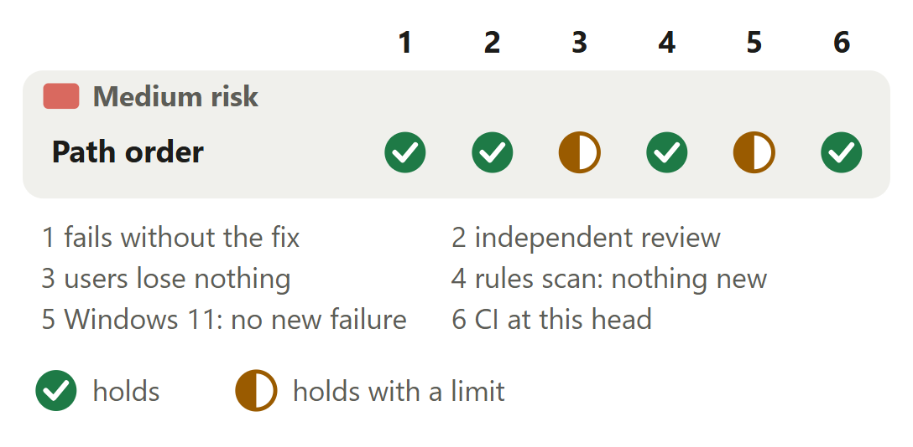

# Audits: the directory walk reads files in path order

For [pull request #635](https://github.com/neralabs/rerail/pull/635), head 664e766aa. [report.html](report.html) is the same report as one page: download it and open it.

## 1. The decision

**Does the walk still read every file it read before, with only the order changed, including when a folder's listing fails partway?**

1. A walk reads in path order: a folder gives the same audit on every machine. **Changes the intent.**

**We recommend:** approve after reading the [one place marked read first](#3-where-to-look), once #654 rules that a walk reads in path order. Closing it instead costs nothing in CI, and audits keep differing by machine.

| Size | Lane | Waits on | Not verified |
|---|---|---|---|
| 202 lines in 5 files: 39 ship, 163 are tests and text | Fast. #654 settles the intent before it is approved. | #654. Its ruling on intent; CI is green at 664e766aa. | 3 |

## 2. Intent, and the gap

| Change | Intended | Found | Now |
|---|---|---|---|
| The walk's order | "follows the file system's entry order" _(a test's comment)_ | A different audit by machine _(CI logs, then tests)_ | **CHANGES THE INTENT: ANSWER 1.** A walk reads in path order. A maintainer must agree. |

Found on 12 November 2026 in CI's unit test jobs. #639 made the test pass the next day.

Sources at main, and causes

| Change | Where main states the intent | The cause, and what was measured |
|---|---|---|
| The walk's order | `test/engine/code-rule/unlisted-text-files.test.ts` line 67 at main (53f5b92a1), a comment #639 put on the test's audit helper: "One log-only audit: its status, and the sorted paths and failures it reports (a directory walk follows the file system's entry order)." Line 74 sorts the failures. The test at line 131 expects `data/dump.raw` before `web/big.ts` (line 141) and now passes in either order. `docs/reference.md` line 875 names the budgets and promises no order. | At main `#auditFiles` pops paths off a stack (`src/engine/code-rule/code-rule-enforcer.ts` line 1636), and `#enqueueAuditDirectory` pushes each entry as `opendir` lists it (line 1698). ext4 lists a folder by a per-filesystem hash, tmpfs newest first, NTFS by name. One `if` counts each file against the 100,000-file and 512 MiB budgets (line 1641). Before #639 main's test failed 22 of 29 "Unit tests (1/2)" jobs of 12 November 2026 on the newer CI runner image, and 0 of 52 on the older. |

## 3. Where to look

1. **Read first**, 5 min: `code-rule-enforcer.ts`: `#enqueueAuditDirectory`, `pushInPathOrder`, `walkOrderKey`. Its `finally` pushes what a failed listing gave. Does every entry main pushed still reach the stack?

**Then skim**, 5 min: One helper comment changes: it held main's words on entry order. No existing assertion changes. Two new tests mock `opendir`. The release note is `changed-`.

## 4. Risk against verification

CI is green at 664e766aa. Two half marks: no walk past the file budget, no whole suite on Windows 11.

Each half mark's limit

| Change | Check | It holds with this limit |
|---|---|---|
| Path order | users lose nothing | At 83e627c0f against main, over 1,741 files on tmpfs and ext4: status, violations and unlisted counts are unchanged, and the walk reads the same files. Under the 20-failure cap the failures are the same set. Over it a plain folder lists what a Git checkout lists. Not rerun since main gained #503. No walk went past its 100,000-file budget. |
| Path order | Windows 11: no new failure | The head's code on Windows 11, Node 24.21.0: both changed test files gave 72 passed, 1 skipped, none failed; the 22 files that import the enforcer gave 259 passed, 2 skipped, both main's own; one did not load, lacking pack test data. Nothing is outside main's baseline. The whole suite ran only in CI, on Windows Server 2025. |

## 5. The changes

**Walk in path order**, medium risk: With 22 failing files, main lists a different 20 on tmpfs than on ext4; this change lists the same 20.

<b>6. The decisions</b>

**Does a walk follow the filesystem's entry order, or read in path order?** (ask 1)

**We chose** path order: the failure list and the budgets stop depending on the filesystem. **Would change our mind:** a ruling in #654 that an audit may differ by machine, or folders of hundreds of thousands of entries outside Git checkouts.

| Option | What a user gets | Cost | What it breaks |
|---|---|---|---|
| Read each folder's entries in path order **(chosen)** | The same failures in the same order on every machine, as a Git checkout gives. The file and byte budgets stop after the same files | One sort per folder. Peak memory 2% to 6% higher on 50,000 to 60,000 files. No measurable audit time | Nothing found. A failure list's order moves. Past 20 failures, which 20 it lists moves too |
| Follow the filesystem's entry order: main's stated intent since #639 | What main gives now. CI is green. An audit follows each machine's filesystem: past 20 failures a different 20 are listed, and a budget stops after other files | Nothing: this pull request closes, and CI needs no change | Nothing in CI. The difference between machines stays, and a result that differs by filesystem is hard to reproduce |
| Sort the failure list when the audit ends | The finished list in path order, when nothing stops the walk | Every failure is held until the end, where a log audit now writes its failures page by page | A budget still stops after different files. Failures written before the end keep the filesystem's order |

Before: At main opendir lists a folder in the filesystem's order, each walkable entry goes on the stack as listed, and the walk takes the last one listed first. After: With this change the walkable entries are collected with a sort key each, sorted by UTF-8 bytes with a folder as its name and a slash, and pushed in a finally with the last in path order first. The walk takes them in path order.

**Evidence.** With main's walk the path-order test's 22 failing files give a different 20 on tmpfs and on ext4. With this change both give the first 20 in path order. The byte-budget test audits the same 16 files for a folder listed in path order and in reverse. Cost, at the first commit, 3 runs each on a 32-core Linux machine: 50,000 files in one folder peaked at 422 to 427 MB at main and 449 to 453 MB here.

**Which order: UTF-8 bytes, JavaScript strings, or the locale?**

**We chose** UTF-8 bytes, a folder as `name/`: Git's order and the native index's. **Would change our mind:** the native index changing its order.

| Option | What a user gets | Cost | What it breaks |
|---|---|---|---|
| UTF-8 bytes (`Buffer.compare`), a folder as `name/` **(chosen)** | Git's order: `B/x.ts`, `a-b.ts`, `a.ts`, `a/b.ts`, `a0.ts` | A small buffer per entry | Nothing found |
| JavaScript string comparison | Git's order for most names | None | Characters above U+FFFF sort before U+E000 to U+FFFF, by UTF-16 code units |
| `localeCompare` | An order that reads well | None | It changes with the machine's locale, the problem this change removes |
| Plain names, no `/` for folders | Almost Git's order | None | Folder `a` sorts before `a-b.ts` and `a.ts`, so `a/b.ts` is read before them, where Git puts it after |

**Evidence.** The native index sorts by Rust `String` comparison, which compares UTF-8 bytes (`native/src/code_rule_dsl/workspace/index.rs` line 453). The new path-order test's 22 names cover upper case before lower case, `-` and `.` before `/`, and `0` after it. It runs through the directory walk and through a Git checkout's index and expects one list from both.

**Is a folder still audited when its listing fails partway?**

**We chose** yes, as at main: a `finally` pushes the listed entries, and the folder is reported. **Would change our mind:** a ruling that an audit stops at the first listing error.

| Option | What a user gets | Cost | What it breaks |
|---|---|---|---|
| Sort and push what was listed, in a `finally` **(chosen)** | The entries listed before the error are audited, in path order, and the folder is reported, as at main | A `try` and `finally` around the listing | Nothing found |
| Push only after a complete listing | Only the folder's failure | The fewest lines | Files main audits go unchecked on a network or FUSE filesystem whose listing fails partway |
| Push as listed, then sort that folder's part of the stack | The same files as main | Still a key per entry, and a sort of a slice of the stack in place | Nothing. More code for the same files |

Before: At main opendir gives 2 of a folder's 5 entries, then fails with EIO. Both are already on the stack, both are audited, and the folder is reported. After: With this change the finally sorts and pushes the 2 entries the listing gave before its error. Both are audited in path order, and the folder is reported.

**Evidence.** The new test "audits the entries a folder listed before its listing failed partway, and reports the folder" mocks `opendir` so one folder's listing throws EIO after two of its five entries. It passes with main's walk on Linux, and at 24741d435, and on the same code after the review, on Linux and on Windows 11. With a walk that pushes only after a complete listing it fails: the audit reads one file and leaves out the two listed ones.

<b>7. How it fits</b>

It stands on main alone, which it merged at 24741d435 with #503 and #636. The change that fixes #594 and three more of ours to follow edit `code-rule-enforcer.ts`; this one adds no conflict to the first.

**The merge of main, and the shared files.** The merge of main (53f5b92a1) had one conflict, in the import lines of `code-rule-enforcer-mechanical.test.ts`; it keeps both sides. Trial merges at 664e766aa with the change that fixes #594, as built on main's line and as carried now: each conflicts in the same files as with main alone at 53f5b92a1 (4 and 27), with the same number of conflicts in this change's two shared files. Open pull requests #640, #562 and #526 also edit `docs/reference.md`, as does #638, merged since, which merges clean with this branch.

<b>8. What is not covered</b>: 3 not verified, 5 smaller gaps, 4 limits that stay

1. **The 100,000-file budget's stop** has no test and no run. One `if` holds both budgets, and the byte budget's stop is pinned.
2. **Windows 11.** The two changed test files and the 22 that import the enforcer ran, not the whole suite. CI ran the whole suite on Windows Server 2025.
3. **macOS** never ran.

**Smaller gaps**

- **Since the merge of main.** CI ran at 24741d435 and at 664e766aa, a maintainer's text commit later. Our runs on the head's code: the changed test files and the 22 that import the enforcer, on Linux and Windows 11, and the rules scan. The 1,741-file comparison last ran at 83e627c0f.
- **Cost at the head.** Audit time and peak memory were measured at the first commit, a0fd11bde. The third commit moves the same sort and push into a `finally` and adds no work, and the later ones change tests only. It takes a rerun of one probe.
- **A test of the file budget's stop.** It needs 100,000 files, or the budgets passed in through the enforcer's options, which is a source change. This pull request adds neither: one `if` holds both budgets.
- **The engine on Windows.** The Windows 11 machine ran the tests with an engine built on 12 November 2026 from an older native tree. The Linux runs used the engine of the merge's own native tree. This change edits no native code.
- **Main's own test.** Since #639 the test that failed CI passes in either order, so it no longer tests this change. The path-order test does: it compares the unsorted list.

**Limits that stay**

- The five-minute budget still stops a walk after different files on slower machines. `docs/reference.md` promises the same failures only where Rerail walks the folders itself, within the budgets; in a Git checkout the native index still follows the filesystem.
- The native index still stops listing at 100,000 files in the filesystem's order, and sorts only what it listed (`native/src/code_rule_dsl/workspace/index.rs` lines 440 to 453). #654 holds it.
- A touched-files audit still takes the paths it is given last first, as at main. A folder among them is walked in path order.
- A folder's entries wait with a sort key each until the listing ends: about half a kilobyte per entry in a folder of 50,000, where peak memory rose 6% (3 runs each, a 32-core Linux machine).

## 9. What we ask of you

Ask 1 rules on answer 1.

1. **Rule in #654: should a walk read in path order, so audits match on every machine?** We recommend yes: results that differ by filesystem are hard to reproduce.

<b>10. Evidence</b>

The description on GitHub is the record: "How you tested it" for the runs and the rules scan, "Decisions" for the options and the cost table.

| Where | What ran | Result |
|---|---|---|
| CI on GitHub | The checks at 664e766aa, read at 19:41 UTC on 13 November 2026, and at 24741d435 (CI run 43473519987, second attempt) | At 664e766aa: 29 passed, 9 skipped (the Rust engine and the automated reviewer's jobs), none failed. At 24741d435: 28 passed, none failed; in its first attempt `Unit tests (2/2)` failed on one test of main in `code-rule-bridge.test.ts`, and `Unit tests (Windows, 2/2)` on one in `claude-status.test.ts`, files this pull request does not edit. One rerun passed both. |
| Linux, 32 and 16 cores | Both changed test files at 24741d435, 5 runs, with the engine built from the merge's native tree; after the review, 1 run on the 16-core machine and 1 each on tmpfs and ext4 on the 32-core one | 73 of 73 passed in each run, at both commits. After the review the 22 test files that import the enforcer passed 261 tests on the 32-core machine, with nothing new against its base run; one did not load, for lack of its pack test data. |
| Windows 11, Node 24.21.0 | Both changed test files on the head's code, 1 run, and the 22 test files that import the enforcer, 1 run, each compared with main's baseline on that machine | Changed files: 72 passed, 1 skipped, none failed. The 22 files: 259 passed, 2 skipped, both main's own; one did not load, for lack of its pack test data. Nothing is outside main's baseline. The changed files' skip is main's own since #503: "audits a Git checkout holding unreadable untracked directories as the walk does" does not run on Windows. |
| Linux, 32 cores | At 24741d435, and again on the same code, with the sort line deleted from `pushInPathOrder`: the path-order test and the byte-budget test, on tmpfs and on ext4 | The path-order test failed through the directory walk and passed through the Git checkout's index, on both. The byte-budget test failed on both: the walk audits the last 16 of 17 files, where the test expects the first 16. With the line in place every run passed. |
| Linux, 32 and 16 cores | The path-order test at ad3b06026 with main's walk (the source file of 6135908eb), on tmpfs and on ext4. Main's own test at 6135908eb, 1 run on each | With main's walk the test failed through the directory walk on both filesystems, on both machines: the 20 failures came in another order and with other members. It passed through the Git checkout's index. Main's own test passed on both: its helper sorts. |
| Linux, 32 cores | Before #639: main's test at e5bdf8b2, eight at a time, on tmpfs, an ext4 root and ten new ext4 filesystems, with and without load | Failed 200 of 200 on tmpfs and 24 of 24 on each of the 7 new filesystems that list `data` first. Failed 0 wherever `web` is listed first. Load changed neither result. With this change, at the first commit, the whole file ran 1,240 times on the same filesystems: 0 failed. |
| Linux, 32 cores | Three corpora of up to 1,741 files, each as a plain folder and as a Git checkout, audited at main, at 83e627c0f and at main again, on tmpfs and on ext4 | Status, violations and unlisted counts are unchanged. The walk reads the same files as main, in path order only at 83e627c0f. Under the 20-failure cap the failures are the same set. Over it a plain folder lists the same failures, in the same order, as the Git checkout. Main run twice gave the same results. |
| Linux, 32 cores | The rules scan as the automated reviewer runs it, on the head's code against its merge base, 53f5b92a1 | 15 findings over the ceiling at the base and the same 15 on the head's code, all in `code-rule-enforcer.ts`, none new. |

**What this report adds to the description**

- **What the sort costs one folder of 100,000 entries.** Our cold check timed the two new functions against main's direct push, 9 rounds taking turns, on a 16-core Linux machine. Listing a folder of 100,000 empty files took a median 152 ms at main and 325 ms here on tmpfs, 167 ms and 329 ms on ext4: under 2% of the time the walk then spends reading those files.
- **The merge of main at 24741d435.** Main at 53f5b92a1 holds #503 and #636. One file conflicted, `code-rule-enforcer-mechanical.test.ts`, in its import lines: the merge keeps #503's `once` and this change's `opendirSync`, `Dir`, `Dirent`, `link` and `opendir`. The diff against main is unchanged in size: 5 files, 191 insertions and 11 deletions, of which 39 lines ship.

**Sources.** The pull request, its diff and its CI on GitHub, read on 13 November 2026. Rerail at main (53f5b92a1) for each quoted intent, and #639's diff for what it changed. The CI logs of 12 November 2026 for how the order was found. Our run records at 24741d435, on the same code after the review, and at earlier commits, and our independent checks.

