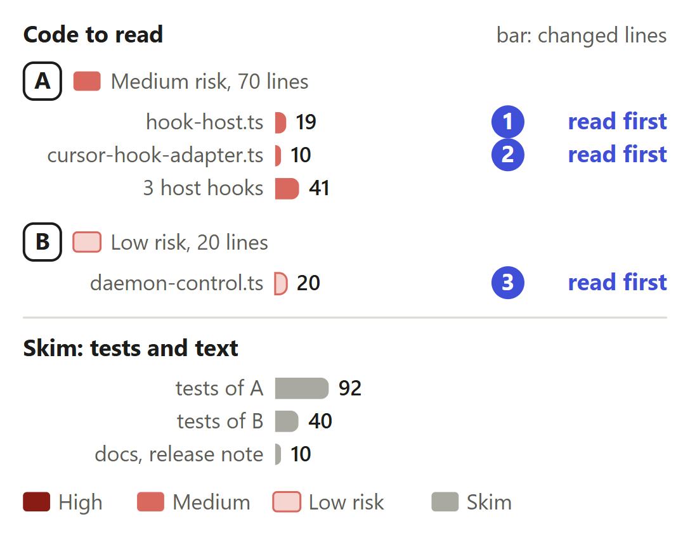
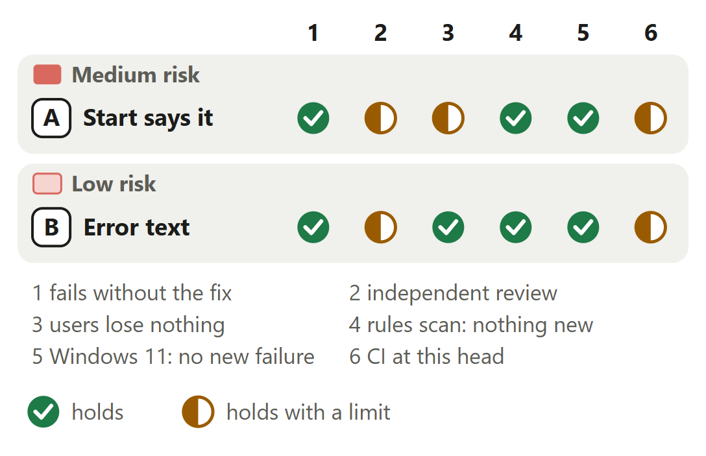

# Hooks: a session's start says nothing is recorded when `RERAIL_AUTOSTART` is off

For [pull request #673](https://github.com/neralabs/rerail/pull/673), head e5656482d. [report.html](report.html) is the same report as one page: download it and open it.

## 1. The decision

**Does each host's session start say that nothing is recorded, exactly when nothing will be recorded?**

1. Cursor's hook asks the agent to begin its first reply with the `rerail status` line. **Changes the intent.**
2. Claude Code and Codex show that line as the session starts. **Changes the intent.**

**We recommend:** approve it once a maintainer answers in #660: 6 of 6 starts with no daemon now say it, and "What is not covered" names the one case left as on `main`.

| Size | Lane | Waits on | Not verified |
|---|---|---|---|
| 232 lines in 13 files: 90 ship, 142 are tests and text | Careful. A maintainer approves: it changes what a session is told. | #660, a review. No maintainer answer; only the automated reviewer approved. | 3 |

## 2. Intent, and the gap

| Change | Intended | Found | Now |
|---|---|---|---|
| A. Cursor's start | The agent relays steers only _(code comment)_ | Cursor's start: `{}` _(hooks started directly)_ | **CHANGES THE INTENT: ANSWER 1.** Asks the agent to relay it. A maintainer must agree. |
| A. Claude Code, Codex | Says `not running`; `rerail status` says why _(docs)_ | No start said it _(hooks started directly)_ | **CHANGES THE INTENT: ANSWER 2.** Both show the `rerail status` line. A maintainer must agree. |
| B. Error text | Each spelling reads the same _(code comment)_ | Errors always said `=0` _(four failing cases)_ | Closes the gap. |

Reported in #660 on 13 November 2026, from hooks started directly on Linux x64.

Sources at main, and causes

| Change | Where main states the intent | The cause, and what was measured |
|---|---|---|
| A. Cursor's start | `src/hosts/cursor/cursor-hook-adapter.ts` lines 162 and 163, the comment above `relayedSteer`: "Cursor shows the person nothing from a hook, so the model is asked to relay each steer's one line itself." Nothing at `main` asks Cursor's agent to relay anything but a steer. | `runCursorHook` (`src/hosts/cursor/cursor-hook.ts` line 20) passes the start's failure on, and the hook's entry answers `{}` and exits 0 whatever fails (lines 24 and 25). Cursor shows a person nothing a hook returns, so only the agent can say the line. |
| A. Claude Code, Codex | `docs/troubleshooting.md` lines 435 to 437: "a hook that finds none logs nothing, since that is what you asked for. `rerail status` then says the daemon is not running" and why. `src/harness/hook-host.ts` lines 111 and 112 and `docs/reference.md` line 611 say the same. `docs/in-session-surfaces.md` line 266: "the footer says \`not running\`". `src/hosts/codex/codex-hook.ts` line 12: a Codex start "says so once". | Measured at f277c6e29 on Linux, three agents under `0` and `false`, 10 starts per case. Claude Code's start printed `{}` and wrote the error to stderr, which named `=0` under `false` too. Codex showed `Rerail ✕ not running · start it with: rerail daemon start`, with no cause. Before #503 the session-start hook read only `0`, so under `false` every session was recorded. |
| B. Error text | `src/runtime/daemon-control.ts` line 765, in the comment above `autostartOff`: "Every reader of the setting asks here, so each spelling means the same to all." Line 782, in `daemonNotRunningMessage`, writes the setting from the environment. Lines 804 and 806 write `RERAIL_AUTOSTART=0` into the two errors. | Line 804 throws the no-daemon error and line 806 the other-package error, each with `=0` written in. With autostart on, `startedDaemon` (line 828) waits for a busy daemon it may not replace; when that daemon answers late from another package, line 806 throws. A second run from a separate clone found that 89513b9f0 printed `=undefined` or `=1` there. fea0d916d fixes it. |

## 3. Where to look

1. **Read first**, 4 min: `hook-host.ts`: `answerAutostartOff`. Can any other hook or failure get the line?
2. **Read first**, 2 min: `cursor-hook-adapter.ts`: `cursorRelayedLine`. Is this all the agent is told?
3. **Read first**, 3 min: `daemon-control.ts`: `daemonEngineEndpoint`, `otherPackageDaemon`. Can either error name a value nobody set?
4. 4 min: A: `claude-hook.ts`, `codex-hook.ts`, `cursor-hook.ts`.

**Then skim**, 4 min: Two assertions of `main` change, in `resident-engine.test.ts` and `claude-hook.test.ts`.

## 4. Risk against verification

Half marks: no person's review, the six starts measured five commits back, CI passed on a rerun.

Each half mark's limit

| Change | Check | It holds with this limit |
|---|---|---|
| A. Start says it | independent review | A second run from a separate clone repeated the measurement at 28c23949f and removed each fix line in turn. The automated reviewer found that a later hook could get the session-start line in a race; 9d532d70f fixes it, and it approved that commit with no finding. The limit: no person on the team has reviewed it. |
| A. Start says it | users lose nothing | Hooks started directly at `main` and at 28c23949f, on Linux and Windows 11: a later hook answers `{}`, no daemon starts and no hook failure is logged, as at `main`. Hook times stayed within the runs' spread. The limit: the six starts were not measured again at 9d532d70f, where six test cases check the same answers. |
| B. Error text | independent review | A second run from a separate clone found that 89513b9f0 printed `RERAIL_AUTOSTART=undefined` or `=1` with autostart on. The automated review found the same. fea0d916d fixes it, and the reviewer approved 9d532d70f with no finding. The limit: no person on the team has reviewed it. |
| A and B | CI at this head | Run 43544083164 at e5656482d, read on 14 November 2026: of the 22 checks on the pull request, 19 pass, 3 are skipped and none fails. The limit: `Unit tests (Windows, 2/2)` failed in the first attempt on two tests, in `claude-status.test.ts` and `merge-assist/runtime-notes.test.ts`; this branch changes neither file. The job was rerun once and passed. |

<b>5. The changes</b>

**A. Session start says it**, medium risk. Starts that say nothing is recorded: 0 of 6 at `main`, 6 of 6 here.

- **Problem:** A person who turned autostart off starts a session while no daemon runs. Rerail records and checks nothing in it. Claude Code's and Cursor's start hooks answer `{}`. Claude Code's footer and Codex's start line say `not running`, with no cause.
- **Who meets it:** Every session start under `RERAIL_AUTOSTART=0` or `false` with no daemon. Since #503, on `main` and in no published version, `false` keeps hooks from starting one too. How many people set the variable is not known. Source: #660.
- **What it does:** `answerAutostartOff` turns the failure of a session's start into an answer with the line `rerail status` prints, only when autostart is off and no daemon runs. Any other hook or failure is rethrown. `runClaudeHook` and `runCodexHook` return the line as `systemMessage`. `runCursorHook` returns `cursorRelayedLine`'s request to the agent. Two docs pages and the unreleased release note say so.
- **Risk:** Medium. It changes what a session is told, and in Cursor what the agent is asked to say. A wrong guard would answer a real failure as if it were the person's choice.
- **Check:** Does `answerAutostartOff` rethrow everything but a session start's `AutostartOffError`? In `runCodexHook` the new catch sits inside the old one: a daemon gone for any other reason must still give `Rerail ✕ not running`. `runHostHook` still logs no failure for an off autostart. Claude Code sends a session start on a resume, `/clear` and a compaction too, so the line shows again there.
- **Picture:** Session starts that say nothing is recorded, with autostart off and no daemon running: 0 of 6 at main, 6 of 6 with this change. The six starts are three coding agents under two settings.
- **Method:** after `npm run build:js`, each agent's registered hook file was started with `node`, the event on stdin and no daemon running, under `false` and under `0`, 10 starts per case, at `main` (f277c6e29) and at 28c23949f on Linux. A second run from a separate clone repeated it on Linux and Windows 11 with the same outputs.

**B. Error text names the setting**, low risk. Off-autostart error under `false`: names `RERAIL_AUTOSTART=0` at `main`, `RERAIL_AUTOSTART=false` here.

- **Problem:** The error a hook gets when autostart keeps it from a daemon names `RERAIL_AUTOSTART=0` whatever the person set. With autostart on, the error for a late-answering daemon of another package names it too.
- **Who meets it:** A person who reads the hook failure log, a hook's stderr or `rerail events`: under `false`, or with autostart on while another package's busy daemon answers late. With change A, none of #660's six starts prints either error.
- **What it does:** `daemonEngineEndpoint` writes the setting as set into the no-daemon error. `otherPackageDaemon` writes it into the other-package error only when autostart is off. With autostart on that error reads "the running Rerail daemon is from another Rerail package; run rerail daemon stop, then rerail daemon start".
- **Risk:** Low. Error text only: when each error is thrown does not change, and the hooks decide as before.
- **Check:** Can either error print `undefined`? The no-daemon error is thrown only after the lookup an off autostart makes, so the setting is `0` or `false` there. `otherPackageDaemon` names the setting only under `autostartOff`. This change is three commits (bcb467316, 89513b9f0, fea0d916d) and four test cases. Tell us, and it leaves as its own pull request.
- **Picture:** Tested cases where the error names a value the person did not set: 4 of 4 at main, 0 of 4 with this change. The cases: no daemon under false, another package's daemon under false, and a late-answering daemon of another package with autostart unset and set to 1.
- **Method:** the branch's `daemon-control.test.ts` over `main`'s source on Linux, one run each. At 28c23949f the two `false` cases fail with `=0`. At 9d532d70f the two late-answering cases fail with `RERAIL_AUTOSTART=0 requires a daemon from the active Rerail package`. All four pass at 9d532d70f.

<b>6. The decisions</b>

**Cursor: ask the agent to relay the line, or stay silent?** (ask 1)

**We chose** the request, as Rerail already asks Cursor's agent to relay a steer. **Would change our mind:** an answer in #660 that the request is out of bounds.

| Option | What a user gets | Cost | What it breaks |
|---|---|---|---|
| Ask Cursor's agent to begin its first reply with the line **(chosen)** | The person reads the line in the first reply, when the agent follows the request. | One more instruction in the agent's context, on that start only. | Nothing measured. No real Cursor session ran with autostart off and no daemon, so whether the agent follows the request is not shown. |
| Cursor's start stays silent | Nothing in Cursor. Claude Code and Codex still say it. | Nothing. | 2 of the 6 starts stay silent. |

Before: At main, with autostart off and no daemon, Cursor's start hook throws, its entry answers {} and exits 0, and Cursor shows the person nothing. After: With this change, runCursorHook catches the failure of a session's start and returns additional_context, which asks Cursor's agent to begin its first reply with the line rerail status prints. Whether the agent follows the request was not run.

**Evidence.** The hook returns `additional_context`: "Rerail checks nothing in this session, and Cursor shows the user nothing from Rerail. Begin your first reply with this line, exactly as written:" and the line. Two hook-host cases check it, and both fail with `runCursorHook`'s catch removed. `relayedSteer` in the same file asks Cursor's agent the same way for a steer. The automated review of 28c23949f passed the question to three maintainers. #660 asks it, and nobody has answered there.

**Where is the person told that nothing is recorded?**

**We chose** a line at the session's start, the one `rerail status` prints. **Would change our mind:** evidence that people set `false` expecting a daemon.

| Option | What a user gets | Cost | What it breaks |
|---|---|---|---|
| A line at the session's start **(chosen)** | The person learns as the session starts, with no command to run. | Nothing on the event path: the answer runs only when the start hook fails for an off autostart. | Nothing measured. The start no longer writes its error to stderr: the line replaces it. |
| `false` starts the daemon again for hooks | Recording under `false`, as before #503. | Nothing. | One setting with two meanings, and a daemon for someone who asked for none. |
| Only `rerail status` says it, as on `main` | Nothing new. | Nothing. | No start says that nothing is recorded until the person runs a command. |
| Claude Code's footer names the cause | The cause beside `not running`, in Claude Code only, for as long as the daemon stays down. | Nothing at the session's start. | Codex and Cursor have no footer, so 4 of the 6 starts still need a line. Not built. |

Before: At main, a session's start with autostart off finds no daemon, throws, logs no failure and starts no daemon. Claude Code and Cursor get {}, and Codex shows not running with no cause. After: With this change the host asks whether the failed hook is a session's start that autostart kept from a daemon. If so it answers with the line rerail status prints. Any other hook or failure is rethrown, as on main.

**Evidence.** 0 of 6 starts say it at `main`, 6 of 6 at 28c23949f, each with exactly the line `rerail status` prints (`daemonNotRunningMessage`), on Linux and on Windows 11. Later hooks answer `{}`, no daemon starts and no failure is logged, as on `main`. Pi and OMP sessions start their daemon whatever the setting says, so they record and need no line.

<b>7. How it fits</b>

It stands on `main` alone and merges clean at c89f068ed. Drafts #674 and #657 conflict in one test file each. B is here because its errors are the same setting's messages, each wrong on `main`. Tell us, and it leaves.

Pull request #673 is based on main at f277c6e29 and merges clean with main at c89f068ed. Nothing waits on it. In trial merges the drafts #674 and #657 each conflict in one test file, the release #631 deletes the release note this edits, and #672 and nine more open pull requests that share a file merge clean.

**Shared files, and what could leave.** #672 shares `docs/reference.md` and `daemon-control.ts`: clean in either order, same tree. #674 shares `hook-host.ts`, clean; `hook-host.test.ts` conflicts where both add imports and cases. #657 shares `daemon-control.ts`, clean; `daemon-control.test.ts` conflicts where both add a case. The second to land keeps both sets of cases. If #631 merges first, this branch's words move to an entry file of their own. Nine more open pull requests share a file, #678 and #667 `daemon-control.ts` too, and merge clean. Change B can leave as three commits (bcb467316, 89513b9f0, fea0d916d) with its four cases.

<b>8. What is not covered</b>: 3 not verified, 6 smaller gaps, 7 limits that stay

1. **Another package's daemon runs, autostart off:** nothing is recorded and the start does not say so, as on `main`. Outside #660.
2. **No real session** ran with autostart off and no daemon, so Cursor's relay is not shown.
3. **macOS:** none of our runs.

**Smaller gaps**

- **CI's real-session job.** `Real Claude Code, Codex, and Cursor sessions` passed at e5656482d, on macOS. Its sessions name an engine socket (`scripts/host/host-smoke.ts` line 416 at `main`), and a hook with a named socket never reaches the new answer.
- **A 16-thread Linux machine under a load test.** `event-adapter-parity` timed out at 5 s twice at 9d532d70f (6.1 s and 6.9 s), and the same way at 28c23949f (8.5 s). It takes 0.36 to 0.57 s on a quiet machine and runs nothing this branch changes.
- **Hook times at the head.** Timed at 28c23949f only. The next four commits add one boolean test in the catch of a failed hook and a helper on an error path. The head, e5656482d, takes "once" out of two docs sentences and changes no code.
- **The merge with today's `main`.** No test ran on it, beyond the trial merge.
- **A test commit that fails on purpose.** ffbcc345d holds the cases for the automated review's two follow-ups before their fixes: 5 failed and 90 passed there on Linux. fea0d916d and 9d532d70f make them pass.
- **The automated review of 28c23949f.** Two follow-ups and one nit. fea0d916d answers the first, 9d532d70f the second, and 352668892 the nit: off Windows the squatted-socket case now asks for the daemon error by name. Its review of 9d532d70f, its latest, has 0 blockers, 0 follow-ups and 0 nits.

**Limits that stay**

- Later hooks, the hook failure log, `rerail status`, when a daemon starts, and Codex's `not running` line for any other cause stay as on `main`.
- The line shows at every session start while the daemon stays down. Nothing remembers that it was said.
- Whether a person in Cursor reads the line depends on the agent following the request.
- With autostart off and no daemon, a session's start no longer writes its error to stderr: the line replaces it. `RERAIL_ENGINE_SOCKET`, which that error named, stays in `docs/reference.md`.
- On Windows, with autostart off, a start whose recorded engine pipe another program holds now answers with the line, where `main` rejected. `claude-hook.test.ts` pins it. Off Windows that start still fails for the daemon that does not answer.
- Pi and OMP sessions start their daemon whatever the setting says, so they record and get no line.
- A script that matches the old error text meets new words. No rule file, API, pack or stored data changes.

## 9. What we ask of you

Asks 1 and 2 rule on answers 1 and 2.

1. **On [#660](https://github.com/neralabs/rerail/issues/660): may the hook ask Cursor's agent to relay the line?** We recommend yes: it relays steers the same way.
2. **On [#660](https://github.com/neralabs/rerail/issues/660): may Claude Code's and Codex's start show the line?** We recommend yes: today no start says why.

<b>10. Evidence</b>

The description on GitHub is the record: "How you tested it" holds the measurements and the failing runs.

| Where | What ran | Result |
|---|---|---|
| CI on GitHub | Run 43544083164 at e5656482d, merged by GitHub into `main` at 4cea86aaa, read on 14 November 2026 | Of the 22 checks on the pull request, 19 pass, 3 are skipped and none fails, on the run's second attempt. In the first, `Unit tests (Windows, 2/2)` failed on two tests: one in `test/hosts/claude/claude-status.test.ts`, and one in `test/runtime/merge-assist/runtime-notes.test.ts`, which `main` holds and this branch does not. This branch changes neither file. The job was rerun once and passed. At 9d532d70f, run 43514746410 passed on its second attempt too. |
| Linux, 32 threads | The 21 test files that import a changed module, at 9d532d70f | 20 files pass and 1 skips (`windows-daemon-launch`, Windows only): 398 passed, 2 skipped, 0 failed. |
| Windows 11 | The same 21 files at 9d532d70f | 21 files pass: 353 passed, 47 skipped, 0 failed. |
| Linux, 32 threads | `integration/resident-engine`, `event-adapter-parity` and `hook-bundle-cost` at 9d532d70f | 18 passed. On a 16-thread machine under a load test, 17 passed and 1 failed, twice: `event-adapter-parity` timed out at 5 s, as it did there at 28c23949f. |
| Linux and Windows 11 | Each agent's registered hook started with `node`, no daemon running, under `false` and under `0`, 10 starts per case, at `main` (f277c6e29) and at 28c23949f; then a later hook and `rerail status`. Repeated from a separate clone | 0 of 6 starts say nothing is recorded at `main`, 6 of 6 at 28c23949f, with the same outputs on both platforms. A later hook answers `{}`, no daemon starts and no hook failure is logged, at both. |
| Linux | The branch's tests over `main`'s source, at 28c23949f and at 9d532d70f. The tests at ffbcc345d | At 28c23949f: 8 of 100 unit cases fail, and the Codex integration case. At 9d532d70f the three later-hook cases pass over `main`'s source and both late-answering cases fail. At ffbcc345d: 5 failed, 90 passed. |
| Linux, a separate clone | Each fix line removed or changed in turn, at 28c23949f and at 9d532d70f | One host's catch removed fails 2 hook-host cases; the guard in `answerAutostartOff`, 6. fea0d916d's source change reverted fails both late-answering cases. `!startsSession \|\|` removed fails the three later-hook cases. A `TypeError` thrown in place of `LiveDaemonError` fails the squatter check. |
| Linux | The rules scan as the automated reviewer runs it (Rerail 0.1.1, complexity pack 0.1.7), at 9d532d70f against f277c6e29 | 0 findings. No function in the six source files counts over 6. |

**What this report adds to the description**

- **The intent at `main`, quoted.** The description quotes no intent. At `main` the docs say a hook that finds no daemon "logs nothing, since that is what you asked for", and a code comment limits what Cursor's agent relays to steers. The pull request rewrites both docs passages. Part 2 gives the quotes, and its folds their lines.
- **A held engine pipe on Windows now gets the line.** The description says the squatted-socket case reaches its check on Windows. A read of the test adds what a person gets: with autostart off, a start whose recorded engine pipe another program holds answers with the line, where `main` rejected. Off Windows the start still fails for the daemon that does not answer.
- **CI's real-session job does not reach the new answer.** The description says no real session was run. CI's job `Real Claude Code, Codex, and Cursor sessions` passed at e5656482d on macOS, but its sessions name an engine socket, read in `scripts/host/host-smoke.ts` at `main`. A real session with autostart off and no daemon stays not run.
- **Our answers to the three read-first questions.** A read of the diff. The line goes only to a session's start whose lookup, under an off autostart, found no daemon running, busy or refusing; a named engine socket, a busy daemon and another package's daemon are rethrown. `cursorRelayedLine` adds two fixed sentences and the line, whose only variable part is `0` or `false`. Neither error can print `undefined`.
- **Claude Code's footer reads `not running` at `main`.** #660 says a person in Claude Code sees nothing. At `main`, `docs/in-session-surfaces.md` line 266 says "the footer says \`not running\`" when the daemon is down, and `withoutDaemon` in `session-presentation.ts` returns it for a started checkout, with no cause. Read, not run. Line 273 there gives Codex's `not running` line for a start with no daemon, and this pull request does not edit it.
- **At `main` the six starts wrote the no-daemon error.** The description says that with this change none of #660's six starts prints either error. At `main` each start wrote the no-daemon error to stderr, with `=0` under `false`: the description's own table shows it for Claude Code. Read in `serveHook` (`hook-adapter.ts`) and `runCodexHook`.

**Sources.** Pull request #673, its diff, CI and reviews, and issue #660, read on GitHub on 14 November 2026. Rerail at `main` (4cea86aaa) for each quoted intent and its line. The description for the runs and the timings, each at the commit it names. Each open pull request's files and head for the shared files and trial merges.

