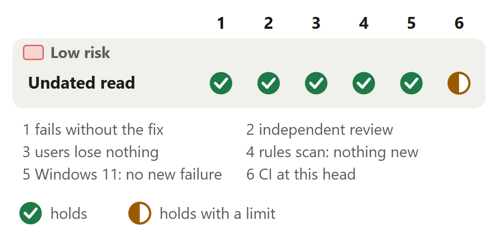

# A file a command is emptying waits for that command's end

For the pull request of branch `JeanFrancoisGagne/bridge-still-writing-race`, not opened yet, head 8e390301d. [report.html](report.html) is the same report as one page: download it and open it.

## 1. The decision

**Does a walk, a first walk too, leave a file a command is emptying to the walk after, with every other file checked as before?**

**We recommend:** approve it: one stamp rule in `stampOfRead` and its first-walk form, cases that fail on `main` every run, and both of `main`'s flaky cases stop failing.

| Size | Risk and review | Waits on | Not verified |
|---|---|---|---|
| 329 lines in 4 files: 41 ship, 288 are tests and text | Quick. Two source files, 35 lines added and 6 removed. | Nothing. No CI at this head yet: the branch is unpushed. | 3 |

## 2. Intent, and the gap

| Change | Intended | Found | Now |
|---|---|---|---|
| A command's half-written file | Left to the walk after the command _(the waiting release note)_ | The emptied file was audited _(CI and 200-run loops)_ | Closes the gap. |

Found on 19 November 2026 (UTC) in three pull requests' CI unit jobs on Linux x64, and in runs of `main`'s cases on Linux x64.

Sources at main, and causes

| Change | Where main states the intent | The cause, and what was measured |
|---|---|---|
| A command's half-written file | `src/engine/code-rule/code-rule-bridge.ts` at cf5d520e4, `stampOfRead`: `return await modifiedSince(absolute, modifiedAt)`, the file's times after the read. | Linux empties a file it truncates before it gives the file its new times. A walk that looked in between saw size 0 with the times of the write before, which came before the command began, and its look after the read showed the same times. A first walk, a baseline walk, dated what it read by those times alone. |

## 3. Where to look

1. **Read first**, 4 min: `code-rule-bridge.ts`: `stampOfRead`, `baselineStamp`, `undatedRead` and `#readObservedFile`. Can a read whose times moved past the earlier observation ever be left to the walk after?
2. 1 min: `file-stamp.ts`: `stampTime`.

**Then skim**, 3 min: Nine cases: the times held while a later or a first walk reads the emptied file; changes from before a command, checked at once; `stampTime`.

## 4. Risk against verification

One change, low risk: the stamp of a read while a command runs.

Each half mark's limit

| Change | Check | It holds with this limit |
|---|---|---|
| Undated read | CI at this head | No CI run at this head on GitHub yet: the branch is not pushed. |

## 5. The changes

**Undated reads left for later walks**, low risk: `main`'s two cases failed 9 and 2 of 200 runs; this change 0 and 0.

<b>6. The decisions</b>

**Date reads by the session's last sight, or stamp every read during a command now?**

**We chose** the session's last sight: only a change in that sight's own timestamp tick is recorded later than at `main`. **Would change our mind:** A failure at this head with the file's times moved past the session's last sight of it: the clock for every read covers that.

| Option | What a user gets | Cost | What it breaks |
|---|---|---|---|
| The session's last sight dates the read where the times did not move **(chosen)** | A file a command is emptying, which the session last saw before it, is left to the walk after that command. | A split and a compare per read while a command runs. | Nothing found; it leaves a file another writer changed after the session last saw it, which the command then empties while a walk looks and reads inside the truncation. |
| Stamp every read during a command with the clock | That file too. | A change made before the command began is checked at the command's result, later than at `main`. | The case that pins no loss. |
| Look at the times again later | Most interleavings, by timing. | A wait: the times landed 5 to 26 ms after the size here, with no bound. | A slow machine. |

**Evidence.** Traced at `main`, 5 of 5 failures in 100 runs had the same order: the walk the open leaves running saw `a.py` with size 0 and the `x = 2` times during the test's `writeFile(path, "")`, and again after its read.

**Keep a first walk's earlier observation, or stamp the read with the clock?**

**We chose** keep the observation it compared with: the session's own from before a quiet spell, or the folder's shared one. **Would change our mind:** A failure of the quiet-session case at this head, or a fresh session in a folder no session walked.

| Option | What a user gets | Cost | What it breaks |
|---|---|---|---|
| Keep the earlier observation **(chosen)** | A first walk leaves the file to the walk after, after a quiet spell or in a folder another session walked. | A compare per read while a command runs; no clock. | Nothing found; it leaves a fresh session in a folder no session walked. |
| Stamp it with the clock | The same after a quiet spell. | A first walk holds back only a file the session saw itself. | With the shared observations, another program's change from before a fresh session read as the session's. |

**Evidence.** Traced at `main`, the quiet-session case's extra audit came from the reopened session's second walk; its first walk never read the file while a command ran, in 400 runs.

<b>7. How it fits</b>

Nothing has to merge first: it stands on `main` c21947263, with the 0.2.0 engine, merged into the branch. #811, merged on 19 November, edited the same two files: the sources merged cleanly, and the test file kept both changes' cases.

**The files it shares.** `code-rule-bridge.ts` and its test file with #738 (open; its head already conflicts with `main`). Any order works.

<b>8. What is not covered</b>: 3 not verified, 1 limit that stays

1. **Another writer's change** made after the session last saw the file, then emptied by the command inside the truncation's window, is still taken: no fact at the read tells it apart.
2. **A fresh session** in a folder no session has walked, whose first command empties a file inside its first walk's look and read: no observation dates it.
3. **macOS** never ran.

**Limits that stay**

- `discovers a command's shell write that races the startup snapshot read` failed now and then as a Log audit of the command's write: the defect #811 fixed, not this one.

## 9. What we ask of you

We ask no ruling.

<b>10. Evidence</b>

The description on GitHub is the record: "How you tested it" holds the runs at `main` and here.

| Where | What ran | Result |
|---|---|---|
| Linux x64 | The later walk's case and the first walk's two cases at `main` (with #811), the branch before the first walk's rule, and here, 20 runs a side | `main` failed 20 of 20 each; the branch before, the first walk's cases 20 of 20; this change 0. |
| Windows 11 | The same three cases at `main` and here, 20 runs a side | `main` failed 20 of 20 each run; the branch before, the first walk's two cases 20 of 20; this change 0 of 20. |
| Linux x64 | `main`'s two flaky cases, 200 runs a side by turns | Bridge case: `main` 9, this change 0. Quiet-session case: `main` 2, this change 0. |
| Linux x64 and Windows 11 | Where it meets #811: a command empties the file and ends as a walk begins, the times held (a forced state: no single command can hold them past its own end) | Here one audit, the agent's edit, every run; `main` and this change without #811 log it as another program's write every run. |
| Linux x64 and Windows 11 | The real runtime, engine and a contract rule, only the times held, 5 runs a side, after a quiet spell too | `main` steers a committed line as the agent's every run; this change never does, and steers the command's own violation as `main` does. |
| Linux x64 | The quiet-session case at `main` with a trace, alone and under a load the run made itself | `main` failed 1 and 1 of 200; each extra audit came from the reopened session's second walk. |
| Linux x64 | A walk of 2,000 changed files beside a running command, and an edit's result beside it, 28 walks a side | Median 55 ms at `main`, 57.5 ms here; the edit 2 to 3 ms on both. |
| Linux x64 and Windows 11 | The 15 test files of the changed modules and those importing them, and the quiet-session case's file, against `main` | None failing that `main` does not: 470 passed here, 461 at `main` on Linux x64; 470 passed on Windows 11. |

**Sources.** The branch at 0f40448f5 and its diff against `main` cf5d520e4, read on 19 November 2026; the CI logs of three pull requests' unit jobs of 19 November.

