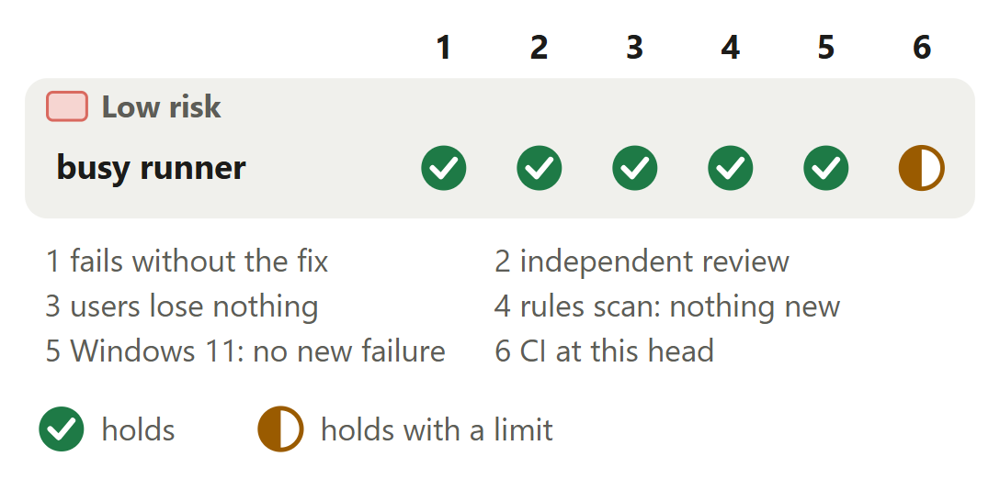

# Two test cases hold on a busy runner

For [pull request #1055](https://github.com/neralabs/rerail/pull/1055), head 21f1a24edb. [report.html](report.html) is the same report as one page: download it and open it.

## 1. The decision

**May two test cases that `main`'s CI failed on busy runners assert the fact itself: rows read, and time for equal work?**

**We recommend:** approve it: test code only; `main`'s unit jobs failed each case once on 24 November with nothing wrong in the product, and mutants of the move and of a scrubber rule fail the new assertions.

| Size | Risk and review | Waits on | Not verified |
|---|---|---|---|
| 165 lines in 2 files: 0 ship, 165 are the tests it changes, 0 are other tests and text | Fast. Two test files, no product code. | Nothing. CI on GitHub runs at this head. | 3 |

## 2. Intent, and the gap

| Change | Intended | Found | Now |
|---|---|---|---|
| The move's reads | No row read past the step _(test name)_ | A 25 ms bound read 31 ms _(CI run)_ | Closes the gap. |
| The scrubber's growth | The scan's cost grows linearly _(test name)_ | A linear scan read as quadratic _(CI run)_ | Closes the gap. |

Found on 24 November 2026: `main`'s own CI failed on six of its seven pushes, each on a different case; these are two.

Sources at main, and causes

| Change | Where main states the intent | The cause, and what was measured |
|---|---|---|
| The move's reads | `test/engine/audit/audit-rule-provenance.test.ts:1074` at `main` be0def9c3. | A time stood for a fact: which rows the move's statements return. |
| The scrubber's growth | `test/engine/secret-scrub.test.ts:233` at `main` eefe9a74b. | A pass shorter than the scheduler's time slice can end uncut while a longer one is almost always cut. |

## 3. Where to look

1. **Read first**, 5 min: `audit-rule-provenance.test.ts`: `countAuditReads()` and the move case. Do the counts (20 moved, 26 rows) show that no row past the step was read?
2. 3 min: `secret-scrub.test.ts`: the linear-time cases.

**Then skim**, 1 min: Nothing else changes.

## 4. Risk against verification

One change, low risk: two test files; the move, the scrubber and every rule are as they were.

Each half mark's limit

| Change | Check | It holds with this limit |
|---|---|---|
| busy runner | CI at this head | CI on GitHub runs at this head; each of the two cases failed a unit job of `main` on 24 November. |

## 5. The changes

**Two cases assert the fact**, low risk: `main`'s unit jobs failed a 25 ms bound and a timing ratio; both cases now assert the fact.

<b>6. The decisions</b>

**How does a case show that the move reads no row past the step?**

**We chose** the helper counts the rows and the text the reads of audits return, and each case asserts its exact count. **Would change our mind:** A better-sqlite3 build with SQLite's statement counters, which would count the rows SQLite reads, those it does not return included.

| Option | What a user gets | Cost | What it breaks |
|---|---|---|---|
| Count rows and text returned at the statement **(chosen)** | A case that fails only when the move reads more rows, on any machine. | 77 added and 41 removed lines in one test file. | It cannot see a row SQLite reads and does not return. |
| Raise the bounds to 50 or 100 ms | One edited number a case. | Nothing. | Still a clock: a slower runner fails it again, and a larger bound hides more reading. |
| Count pages read through SQLite's VFS or the system's read counters | Every row SQLite reads. | A counter better-sqlite3 does not give. | The system's counters differ by system and count the page cache differently. |

**Evidence.** Two mutants of the move fail the counts with 2,068 and 29 rows where the case expects 26; all 60 runs at the head read the same counts.

**What does the scrubber's case time, so that load does not read as growth?**

**We chose** equal work on both sides: four quarter-megabyte passes against one megabyte pass, alternating, the fastest turn of each. **Would change our mind:** A counted fact for the scan's work, which V8's regular expression engine does not give.

| Option | What a user gets | Cost | What it breaks |
|---|---|---|---|
| Equal work on both sides, bound 2 **(chosen)** | A linear cost reads 1 and a quadratic one 4; load cuts into both sides alike. | The timed cases scan about 10 MB of text each where they scanned 6.6 MB. | Nothing: the fixed 50 ms allowance is gone. |
| One pass of each, the fastest of several, in turns | Less text scanned. | Nothing. | Beside busy processes it still read a linear scan at up to 8.4 times. |
| The thread's CPU clock | A reading other processes do not stretch. | Nothing. | On Linux it read in steps of about 4 ms, as long as a quarter pass. |

**Evidence.** A quadratic JWT rule fails the ratio line 3 of 3; the cases pass 30 of 30 under load on Linux x64 and 30 of 30 on Windows 11.

<b>7. How it fits</b>

Nothing has to merge first: two commits on `main` be0def9c3, joined by Git with no file in common. No other open pull request of ours edits either file; once on `main`, neither case fails a unit job by its runner's load.

<b>8. What is not covered</b>: 3 not verified, 2 limits that stay

1. **macOS** never ran.
2. **The files under `integration/`** not run: none reads or imports either changed file.
3. **The scrubber's old failure** not reproduced on our machines: the old case passed 30 of 30 beside one busy process.

**Limits that stay**

- The move's counts see the rows a statement returns: a later statement that read rows in a WHERE term it does not return would pass them.
- The scrubber's cases still read a clock, since their promise is growth in time; both sides now last as long when the cost is linear.

## 9. What we ask of you

We ask no ruling.

<b>10. Evidence</b>

The description on GitHub is the record: "How you tested it" holds the runs on `main` and at the two commits this head joins.

| Where | What ran | Result |
|---|---|---|
| Windows 11 | Two mutants of the move, the whole provenance file once each | Without the step's rowid bound: 2,020 moved, 2,068 rows. With the step's time alone: 29 rows. The case expects 20 and 26. |
| Linux x64, Windows 11 | The provenance file, 30 runs on each | 30 of 30 on each, 70 cases a run, the same counts in all 60. |
| Linux x64 | The scrubber's linear-time cases pinned to one CPU beside a busy process, this change and `main` in turns | 30 of 30 each. |
| Windows 11 | The scrubber's linear-time cases, this change and `main` | 30 of 30 each. |
| Linux x64 | A mutant that makes the JWT rule quadratic on its unit | The ratio line fails 3 of 3: 600 to 622 ms against 326 to 333. |
| Linux x64 | The type check and the repository's own check before a commit, at each of the two commits; the rules review | Passed; nothing new. |

**Sources.** The branch at 21f1a24edb and its diff against `main` be0def9c3, read on 24 November 2026; runs at its two commits on Linux x64 machines and Windows 11 machines.

