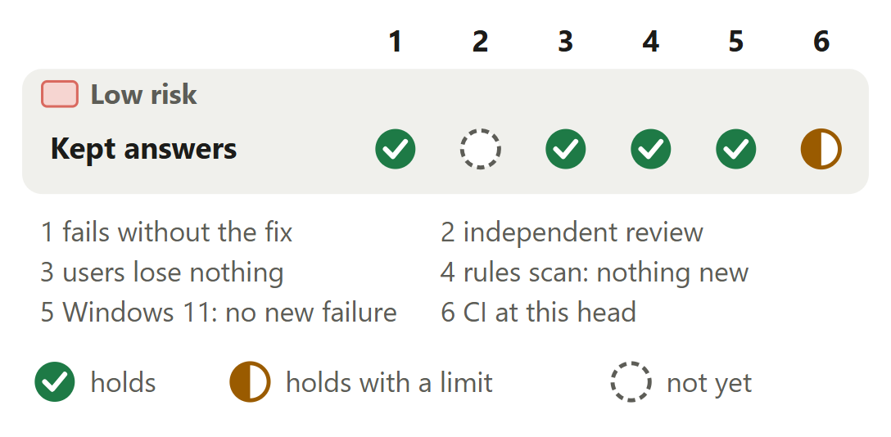

# Kept Git answers leave with their checkout; commondir read as Git does

For the pull request of branch `JeanFrancoisGagne/catalog-kept-answers-leave-with-their-checkout`, not opened yet, head 24cfab825. [report.html](report.html) is the same report as one page: download it and open it.

## 1. The decision

**May the catalog drop what it keeps for a folder once Git lists that folder's repository again and the folder is gone?**

**We recommend:** approve it: a removed worktree's answers leave the daemon's memory, every checkout that stays keeps its own, and a hand-written `commondir` is read as Git reads it.

| Size | Risk and review | Waits on | Not verified |
|---|---|---|---|
| 429 lines in 4 files: 150 ship, 279 are tests and text | Fast. Low risk, no high-risk path. | Nothing. No CI run on GitHub yet: not pushed. | 2 |

## 2. Intent, and the gap

| Change | Intended | Found | Now |
|---|---|---|---|
| Removed worktrees kept | Gone folders keep no answer _(code comment)_ | Removed worktrees stayed kept _(a maintainer's review)_ | Closes the gap. |
| commondir through a link | commondir read as Git reads it _(code comment)_ | Read as text through links _(automated review N2)_ | Closes the gap. |

Found on 19 November 2026 in the review of #813, by a maintainer and the automated reviewer, and measured on Linux x64.

Sources at main, and causes

| Change | Where main states the intent | The cause, and what was measured |
|---|---|---|
| Removed worktrees kept | `src/engine/catalog/repository-identity.ts` at cd769e9c0, the comment of `registryPlace`: "A folder that is gone keeps no acceptance, as the registry kept nothing for it before". The four maps (`heldTopLevels` line 61, `gitPlacedCommons` 68, `gitAcceptances` 454, `configs` in `git-placement.ts` 653) have no other delete. | Only an ask of a folder drops its answers when it finds the folder gone. A start places the worktrees Git lists and skips a listed folder that is gone, so a removed worktree, and every folder asked in it, is never asked again, and its entries stay until the daemon restarts. |
| commondir through a link | `src/engine/catalog/checkouts/git-placement.ts` at cd769e9c0, line 500: "the one its `commondir` names, joined to `path` and taken through its real path". Line 507: `return resolve(realOf(path) ?? path, common.stamp);`; `commonOf` at line 226: `resolve(gitFolder, named)`. | `path.resolve` cancels `..` against the name before it, where Git's `get_common_dir_noenv` takes the real path of the joined text and follows each link before the next `..`. The same read fed the search, the files' placement of a linked worktree and the acceptance stamp. |

## 3. Where to look

1. **Read first**, 10 min: `repository-identity.ts`: `keepList`, `forgetGone`, `forgetGoneFrom`, `keepAcceptance`. Can an answer still served, for a checkout that stays, be dropped?
2. 10 min: `git-placement.ts` and `checkout-control.ts`: `commonOf`, `commonFolderOf`, `forgetGoneConfigs`, `realpathNamesInTurn`, `storedForm`.

**Then skim**, 5 min: The tests: eight cases in one new file count each map, ask through other spellings of a folder, and compare each list and placement with Git's own.

## 4. Risk against verification

One change, low risk: what the daemon keeps in memory, and one path read as Git reads it.

Each limit, and each check that does not hold yet

| Change | Check | Its limit, or why it does not hold yet |
|---|---|---|
| Kept answers | independent review | No independent review of this head yet. |
| Kept answers | CI at this head | No CI run at this head on GitHub yet: the branch is not pushed. CI's lint and type-check job passed on Linux x64. |

## 5. The changes

**Kept answers leave with checkouts**, low risk: After 600 worktrees placed and removed: `main` kept 1,203 answers, here 3.

<b>6. The decisions</b>

**When does an answer the catalog keeps for a folder leave?**

**We chose** once Git lists its repository again and the folder is found gone. **Would change our mind:** A maintainer who wants a clone deleted for good to leave too, through the hourly forgetting of removed checkouts.

| Option | What a user gets | Cost | What it breaks |
|---|---|---|---|
| Relisted and found gone **(chosen)** | A removed worktree's answers leave at the next list of its repository; a checkout that stays keeps its own. | One existence check per answer of that repository when its list changes. | A clone deleted for good keeps its main checkout's answers until a repository is listed at its path again. |
| Relisted and no longer listed | The same, with no existence check. | None at the list. | A folder Git places but does not list asks Git again after every list. |
| A bound by count | Memory capped. | A number with no fact behind it. | A start with 190 worktrees evicts answers still in use and asks Git again. |

**Evidence.** One Node process on Linux x64, three rounds of 200 worktrees placed and removed: `main` kept 603 answers and 600 acceptances, here 3 and 0; heap after a full collection 13,944 KiB at `main`, 12,890 KiB here.

<b>7. How it fits</b>

Nothing has to merge first: it stands on `main` cccb25a8d, merged in, which holds #813. No open pull request edits its files: not #812, #865, #880, #881 or #883.

<b>8. What is not covered</b>: 2 not verified, 4 limits that stay

1. **macOS** never ran.
2. **A clone deleted for good** keeps its main checkout's answers until a repository is listed at its path again.

**Limits that stay**

- The `.git` file's `gitdir:` text is still resolved as text.
- A whole daemon's memory is read as its heap after a full collection: no public surface counts kept answers.
- A worktree away from its path when its repository's list changes is placed again when it is back: one Git process for a worktree Git places, where `main` starts none; answers equal Git's at both.
- On Linux x64 and Windows 11 Git's answers and the files' spell a common Git folder alike; the stored-form match of kept answers is for macOS, which never ran.

## 9. What we ask of you

We ask no ruling.

<b>10. Evidence</b>

The description on GitHub is the record: "How you tested it" holds the runs on `main` and here.

| Where | What ran | Result |
|---|---|---|
| Linux x64 | The eight new cases: five over `main`'s source, three at 1ca3a148b, and here | Over `main`'s source 5 of 5 fail at their own assertions; at 1ca3a148b the link case fails (config facts of removed worktrees kept); here 20 of 20 runs pass. |
| Windows 11 | The eight new cases: over `main`'s source, at 1ca3a148b and here, in turn on one machine | Over `main`'s source the three counting cases fail 20 of 20, the two `commondir` cases pass; at 1ca3a148b the three spelling cases fail 20 of 20; here all eight pass 20 of 20. |
| Linux x64 | The 13 changed, new and importing test files, here and at 1ca3a148b | Here 329 passed, 16 skipped, none failed; 1ca3a148b 328 passed, 14 skipped, none failed. |
| Windows 11 | The 13 changed, new and importing test files, here and at 1ca3a148b | Here 341 passed, 9 skipped, none failed, nothing outside `main`'s Windows baseline; 1ca3a148b 338 passed. |
| Linux x64 | CI's lint and type-check job, and the automated reviewer's rules | Passed; no new finding. |
| Linux x64 | One Node process: 200 worktrees placed and removed, three rounds | `main` 603 answers, 600 acceptances, 13,944 KiB heap; here 3, 0, 12,890 KiB. |
| Linux x64 | The built daemon and hook: 200 worktrees recorded, removed, then an event in a checkout that stays | Every run here holds about 700 fewer heap objects than every run at `main`; Git processes per event equal at both; a hand-written `commondir` answered as Git's at both. |

**Sources.** The branch at 24cfab825 and its diff against `main` cccb25a8d, read on 19 November 2026; runs on three Linux x64 machines and Windows 11 virtual machines.

