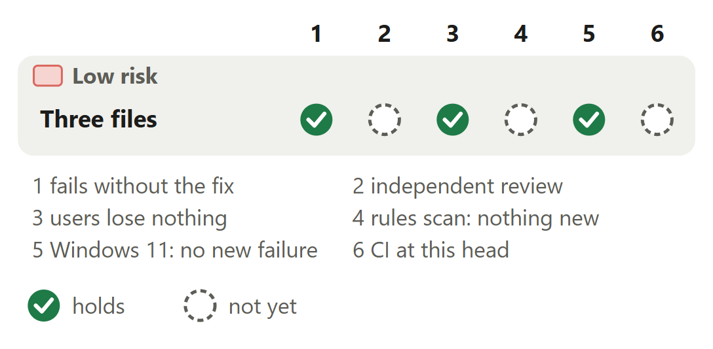

# The two checks' own tests run each check over three files

For [pull request #1173](https://github.com/neralabs/rerail/pull/1173), head e9bf17fd12. [report.html](report.html) is the same report as one page: download it and open it.

## 1. The decision

**Should the two checks' own tests run each check over a three-file repository, and leave the verdict over this checkout to the lint job?**

**We recommend:** approve it: CI's lint job runs both commands over this checkout on every pull request, and the new cases show each command exits 0 on a clean tree and 1 on a problem.

| Size | Risk and review | Waits on | Not verified |
|---|---|---|---|
| 102 lines in 3 files: 0 ship, 102 are the tests it changes, 0 are other tests and text | Fast. Test files only; no high-risk path. | Nothing. It stands alone on `main` ef885f6e1c. | 3 |

## 2. Intent, and the gap

| Change | Intended | Found | Now |
|---|---|---|---|
| Unit cases within limit | Unit cases within 5 s _(code comment)_ | A checkout-wide case at 5,169 ms _(a CI job, #1144)_ | Closes the gap. |

Found on 26 November 2026, in a Linux unit job on GitHub's runner and in runs on a Windows 11 machine.

Sources at main, and causes

| Change | Where main states the intent | The cause, and what was measured |
|---|---|---|
| Unit cases within limit | `vitest.config.ts` at `main` ef885f6e1c, the comment above `testTimeout`: Linux and macOS keep vitest's 5 s default. `check-folder-removal.test.mjs` at `main`, "passes on this checkout's test/", starts the check over the whole checkout; `check-owned-builtins.test.mjs`'s "passes on this checkout's src/" does the same over `src/`. | The case started `node scripts/check/check-folder-removal.mjs` over the whole checkout: a Node start, TypeScript's load, a Git file listing and a parse of the 657 code files under `test/`, all inside the case's 5 s limit, and its cost grows with the checkout. |

## 3. Where to look

1. **Read first**, 4 min: `run-check.mjs`: `runCheck`, `printedPlaces`. Does the copy run as `npm run check` starts it, and can the removal never reach this checkout's `node_modules`?
2. 3 min: `check-folder-removal.test.mjs`, `check-owned-builtins.test.mjs`.

**Then skim**, 2 min: The new process cases: a clean tree exits 0 and reads 2 files; one problem exits 1 naming its file and line.

## 4. Risk against verification

One change, low risk, test code only: start at `runCheck`, which copies the checks into a new repository.

Each limit, and each check that does not hold yet

| Change | Check | Its limit, or why it does not hold yet |
|---|---|---|
| Three files | independent review | No reader outside the author has read this head yet. |
| Three files | rules scan: nothing new | The rule pack's review has not run for this change. |
| Three files | CI at this head | GitHub's CI has no result at this head yet. |

## 5. The changes

**Check cases over three files**, low risk: Each file's longest case on Linux x64: medians 1,060 and 776 ms at `main`, 176 ms here.

<b>6. The decisions</b>

**Where should the checks' verdict over this checkout's own files run?**

**We chose** in CI's lint job, which runs both commands on every pull request; unit cases run each check over three files. **Would change our mind:** A path filter or a condition that could skip the lint job on some pull request, or a maintainer wanting the checkout-wide cases kept.

| Option | What a user gets | Cost | What it breaks |
|---|---|---|---|
| The lint job alone; process cases over three files **(chosen)** | No unit case's limit holds a walk of the whole checkout; each command is still shown to start, exit 0 on a clean tree and exit 1 on a problem. | A false finding over this checkout's own files shows in the lint job, not in a unit job. | Nothing found. |
| Keep the checkout-wide cases, with a longer limit | The smallest change. | Each case's time grows with the checkout: 9,880 ms at its highest on Windows 11. | The limit is a guess from one failure; the next slow runner may pass it. |
| Give each check a folder argument | No copy of the checks. | A change to the checks themselves, outside the tests. | Nothing found; a larger change. |

**Evidence.** `ci.yml` runs on every pull request with no path filter (lines 3 to 14); its lint job has no condition and runs `npm run check` (lines 112 to 157), which runs both checks (`package.json` line 101); the required "CI result" needs it (line 2176).

<b>7. How it fits</b>

It stands alone on `main` ef885f6e1c, which Git merged into it with no conflict, and needs no other pull request. #1076, #1126 and #1143 share no file with it. A fix for #1145, not yet open, meets it in one import block.

**The test file a fix for #1145 shares.** A fix for #1145 rewrites `check-folder-removal.mjs` and edits both test files. Git merges `check-owned-builtins.test.mjs` alone and stops at one import block of `check-folder-removal.test.mjs`: keep that fix's import of `check-owned-builtins.mjs` and its `HELPER` and `EXEMPT` from `RULES`, add this change's `run-check.mjs` import, and drop `ROOT`, which nothing else reads. `printedPlaces` keeps clear of the `places` that fix declares.

<b>8. What is not covered</b>: 3 not verified, 1 limit that stays

1. **macOS** never ran; the cases name the repository by its real path, since the temp folder is under `/var` there.
2. **Under a fix for #1145** the process cases should hold, since the copy carries every module of `scripts/check/`; not run.
3. **Rules scan** the rule pack's review has not run for this change.

**Limits that stay**

- A false finding over this checkout's own files now shows in the lint job of the same pull request, not in a unit job.

## 9. What we ask of you

We ask no ruling.

<b>10. Evidence</b>

The description on GitHub is the record: "How you tested it" holds the runs.

| Where | What ran | Result |
|---|---|---|
| Linux x64 | At this head: the two files 10 times with `main`'s text and 10 times here, in turn | 0 of 20 failed, 86 cases here; each file's longest case: medians 1,060 and 776 ms at `main`, 176 ms each here. |
| Linux x64 | At this head: six one-line changes to the checks' own code, each alone | Each fails a case here; `main`'s removed cases catch only the two that throw. |
| Windows 11 | At this head: the two test files 15 times | 15 of 15, 86 passed a run. |
| Windows 11 | Before the merge: the two files 10 times at `main` and 10 times here, in turn; the six changes | 0 of 20 failed; each file's longest case: medians 1,763 and 1,351 ms at `main`, 388 and 386 ms here. Each change fails a case here. |
| Windows 11 | Before the merge: the two files 30 times beside their CI shard neighbours | Every case of the two files passed 30 of 30. |

**Sources.** The branch at fe0050f346, Git's own merge of `main` ef885f6e1c into ff430fe202, and its diff against that `main`, read on 26 November 2026; runs on Windows 11 x64 and Linux x64 machines.

