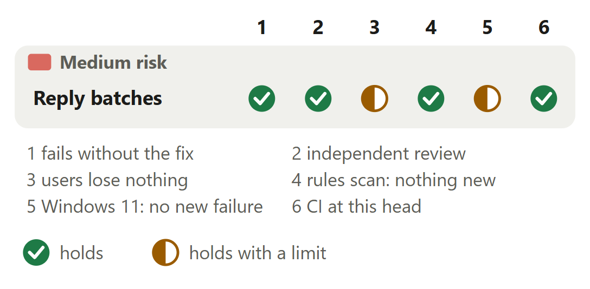

# Claude Code: every batch of a streamed reply is recorded

For [pull request #647](https://github.com/neralabs/rerail/pull/647), head 8d531e566. [report.html](report.html) is the same report as one page: download it and open it.

## 1. The decision

**Does any payload Rerail accepted before now fail, and does a reply with a blank or empty batch end?**

1. A blank or empty `delta` is recorded; a non-text one gets a new refusal message.

**We recommend:** it is approved and ready to merge: a code owner approved 2bbd811b1 and asked for a reply-ends test, 8d531e566 adds it with no source change, and CI passed there.

| Size | Lane | Waits on | Not verified |
|---|---|---|---|
| 206 lines in 4 files: 125 ship, 81 are tests and text | Standard. A code owner approved it at 2bbd811b1. | Nothing. Approved, and CI passed at this head. | 4 |

## 2. Intent, and the gap

| Change | Intended | Found | Now |
|---|---|---|---|
| Blank reply batches | The runtime takes any text as `delta` _(the runtime's schema)_ | 20 of 30 batches refused _(replay through the hook)_ | Closes the gap, changes answer 1. |
| Function over the ceiling | A function counts 6 or under _(docs)_ | `claudeHookEvents` counts 13 _(rules scan)_ | Closes the gap. |

Found on 11 November 2026 with Claude Code 2.1.322 on Windows. Measured on 13 November on Linux.

Sources at main, and causes

| Change | Where main states the intent | The cause, and what was measured |
|---|---|---|
| Blank reply batches | `src/runtime/event-protocol.ts` line 31: `delta: z.string()`, where every id is `z.string().min(1)`. `src/engine/adapter-contract.ts` line 297: the engine's own last batch of a streamed message is `""`, with `final` true. `src/runtime/host-runtime.ts` lines 143 to 149: only a `final` batch finishes the message and stores it whole. Line 191 of `adapter-contract.ts`, "nonblank text is the accepted value of a text field", is the shared reader's rule, which `delta` was read under. | `src/hosts/claude/claude-event-adapter.ts` line 61 at `main` reads `delta` with `requiredText`, the shared text reader. It throws `Claude hook omitted delta` for a `delta` that is missing, blank or not text (`adapter-contract.ts` line 198). Claude Code sends whole lines per batch: a batch can be one blank line, and the last batch of a reply that ends on a newline is empty. Measured by a test file, not committed: 10 replies of three batches through the hook to a running daemon. |
| Function over the ceiling | `packs/complexity/README.md` line 23: "A function fails when that exceeds 6". Lines 4 to 6: "A `switch` or `match` counts once however many cases it has", "so a flat dispatch table is not a reason to split a function". Line 24: under the `ai-output` scope only functions an edit touched are reported. `.github/workflows/reviewer.yml` lines 108 to 112 run that pack on each pull request and mark each violation new or existing. | `src/hosts/claude/claude-event-adapter.ts` lines 35 to 96 at `main`: one function picks the hook through seven `if` statements and builds each event inline. The scan counts it 13: 1, seven `if`, three `\|\|` and two `?:`. Run on an earlier version of this fix that edited the chain in place (78b916332, the function then at 12), the scan reported it as 1 new finding. At this head the scan counts `claudeHookEvents` 5 and `batchDelta` 4. |

## 3. Where to look

1. **Read first**, 5 min: `claude-event-adapter.ts`: `batchDelta`, then `claudeHookEvents`: its `MessageDisplay` case and its `case` labels. Hide whitespace: 37 lines change. Does `batchDelta` let only text through, and does each `case` keep `main`'s body?

**Then skim**, 3 min: 8d531e566, new since the approval, adds one test in `claude-hook.test.ts`: check it asserts the reply's end. Earlier commits hold a replaced shape: read the squashed diff. `main`'s assertions stay.

## 4. Risk against verification

Two half marks: the wait a blank batch now pays, timed at an earlier commit, and the integration tests, not run on Windows.

Each half mark's limit

| Change | Check | It holds with this limit |
|---|---|---|
| Reply batches | users lose nothing | On 587,738 payloads, every one `main` accepts gives the same event here, with the same event id. `main`'s own test files pass at this head. The limit: a blank or empty batch now waits for the daemon, 33 to 36 ms more per hook process, and that was timed at 468039e93, before the source took its present shape. |
| Reply batches | Windows 11: no new failure | The 9 test files that use the Claude adapter or the adapter contract passed on Windows 11 at this head: 187 passed, 1 skipped (a symlink case that skips on Windows), 0 failed. The reply-ends test passed 20 of 20 separate runs there. The limit: the integration tests did not run on Windows. |

## 5. The changes

**Reply batches of any text**, medium risk: Of 30 batches in 10 replies, `main` records 10 and ends no reply; this change records 30 and ends 10.

<b>6. The decisions</b>

**Why does a one-line fix rewrite `claudeHookEvents` as a `switch`?**

**We chose** one `switch` in place: it counts 5 against `main`'s 13, with no new finding. **Would change our mind:** a maintainer who wants each hook's event in a function of its own: 6bf5eb213 holds that shape.

| Option | What a user gets | Cost | What it breaks |
|---|---|---|---|
| One `switch` on the hook's name, each case's body inline **(chosen)** | One function, as at `main`, and one new one, `batchDelta`. The reviewer's scan: 0 findings, `claudeHookEvents` 5, `batchDelta` 4. | 125 changed source lines in 1 file. 88 of them are `main`'s text one indent deeper: with whitespace hidden, 37. | Nothing measured: on 587,738 payloads the two adapters differ only for a blank, empty or non-text `delta`. |
| Edit the `if` chain in place | The smallest diff: `batchDelta` and one line. | Nothing more to write. | The function stays over the ceiling, and the edit makes its finding new: the scan of an earlier version of this fix, at 78b916332, reported 1 new finding. `.github/workflows/reviewer.yml` line 111: a new violation "can be a blocker". |
| One function per hook, looked up by the hook's name | `claudeHookEvents` counts 2, and the scan reports 0 new findings. Commits 9a78d72f1 and 6bf5eb213 hold this shape. | 158 changed source lines in 2 files, 96 with whitespace hidden: five new functions and a map. | Nothing measured. The automated reviewer noted at 468039e93 that the supported hooks are then listed twice by hand. |
| The `switch` first as its own pull request, the fix after it | Each pull request holds one kind of change, as `CONTRIBUTING.md` asks of large changes. | Two reviews, and the fix waits for the first merge. | Nothing in the code. Replies with a blank line stay unfinished on `main` until both merge. |

Before: At main, claudeHookEvents reads the hook's name, picks among nine hooks through seven if statements, and the branch builds its event inline. The function counts 13. After: With this change, claudeHookEvents reads the hook's name, one switch picks the hook's case, and the case builds its event inline in main's text. The MessageDisplay case reads delta through batchDelta. The function counts 5 and batchDelta counts 4.

**Evidence.** The scan the automated reviewer runs, on Linux: `claudeHookEvents` 13 at `main`, 2 at 468039e93 and 5 at this head, with 0 new findings at both. Line counts: `git diff` of `src/` against `main`, plain and with `-w`. The branch's history holds both shapes, since pushed commits are never rewritten. `CONTRIBUTING.md` line 538 asks for refactoring apart from behaviour changes under "Large changes"; this edits one function of one component.

**What does the adapter take as `delta`?**

**We chose** any text, in a reader for `delta` alone, so no id can pass blank. **Would change our mind:** a second hook field that can be blank: the shared reader then takes blank text.

| Option | What a user gets | Cost | What it breaks |
|---|---|---|---|
| A reader for `delta` alone that takes any text **(chosen)** | Blank lines and the empty last batch are recorded, and the reply ends on `final`. | One function, `batchDelta`: 10 lines with its comment. | Nothing accepted before. A `delta` that is not text is refused with a new message that names its type. |
| Let the shared reader take blank text | The same. | Fewer lines. | The shared reader also reads `session_id`, `prompt_id`, `tool_use_id` and `message_id` here, and the ids of the Codex and Cursor adapters. A blank id would pass in all three. |
| Take the empty last batch, keep refusing a blank line | The reply ends. | No daemon call for a blank line. | By a read of the code, not run: the whole message loses its blank lines, as at `main` today. `Here is the plan:\n\nFix the test.` would be stored as `Here is the plan:\nFix the test.` |

Before: At main, of a reply's three batches, the line of text is recorded, the blank line is refused with Claude hook omitted delta, and the empty last batch is refused, so the reply never ends. After: With this change all three batches are recorded: the line of text, the blank line and the empty last batch. The reply ends and is stored as one whole message.

**Evidence.** The adapter's delta test and the rows test fail at `main` with `Claude hook omitted delta`. In a second run from a separate checkout at 2bbd811b1: the fix line put back to `main`'s fails both; the not-text check removed fails the delta test for `7`; the missing check removed fails it on the message; the null wording put back fails it on `not object`.

**Where does the test that a reply ends run, and what does it assert?**

**We chose** through the hook to a running daemon, asserting the one whole-message sample the empty last batch stores. **Would change our mind:** a maintainer who wants a conversation rule's match asserted too.

| Option | What a user gets | Cost | What it breaks |
|---|---|---|---|
| Through the hook to a running daemon, reading the session's ledger **(chosen)** | The end as a person gets it. After four batches the ledger holds exactly one whole-message sample, made by the empty last batch's event: `Here is the plan:\n\nFix the test.` | One test daemon. The test takes 0.30 s on Linux and 1.6 s on Windows 11. | Nothing. |
| Add the end to the rows test, which runs in process | No daemon to start. | None. | It cannot show the end. By a read of `src/harness/hook-host.ts` lines 157 to 167, not run: each in-process hook call builds a new runtime, so a reply spread over hook calls never ends there. |
| Also assert a conversation rule's match on the reply | The rule check itself, beside the sample it reads. | A set-up repository, a library rule and the real model's match. No test in the file gives a rule. | Not built. |

**Evidence.** `src/runtime/host-runtime.ts` lines 143 to 149: only a `final` batch finishes the stream and stores the `message` sample. The test sends no `Stop` and no `SessionEnd`, so the sample can only come from the empty last batch. With line 143 edited to skip an empty final `delta`, not committed, the test fails on `expected [] to deeply equal` and the rows test passes. At 8d531e566 it passed 20 of 20 separate runs on Linux and 20 of 20 on Windows 11.

<b>7. How it fits</b>

Nothing has to merge first: it is based on `main`, and no open pull request needs it. `main` took #526, which edits one of its test files: GitHub reports no conflict.

**Related pull requests.** #503, merged, fixed #536, the numeric `index` that #549's reproduction needs; this branch is cut after it. #571, closed on 12 November, held this fix with the `index` fix and stays closed. Two open pull requests also edit `test/hosts/claude/claude-hook.test.ts`, in other lines: #667, the team's, and #673, ours. A trial merge with each has no conflict. Neither edits the adapter. No other open pull request touches the four files, read on GitHub on 14 November 2026.

<b>8. What is not covered</b>: 4 not verified, 5 smaller gaps, 6 limits that stay

1. **A Claude Code session of our own** did not run against this head: the wait per batch in one is not timed.
2. **A conversation rule's match** on the stored reply is not asserted: the test checks the whole-message sample such a rule reads.
3. **How many real replies** hold a blank line or end on a newline was not counted.
4. **macOS** never ran.

**Smaller gaps**

- **The wait's figures.** The 33 to 36 ms come from medians of 10 runs per case, hook process start included, on a 32-thread Linux machine at 468039e93. The spread was not recorded, and the timing was not run again at this head.
- **The integration tests on Windows.** They did not run on Windows. On Linux at 2bbd811b1 the adapter parity test passed 1 of 1 and the Claude hook rules test 3, with 1 skipped. CI's `Integration tests` job passed at this head.
- **The whole suite outside CI.** Not run: CI ran it at this head. The other runs cover the 9 test files that use the Claude adapter or the adapter contract.
- **#667 and #673.** Both edit `claude-hook.test.ts` in other lines. A trial merge of 8d531e566 with each head, 34dae62e9 and e5656482d, has no conflict. No test ran on a merged tree.
- **A `delta` of another type.** The tests send a number and a `null`. By a read of `batchDelta`, an array or an object is refused as `Claude hook delta must be text, not object`. Nothing under `src/` parses the old message.

**Limits that stay**

- Replies recorded before the upgrade stay as they were recorded.
- A blank or empty batch now waits for the daemon, as a text batch does: 33 to 36 ms more per hook process, at the median of 10 runs on a 32-thread Linux machine at 468039e93.
- The stored whole message is trimmed, at `main` and here (`src/runtime/chunker.ts` line 76): a reply that ends on a newline is stored without it.
- A `delta` of spaces only is recorded too. It adds no message sample: the chunker trims it.
- A refused batch still answers `{}` and exits 0. The comment at `src/harness/hook-host.ts` line 139 says where it shows: the hook failure log that `rerail status` reads.
- The fix stops at the adapter. How `index` is read, how the hook waits for the daemon, and the Codex and Cursor adapters stay as they are.

## 9. What we ask of you

We ask no ruling.

Answer 1 asks no ruling. A code owner approved it; #549 states it.

<b>10. Evidence</b>

The description on GitHub is the record. "How you tested it" holds the failing tests, the runs and the measurements.

| Where | What ran | Result |
|---|---|---|
| CI on GitHub | The run at 8d531e566, read on 14 November 2026 at 01:41 UTC | 19 checks passed, `CI result`, `Unit tests (1/2)` and `(2/2)`, `Unit tests (Windows, 1/2)` and `(Windows, 2/2)`, `Integration tests` and `Real Claude Code, Codex, and Cursor sessions` among them. 3 were skipped: `Rust engine`, `Conformance` and `Conformance comment`. None failed. |
| Linux | 2bbd811b1 with the fix line put back to `main`'s, from a separate checkout; then `main`'s source at c438bc813 with this head's `claude-hook.test.ts` | At 2bbd811b1 the delta test and the rows test failed and the 25 other tests of the two files passed. At c438bc813 the reply-ends test and the rows test failed. Every failure says `Claude hook omitted delta`. |
| Linux | The reply-ends test and the rows test at this head with one edit each time, not committed: `batchDelta` refusing `""`; the fix line put back to `main`'s; the runtime skipping the end when the final `delta` is empty | `batchDelta` refusing `""`: both failed. The fix line put back: the reply-ends test failed. The end skipped: the reply-ends test failed on `expected [] to deeply equal`, and the rows test passed, so only the new test catches a stored final batch that does not end the reply. |
| Linux and Windows 11 | The reply-ends test alone at 8d531e566, 20 separate runs on each | 20 of 20 passed on Linux, 391 to 427 ms each. 20 of 20 passed on Windows 11. |
| Linux and Windows 11 | 9 test files at 8d531e566: the 5 that import the Claude adapter and the 4 that import `adapter-contract.ts` directly | On each: 187 passed, 1 skipped, 0 failed. The skip on Linux is a Git Bash case that runs on Windows only. The skip on Windows is a symlink case. |
| Linux, a separate checkout | At 2bbd811b1, whose source is this head's: `main`'s adapter against this one on 587,738 payloads; 10 replies of four batches through the hook to a running daemon; four one-line edits | 575,911 payloads gave the same events or the same error. 3,288 held a blank `delta`: `main` refused it, this records it. 8,539 held a `delta` that is not text: both refuse it, and this names the type. None was unexplained. `main` stored 0 whole messages for the 10 replies, this stored 10. Each edit failed a test. |
| Linux | A test file, not committed: 10 replies of three batches through the hook to a running daemon, at `main` (383fc99aa) and at 2bbd811b1 | `main`: 10 of 30 batches recorded, the last batch of 0 of 10 replies. 2bbd811b1: 30 of 30, and the last batch of 10 of 10. In the test process a text, a blank and an empty batch took 26.9, 29.3 and 28.0 ms at the median there. |
| Linux | The rules scan as the automated reviewer runs it, rules from `main` at c438bc813, against 8d531e566 | 40 checks, 0 findings, 0 new. `claudeHookEvents` counts 5, against 13 at `main`, and `batchDelta` 4. |

**What this report adds to the description**

- **GitHub at 01:41 UTC on 14 November 2026.** #647 is open and ready for review at 8d531e566: six commits, 150 lines added and 56 removed in 4 files. A code owner approved 2bbd811b1 on 13 November and asked for a test that the reply ends; the reply under that review names 8d531e566. GitHub reports no conflict with `main` at 4cea86aaa, which took #526 on 13 November.
- **#667 and #673 share one test file.** Both are open and edit `test/hosts/claude/claude-hook.test.ts`: #667 near lines 8 and 425, #673 near line 143, this pull request near lines 1, 213 and 266, each counted in its own base. A trial merge of 8d531e566 with each head, 34dae62e9 and e5656482d, and with `main` at 4cea86aaa has no conflict.
- **An in-process hook test cannot show a reply's end.** By a read of `src/harness/hook-host.ts` lines 157 to 167, not run: with a test embedder each hook call builds a new runtime, and the runtime holds a reply's text in memory. A reply spread over hook calls ends only when a daemon holds it between batches, so the reply-ends test starts one.
- **The wait was timed at an earlier commit.** The 33 to 36 ms were measured at 468039e93. Since then `batchDelta` changed in one place, the word it gives a `null`, and the code around it became a `switch`. At 2bbd811b1 the three kinds of batch took 26.9, 29.3 and 28.0 ms at the median in the test process, without the hook process's start.

**Sources.** Pull request #647, its diff, its reviews and its CI on GitHub, read on 14 November 2026 at 01:41 UTC. Rerail at `main` (4cea86aaa) for each quoted intent. Issue #549 for how the gap was found. Each measurement names the commit it ran at. The open pull requests on GitHub for the related ones.

