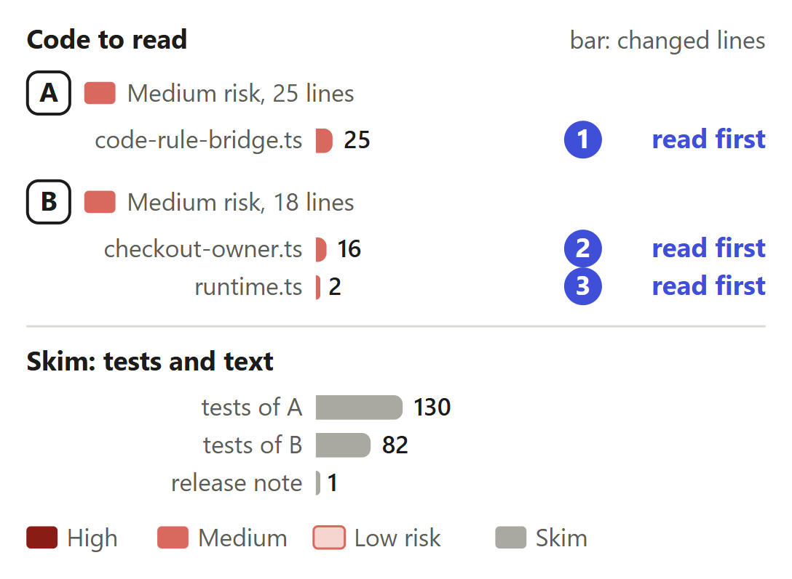
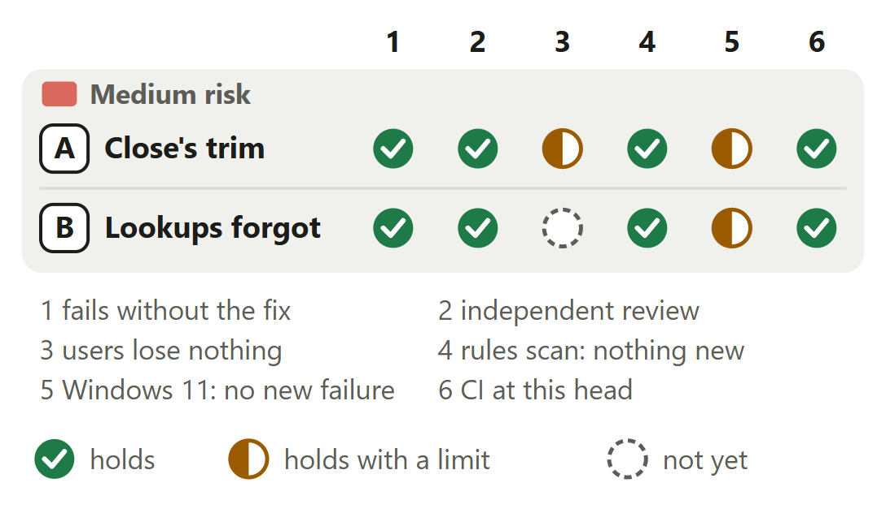

# Code rules: a closed session's folder keeps only its own observations

For [pull request #671](https://github.com/neralabs/rerail/pull/671), head 714e8d97a. [report.html](report.html) is the same report as one page: download it and open it.

## 1. The decision

**Is every change a later session meets still seen and checked as before, with closed sessions' observations and lookups dropped?**

1. A session reopened in a closed folder reads the other worktrees again. **Changes the intent.**
2. After a runtime's last close, the next session looks every folder up again.

**We recommend:** approve it if the trade #661 asks about is acceptable: a later session's steers and records match main's in our test, and a closed folder keeps 561 KB where it kept 36,091 KB.

| Size | Lane | Waits on | Not verified |
|---|---|---|---|
| 256 lines in 6 files: 43 ship, 213 are tests and text | Careful. A code owner approves. | Nothing. A code owner approved 714e8d97a; CI passes. | 5 |

## 2. Intent, and the gap

| Change | Intended | Found | Now |
|---|---|---|---|
| A. Shared observations | Later sessions reuse digests _(code comment)_ | Every worktree's files stay shared _(bridge test)_ | **CHANGES THE INTENT: ANSWER 1.** Shares the folder's own sources only. A maintainer must agree. |
| A. The 15 minutes | Returning session finds its checkout walked _(code comment)_ | 36 MB a folder, for 15 minutes _(memory probe)_ | Closes the gap. |
| B. Folder lookups | Each folder looked at once _(code comment)_ | 15,471 answers outlive the sessions _(memory probe)_ | Closes the gap, changes answer 2. |

Found at about 190 worktrees on Windows 11 (#548); measured 13 November 2026.

Sources at main, and causes

| Change | Where main states the intent | The cause, and what was measured |
|---|---|---|
| A. Shared observations | `src/engine/code-rule/code-rule-bridge.ts` line 100, above `SourceObservationCache`: "Baseline observations keyed by workspace directory, shared so later sessions reuse digests of unchanged sources." Line 1562, in `#scanSources`: "An earlier session's baseline of this workspace lets unchanged sources skip the read." Neither says which sources: the folder's own, or every worktree's. | Line 1596, the last of `#applyWalk`, copies the session's whole map into the shared one after every walk: `this.#observations?.set(this.#cwd, new Map(this.#observed))`. After the worktrees' walk that map holds every file of every worktree. `close()` clears the session's own map (line 1272) and leaves the shared one. At 190 worktrees of 500 Python files: 34,755, 71,571 and 108,273 KB kept after 1, 2 and 3 closed folders. |
| A. The 15 minutes | `src/runtime/engine-service.ts` lines 193 to 196, above `IDLE_RUNTIME_MS`: "How long a checkout's runtime stays open after its last session ends. A session that starts there again within it finds its rules compiled and its checkout walked". Lines 363 to 367, above `retireUnusedRuntime`, say why a runtime is disposed: a daemon that kept every runtime "grew until its heap ran out". | Since #503, `retireUnusedRuntime` disposes a runtime 15 minutes after its last session, and the shared observations and the lookups go with it. The same probe at main with the limit at 3 minutes: 36,060 KB per closed folder while the runtimes lived; once they had closed, the heap read 37,838 KB below its reading after the first session. So the growth stops at the folders sessions close in inside one window. |
| B. Folder lookups | `src/engine/catalog/checkout-owner.ts` lines 38 to 41, above `CheckoutOwners`: "Resolves owning checkouts for one runtime. Each folder's \`.git\` entry is looked at once, and each candidate root is confirmed once with Git, so a lookup costs a map access per file once its folders are known." The comment then names the one time answers are forgotten: when the recorded checkouts change. | `#gitRoot` (lines 137 to 155) keeps an answer in `#roots` for every folder a lookup passes, and `#confirm` (line 157) one in `#confirmed` for every folder it tests. A session's walk of the other worktrees looks up every folder of every worktree. Only `#revalidate` (line 119) clears them, when the recorded checkouts change. With A alone a closed folder still keeps 2,996 KB; with both, 561 KB. |

## 3. Where to look

1. **Read first**, 6 min: `code-rule-bridge.ts`: `inSessionFolder`, `#shareOwnObservations`. `observedText` and `failFolder` now answer as in a new folder: acceptable?
2. **Read first**, 4 min: `checkout-owner.ts`: `forgetFolders`, `cachedFolders`. Negative answers go too: is asking again about each folder right?
3. **Read first**, 2 min: `runtime.ts`: `closeSession`. Is an empty `#sessions` the right moment to forget?

**Then skim**, 5 min: The tests only add. The later-session test pins each steer and log record.

## 4. Risk against verification

Start at A. B's open mark: a reopened session's hook cost on Windows 11.

Each limit, and each check that does not hold yet

| Change | Check | Its limit, or why it does not hold yet |
|---|---|---|
| A. Close's trim | users lose nothing | The later-session test passes at main and here, on Linux x64 and Windows 11. The limits: a reopened session reads the other worktrees again (answer 1); `observedText` and `failFolder` then answer as in a new folder, in log-mode records, not run; a daemon's first closes block the event loop 17 to 22 ms longer. |
| A. Close's trim | Windows 11: no new failure | On Windows 11 the two bridge tests fail over main's source with the same messages and pass at the head. Heap kept per closed folder there: 38,992 KB at main, 1,359 KB here. The limit: of the 31 test files, one `audit-cli.test.ts` test failed beside another run. It fails in main's run there too, and 0 of 5 times alone. |
| B. Lookups forgot | users lose nothing | Linux x64 holds, 10 reopens each: 22.0 s of CPU at main, 22.1 s here; slowest hook 606 against 620 ms. Windows 11 is not settled: one comparable run on a busy machine, one sample each of two reopened sessions: slowest hook 1,259 and 1,134 ms at main, 1,481 and 1,430 ms here. CPU was lower here. |
| B. Lookups forgot | Windows 11: no new failure | The runtime test fails over main's source on Windows 11 and passed 20 of 20 times here. The limit: the 31 test files ran there at a commit with the head's tree but for the release note's text, and one `audit-cli.test.ts` test failed, as in main's run there. |

<b>5. The changes</b>

**A. A close keeps its own observations**, medium risk. Kept per closed folder: 36,091 KB at main, 2,996 KB with A, 561 KB with B too.

- **Problem:** Each folder a session closed in keeps an observation of every file of every worktree until its runtime closes, 15 minutes after its last session. Nothing reads them unless a session reopens in the folder.
- **Who meets it:** A person whose sessions end in several folders of a repository with many linked worktrees inside 15 minutes, as with one worktree per task. How often is not measured. #548 lists this among its causes.
- **What it does:** `close()` calls `#shareOwnObservations` before it clears the session. It filters the folder's shared map in one pass and keeps a path when `inSessionFolder` says the folder's own walk covers it: no `..` in front, and under no worktree root. The other worktrees' sources go, and so do files a tool wrote outside the folder.
- **Risk:** Medium. A later session in the folder starts from less. A trim that keeps too little costs it file reads. Its edits are judged against its own observations, never the shared ones.
- **Check:** Four places read the shared observations, all in a walk's scan: `staleStamp` skips a read, `knownDigest` carries a digest, `observedText` decides whether the walk keeps a file's text, `failFolder` marks known sources under an unreadable folder. Without the worktrees' entries the last two answer as in a new folder: acceptable? Can a second session live in the folder lose anything when the first closes? Does `inSessionFolder` keep `wt/w1-notes` when `wt/w1` is a worktree?
- **Picture:** Heap the engine service keeps per closed session folder on Linux x64, at 190 worktrees of 500 Python files: 36,091 KB at main, 2,996 KB with A alone and 561 KB at the head, with B too.
- **Method:** the engine service in one Node 24.21 process on Linux x64. A repository of 190 worktrees of 500 Python files in 60 folders; one session in the main checkout, then three sessions one after another, each in its own worktree. Heap is `heapUsed` after full collections, once the walks finished. Main, d8c703db8 alone and the head ran side by side.

**B. A runtime forgets its folder lookups**, medium risk. Lookups held: 15,471 folders live, 191 after the last close.

- **Problem:** A session's walk of the other worktrees looks up the owner of every folder of every worktree. The runtime keeps each answer after its sessions end, until it closes 15 minutes later.
- **Who meets it:** The same person as A: sessions that end in several folders of a repository with many linked worktrees. With A alone a closed folder keeps 2,996 KB; these answers are most of it.
- **What it does:** `forgetFolders` clears `#roots` and drops every `#confirmed` entry that is not a top level Git confirmed. `closeSession` calls it once `#sessions` is empty, after the bridge has closed. `cachedFolders` counts the folders held; only the test calls it. `#submodules` and `#plainRoots` stay.
- **Risk:** Medium. The next session there looks its folders up again. A forget that dropped the confirmed top levels would cost a Git process per checkout. A lookup decides which checkout's rules judge a file.
- **Check:** After the forget, a lookup starts from the confirmed top levels alone. Is keeping them and `#submodules` safe, as main keeps them? Answers that said a folder holds no checkout go too, so the next session asks again: a folder that became a checkout meanwhile gets its own answer, where main keeps the old one. `#abandonSession` also removes a session and does not forget: that session ran no walk. `cachedFolders` is public for the test alone.
- **Picture:** Folders a runtime's lookups hold at 190 worktrees of 500 Python files in 60 folders: 15,471 while a session lives, which main keeps after the last close, and 191 after the last close with this change, one per checkout.
- **Method:** the same memory probe, Linux x64 and Windows 11: `cachedFolders()` read while a session lives and after its last close, at the head. Main has no count. Its bar is the head's count while a session lives, since nothing at main drops an answer before the runtime closes or the recorded checkouts change.

<b>6. The decisions</b>

**What does a folder keep once its session closes?** (ask 1)

**We chose** its own sources' observations: no check reads the others. **Would change our mind:** one walk of the other worktrees shared by all sessions: no copy to trim.

| Option | What a user gets | Cost | What it breaks |
|---|---|---|---|
| Trim at the close **(chosen)** | 36,091 KB per closed folder becomes 2,996 KB with this alone, and 561 KB with the lookups forgotten too. | A session reopened in the folder inside 15 minutes reads the other worktrees' files again on its first walk. One pass over the shared map at each close. | No steer or log record in our tests. Two walk decisions answer as in a new folder, in the worktrees' walk only: part 8. |
| Keep everything until the runtime closes, as main does | Nothing new. | About 36 MB per closed folder for 15 minutes at this shape. | Nothing. |
| Close an idle runtime sooner | The same memory freed sooner. | The whole runtime closes, not only these entries. What a session that returns after the limit then pays is not measured. | Not measured. |
| One walk of the other worktrees for all sessions of a repository | No copy per folder to trim. | A new design, not built here. | Not measured. |

Before: At main, when a session closes, its folder keeps an observation of every file of every worktree and its runtime keeps an answer for every folder looked up. Fifteen minutes after the runtime's last session the runtime closes and all of it is freed. After: With this change, when a session closes, its folder keeps its own sources' observations. When the runtime's last session closes, one answer per checkout stays. Fifteen minutes after the last session the runtime closes, as at main.

**Evidence.** Heap kept per closed folder, read after full collections once the walks had finished, main against the head: 36,091 against 561 KB on Linux x64 (a second, independent run: 36,033 against 547 KB) and 38,992 against 1,359 KB on Windows 11. The later-session test passes at main, here, and under each of 9 mutations of the fix, while another test of the change fails under each one.

**What do a runtime's lookups keep after its last session?**

**We chose** the top levels Git confirmed: each took a Git process to learn. **Would change our mind:** a Windows measurement where the lookups cost a reopened session's hooks more than they save.

| Option | What a user gets | Cost | What it breaks |
|---|---|---|---|
| Forget the folders, keep the confirmed top levels **(chosen)** | 15,471 kept folders become 191. Per closed folder, 2,996 KB becomes 561 KB. | The next session there looks its folders up again, about 15,000 at this shape, one `lstat` each. A `.git` entry Git refused costs its Git process again. | Nothing found on Linux. Not settled on Windows 11: part 8. |
| Forget everything | 191 entries fewer at this shape. | A Git process per checkout for the next session. | Not measured. |
| Keep everything until the runtime closes, as main does | Nothing new. | An entry for every folder of every worktree, for 15 minutes. | Nothing. |
| One `CheckoutOwners` for the whole engine service | One copy, shared by the live runtimes too. | It ties together the runtimes' plain roots and their recorded-checkout versions. | Not built. |

**Evidence.** The runtime test walks a repository with three worktrees and counts the folders its lookups hold after the session ends: 20 without the call, 4 with it, one per checkout. A session reopened in the folder, Linux x64, 10 reopens each, main against the head: 22.0 against 22.1 s of CPU, hook time summed 2,832 against 2,876 ms, slowest hook 606 against 620 ms.

**Where does the trim run?**

**We chose** inside the close, in one pass. **Would change our mind:** several hundred thousand shared observations: chunks then win.

| Option | What a user gets | Cost | What it breaks |
|---|---|---|---|
| One pass inside the close **(chosen)** | The folder is trimmed before the close answers. | On a daemon's first closes the longest event-loop block is about 17 to 22 ms longer and the session-end hook 17 to 60 ms longer. Hooks of other sessions that arrive then wait that much longer. | Nothing: once warm it equals main. |
| After the session-end's answer, in chunks that yield | No longer block in the close. | More code: the chunking, and replacing the folder's entry only if it is still the same map. | Not built. |

**Evidence.** The longest event-loop block in a session's close, main against the head: 33 to 54 ms against 44 to 67 ms over 7 closes on Linux x64, 44 to 49 against 50 to 86 ms over 5 on a second Linux machine, 40 to 71 against 34 to 80 ms over 7 on a busy Windows 11 machine. The filter alone, once, in a new process: 9.6 to 11.1 ms over 95,500 observations, 39 to 40 ms over 382,000.

<b>7. How it fits</b>

It stands on main alone, merges clean at c438bc813, and a code owner approved it.

#671 is based on main at f277c6e29 and merges clean with main at c438bc813. A code owner approved it, answering issue #661. No open pull request needs it. One fix of ours, not open, for a worktree made over a folder a session found plain, adds to its code. It conflicts in one hunk with the draft #680, and the drafts #665 and #532 keep the one hunk each has against main. It merges clean with #679, #667 and #526.

**The shared files, by pull request.** #680 (ours, a draft): `runtime.ts`, the bridge and its test; 1 conflict hunk at the end of `closeSession`. Whichever lands second keeps both edits; we make that merge. #665 (ours, a draft) and #532 (the team's, a draft): 1 hunk each, the one each has against main alone. #679 (ours, a draft), #667 and #526 (the team's): the bridge or `runtime.ts`, other lines, clean. A fix of ours, not open, for a worktree made over a folder a session found plain, adds to `forgetFolders` and opens after this merges.

<b>8. What is not covered</b>: 5 not verified, 6 smaller gaps, 6 limits that stay

1. **Windows 11:** a reopened session's slowest hook: 1,481 and 1,430 ms, 1,259 and 1,134 at main, one busy run.
2. **`observedText` and `failFolder`** then answer as in a new folder, in log-mode records only: read, not run.
3. **Lookups after the last close** ask again about a folder that held no checkout: no test.
4. **The field:** no count of closes in many folders inside 15 minutes.
5. **macOS** never ran.

**Smaller gaps**

- **The Windows 11 run.** Its first session, the same code at both, took 84.4 s of CPU at main and 81.2 s here: the machine was busy. A second run could not be compared: main's half ran beside five other runs. A quiet run in alternating order would settle it.
- **The two walk decisions.** `observedText` keeps a file's text only when its digest differs from the one seen before. `failFolder` gives each source under an unreadable folder its read error. Without the worktrees' entries both answer as in a new folder, in the worktrees' walk alone, which steers no session.
- **A refused `.git` entry.** `forgetFolders` drops every answer that is not a confirmed top level. A folder whose `.git` entry Git refused then costs its Git process again in the next session. Read in the code, not measured.
- **#548's report.** It gives 4 GB of heap in under ten minutes at about 190 worktrees and lists this among its causes. We have not checked whether that build had the 15-minute limit.
- **The Windows run of the 31 files.** It ran at a commit with the head's tree but for the release note's text. CI's two Windows unit jobs ran the head itself and passed.
- **Main since the base.** Main moved to c438bc813 after this head's base, f277c6e29. The trial merge is clean, and the four source files quoted here are the same at both. No run of ours tested that merge.

**Limits that stay**

- Main frees all of this when the runtime closes, 15 minutes after its last session. This lowers the heap inside that window. It ends no leak that lasts the daemon's life.
- A live session's memory does not change: it holds an observation of every file of every worktree while it runs, 41,214 KB at this shape against 41,338 KB at main.
- After each walk the bridge still copies the session's whole map into the shared one: 10 to 12 ms at 95,500 observations, about 300 ms at 955,000, in a new process on Linux.
- A session reopened in the folder inside the 15 minutes reads the other worktrees' files again on its first walk and looks its folders up again: about 15,000 at this shape, one `lstat` each.
- The trim runs inside the close, in one pass: a daemon's first closes block the event loop about 17 to 22 ms longer, and the session-end hook takes 17 to 60 ms longer. Once warm, a close equals main's.
- Files a tool wrote outside the folder leave the shared observations too. No walk covers them. The later-session test pins a tool write there against the text the file held at the call.

## 9. What we ask of you

Ask 1 rules on answer 1.

1. **On [#661](https://github.com/neralabs/rerail/issues/661): may a later session read the other worktrees again on its first walk?** We recommend yes: a session in a new folder already does.

Answer 2 asks no ruling. One `lstat` per folder; its hook cost on Windows 11 is not settled.

<b>10. Evidence</b>

The description is the record: see "How you tested it", "The decisions" and "Not covered".

| Where | What ran | Result |
|---|---|---|
| CI on GitHub | Run 43502427962 at 714e8d97a, read on 13 November 2026 | Of 40 checks on the pull request, 34 passed, 6 were skipped and none failed. `Unit tests (1/2)` and `(2/2)`, both Windows unit jobs, `Integration tests`, `Lint and type-check`, `Build` and the licence gate passed. The automated reviewer approved 714e8d97a: 0 blockers, 0 follow-ups, 0 nits. A code owner then approved 714e8d97a. |
| Linux x64, Windows 11 | The head's two test files over main's source (f277c6e29) | 3 tests fail on both, with the same messages: 9 entries where 2 are expected, 7 kept where 3 are, and `owners.cachedFolders is not a function` (20 against 4 with the count alone added). The later-session test passes. At the head all 4 pass on both. |
| Linux x64 | The 31 test files that import the bridge, `CheckoutOwners`, `RerailRuntime` or the engine service, at 714e8d97a | 528 passed, 2 skipped, 0 failed. No test fails that passed at the base. |
| Windows 11 x64 | The same 31 files, at a commit with the head's tree but for the release note's text; then the runtime test 20 times | 509 passed, 20 skipped, 1 failed: an `audit-cli.test.ts` test, beside another run, that also fails in main's run there. Alone it failed 0 of 5 times at main and 0 of 5 here. The runtime test: 0 of 20 failed. |
| Linux x64, Windows 11 | An independent check from its own clone: the two changed test files and `checkout-owner.test.ts` at 714e8d97a, and the memory probe at main and at the head | 117 passed, 1 skipped, 0 failed. Heap kept per closed folder: 36,033 against 547 KB on Linux, 38,992 against 1,359 KB on Windows 11. On both a runtime's lookups hold 15,471 folders while a session lives and 191 after its last close. |
| Linux x64 | Nine mutations of the fix, each run against the four new tests | The later-session test passes under all nine. Under each one another test of the change fails: five mutate the trim, four the forget. |
| Linux x64 | The memory probe at main with the runtimes' idle limit at 3 minutes | 36,060 KB per closed folder while the runtimes lived. Once they had closed, no runtime was open and the heap read 37,838 KB below its reading after the first session. |
| Linux x64 | The rules scan as the automated reviewer runs it: Rerail 0.1.1, `complexity` 0.1.7, the diff against f277c6e29 | 18 findings, all at main already, 0 new. Complexity: `inSessionFolder` 3, `#shareOwnObservations` 4, `forgetFolders` 3, `cachedFolders` 1; `closeSession` goes from 5 to 6. |

**What this report adds to the description**

- **Two changes, by what a close drops.** The description's table has four rows, one per commit. This report groups them by what a reviewer rules on. A is the bridge's trim: d8c703db8, and cf73cfca8, which made its filter cheaper. B is the lookups: 114a93734. The later-session test, 714e8d97a, is A's third check.
- **A change of intent, marked.** The description asks nothing and points at #661. This report marks answer 1 as a change of what line 100 of the bridge says the shared observations are for, and carries #661's question as ask 1.
- **Four places read the shared observations, not two.** The description names `staleStamp` and the carried digest, and says records stay as on main. `observedText` (line 309) and `failFolder` (line 335) read them too. Without the worktrees' entries, a worktree file rewritten with the same bytes between a session's open and its first worktrees' walk is recorded in log mode, and sources under an unreadable worktree folder do not get its error. As in a new folder. Not run.
- **The trimmed state exists at main.** Read at main: line 1596 copies the session's map after each walk it applies, and the folder's own walk applies first. A session that closes before its worktrees' walk applies leaves the folder's own sources, and files a tool wrote outside it. The trim brings every close to that state, less those outside files.
- **Lookups after the last close start again.** Read at the head: `forgetFolders` also drops the answers that said a folder holds no checkout. A folder that became a checkout while the runtime lived is then asked about again by the next session; at main that answer stays until the recorded checkouts change. No test pins it, and the description does not say it. The class comment still names one time answers are forgotten.
- **A code owner approved this head.** Read on GitHub on 13 November 2026: a code owner approved 714e8d97a after the automated reviewer did, and wrote that it may ship. We take that as the answer to #661, which has no comment of its own.

**Sources.** Pull request #671, its diff, its reviews and its CI, and issue #661, read on GitHub on 13 November 2026. Rerail at main (c438bc813) for each quoted intent. Our run records, the decision record of the change and its build record for the measurements and the trial merges.

