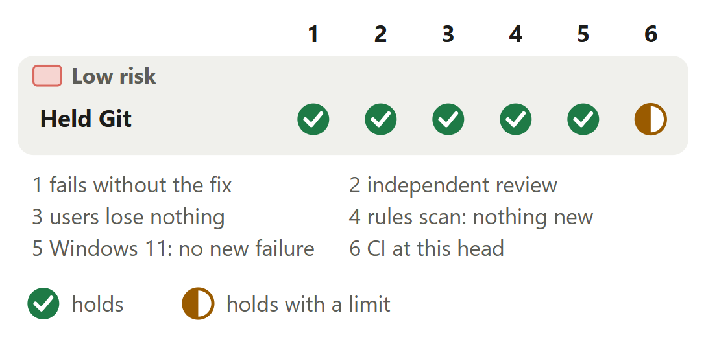

# The case that closes mid-walk passes alone and in its file

For [pull request #935](https://github.com/neralabs/rerail/pull/935), head f43c77c14. [report.html](report.html) is the same report as one page: download it and open it.

## 1. The decision

**May the case that closes mid-walk hold the session's first Git running until the close ends it?**

**We recommend:** approve it: alone on Linux x64 the case then passed 20 of 20 runs where `main` failed 10 of 10, and it fails when the close leaves that Git running.

| Size | Risk and review | Waits on | Not verified |
|---|---|---|---|
| 12 lines in 1 file: 0 ship, 12 are the tests it changes, 0 are other tests and text | Fast. One test case, no product code. | Nothing. No CI run on GitHub yet: not pushed. | 1 |

## 2. Intent, and the gap

| Change | Intended | Found | Now |
|---|---|---|---|
| Close meets running Git | A Git running at the close _(code comment)_ | That Git exited first _(timed runs)_ | Closes the gap. |

Found on 20 November 2026: `main`'s CI run 44761604477 failed on the case at d69d7ab68, one commit after #904.

Sources at main, and causes

| Change | Where main states the intent | The cause, and what was measured |
|---|---|---|
| Close meets running Git | `test/engine/code-rule/code-rule-bridge.test.ts` at d5f941195, the case's comment above its first check. | The case expected a real Git to still be running at a moment it did not wait for: the open's return, about 4 ms in a cold process and 2 ms in a warm one. |

## 3. Where to look

1. **Read first**, 3 min: `code-rule-bridge.test.ts`: the case "closes mid-walk with no Git it started still running". Does it hold a Git the session starts, and must the close end it, as in the case after it?

**Then skim**, 1 min: Nothing else changes.

## 4. Risk against verification

One change, low risk: one test case; the bridge, the HEAD reader and the ignore rules are as they were.

Each half mark's limit

| Change | Check | It holds with this limit |
|---|---|---|
| Held Git | CI at this head | No CI run at this head on GitHub yet: the branch is not pushed. |

## 5. The changes

**First Git held until close**, low risk: Linux x64, the case alone: `main` failed 10 of 10 runs; here 20 of 20 passed.

<b>6. The decisions</b>

**How does the case make sure a Git of the session runs when it closes?**

**We chose** it holds the session's first Git until it is ended, as the case after it does. **Would change our mind:** A maintainer who wants the real Git running at the close, at the cost of a check that depends on how fast Git exits.

| Option | What a user gets | Cost | What it breaks |
|---|---|---|---|
| Hold the session's first Git **(chosen)** | A close that meets a running Git every run, and must end it. | 11 added and 1 removed line in one test file. | The Git the close ends is the file's stand-in, not Git itself. |
| Wait for a real Git to be running | The real Git. | A wait in the case. | Git answers in a few milliseconds: it may exit before the wait sees it, so the case still depends on timing. |

**Evidence.** On Linux x64 `main` d5f941195 failed the case alone in 10 of 10 runs and this head passed 20 of 20 alone and 20 of 20 in its file; without the close's `git.stop()` this head failed 5 of 5.

<b>7. How it fits</b>

Nothing has to merge first: it is one commit on `main` d5f941195. It edits one case of `code-rule-bridge.test.ts`.

<b>8. What is not covered</b>: 1 not verified, 1 limit that stays

1. **macOS** never ran.

**Limits that stay**

- On Windows 11 the case passed alone at `main` too, 20 of 20 runs, so the change has no red run there.

## 9. What we ask of you

We ask no ruling.

<b>10. Evidence</b>

The description on GitHub is the record: "How you tested it" holds the runs on `main` and here.

| Where | What ran | Result |
|---|---|---|
| Linux x64 | The case alone and in its whole file at `main` d5f941195, 0a3ce014c, b2c8e7ea1 and v0.1.5 | `main`: 0 of 10 alone, 10 of 10 in the file. 0a3ce014c: 9 of 10 alone, 10 of 10 in the file. b2c8e7ea1 and v0.1.5: 10 of 10 alone. |
| Linux x64 | The case here, 20 runs alone and 20 in its whole file | 20 of 20 alone; 20 of 20 in the file, 254 passed and 2 skipped each run. |
| Linux x64 | The case here with `await discovery.git.stop()` taken out of `CodeRuleBridge.close` | Failed 5 of 5: the case checks that the close ends the session's Git. |
| Linux x64 | A log line at the open's return, alone and in the file, at `main` and at 0a3ce014c | 0a3ce014c: the HEAD Git running in 6 of 6. `main`: no Git running alone in 6 of 6 (open 3.8 to 4.8 ms), one running in the file in 4 of 4 (1.8 to 2.1 ms). |
| Windows 11 | The case alone at `main` and here, and in its whole file here | Here: 20 of 20 alone, 30 of 30 in the whole file (256 passed each). `main`: 20 of 20 alone. |

**Sources.** The branch at f43c77c14 and its diff against `main` d5f941195, read on 20 November 2026; runs at f43c77c14, at `main` d5f941195, 0a3ce014c, b2c8e7ea1 and v0.1.5 on two Linux x64 machines and a Windows 11 machine.

