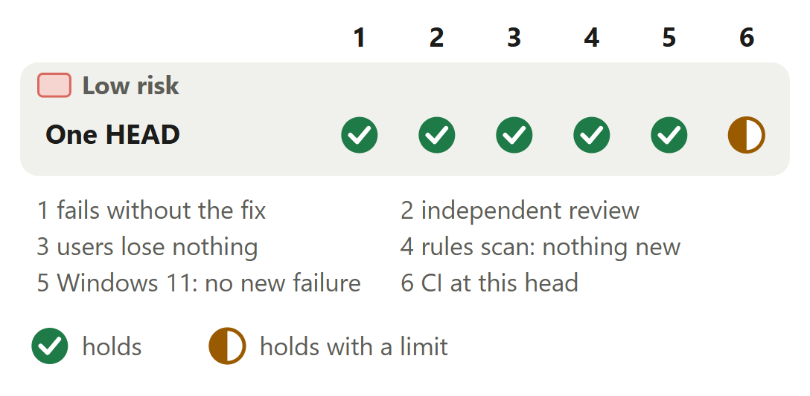

# Files a command writes and commits while Rerail reads Git are checked

For the pull request of branch `JeanFrancoisGagne/committed-edits-stay-own`, not opened yet, head 7ec49f378. [report.html](report.html) is the same report as one page: download it and open it.

## 1. The decision

**May a walk read Git again while `HEAD` moves under it, up to three times, keeping the first reading when `HEAD` never holds still?**

**We recommend:** approve it: files a command writes and commits while Rerail reads Git are checked as the agent's edits; a walk finding no write of Git's starts no extra Git process; nothing is checked less.

| Size | Risk and review | Waits on | Not verified |
|---|---|---|---|
| 293 lines in 3 files: 83 ship, 210 are tests and text | Careful. A code owner approves; no high-risk path. | CI. GitHub's CI runs at this head, 7ec49f378. | 3 |

## 2. Intent, and the gap

| Change | Intended | Found | Now |
|---|---|---|---|
| A committed file, checked | A committed file stays an edit _(docs)_ | Taken for Git's, never checked _(loaded test runs)_ | Closes the gap. |

Found on 14 November 2026 on Linux x64, in a unit test that failed now and then under load, and in its Git traces.

Sources at main, and causes

| Change | Where main states the intent | The cause, and what was measured |
|---|---|---|
| A committed file, checked | `docs/reference.md` at 7ff56e15e, "What counts as Git's write": "A file written and committed in one command stays an edit, measured from the tree before the commit." `src/engine/code-rule/code-rule-bridge.ts`, `#gitVerdicts`: `readGitView` reads `HEAD`, then `HEAD`'s blobs and the index; `#restoredFromBranches` then reads blob ids and the branch tips, each in a Git process of its own. | Each later Git process resolves `HEAD` and the branches again. A commit between the first read and a later one leaves `HEAD` read as unmoved while `HEAD:path` or the branch's new tip holds the file's blob. The file then reads as one holding `HEAD`'s blob with `HEAD` still (`holdsGitBlob`) or as restored from the branch, is recorded as seen, and never reaches the evaluator. |

## 3. Where to look

1. **Read first**, 10 min: `code-rule-bridge.ts`: `#gitVerdicts`, `#settledReading`, `#readGitVerdicts`, `findsGitWrite`, `headStill`, `keepFirstSnapshot`. Can a reading stand that no longer holds for one `HEAD`, or Git be read again when nothing is Git's?

**Then skim**, 5 min: The tests: a hook on the stand-in for Git processes that commits at a chosen Git read, and a case that counts the reads of `HEAD`.

## 4. Risk against verification

One change, low risk: a walk with no write of Git's reads as before, and the first reading stands when `HEAD` never holds still.

Each half mark's limit

| Change | Check | It holds with this limit |
|---|---|---|
| One HEAD | CI at this head | GitHub's CI runs at this head. Before the engine, CI's integration job at the head before the merge, 20 runs a side on one machine: 15 of 20 passed, `main` 7ff56e15e 12 of 20, the failures in the same cases or test file on both. |

## 5. The changes

**Git verdicts read at one HEAD**, low risk: A commit landing while Rerail reads Git: `main` audits none of its files; here all, unless commits land every reading.

<b>6. The decisions</b>

**Read Git again while `HEAD` moved, or pin every read to one `HEAD`?**

**We chose** read again, up to three readings, only when a reading takes a change for Git's and `HEAD` moved. **Would change our mind:** A reading of Git in one long-lived process that also answers for `HEAD` and the branches, which would remove the window itself.

| Option | What a user gets | Cost | What it breaks |
|---|---|---|---|
| Read again while `HEAD` moved, up to three readings **(chosen)** | Every file of a command that committed once or twice during the reading is checked as the agent's. | One `git rev-parse HEAD` on a walk that finds a write of Git's; a whole reading more only when `HEAD` moved. | Nothing; `HEAD` moved and back within one reading stays uncaught, as on `main`. |
| Pin each read to the `HEAD` read first | The same for `HEAD`'s blobs and the branch tips. | No extra process. | Touches the shared `gitBranchTips` and `gitRevisions`; the index and the reflog are still read at other moments. |
| Read `HEAD` again after every walk's verdicts | The same as the chosen option. | One Git process more on every walk with changes. | Costs every edit walk for a case only Git's writes can meet. |
| Hold every file a running command writes for its result | Files new to the session checked when the command ends. | No extra process. | Checks of a long command's new files come later than today; a commit during the command's own result walk is still lost. |

**Evidence.** The race cases: a hook on the test's stand-in for Git processes commits a staged file just after the verdicts read `HEAD`, or just before they list the branches. `main` 7ff56e15e and the published 0.1.5 audit nothing; this change audits the file, on Linux x64 and Windows 11. Through the hook and a daemon on Linux x64, at the head before the merge: `main` 890802859 steered 0 of 5 such commands, that head 5 of 5.

**When `HEAD` moves through every reading, which reading stands?**

**We chose** the first, which is the one reading `main` makes, so no file is checked less than today. **Would change our mind:** A way to tell a command still committing from a rebase at work, so that its files could be checked without steering on Git's writes.

| Option | What a user gets | Cost | What it breaks |
|---|---|---|---|
| The first reading **(chosen)** | What `main` checks, exactly. | None. | A command committing at every reading keeps the files `main` misses unchecked, as today. |
| The last reading | Less: each later reading's branch tip holds more of a committing command's files. | None. | Checks less than `main` in a command that commits in a loop; a case fails with it. |
| None: every change the agent's | More files checked. | None. | Files Git wrote while `HEAD` moved, as in a rebase at work, would be checked as the agent's and steer it; a case fails with it. |

**Evidence.** A case commits at each of the three readings: `main` and this change audit exactly the same file. With the last reading standing, or none, that case fails, on Linux x64 and Windows 11.

<b>7. How it fits</b>

Nothing has to merge first: it stands on `main` c21947263, with the 0.2.0 engine, merged in with no conflict. #640, #665, #680, #698, #771 and #802 edited `code-rule-bridge.ts` and have merged; #768 changed the same walk, and this change covers what it leaves.

**The trial merges.** `git merge-tree --write-tree` of this head, which holds `main` cf5d520e4, with the head of each open pull request on GitHub on 19 November 2026: only #738 changes this change's files, and it conflicts in the three files it conflicts in with `main` alone; the 15 others share no file with it. Any order works.

<b>8. What is not covered</b>: 3 not verified, 1 smaller gap, 2 limits that stay

1. **macOS** never ran.
2. **On the 0.2.0 engine** only the 14 importing test files ran; the hook-and-daemon run, the mutants, the 166 files and the integration job are of the head before the merge.
3. **`main`'s entries line put back** in `readUnmergedView` passes every case: it differs only when a checkout's unmerged entries change between two readings of the first walk that reads them; `main`'s line had no case either.

**Smaller gaps**

- **A second and third reading on Windows** are not timed through the product: Rerail runs git.exe from PATH there, and no script can stand in for it to commit during a walk.

**Limits that stay**

- A command that commits at every one of the three readings keeps the files `main` misses unchecked, as today; the release note says so.
- `HEAD` moved and moved back within one reading, a commit and its reset within milliseconds, is not caught, as on `main`.

## 9. What we ask of you

We ask no ruling.

<b>10. Evidence</b>

The description on GitHub is the record: "How you tested it" holds the runs on `main` and here.

| Where | What ran | Result |
|---|---|---|
| Linux x64 and Windows 11 | On the 0.2.0 engine: the 14 test files importing `code-rule-bridge.ts` at this head and at `main` c21947263, and this head's tests over `main` c21947263's source, each OS on one machine | Linux x64: this head 416 passed, 1 skipped; `main` 406 passed, 1 skipped; over `main`'s source the same 6 new cases fail, 410 pass. Windows 11, the same three counts. A busier Windows machine timed out older cases on both sides, none new. |
| Linux x64 | The bridge's cases with `code-rule-bridge.ts` as on `main` 7ff56e15e, and here; the two race cases and a control at the published 0.1.5's source | `main`: 6 of the 10 new cases fail. 0.1.5: both race cases fail in 20 of 20 runs, the control passes. The head before the merge: 203 of 203 pass, 20 of 20 rounds. |
| Windows 11 | The same, 20 rounds each side | `main`'s source: the same 6 fail in all 20 rounds. The head before the merge: 20 of 20 rounds pass, 10 new cases each. |
| Linux x64 | The built hook and a daemon, a commit during the walk, 5 commands each side, at the head before the merge | `main` steered and logged 0 of 5; here 5 of 5, in two runs. Git processes per hook call: 12 and 24; `HEAD` never still 12 and 39; idle and edits equal. |
| Linux x64 and Windows 11 | Each new or changed line changed, 14 mutants, at the head before the merge | Linux x64: 13 of 14 caught. Windows 11: 13 of 14 caught, by the same cases. The one left puts `main`'s own entries line back. |
| Linux x64 and Windows 11 | The 166 test files importing `code-rule-bridge.ts` at the head before the merge, on Linux with `main` 7ff56e15e on one machine | Linux: `main` 3,179 passed, 13 failed; the head 3,191 passed, 11 failed, the 11 lacking pack data on both. Windows: 3,158 passed, 11 failed, the react pack's cases `main` fails every run too. |
| Linux x64 | CI's integration job | 20 runs a side on one machine: 15 of 20 pass here, 12 of 20 at `main`; the failures fall in the same cases or test file on both sides. The hook case an earlier count flagged: 40 of 40 a side under load. |
| Linux x64 | The automated reviewer's rules over the diff against `main` | no new finding; functions at complexity 1 to 5. |

**Sources.** The branch at fd2eead23 (552cc6e38 with `main` c21947263 merged in, no conflict) and its diff against `main` c21947263, read on 19 November 2026; the runs on the 0.2.0 engine on 19 November; the others on 18 and 19 November at the head before the merge, against the `main` each names; the 25-file test runs of 14 November at `main` c89f068ed.

