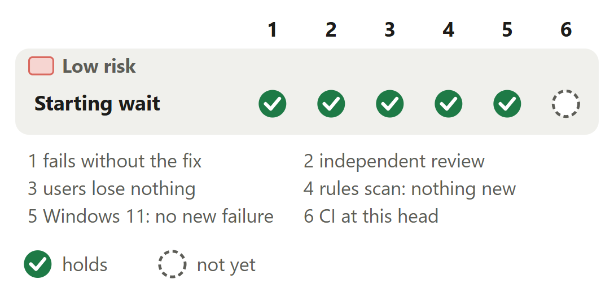

# A start beside a daemon still in its start waits for it

For [pull request #987](https://github.com/neralabs/rerail/pull/987), head ab81d1c26. [report.html](report.html) is the same report as one page: download it and open it.

## 1. The decision

**May a start wait for a daemon still in its start as long as for its own launch, 15 s?**

**We recommend:** approve it: a script's start beside a starting daemon now ends with that daemon running, and no state gives less than `main`.

| Size | Risk and review | Waits on | Not verified |
|---|---|---|---|
| 970 lines in 15 files: 329 ship, 217 run in every test run, 424 are tests and text | Standard. No ruling asked; no high-risk path. | Nothing. CI runs on GitHub once the branch is pushed. | 3 |

## 2. Intent, and the gap

| Change | Intended | Found | Now |
|---|---|---|---|
| Start beside starting daemon | A start uses a slow daemon _(a test's name)_ | Exit 1 beside a starting daemon _(held runs, 10 each)_ | Closes the gap. |

Reported in November 2026 for a script in a fresh container; held and counted on Linux x64 and Windows 11 machines.

Sources at main, and causes

| Change | Where main states the intent | The cause, and what was measured |
|---|---|---|
| Start beside starting daemon | `test/runtime/daemon-control/daemon-home.test.ts` at `main` 8b4c74cbe: "says a daemon slow to come up may still be starting, and names the status that shows it once it answers; a start uses it, never a second". | `startDaemon` looked the daemon up with one 2 s probe and refused one that `daemon.json` records and that does not answer, as `alive but not answering`. Nothing told a daemon in its start from one that had stopped answering. Two starts at once: the second waited 15 s for the start lock the first held. |

## 3. Where to look

1. **Read first**, 10 min: `daemon-control.ts`: `startBesideStarting`, `untilStarted`, `startLookup`. Can any path launch a second daemon beside one in its start, or wait past a start's limit?
2. 10 min: `home-daemon-lock.ts`, `daemon.ts`, `cli.ts`, `setup-cli.ts`, `daemon-waits.ts`, `index.ts`, `starting-daemon.ts`, `daemon-start-gate.mjs`.

**Then skim**, 5 min: The two cases for a slow daemon are as on `main`; new cases fake the home's lock; the test support holds the daemon's start until a file appears.

## 4. Risk against verification

Start at `startBesideStarting`: the one place a start waits or launches.

Each limit, and each check that does not hold yet

| Change | Check | Its limit, or why it does not hold yet |
|---|---|---|
| Starting wait | CI at this head | CI runs on GitHub once the branch is pushed; the lint and type-check job is clean on a lab machine. |

## 5. The changes

**Start waits for a starting daemon**, low risk: A start beside a daemon in its start: exit 1 in 10 of 10 runs at `main`, exit 0 here.

**6. The decisions:** we made no choice here that a maintainer could have made differently.

<b>7. How it fits</b>

It stands on `main` 1609ac3a30 alone and shares no file with an open pull request we know of.

<b>8. What is not covered</b>: 3 not verified, 1 limit that stays

1. **macOS** never ran.
2. **Lines taken out** were taken out on Linux x64 only; the cases ran on both systems.
3. **The longest hook wait** beside an older package's daemon in its start is about 60 s by the limits, as at `main`; no run measured it.

**Limits that stay**

- A daemon that ends its start and then stops answering is reported at 15 s as one that may still be starting.

## 9. What we ask of you

We ask no ruling.

<b>10. Evidence</b>

The description on GitHub is the record: "How you tested it" holds the held runs, the red cases and the test files.

| Where | What ran | Result |
|---|---|---|
| Linux x64 | Both flows, 10 runs each, held and not | 40 of 40 runs exit 0, one daemon each, at c537ef225. |
| Windows 11 | The same | 40 of 40 runs exit 0, one daemon each, at 4453c03c6. |
| Linux x64 | 21 unit files, 6 integration files | 658 and 25 passed, none failing. |
| Windows 11 | 21 unit files | 603 passed, none failing; `main` 589. |

**Sources.** The diff at ab81d1c26 against `main` 1609ac3a30, read on 21 November 2026; runs on Linux x64 lab machines and Windows 11 virtual machines.

