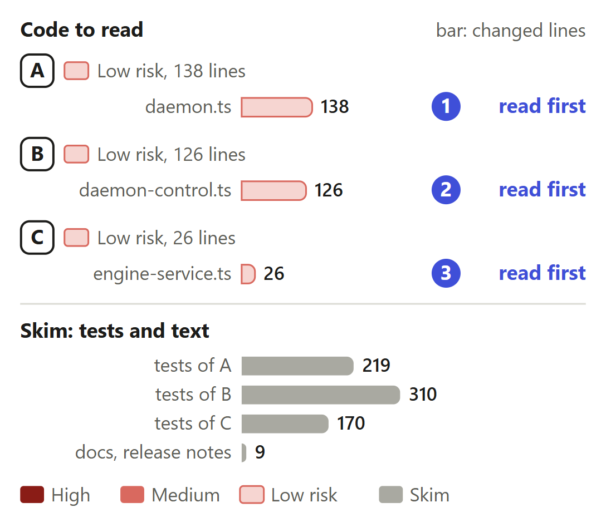
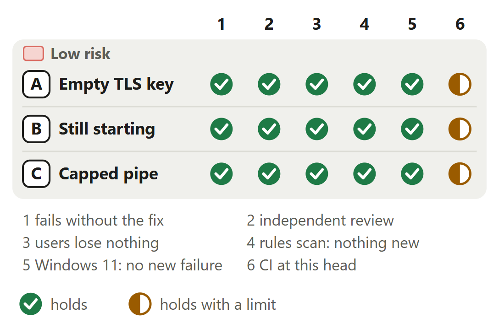

# A daemon start ends in the state it reports, in three cases

For the pull request of branch `JeanFrancoisGagne/daemon-start-three-states`, not opened yet, head 89fb747c7. [report.html](report.html) is the same report as one page: download it and open it.

## 1. The decision

**Should `rerail daemon start` end in the state it reports beside a one-instance pipe, past its 15 s wait and with an empty TLS key?**

**We recommend:** approve it: each start now says what is true and leaves a serving daemon where one can serve, and no state gives less than `main`.

| Size | Risk and review | Waits on | Not verified |
|---|---|---|---|
| 998 lines in 14 files: 290 ship, 708 are tests and text | Standard. No ruling asked; no high-risk path. | Nothing. CI passed at 3cf2a025b; the run at this head follows. | 1 |

## 2. Intent, and the gap

| Change | Intended | Found | Now |
|---|---|---|---|
| A. An empty key file | A bad key serves locally _(code comment)_ | An empty key served nothing _(a real daemon)_ | Closes the gap. |
| B. A start's wait ends | A slow daemon is left running _(a test's name)_ | Told it failed; it served _(the built CLI)_ | Closes the gap. |
| C. A held pipe name | A held name moves the engine _(docs)_ | Every start exits with EBUSY _(Windows 11 probe)_ | Closes the gap. |

Found in November 2026 on Linux x64 and Windows 11 machines, with a real daemon and the built CLI.

Sources at main, and causes

| Change | Where main states the intent | The cause, and what was measured |
|---|---|---|
| A. An empty key file | `src/daemon/daemon.ts` at 7efcac9c6, above `serveRerailDaemon`: "a TLS key it may not serve with (`TlsKeyExposedError`), which keeps it from serving https and from other machines, no longer keeps it from this one ... so hooks keep recording and steering". | `loadDaemonTls` read the key as text and handed it on unparsed, and Node's TLS server sets a key only when its value is truthy, so an empty key read as none: the daemon listened with a certificate and no key. A key file of spaces or text was refused by OpenSSL with a line that named no file. |
| B. A start's wait ends | `test/runtime/daemon-control/daemon-home.test.ts` at 7efcac9c6, line 280: "leaves the next start to use a daemon slow to come up after the first start's wait ran out, never a second". `src/runtime/daemon-control.ts` line 1166 throws `Rerail daemon did not become ready within 15s`. | `readyDaemon` threw "did not become ready" when its clock ran out and never asked the launched process again, so the message came from the clock, not the process. The daemon went on to write `daemon.json` and serve as the command asked. |
| C. A held pipe name | `docs/windows.md` at 7efcac9c6, line 526: the engine "listens on the same name with a random hex suffix, recorded in `daemon.json` as `kernelSocketPath`". `src/runtime/engine-service.ts` line 941: "libuv ... reports a name another process holds as EACCES or EADDRINUSE." | libuv reports a holder that capped its instances and made them all as `EBUSY`. `listenOnSocket` sent only `EACCES` and `EADDRINUSE` to `listenBesideHeldPipe`, so it rethrew `EBUSY` and the daemon exited before it was ready. |

## 3. Where to look

1. **Read first**, 5 min: `daemon.ts`: `loadDaemonTls`, `refuseUnparsed`, `serveRerailDaemon`. Does an empty key get what a key others can read gets?
2. **Read first**, 10 min: `daemon-control.ts`: `unansweredLaunch`, `holderNotRecorded`, `readTail`. Does a later start name a daemon that never answers, and how to check it, as `main` does?
3. **Read first**, 5 min: `engine-service.ts`: `listenBesideHeldPipe`, `HELD_PIPE_CODES`. Can a start skip the question beside this home's own busy engine?

**Then skim**, 10 min: The tests: each change's cases at its seam, and one case where a slow daemon meets a held pipe on Windows. The release notes and five doc lines.

## 4. Risk against verification

Three changes, one source area each; none gives less than `main`.

Each half mark's limit

| Change | Check | It holds with this limit |
|---|---|---|
| A to C | CI at this head | No CI run at this head on GitHub yet: the branch is not pushed. CI's lint and type-check job is clean here; its integration job passed at 1be9a52aa: 91 tests, 4 skipped. |

<b>5. The changes</b>

**A. Empty TLS key serves locally**, low risk. A start with an empty key: `main` 15.2 s and a daemon serving nothing; here 0.7 s, serving loopback.

- **Problem:** A daemon given an empty `--tls-key` said it listened on https while every handshake failed and a plain request was reset; the start waited 15 s, said it did not become ready, and left it running.
- **Who meets it:** Anyone whose key file is empty, truncated or not yet written (`touch key.pem`), on every such start: 9 of 9 starts at `main` 7efcac9c6 on Linux x64 and Windows 11. How many people meet it is not known.
- **What it does:** `loadDaemonTls` parses the certificate as the start does, then the key as the https server does. A key that fails, whoever can read it, is a `TlsKeyUnparsedError`, which `serveRerailDaemon` answers as it answers a key others can read: this computer alone, over http, saying why in one line naming the file.
- **Risk:** Low: the path a key others can read already takes; every key a server took before still serves.
- **Check:** `serveRerailDaemon`: does an empty key now get exactly what a key others can read gets, and nothing more? `refuseUnparsed`: is every key a server took before still taken? The parse is the server's own.
- **Picture:** An empty TLS key, the built CLI and Claude Code hook on Linux x64, two runs a side: at main 7efcac9c6 the start answered after 15.2 s, its port serving nothing; here it answered in 0.69 s naming the file and served http. Hooks on the engine socket recorded 7 ledger lines a run at both.
- **Method:** Linux x64, the built CLI and hook, two runs a side at `main` 7efcac9c6 and at this head on one machine; the start timed from its start to its exit, the port asked over http and https, two hooks sent to the recorded engine socket.

**B. Start names a daemon still starting**, low risk. Paused daemon: `main`'s first start said it failed, 4 of 4; here it says the daemon may still be starting.

- **Problem:** The start waited 15 s, said the daemon did not become ready, and exited 1, while the daemon it launched went on to serve.
- **Who meets it:** Every start whose daemon takes over 15 s to answer: a busy machine, or a key file another program holds. 4 of 4 starts through the built CLI at `main` 7efcac9c6 on Linux x64 and Windows 11.
- **What it does:** `unansweredLaunch` asks the process once more when the wait ends, names it by pid as possibly still starting and points to `rerail status`. `holderNotRecorded` gives a daemon not yet in `daemon.json` when a later start's wait ends `main`'s text, and says the start leaves it running. `readTail` reads at most 64 KiB.
- **Risk:** Low: one message at the end of a wait that ran out; the 15 s wait, the exit code and when a daemon ends are `main`'s.
- **Check:** `holderNotRecorded`: does a later start name a daemon that never answers, with how to check it before ending it? Does `readTail` leave out the line its 64 KiB edge cuts into?
- **Picture:** Through the built CLI on Linux x64 and Windows 11, a daemon paused right after it took the home, two runs a side on each system: at main 7efcac9c6 every first start said the daemon did not become ready and every daemon then served; here each said it may still be starting, and each daemon served.
- **Method:** Linux x64 and Windows 11, the built CLI, a daemon paused right after it took the home and resumed once the first start ended, two runs a side at `main` 7efcac9c6 and at this head on one machine; a second start, `rerail status` and `rerail daemon stop` after it.

**C. Fallback pipe beside a capped holder**, low risk. Starts beside a one-instance pipe: `main` exited 1 with `listen EBUSY`; here both served on the fallback pipe.

- **Problem:** On Windows, while another program held the engine pipe's name with a one-instance pipe, every start exited 1 with `listen EBUSY` and a hook's autostart started no daemon.
- **Who meets it:** A Windows computer with such a program running, on every start and every hook while it runs. How many computers meet it is not known.
- **What it does:** `listenOnSocket` hands every listen failure on a pipe name to `listenBesideHeldPipe`, which owns the held codes (`HELD_PIPE_CODES`: `EACCES`, `EADDRINUSE`, `EBUSY`). For `EBUSY` it listens on the fallback pipe without asking the holder.
- **Risk:** Low: the changed code runs only when a listen on a pipe name fails; every code but `EBUSY` takes `main`'s path.
- **Check:** `listenBesideHeldPipe`: can a start beside this home's own busy engine skip the question and run a second daemon? Only `EBUSY` skips it, and a case shows a busy Node pipe server reads as `EADDRINUSE`.
- **Picture:** On Windows 11 at main 7efcac9c6 beside a one-instance pipe on the engine pipe's name: no start served, each exited 1 with listen EBUSY; here both served on the fallback pipe.
- **Method:** Windows 11, the built CLI and two Claude Code hooks from each build, two runs a side on one machine, beside a PowerShell pipe of one instance that only holds the name.

<b>6. The decisions</b>

**What does a start say when its daemon has not answered in 15 s?**

**We chose** it asks once more, names the daemon by pid as possibly still starting, points to `rerail status`, and exits 1. **Would change our mind:** a maintainer who wants scripts to tell "still starting" from "failed" by the exit code.

| Option | What a user gets | Cost | What it breaks |
|---|---|---|---|
| Ask once more; a later start gives `main`'s text and leaves the daemon running **(chosen)** | A true message in every state, and `main`'s text naming a daemon that never answers. | Nothing. | A second start that ends before a slow daemon answers gives `main`'s text. |
| End the daemon when the wait runs out | A true "failed". | Nothing. | A daemon slower than 15 s never comes up; `main` keeps it for the next start. |
| Every later start says "still starting" | Starts that agree while a daemon comes up. | Nothing. | No start names a hung daemon to end, and `rerail status` says nothing runs. |

**Evidence.** Through the built CLI on Linux x64 and Windows 11, a daemon paused as it starts: each second start, begun 0.6 to 1.6 s or 4 to 5.4 s after the first or once it gave up, ended with the daemon 25.5 to 30.0 s in the home, naming it to check before ending, at `main`, at e30f3ae42 and here, here adding "This start leaves that process running." A refused remote start already exits 1 while a daemon runs.

**Ask a holder that capped the pipe's instances whether it is this home's engine?**

**We chose** no: no Rerail engine caps its instances, and asking costs 2 to 30 s. **Would change our mind:** a Rerail engine that makes its pipe through something other than Node.

| Option | What a user gets | Cost | What it breaks |
|---|---|---|---|
| The fallback pipe at once, without asking **(chosen)** | A daemon as fast as with no holder; nothing sent to the holder. | Nothing on the common path. | It rests on Node never capping a pipe server's instances, which a case checks. |
| Ask, as for other holders, then the fallback pipe | One path for every holder. | The ask takes the holder's one free instance (2.0 s) or waits 30 s for one it never frees. | The start reports failure at 15 s while the daemon then serves. |

**Evidence.** On Windows 11 at `main`, three rounds of each holder: a one-instance pipe, free or taken, gives `EBUSY`; a Node pipe server, busy or not, gives `EADDRINUSE`. The ask against the one-instance holder answered false in 2.0 s free and 30.0 s taken.

<b>7. How it fits</b>

It stands on `main` 6b3990ba8, merged in; nothing has to merge first. That `main` holds #677, which edits the same lookup: the merge keeps #677's read limit and text.

This pull request is based on main at 6b3990ba8, which holds #677, and needs no other change; nothing waits on it. In trial merges it adds no conflict to three open pull requests that share a file.

**Shared files and trial merges.** Trial merges of 89fb747c7 on 20 November 2026, to refresh against GitHub: `main` 6b3990ba8, with #677, merged in. #674, #676 and #812 share a file each and add no conflict beyond their own with `main`.

<b>8. What is not covered</b>: 1 not verified, 5 limits that stay

1. **macOS** never ran.

**Limits that stay**

- A pipe holder that may make more instances but keeps every one taken still makes a start wait 30 s for its answer, as on `main`.
- Two starts at once while a daemon takes 15 to 30 s: whether the second finds it depends on which wait ends first, as on `main`.
- A second start that ends before a slow daemon answers names it to check before ending, as on `main`, and says it leaves it running.
- Until a daemon still coming up answers, `rerail status` says it is not running or not answering, as on `main`.
- A start with the key fixed, beside the daemon an empty key left serving this computer alone, finds it serving and exits 0 still over http; run `rerail daemon stop` first, as for a key others can read.

## 9. What we ask of you

We ask no ruling.

<b>10. Evidence</b>

The description on GitHub is the record: "How you tested it" holds the runs at `main` and here.

| Where | What ran | Result |
|---|---|---|
| Windows 11 | The built CLI and two Claude Code hooks beside a one-instance pipe on the engine pipe's name, `main` 7efcac9c6, ba0545900 and here on one machine | `main` 7efcac9c6: the start exited 1 with `listen EBUSY` in 2.0 to 4.3 s, 4 of 4, and the hooks recorded nothing (ba0545900: 1.3 and 1.5 s). Here: the fallback pipe in 2.4 and 4.7 s, http 200, 7 ledger lines. |
| Linux x64 and Windows 11 | At c1a0c0f2d: two starts beside a daemon paused while it starts, the second begun while the first waits or after | Each second start ended 30.2 to 31.2 s after the first began and named the process to check before ending it, at `main`, at e30f3ae42 and at c1a0c0f2d, the last two adding that it leaves it running; the first said it may still be starting, where `main` said it did not become ready. |
| Linux x64 and Windows 11 | The built CLI with a daemon paused right after it took the home, two runs a side | `main` 7efcac9c6: the first start said it did not become ready at 15.3 to 16.7 s and the daemon then served, as at ba0545900. Here: it said the daemon may still be starting, by pid; resumed, `rerail status` showed it running and the next start found it. Kept paused, `rerail status` and the next start gave what `main` gives, in each of three states. |
| Linux x64 and Windows 11 | The built CLI and the built Claude Code hook with an empty TLS key, two runs a side; at this head, four key files | `main` 7efcac9c6: the start exited 1 after 15.2 to 17.0 s, its port serving nothing. Here: exit 0 in 0.7 s on Linux and 2.7 to 14.0 s on Windows, naming the file, http 200 on loopback, 7 ledger lines a run. An empty key or one of spaces others can read: `main` cccb25a8d stopped the start, named only as open to others; here it serves alone, naming both faults. |
| Linux x64 and Windows 11 | Each fix's cases at this head; each fix's first line out | Linux 17 passed in each of 3 runs, Windows 21 in each of 2. Lines out: each fails its cases on Linux x64; on Windows 11 a commit with the four first lines out failed 2 of 2 runs, 12 cases each. |
| Linux x64 and Windows 11 | The test files of this change and of #677, at this head and at c1a0c0f2d | Here the 8 new cases: 20 of 20 on each system. 12 files: at 3cf2a025b Linux 427 passed and Windows 423, at c1a0c0f2d 424 and 420, none failing at either; the three more are that round's cases. At e30f3ae42 beside `main` d0c10e05e: Windows 420 against 400; Linux, with every importing file (27), 708 against 692. At 16cd83190 the 23 files passed beside `main` 7efcac9c6 on both systems. |
| Linux x64 | CI's integration job, at 1be9a52aa | 91 passed, 4 skipped. |
| Linux x64 | The automated reviewer's rules at `main` 6b3990ba8 over the diff | no new finding, with the published 0.1.5 and with Rerail built from `main`; no function this change adds or edits counts over 6. |

**Sources.** The branch at 89fb747c7, `main` 6b3990ba8 merged into it, and its diff against that `main`, read on 20 November 2026; runs at 89fb747c7, 3cf2a025b, 126e0fa6e, c1a0c0f2d, e30f3ae42, 16cd83190, 1be9a52aa, 7efcac9c6 and ba0545900 on Linux x64 machines and Windows 11 virtual machines, each beside other test runs.

