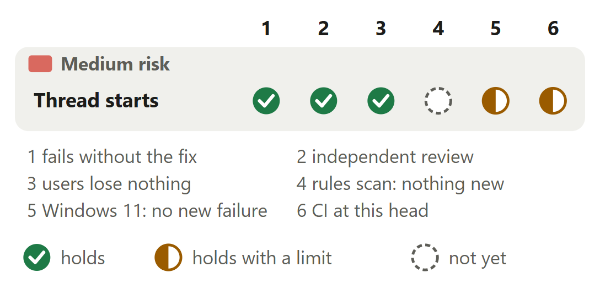

# On Windows the daemon starts Git and most icacls in starter threads

For [pull request #1076](https://github.com/neralabs/rerail/pull/1076), head c806a814c0. [report.html](report.html) is the same report as one page: download it and open it.

## 1. The decision

**May the daemon start its Git on Windows in up to four starter threads, and ask Git its two config questions as it starts?**

**We recommend:** approve it: the daemon then answers health probes and hooks while a Git start is held, and a session's first hooks while Git holds its config asks, where `main` waits 20.2 s.

| Size | Risk and review | Waits on | Not verified |
|---|---|---|---|
| 1,946 lines in 17 files: 816 ship, 1,130 are tests and text | Standard. Product code on Windows; a maintainer approves. | Nothing. Whole CI on GitHub not run yet. | 3 |

## 2. Intent, and the gap

| Change | Intended | Found | Now |
|---|---|---|---|
| The daemon keeps answering | Git reads do not block the daemon _(code comment)_ | Each Windows start held its thread _(slow-start loop)_ | Closes the gap. |

Found on 22 November 2026 on a Windows 11 laptop whose process starts stalled, then measured on a Windows 11 virtual machine.

Sources at main, and causes

| Change | Where main states the intent | The cause, and what was measured |
|---|---|---|
| The daemon keeps answering | `src/engine/git-start.ts` at 977061ebd0, the module's first lines: "Starts every Git process Rerail runs: the reads that do not block ({@link startGit}) and the runs that do ({@link runGitSync})." `startGit` then calls `spawn` on the asking thread (`git-start.ts:104`). | Node's `spawn` returns only once Windows has made the process, on the thread that asks. The daemon starts each Git read on its one thread, and a new worktree's walk asks a dozen or more, so the thread waits seconds per start and answers no hook, `rerail status` or `/healthz`. At `main` 4c49132c6e on a Windows 11 test machine with each start held by a preload, the thread stopped for up to 5.7 s at a time. |

## 3. Where to look

1. **Read first**, 25 min: `git-thread.ts`: `starterFor`, `threadLost`, `ThreadGit.endTree`, `ThreadGit.lost`. Does every start reach exactly one thread or this one, and end once, whatever thread ends first?
2. 20 min: `git-starter.ts`, `git-access.ts`, `exec-in-thread.ts`, `git.ts`, `git-start.ts`, `windows-acl.ts`, `engine-service.ts`, `child-process.ts`.

**Then skim**, 10 min: The daemon-level case and its gate; the thread cases hold starts with a preload that waits for files, never for time.

## 4. Risk against verification

One change, medium risk: start with the thread pool's loss and move paths in `git-thread.ts`.

Each limit, and each check that does not hold yet

| Change | Check | Its limit, or why it does not hold yet |
|---|---|---|
| Thread starts | rules scan: nothing new | Five lines of the asks' part fail no case when changed: an ask due again in a daemon, the close's end of the asks, and three that change only cost or an aborted signal. |
| Thread starts | Windows 11: no new failure | Until Git answers its asks, a checkout's remote is asked of Git on the daemon's thread. On Windows two starts made at once in two threads inherit each other's pipe ends. |
| Thread starts | CI at this head | No whole CI run at this head on GitHub yet; the 5 changed test files passed 30 rounds on its runners in our fork. |

## 5. The changes

**Git starts and asks off-thread**, medium risk: Hooks while a Git start or Git's config asks are held: unanswered at `main`, answered here.

<b>6. The decisions</b>

**Where should a slow process start wait?**

**We chose** starter threads in the daemon: no new process to watch, and file reads keep libuv's thread pool. **Would change our mind:** A run where a helper process or the engine's own start answers hooks faster at the slowest delay.

| Option | What a user gets | Cost | What it breaks |
|---|---|---|---|
| Starter threads in the daemon **(chosen)** | No start on the daemon's thread; the reader gets Node's child as before. | Up to four threads, a message per event of a child. | Nothing found. |
| A long-lived helper process | The same hooks: 175 ms at the median, 323 ms at p95. | A process to start, watch and restart. | Nothing, at a higher cost. |
| The native engine's own start | Starts off the thread: 180 ms at the median, 2,527 ms at p95. | A rebuild of the engine. | File reads wait behind starts in libuv's thread pool. |

**Evidence.** One run of the slow-start loop per option on a Windows 11 virtual machine at the slowest delay, each built on `main` 92fbff1ccf with the same other changes; starts on two worker threads, an earlier form of this change, gave 173 ms at the median and 250 ms at p95.

**What should a starter thread that fails before it runs leave?**

**We chose** a new thread once; after two such failures in a row, starts go where `main` makes them. **Would change our mind:** A failure that passes and comes back more than twice in a row on a real machine.

| Option | What a user gets | Cost | What it breaks |
|---|---|---|---|
| Replace it; after two in a row make no more **(chosen)** | A passing failure costs nothing; a lasting one ends as `main` behaves. | A counter, reset when a thread runs. | Nothing found. |
| Make no new thread after the first failure | The threads that run go on. | Nothing. | One passing failure leaves fewer threads for the daemon's life. |
| Always replace it | Threads come back after any failure. | Nothing. | A lasting failure makes a thread per start. |

**Evidence.** Three cases in `git-thread.test.ts`: a failed thread replaced and the read answered there; two failures in a row and every read on the asking thread; a thread that ran between two failures lets the second be replaced. Each fails with its line changed.

<b>7. How it fits</b>

It holds `main` 2a7a2b7766 by merges Git made alone and adds the starter threads and sessions' first hooks; `main` since touches none of its files. It needs no open pull request, and none needs it; #1051 and #1045 change other parts of its files, and each merges with no conflict.

<b>8. What is not covered</b>: 3 not verified, 1 smaller gap, 4 limits that stay

1. **The slow-start loop** ran once per setting. Here the slowest hook still took 15.5 s; with longer starts, 4.8 s, behind the worktree list the daemon's thread still runs.
2. **Independent review** read 988ee5431; it has not read this head or its config asks.
3. **macOS** never ran.

**Smaller gaps**

- **On Linux** the daemon-level case passes at `main` too: a start returns once the child runs there, so the case holds the run of the walk's verdict reads and guards that the daemon answers meanwhile.

**Limits that stay**

- Blocking Git runs (the worktree list, a clone's remote, the session's repository) still start on the daemon's thread: in the loop the worktree list stopped it for up to 3.6 s.
- A start may hop once more when a thread made before a failure has not run yet and fails too; each such failure counts toward the two.
- The `icacls` that makes a new session records folder outside the profile folder private still starts on the daemon's thread, once per such folder.
- Two starts made at once in two threads inherit each other's pipe ends on Windows; the daemon's own children were not measured for it.

## 9. What we ask of you

We ask no ruling.

<b>10. Evidence</b>

The description's "How you tested it" holds every run, at this head, at `main` 4c49132c6e and before this head took it; "What is not covered" what did not run.

| Where | What ran | Result |
|---|---|---|
| Windows 11, Linux x64 | Both daemon-level cases at `main` 4c49132c6e with the cases added | Windows: both failed, `/healthz` unanswered past 2.5 s while a Git start was held, and `Kernel request timed out` while Git held its asks. Linux: the slow Git case failed at 20.2 s against 5 s; a start does not hold the thread there. |
| Windows 11 | The 72 test files that import a changed module or start the daemon, here; the 69 of them `main` has, at `main` 4c49132c6e, on one machine | None failed here; at `main` one case ran past a 250 ms bound and passed here. |
| Windows 11 | The slow-start loop at this head's source and at `main` 4c49132c6e, alone on one machine | Hooks waited 167 ms at the median here against 1.5 s at `main`, and 164 ms against 3.7 s with longer starts; no hook failed on either side. |
| Windows 11, Linux x64 | The 5 test files this change adds or changes, 30 rounds here | Windows: 30 of 30 on a machine of ours and on GitHub's runner. Linux: 30 of 30 on GitHub's ubuntu-24.04 runner in our fork, 20 more on ours. |
| Linux x64 | Rerail's own rules and the complexity pack against `main` 4c49132c6e, and `npm run check` | No new finding, the same with Rerail built from `main`; the checks passed. |
| Windows 11 | The window, log and refused-thread cases at 988ee5431 with them added | 4 of 15 failed; here all pass. |
| Linux x64 | A single-line change to each of 6 lines the output window, the log lines and a refused thread add | Each fails its case. |
| Linux x64, Windows 11 | Every file under `integration/`, at 988ee5431 and at `main` 977061ebd0 | Linux: 8 fail on both for want of a standalone OMP executable, the launcher's update case at `main` too. Windows: 12 fail on both; one time limit here passed 3 of 3 alone. |

**Sources.** The branch at 1c210001f, which merged `main` 4c49132c6e, and its diff against that `main`, read on 25 November 2026; runs at c7e62fd61 (the same source and tests) and at that `main` on a Windows 11 virtual machine and Linux x64 machines, and at 1c210001f on GitHub's runners in our fork; older runs at 988ee5431, at 9b63f3fc2 and at `main` 977061ebd0.

