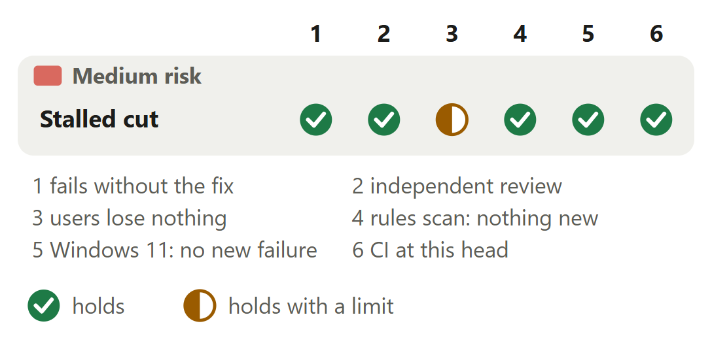

# Daemon: a stop cuts a stalled request and ends without the kill

For [pull request #652](https://github.com/neralabs/rerail/pull/652), head ffd9a7e3a. [report.html](report.html) is the same report as one page: download it and open it.

## 1. The decision

**May a stop cut a request that sent nothing for a second or two, so a stall no longer costs 10 s and a kill?**

1. During a stop, a client pausing a second or two inside one request is cut.

**We recommend:** approve it once you agree to answer 1: side by side with `main` on Linux x64 and Windows 11 every hook `main` answers is answered here, and Rerail's clients send each request in one write.

| Size | Lane | Waits on | Not verified |
|---|---|---|---|
| 752 lines in 5 files: 119 ship, 633 are tests and text | Fast. No high-risk path; the automated reviewer approved ffd9a7e3a. | A maintainer's review. CI passed at ffd9a7e3a, first attempt; no person has reviewed. | 5 |

## 2. Intent, and the gap

| Change | Intended | Found | Now |
|---|---|---|---|
| The stop | A graceful stop, the kill as fallback _(docs)_ | One stalled request: wait, then SIGKILL _(#609's steps, Linux x64)_ | Closes the gap, changes answer 1. |

Reported in #609 on 12 November 2026; its steps reproduce it on Linux x64.

Sources at main, and causes

| Change | Where main states the intent | The cause, and what was measured |
|---|---|---|
| The stop | `docs/reference.md` line 405: "a graceful stop (SIGTERM, or on Windows a request over its API); forced termination after 10 s, and an error if the process outlives that by 5 s." `src/runtime/daemon-control.ts` lines 1108 to 1109, a code comment: in the daemon's own shutdown "requests from other sessions finish, and it removes its state file and main-instance record." | `close` (`src/runtime/engine-service.ts` line 576) calls `server.close()` and waits for every connection. Line 587 gives a request 30 s, but once the server closes, Node 24 stops the check that enforces it, so a stalled request holds the close with no limit. Linux x64, 3 runs each: 10.16 s with a SIGKILL every run on `main`, 1.11 s with none here. After a SIGTERM with no kill behind it, `main` still ran 25 s later in all 9 cases. |

## 3. Where to look

1. **Read first**, 12 min: `engine-service.ts`: `awaitsRequest`, the `finish` handler in `trackConnections`, `cutStalledRequests`, then `close()`. Can a request whose body arrived, or an answer still being written, ever be cut?

**Then skim**, 6 min: No assertion of `main` is removed: each test file changes two import lines and adds tests, fourteen in all. Read the docs line: it now says what a stop answers.

## 4. Risk against verification

One half mark, none open. Start at check 3: one request `main` answers is cut here, on purpose.

Each half mark's limit

| Change | Check | It holds with this limit |
|---|---|---|
| Stalled cut | users lose nothing | Beside `main` on Linux x64 and Windows 11 at ffd9a7e3a, 0, 1 or 20 hooks waiting on events of 1 s, 9 s or never ending, a stalled request or none: every hook `main` answers is answered, at most 46 ms later on Linux x64 and 63 ms on Windows 11. The limit: answer 1 is cut on purpose. |

## 5. The changes

**The close cuts stalled requests**, medium risk: #609's steps, Linux x64, 3 runs each: 10.16 s and a SIGKILL on `main`; 1.11 s and none here.

<b>6. The decisions</b>

**What may the close cut?** (ask 1)

**We chose** only a request that stalls: cutting every connection resets a running event's hook. **Would change our mind:** a Rerail client that streams its request body or pauses inside it.

| Option | What a user gets | Cost | What it breaks |
|---|---|---|---|
| Keep requests that arrived; cut ones that stall, and connections that sent none **(chosen)** | Every hook whose request arrived gets its answer. A stop with one stalled request ends in 1.1 s, with no kill. | A look a second while the service closes, and a map of open connections. | A client that pauses over a second inside one request during a stop is cut: [answer 1](#1-the-decision). |
| Cut every connection as the close begins (07d749d7a) | The shortest stop. | Nothing. | The running event's hook gets a reset, and queued events are neither run nor recorded. |
| Refuse queued events some seconds into a stop (built and set aside) | A refusal a hook can read, in place of a reset at the kill. | About 1,100 more lines. #609's first comment describes it. | It refuses events `main` runs in the time left, and every queued event after an operating system's SIGTERM. |
| Do nothing (`main`) | Every event runs until the kill. | The full wait and a SIGKILL for each stop with a stalled request. | The daemon's clean-up is skipped. |

Before: At main the close calls server.close() and waits for every connection. A stalled request holds it with no limit, so rerail daemon stop sends SIGKILL at 10 s and the daemon runs no clean-up. After: With this change the close calls server.close(), then looks every second and cuts a request that sent nothing since the last look. It runs every event whose request arrived and answers each hook. When the last connection ends, the runtimes close, the clean-up runs and the daemon exits.

**Evidence.** On `main`'s source the stall test reads "still open" and the stop test counts one SIGKILL after 10.7 s (Linux x64). At 07d749d7a, which cut every connection, the three close tests fail with `socket hang up` where `answered` was expected. With the guard line removed at 4b2cea09e, both guard tests fail the same way. The description's "Decision 1" holds the same table.

**How long may a request send nothing?** (ask 1)

**We chose** one second between looks: five makes a stalled stop 5.0 s. **Would change our mind:** a hook seen pausing over a second inside a request.

| Option | What a user gets | Cost | What it breaks |
|---|---|---|---|
| 1 s between looks **(chosen)** | A stop with one stalled request takes 1.115 to 1.118 s, with no kill. A 0.5 s pause inside a request is answered. | Pauses of 1.6, 4 and 6 s inside one request are cut at 1.01 s, where `main` answers them. | Nothing a Rerail client does: every hook and the event stream hand the socket the headers and the whole body in one `end(body)`, and the engine proof sends headers only. |
| 5 s between looks | Pauses of 0.5, 1.6 and 4 s are answered. A 6 s pause is cut at 5.01 s. | A stop with one stalled request takes 5.040 to 5.047 s, with no kill. | Nothing found. |
| No cut (`main`) | All four pauses are answered. | A stop with one stalled request takes 10.169 to 10.192 s, with one SIGKILL each run. | The daemon's clean-up is skipped. |

**Evidence.** Measured at d34fe2f94 on Linux x64; the first request's cut is unchanged since. The stop: `stopDaemon` against a daemon from the built package, 3 runs. A pausing client sends half its request, waits, then sends the rest. A cut needs two looks a second apart that both find nothing new, so it comes one to two seconds after the last byte. Windows 11: the 0.5 s pause is answered, the 1.6 s and 4 s pauses are cut.

**On a connection its client keeps open, what marks a next request?**

**We chose** bytes read since an answer: a whole request sent late is still answered. **Would change our mind:** a Rerail client that keeps engine connections open.

| Option | What a user gets | Cost | What it breaks |
|---|---|---|---|
| Bytes read since the answer to a whole request **(chosen)** | A next request that stalls in its headers is cut: the connection ends at 6.00 s and at 1.0 s in the two cases measured. A whole request sent late is answered, as on `main`. | 18 code lines added and 6 removed, one union type, then one condition, then a queue per connection: 10 code lines added and 2 removed. | Nothing against `main` in 30 cases at 4b2cea09e and 20 at ffd9a7e3a, on Linux x64 and Windows 11; the 20 have a client that sends ahead or keeps its connection. Three cases stay as on `main`: part 8. |
| Leave it to Node's keep-alive timeout (`main`) | A whole request sent late is answered. | No code. | A next request that stalls in its headers is not cut: 10.6 s in one case, past the kill, and still open at 17 s in the other. |
| Clear the entry once the answer is written (the automated review's first fix) | A next request that stalls in its headers is cut. | One line. | A whole request sent late is lost: the connection is gone 2.0 s in and the request is never sent. |

**Evidence.** `main` at c89f068ed against 4b2cea09e, Linux x64 and Windows 11, two to four rows a case, times from the close's start. Part of a next request's headers 0.1 s after an answer 4.5 s into the close: 10.60 to 10.66 s on `main`, 6.00 to 6.13 s here. One header byte every 2 s: open at 17 s on `main`, cut at 1.00 to 1.04 s here. A whole request 2.5 s after an answer is answered on both.

<b>7. How it fits</b>

It stands on `main` alone and merges clean at c89f068ed; nothing waits on it. Of ten open pull requests sharing a file, two conflict in a trial merge: #680 in `close()`, #657 in one test's import lines.

**Trial merges and shared files.** `git merge-tree` of ffd9a7e3a with each head on GitHub on 14 November 2026. #680 (ours, a draft) at 961848254 conflicts in the body of `close()` in `src/runtime/engine-service.ts`: each wraps a different call in `try`/`finally`. #657 (ours, in review) at cf986a055 conflicts in the import lines of `test/runtime/daemon-control.test.ts`. Whichever lands second keeps both, and that fix is ours to make. Clean: the team's #667, #640 and #562, and our #665, #672, #673, #674 and #678, which edit `docs/reference.md`, `engine-service.ts` (#667) or the daemon-control test (#673, #678) in other lines.

<b>8. What is not covered</b>: 5 not verified, 5 smaller gaps, 7 limits that stay

1. **How often a request stalls in the field:** not known. #609's two field stops could have had this cause or #689's.
2. **Events still running at the kill:** the daemon is killed, as on `main`. That cause is #689, which this change leaves open.
3. **Three kept-connection cases stay as on `main`:** each is left to Node's keep-alive timeout and can hold the close past the kill (the limits below).
4. **Two lines have no test:** `stopLooking()` in the close's `finally`, and the `finish` listener's guard for a connection already closed.
5. **macOS** never ran.

**Smaller gaps**

- **A second stop, a session start.** A second `rerail daemon stop` while a first waits ends the daemon at once, on `main` and here. A session start 5 or 9 s into a stop with a stalled request fails on `main`; at 6bd876ba6 it was served (Linux x64).
- **Windows 11 under load.** Two cases of 20 hooks queued behind a 9 s event lost 12 and 14 hooks to the kill in one run. One has no stalled request, so it runs `main`'s path: alternating runs, 16 a side, answered 14.6 of 20 on `main` and 14.9 here.
- **The stop test's clean-up.** It failed in 6 of 40 rounds at 18a6c39e3 on Linux x64, after its body passed: its folder went while a thread of the stopped daemon still ran. Since 2d0b58a8a it waits until its daemon is gone: 0 of 40. The cause is `main`'s (#688).
- **The automated reviewer's two nits at 2d0b58a8a, both in tests.** A wait in the stop test's `finally` could hide the test's own failure, and a test helper unsubscribed a microtask late. 294dd8403 and 404f30d31 answer them, and the reviewer's review of ffd9a7e3a counts both as fixed.
- **One commit message is wrong.** 1eda50da2 says of a connection its client keeps open that "it never holds a stop to its 10 s kill". It can: decision 3. 8b02c7d74's message says so, and its code replaces that comment. Pushed commits are not rewritten.

**Limits that stay**

- `stopDaemon` and its 10 s before the kill, `daemon.ts`, `daemon-exit.ts`, `daemon-control.ts`, the start path and the daemon's HTTP server are unchanged.
- A kept connection that sends nothing after its answer ends about 6 s after that answer (Node's keep-alive timeout). One answered more than 4 s into the close holds it past the kill, as on `main`.
- Part of a next request's headers sent before the answer was written counts with the answered request, so that connection is left to the same timeout.
- After a request answered on its headers alone whose body then came, a next request that stalls in its headers is left to the same timeout.
- An event that never ends still holds the close: `rerail daemon stop` kills the daemon at 10 s and every waiting hook gets a reset, on `main` and here.
- A client of the engine socket can see one new thing: during a close, a connection whose request stalls is destroyed. No rule file, command, API or stored data changes.
- At run time a hook's connection and its request cost two listeners, four map writes and a queue entry, and the closing service looks once a second.

## 9. What we ask of you

Ask 1 rules on answer 1.

1. **May a stop cut a request that has sent nothing for a second or two?** We recommend yes: Rerail's clients send each request in one write.

<b>10. Evidence</b>

The description on GitHub is the record: "How you tested it" holds the runs, the cases beside `main` and each review's findings.

| Where | What ran | Result |
|---|---|---|
| CI on GitHub | Run 43589689351 at ffd9a7e3a, read on 14 November 2026 | 24 checks: 19 pass, 5 are skipped, none fails, all on the first attempt. At 404f30d31, run 43575929402 failed on each of three attempts, only in `Unit tests (Windows, 2/2)` and `CI result`, on tests of `main` this change does not touch (#683 in all three, #691 in the first, #681 in the third). At 2d0b58a8a, run 43569053686 passed on its third attempt after the #681 test failed twice. |
| Linux x64 | Failing first: the two test files of ffd9a7e3a on `main` at c89f068ed; before that, the first tests on `main`'s source | 8 of 58 fail: the stop test ends in one SIGKILL, five stalls stay open, and the two list tests have no `trackConnections` to call. With the first tests, 2 fail: the stalled request stays open, and the stop ends in one SIGKILL after 10.7 s. |
| Linux x64, Windows 11 | ffd9a7e3a: the 9 test files of the change and of the modules importing the engine service, the close tests run 20 times on Linux x64 and 10 on Windows 11; then a second run with 20 on each | Linux x64: 419 passed and 4 failed, each a 5 s timeout under a load of 13.5 in `hook-host` and `engine-service-runtimes` tests; those two files then passed 27 of 27 on a second machine, and the second run passed 423 of 423. The close tests: 280 of 280 in each. Windows 11: 265 passed, 18 skipped, 0 failed; then 405 passed, 18 skipped, 0 failed. |
| Linux x64, Windows 11 | ffd9a7e3a beside `main`: #609's steps against a daemon from the built package, 3 runs each. Then 0, 1 or 20 hooks waiting on events of 1 s, 9 s or never ending, with and without a stalled request | Linux x64: `main` 10.16 s with a SIGKILL every run, this branch 1.11 s with none. Windows 11: `main` 10.04 to 10.05 s with a kill, this branch 1.08 to 1.10 s with none. An idle daemon: 0.10 to 0.13 s on both. Every hook `main` answers is answered here, at most 46 ms later on Linux x64 and 63 ms on Windows 11. |
| Linux x64, Windows 11 | The case fixed in 08de63843, at 404f30d31 and at ffd9a7e3a beside `main` at c89f068ed. Then 20 cases with a client that sends ahead or keeps its connection | A whole first request whose event runs, then a next request's headers and one byte of its body. 404f30d31: cut 1.0 s into the close, the first request unanswered. ffd9a7e3a: answered 1.5 s in, when its event ends, and the stalled request cut 3.0 s in. `main` answers it and never cuts. In the 20 cases every request whose body arrived is answered wherever `main` answers it. |
| Linux x64 | The stop test, 40 rounds at each of three commits | It failed 6 of 40 at 18a6c39e3, 4 of 40 at c28ec2b8f and 0 of 40 at 2d0b58a8a. Each failure came in the test's clean-up, after its body passed (#688). |
| Linux x64, Windows 11 | `main` at c89f068ed against 4b2cea09e, Node 24.21: four kept-connection cases, two to four rows a case | Part of a next request's headers 0.1 s after an answer 4.5 s into the close: `main` ends at 10.60 to 10.66 s, this branch at 6.00 to 6.13 s. One header byte every 2 s: open at 17 s on `main`, cut at 1.00 to 1.04 s here. A whole request sent late, in two cases: answered on both, with no difference measured. |
| Linux | The automated reviewer's rules scan over the diff against `main`, at ffd9a7e3a and at three earlier heads: 4b2cea09e, c28ec2b8f and 404f30d31 | No new finding. |

**What this report adds to the description**

- **`main` writes the intent down.** The description quotes no intent. Part 2 adds the docs' line: `rerail daemon stop` is "a graceful stop", with forced termination behind it. Its fold adds a comment in `daemon-control.ts`: in the daemon's own shutdown "requests from other sessions finish". So this closes a gap between those texts and the code, and changes one answer: a request that pauses partway during a stop no longer finishes.
- **Our answer to the read-first question.** No, at ffd9a7e3a: `awaitsRequest` is false for a request whose `complete` is true, and 08de63843 holds a connection at its oldest request still owed an answer, so no look cuts it. A read at 2d0b58a8a found one exception: a next request sent ahead of its answer replaced the entry, and when its body stalled the look cut the connection, the first request unanswered. An answer still being written stays.
- **#609's latest comment asks this report's one question.** May a stop cut a request that has sent nothing for a second or two, and at which threshold: 1 s as built, 5 s, or no cut? The three questions its first comment asked moved to #689: keep `main`'s 10 s or wait longer, a refusal a hook can read for events queued at the kill, and sending a refused event again. No maintainer has answered either.
- **Two lines have no test.** The description names neither. `stopLooking()` in the close's `finally`: a read of the tests at 2d0b58a8a finds none that fails without it; without it a timer looks over an empty list each second until the process exits. The `finish` listener's guard for a connection already closed: with it removed at ffd9a7e3a the close tests' file still passes 14 of 14 on Linux x64.

**Sources.** Pull request #652, its diff, checks and reviews, issue #609 with its comments, issues #681, #683, #688, #689 and #691, read on GitHub, 14 November 2026. Rerail at `main` (c89f068ed) for each quoted intent. The description for the runs and timings. The heads of the ten open pull requests sharing a file, for the trial merges at ffd9a7e3a. The automated reviewer's reviews of 2d0b58a8a and ffd9a7e3a for its nits.

