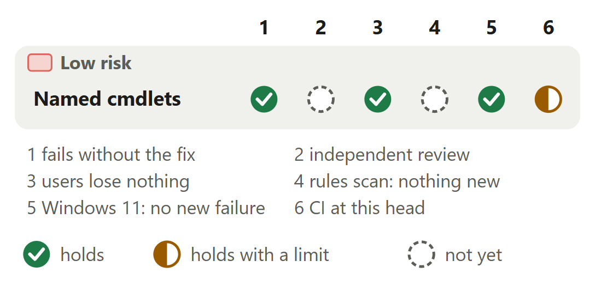

# Each cmdlet Rerail runs through Windows PowerShell names its module

For [pull request #967](https://github.com/neralabs/rerail/pull/967), head 3435f4ebf. [report.html](report.html) is the same report as one page: download it and open it.

## 1. The decision

**May each cmdlet Rerail runs through Windows PowerShell be named with its module, so PowerShell reads no other installed module before it runs?**

**We recommend:** approve it: the reads give the same answers in both language modes, and on a computer with many modules the stop ends a busy daemon again.

| Size | Risk and review | Waits on | Not verified |
|---|---|---|---|
| 144 lines in 9 files: 28 ship, 116 are tests and text | Careful. A code owner approves. | Nothing. No CI run on GitHub yet: not pushed. | 3 |

## 2. Intent, and the gap

| Change | Intended | Found | Now |
|---|---|---|---|
| The stop ends daemons | A stop ends the home's daemon _(code comment)_ | Ended nothing with many modules _(the issue's steps)_ | Closes the gap. |

Found on 20 November 2026 on Windows 11, with many PowerShell modules not yet read.

Sources at main, and causes

| Change | Where main states the intent | The cause, and what was measured |
|---|---|---|
| The stop ends daemons | `src/runtime/daemon-control.ts` at d93d74b74, `stopDaemon`'s comment: "Stops the daemon `home` records ... Either way a daemon still running after STOP_TIMEOUT_MS is killed." `src/engine/process-liveness.ts`, line 113: `(Get-Process -Id ${pid} -ErrorAction Stop)`, a cmdlet named alone. | Windows PowerShell finds a cmdlet named alone by reading every installed module its cache does not hold yet, before the line runs: 46 s for the read alone with those modules. The stop gives the read what is left of its 10 s, twice; with no start read, nothing proves the process the home's daemon, so the stop says so and ends nothing. |

## 3. Where to look

1. **Read first**, 5 min: `process-liveness.ts`: `windowsStartedAt`. Does the module-qualified name find the same process, in Constrained Language Mode too?
2. 5 min: `windows-acl.ts`, `device-keystore.ts`: the same names in the ACL read and the Credential Manager script.

**Then skim**, 10 min: The tests: a helper that lists a script's cmdlets named alone, and PowerShell's own setting that loads only modules a command names, for the read and the stop.

## 4. Risk against verification

One change, low risk: three scripts name each cmdlet's module; what each read returns stays as on `main`.

Each limit, and each check that does not hold yet

| Change | Check | Its limit, or why it does not hold yet |
|---|---|---|
| Named cmdlets | independent review | No review by a reader outside this change yet. |
| Named cmdlets | rules scan: nothing new | The automated reviewer's rules were not run over this diff. |
| Named cmdlets | CI at this head | No CI run at this head on GitHub yet: the branch is not pushed. The type check and the four test files passed on Linux x64. |

## 5. The changes

**Each cmdlet names its module**, low risk: Stop of a busy daemon, 40 modules held: `main` 22.3 s, ends nothing; here 4.7 s, stopped 10 of 10.

<b>6. The decisions</b>

**Name each cmdlet's module, narrow PSModulePath, call .NET, or read in the engine?**

**We chose** module-qualified names: the cheapest change, and the only one measured to hold in both language modes. **Would change our mind:** A Windows PowerShell where a module-qualified name still reads other modules first.

| Option | What a user gets | Cost | What it breaks |
|---|---|---|---|
| Name each cmdlet with its module **(chosen)** | The read in 0.13 s with or without the modules, in Full and Constrained Language Mode. | Five code lines in three files. | Nothing found. |
| PSModulePath naming only Windows' own module folder | The same for modules on a person's own paths. | An environment built for each start. | Windows PowerShell 5.1 puts the Program Files module folder back first, so modules installed for all users are still read. |
| `GetProcessById` first, the cmdlet where Constrained Language Mode refuses it | 0.11 s in Full Language. | A second command. | That mode refuses the static method, and the cmdlet then took 47.9 s with the modules: the stop still ends nothing there. |
| A native read in the engine | No PowerShell for the read. | An engine function and build. | The uninstall's stop loads no engine, since it then deletes `versions/`, which a loaded DLL keeps; it would keep the PowerShell read. |

**Evidence.** Two Windows 11 machines, 2 to 3 runs a cell, 40 large modules first on PSModulePath, renewed before each start: as on `main` 45.9 s (Full) and 47.9 s (Constrained); module-qualified 0.13 and 0.14 s; the narrowed path 0.13 s, its child listing the Program Files module folder first; .NET only refused in Constrained Language Mode.

<b>7. How it fits</b>

Nothing has to merge first: it stands on `main` d93d74b74. The read it fixes came with #677, after 0.1.5. A change to follow, which makes a daemon start end in the state it reports, adds cases elsewhere in `daemon-control.test.ts`; they merge cleanly.

<b>8. What is not covered</b>: 3 not verified, 1 smaller gap, 2 limits that stay

1. **macOS** starts no PowerShell, and never ran.
2. **Constrained Language Mode** was set in the command, as the repository's own case sets it, and confirmed by the child; no AppLocker or WDAC policy was set up.
3. **Modules installed for all users** were not put in the Program Files module folder of a shared machine; a module-qualified name reads no folder's other modules.

**Smaller gaps**

- **Credential Manager refused its read in the test machines' remote sessions.** The script's time was measured up to that call (48.4 s at `main`, 0.29 s here, the modules held); its test stands the runner in. A read in a person's own session would close it.

**Limits that stay**

- The PATH script of `shell-path.ts` calls only `Where-Object`, a core cmdlet: it reads no module (0.14 s with the modules held) and is left as it is.
- Constrained Language Mode refuses `Add-Type` in the Credential Manager script and .NET's static methods in the PATH script, at `main` and here alike.

## 9. What we ask of you

We ask no ruling.

<b>10. Evidence</b>

The description on GitHub is the record: "How you tested it" holds the runs at `main` and here.

| Where | What ran | Result |
|---|---|---|
| Windows 11 and Linux x64 | The four test files at `main` d93d74b74 with the new cases, and at this head | Windows 11: at `main` the five new cases fail, 232 passed; here 237 passed, none failed. Linux x64: at `main` the three that run there fail, 230 passed; here 233 passed, 8 skipped. `tsc --noEmit` exits 0. |
| Windows 11, 8 cores | `main` d93d74b74 and this head built, packed and installed with `npm install`, a real daemon, the nine paths of the issue's table, 10 runs each, as the machine is and with 40 large modules first on PSModulePath | The stop of a busy daemon the lock does not prove: `main` 4,721 ms and stopped, 22,262 ms with the modules, exit 1, running 10 of 10; here 4,650 and 4,654 ms, stopped 10 of 10 in each. The other eight paths here give `main`'s answers, within 10 ms between the arms. A TLS start: `main` gave up after 15.4 s with the modules; here 1.2 s in both. |
| Windows 11, 8 cores | The start-time command from each installed package, Full and Constrained Language Mode, 5 runs a cell | At `main` and here 0.13 s as the machine is, the same start as a plain read in every run; here 0.13 s with the modules held, in both modes. |
| Two Windows 11 machines | The ACL read and the Credential Manager script as they ship, the modules held, 2 runs a cell | `Get-Acl` 47.0 s at `main`, past its 30 s limit, 0.12 s here, in both modes; the Credential Manager script 48.4 s and 0.29 s. |

**Sources.** The branch at 0b214e112 and its diff against `main` d93d74b74, read on 20 November 2026; runs at 2b32ba7b2, whose code the head keeps (it adds only the release note's wording), and at `main` d93d74b74, on Windows 11 and Linux x64 machines.

