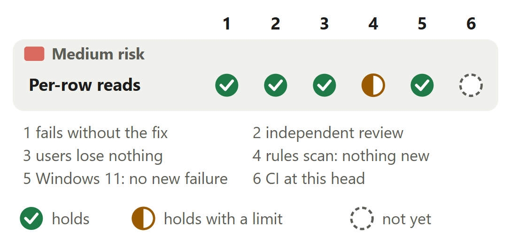

# One damaged stored row no longer fails the history or repository pages

For [pull request #1113](https://github.com/neralabs/rerail/pull/1113), head 0357225992. [report.html](report.html) is the same report as one page: download it and open it.

## 1. The decision

**Is a damaged row better left out, or read with no aliases, with `daemon.log` naming it, than a 500 for every row beside it?**

1. The history answers and leaves out the violations it cannot read.
2. Every repository page answers; the damaged repository lists with no aliases.

**We recommend:** approve it: the history, `violations_list` and every repository page answer, rows that parse read as before, and `daemon.log` names the row to mend, as #989 does for audits.

| Size | Risk and review | Waits on | Not verified |
|---|---|---|---|
| 707 lines in 9 files: 319 ship, 388 are tests and text | Standard. It changes what pages read, never what is stored. | Nothing. No CI run at this head yet: not pushed. | 3 |

## 2. Intent, and the gap

| Change | Intended | Found | Now |
|---|---|---|---|
| History | List what reads, name the rest _(issue)_ | History 500 for one audit _(3 of 3 runs)_ | Closes the gap, changes answer 1. |
| Repository pages | List what reads, name the rest _(issue)_ | Every repository page 500 _(3 of 3 runs)_ | Closes the gap, changes answer 2. |

Reported on 22 November 2026; still shows at `main` bac625dca and in 0.2.1 on Linux x64, 25 November 2026.

Sources at main, and causes

| Change | Where main states the intent | The cause, and what was measured |
|---|---|---|
| History | #983's expected result. #989 set the way for the audit pages: read the text per row, mark the row, name it in the log. | `listViolationHistory` read each violation with `json_extract` in the page's SQL, which raises on text that is not JSON. |
| Repository pages | #983's expected result. | `listRepositories` selected `aliases_json` through Drizzle's JSON mode, whose parse throws for the whole list. |

## 3. Where to look

1. **Read first**, 5 min: `audit-store.ts`: `storedViolation`, `readableHistory`, `historyPage`. Does a readable row keep its place, cursor and total when a damaged one is left out?
2. 3 min: `repository-registry.ts`: `listedRow`; `stored-list.ts`: #989's parse, moved; `support-bundle.ts`: the log it passes.

**Then skim**, 3 min: The repository audit pages reuse #989's list tests in SQL. Reference rows say what each page does with a damaged row.

## 4. Risk against verification

One change. Start at the history's page in `audit-store.ts`.

Each limit, and each check that does not hold yet

| Change | Check | Its limit, or why it does not hold yet |
|---|---|---|
| Per-row reads | rules scan: nothing new | Rules scan against `main` bac625dca with Rerail built from `main`: no new finding, every function added or edited 5 or under. The published 0.2.1 cannot load `main`'s pack: no verdict there. |
| Per-row reads | CI at this head | No CI run at this head on GitHub yet: the branch is not pushed. |

## 5. The changes

**Damaged stored rows read per row**, medium risk: One damaged row: history or every repository page 500 at `main`; 200 here, the row named in `daemon.log`.

<b>6. The decisions</b>

**Repair the row, refuse to start, skip it, or cost its entry?**

**We chose** cost the row its entry and name it in the log, as #989 does. **Would change our mind:** A maintainer preferring a field on the history's record that marks a left-out violation.

| Option | What a user gets | Cost | What it breaks |
|---|---|---|---|
| Cost the row its entry, name it in `daemon.log` **(chosen)** | Every page answers; the person learns which row to mend. | The damaged entry reads as missing. | Nothing found. |
| Repair the row on read | Pages answer. | A read writes, guessing at text that is gone. | Erases what a person could mend from. |
| Refuse to start, or fail the health check | The fault is loud. | The whole dashboard and every steer, for one row. | Everything beside the row. |
| Skip it with no word | Pages answer. | Nothing. | Nobody learns a row is damaged. |

**Evidence.** At `main` the history and the repository pages answered 500 in 3 of 3 runs and `daemon.log` named no row; here they answer 200 and the log names the audit or the repository.

**Leave a damaged violation out of the history, or list it marked?**

**We chose** leave it out, keep it in the total; the audits page already marks the audit. **Would change our mind:** A dashboard that needs to show a left-out violation in the history itself.

| Option | What a user gets | Cost | What it breaks |
|---|---|---|---|
| Leave it out; the total and the cursor count it **(chosen)** | No API change; each readable row keeps its page. | A page can hold fewer rows than asked. | Nothing found. |
| List it with a mark | The history shows the gap. | A new field on `violations_list` and a dashboard change. | Its rule, path and message cannot be read anyway. |
| Take it out of the total too | The total matches what can be read. | The count would parse every audit's list. | The cost the history's own table exists to avoid. |

**Evidence.** Since #989, `GET /api/audits` lists the damaged audit with no violations and a failure naming its `violations_json`.

<b>7. How it fits</b>

It stands on `main` bac625dca alone and follows #989; Git merges it with #1076, #1103 and #1110 with no conflict.

**The shared parse.** #989's parse and once-a-row log line move to `stored-list.ts`, which the audit store and the repository list share.

<b>8. What is not covered</b>: 3 not verified, 2 limits that stay

1. **Event payloads** one damaged steer or coverage event still fails a session's page and rule activity.
2. **Rules and settings** stored as JSON still fail their whole list; no run reached them.
3. **macOS** never ran.

**Limits that stay**

- A page made only of a damaged audit's violations comes back empty, with a cursor to the rest.
- While aliases do not read, the repository is not found by an alias.

## 9. What we ask of you

Ask 1 rules on answer 1.

1. **May the history leave out a violation it cannot read, with the total still counting it?** We recommend yes: the audits page marks that audit, and the log names it.

Answer 2 asks no ruling. It reads as #989 reads a damaged audit list: as none.

<b>10. Evidence</b>

The description on GitHub is the record: "How you tested it" holds the runs at `main` and here.

| Where | What ran | Result |
|---|---|---|
| Linux x64 | The issue's steps at `main`, 3 runs: one audit's violations cut short, one repository's aliases cut short | History 500 both ways; three repository pages 500; `daemon.log` names no row. |
| Linux x64 | The same at this head, 3 runs | Every page 200; the history leaves out the damaged audit's 3 violations; the log names each row once. |
| Linux x64 | The new cases with `main`'s `src/`; mutants of the deciding lines | 12 of 13 fail at `main`, the 13th pins the intact entries page; every mutant caught. |
| Windows 11, Linux x64 | The changed test files and those importing the changed modules, 35 files | No failure on either system; on Windows none `main`'s baseline lacks. |
| Windows 11 | The 3 new test files, 30 runs | 30 of 30 runs pass on Windows 11; 30 of 30 on each of GitHub's Linux and Windows runners in our fork. |

**Sources.** The diff against `main` bac625dca and the runs, read on 25 November 2026.

