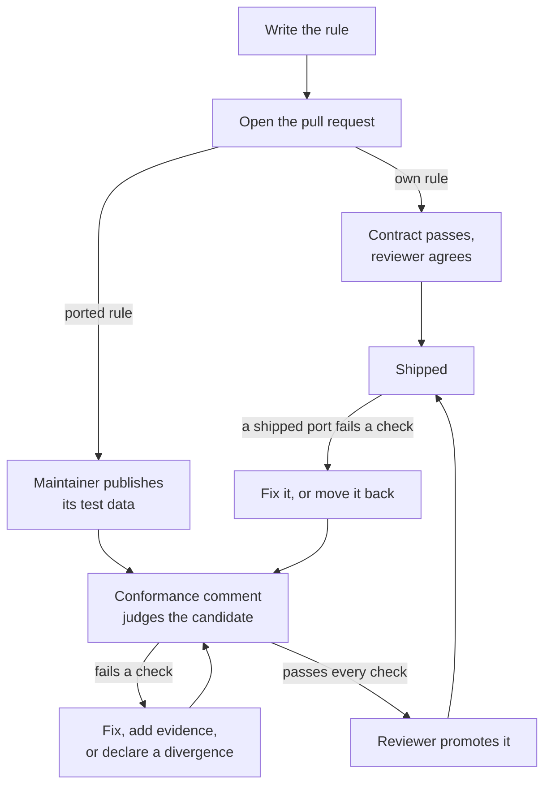

# Adding rules to a pack

A pack rule is either written for Rerail and proven by its examples, or ported from another tool (a linter, a security
scanner, a complexity metric) and proven against that tool's tests.



- **An own rule** ships when the validation contract passes and a reviewer agrees its examples show what it claims.
- **A ported rule** stays a candidate until it passes every conformance check and a reviewer accepts its evidence.

Below, `<id>` is the pack (`packs/<id>/`), `<tool>` the upstream tool, `<rule>` the Rerail rule id
(`ruff-f401-unused-import`), and "upstream rule" the tool's name for it (`F401`).

<details>
<summary>Candidates and whether a port starts on</summary>

A rule the reviewer is not sure of stays a candidate; `candidates/README.md` says what each candidate waits on.
Whether a shipped port starts on is not a judgement call: `upstream-status` decides it from the tool's declared facts.
The one exception is a steer that would do harm where no matcher change can tell the cases apart
([rule quality](../skills/rerail-create/references/rule-quality.md#the-fix-ladder)): the reviewer lists it
`"on": false` and its section in the pack's README says why.
This page is for the contributor and for the coding agent working with them.

</details>

## Who does what

Contributors write everything in git; maintainers control the pack test data, publishes and merges; reviewers decide
promotions.

**Pack test data** is a tool's tests plus the findings the pinned tool reported on them; it is not in git. A fork's pull
request runs no CI ([How contribution works](../CONTRIBUTING.md#how-contribution-works)): check ported rules against
upstream's tests and say which cases you checked and how.

<details>
<summary>Who does each step</summary>

Reading the data needs access a maintainer grants; writing it is a publish a maintainer dispatches. A branch here has
the data and CI. A fork's pull request is judged once a maintainer ports it onto a branch here and publishes its data;
until then, check ported rules against the tool's tests in upstream's repository.

| Step | Who |
| --- | --- |
| Write a rule of the pack's own, with its examples | Contributor; needs no data |
| Write ported rules, their port entries, upstream facts and README sections; name their upstream tests | Contributor |
| Write a new tool-pack's generator, manifest and licence records; a new pack's skeleton | Contributor |
| Derive one rule's data and stage it | Maintainer |
| Derive and stage a new tool-pack's whole set; a maintainer derives it again before publishing | Contributor |
| Dispatch and approve the publish | Maintainer |
| Read the Conformance comment; fix the rules, declare checked divergences, add clean samples | Contributor |
| Promote a candidate that passes every check | Contributor proposes, a reviewer decides |
| Merge; a new pack's first publish to npm | Maintainer |

</details>

## Before you start

Check licences, pull the test data, and look for conflicting pull requests.

1. **Licence.** The tool and its tests must be under a licence on `scripts/check/licence-allowlist.json`
   ([Third-party material](../CONTRIBUTING.md#third-party-material)).
2. **Test data, if you can** ([Pack test data](../CONTRIBUTING.md#pack-test-data)):

   ```sh
   npm run fixtures:pull    # -- --pack <id> for one pack; needs read access to the bucket, which a maintainer grants
   ```

3. **Open pull requests on the same pack.** Land the smaller first, then merge `main` into the other.

<details>
<summary>Edge cases</summary>

- Copyleft tests are not copied, and their rules cannot be ported with them.
- Without the data, the pack tests and the conformance check fail, so nothing run locally proves anything.
- Archives cache in `.rerail/pack-data/archives/`. Copy that directory into a fresh worktree, which also needs
  `npm ci` and `npm run build:native`.
- Two pull requests conflict when both change the pack's listing, its README or the native anchors pin.

</details>

## A rule of the pack's own

A rule with no upstream needs no test data; its examples are the proof.

1. Write `packs/<id>/rules/<rule>.json` ([writing-rules.md](writing-rules.md),
   [text criteria](pack-format.md#description), check 8).
2. List it in `pack.json` with a caught and a passing example in the rule's scope (check 3).
3. In a pack with a `conformance.json`, add its id to `own` there, so the gates know it has no upstream and judge it on `loads` and `compact` alone
   ([conformance.json](pack-format.md#conformancejson)). Where a generator writes `conformance.json`, add it to the
   generator's input instead (React: `OWN` in `scripts/generate/packs/react-specs.mjs`).
4. Add its section under `## Rule details` in `packs/<id>/README.md` (check 5).
5. Add a changeset, its file name opening with its change type ([.changeset/README.md](../.changeset/README.md)).
6. Run `npx vitest run test/engine/catalog/packs.test.ts -t "pack <id>"`.

The pull request says what the examples show and what they leave out.

<details>
<summary>Edge cases</summary>

- The React pack's practice rules are the model: own rules beside a tool-pack's ports, listed in its
  `conformance.json` `own`. Their cases are pack test data in an archive of their own,
  `packs/react/upstream/react-practice/` (written by Rerail, listed in its `UPSTREAM.md`, no upstream tool or
  generator), run by `test/cli/react-practice-rules.test.ts`. A pack with no tool-pack follows
  [language-packs.md, "A pack for a supported language"](language-packs.md#a-pack-for-a-supported-language).
- Each example sits at a path inside the rule's scope; a conversation rule's examples carry no path.
- The changeset is needed because the rule changes what the pack publishes.
- In a pack with a tool-pack, the contract run also needs the pulled data; without it, say so.
- The rule starts on unless its listing says otherwise; nothing judges it against a tool.

</details>

## One rule into an existing tool-pack

Port one more rule of an already-ported tool as a candidate; a maintainer then publishes its data.

Copy a document of the same tool from `packs/<id>/rules/`. No changeset: a candidate changes nothing published.

1. **Check it can be ported** against `packs/<id>/upstream/<tool>/gates.yaml`, the licence record and
   `packs/<id>/candidates/README.md`.
2. **Write** `packs/<id>/candidates/rules/<rule>.json`, with the tool's suppression key on each violation (check 4).
3. **Add the port entry** to `packs/<id>/conformance.json`
   ([schema](pack-format.md#conformancejson-divergencesjson-upstream)).
4. **Name its upstream tests** where the manifest's `watch.tests` says; for Ruff and Bandit, add a suppression case.
5. **Add the manifest entry** if missing
   ([Declared upstream facts](../conformance/README.md#declared-upstream-facts-gatesyaml)).
6. **Add its section** under `## Rule details` in `packs/<id>/candidates/README.md`.

A maintainer then derives the data in a sandbox, stages and publishes it ([For maintainers](#for-maintainers)). The
Conformance comment on the published commit is the first verdict.

<details>
<summary>Step details</summary>

- **Step 1**: the manifest does not mark it deprecated; its tests are not under a `Not copied` prefix in the licence
  record; `candidates/README.md` does not already record it as ported and waiting.
- **Step 2**: match the construct, not the test cases. A rule matching the cases' names fails `holds-under-rename`;
  one matching their shape fails the real-code samples.
- **Step 3**: the entry points at the candidate. If upstream's tests never exercise the rule at the pin, give the
  entry an example pair; it moves to `pack.json` at promotion.
- **Step 4**: the generator records findings only for rules it knows, on tests it is told to read; an unknown rule
  gets a scoring error. `watch.tests` points to a hand-kept `fixtures.json` beside the generator (Ruff, Bandit,
  PHPStan, Clippy) or a path convention (ESLint-family tools). Ruff's and Bandit's generators refuse to derive while a
  shipped rule has no suppression case in their table, and CI does not catch the gap.
- **Step 5**: the entry says whether upstream deprecates the rule, and which approved configuration turns it on.
  Without it the rule never starts on. Take the values from upstream at the pinned release, and say how.
- **Step 6**: the section says what the rule matches beyond its description, and what it waits on.

</details>

## A new tool-pack

A tool-pack is one upstream tool in `packs/<id>/upstream/<tool>/`, with its own data, manifest and licence record.

See [language-packs.md, "A ported pack"](language-packs.md#a-ported-pack). Models: `packs/python/upstream/ruff/`
(Python generator) and `packs/javascript/upstream/` (ESLint-family generators).

### What to write

1. **Licence record**, `packs/<id>/licenses/<project>/`: upstream licence and [UPSTREAM.md](pack-format.md#upstreammd).
2. **Manifest**, `upstream/<tool>/gates.yaml` ([schema](../conformance/README.md#declared-upstream-facts-gatesyaml)).
3. **Generator**, `upstream/<tool>/generate.*`, with a recipe in `scripts/pack-data/recipes/`
   ([What the generators write](upstream.md#what-the-generators-write)).
4. **`conformance.json`** with the port entries; **`divergences.json`** starts empty.
5. **Real-code samples**, optional ([Samples](upstream.md#samples)).
6. **The rules**, each as [above](#one-rule-into-an-existing-tool-pack), all candidates.

<details>
<summary>What each file holds</summary>

- **Licence record**: the upstream licence verbatim, and an `UPSTREAM.md` with the source commit, copied-file globs,
  and a `Not copied` line per part under a refused licence. Update the pack's `package.json` licence and the root
  `REUSE.toml`.
- **Manifest**: pin, runtime, approved configurations, file types, what the nightly upstream report watches, and an
  entry per rule ported or portable. Copy a sibling's header comments.
- **Generator**: installs the pinned runtime, checks out the pinned commit, copies each ported rule's tests, and runs
  the tool under the approved configuration. It writes expected findings, Rerail's own cases, and provenance via the
  shared writer, which fails the derive on any file the licence record disagrees with.
- **`conformance.json`**: the tool, the capabilities the ports exercise, the port entries.
- **Samples**: usually needed for `stays-silent`. Land any `scripts/samples/` change on `main` first in its own pull
  request, such as a new source repository's entry in `scripts/samples/licences.ts`. Publish prep validates staged
  samples with `main`'s code and refuses unknown repositories.

</details>

### The first data

```sh
npm run fixtures:derive -- --pack <id> --tool <tool>          # in a sandbox, on the pinned runtime
npm run fixtures:stage -- --pack <id> --tool <tool> --all    # the whole set: a first publish is a `replace`
git add packs/<id>/upstream/<tool>/publish
```

Derive runs upstream's code: use a sandbox with no credentials ([Derive in a sandbox](upstream.md#derive-in-a-sandbox)).
Then run the gate on one rule and on the pack:

```sh
npm run conformance:languages -- --pack <id> --rule <rule> --fixtures   # every false positive and miss of one port
npm run conformance:languages -- --check --pack <id>
```

<details>
<summary>Edge cases</summary>

- The sandbox holds neither the bucket's nor GitHub's credentials.
- Derive stops if an authored file listed in the tool's `UPSTREAM.md` is missing on disk: pull first. For generators
  that write their own authored cases (Ruff, Bandit), run that part first and check the written set equals the
  listing.
- Stage reads the locked archive to report what a publish would drop, so it needs bucket read even with `--all`.
- While `publish/` is tracked, structure metric #3 fails by design; every failing path must be under `publish/`.
- Shipped rules are judged on the new data too. Check them before asking for the publish; fix, give a checked
  divergence to, or move back any that fail.

</details>

### A port of many rules

A port that takes weeks outlives `main`, which keeps shipping rules to the same pack; merge `main` in with care.

<details>
<summary>Merge checklist</summary>

- Resolve `pack.json` as data from the index stages (`git show :1:`, `:2:`, `:3:`), never as text: branch rules plus
  `main`'s new ones in place.
- Rebuild both READMEs from both sides, placing each section per the merged `pack.json` (check 5). Keep the
  generator's test list a superset of `main`'s.
- Take `main`'s deletions; check no branch-added file survives in a deleted directory. Re-pin the anchors test last.
- Never resolve rule or README text with JavaScript `String.replace(x, string)`: `` $` `` and `$'` expand. Slice, or
  pass a function.
- A pull request with conflicts gets no CI: `ci.yml` runs on `pull_request`, which GitHub skips when it cannot build
  the merge commit. `gh pr view <n> --json mergeStateStatus` shows `DIRTY`.
- Afterwards: `npm ci` if the lock file changed; add a suppression case per rule `main` shipped since the last derive;
  re-derive, and check expected findings differ from staged ones only by the new cases.

</details>

## A new pack

A pack is a directory `packs/<id>/` that passes the validation contract and publishes as its own npm package.

Skeleton and full example:
[language-packs.md, "A pack for a supported language"](language-packs.md#a-pack-for-a-supported-language).

1. **Skeleton** ([Layout](pack-format.md#layout)).
2. **Register**: `npm install --package-lock-only --ignore-scripts`, then `npm run generate:packs`.
3. **Changeset**: `patch` ([versioning](pack-format.md#versioning-and-release)).
4. **Rules**: own rules, or a tool-pack of candidates.
5. **Repository lists**: grep for a sibling pack's id, including [rule-packs.md](rule-packs.md#the-packs).

Run `npx vitest run test/engine/catalog/packs.test.ts -t "pack <id>"`. After merge, a maintainer publishes the first
version by hand, once ([publishing-a-new-pack.md](publishing-a-new-pack.md)).

<details>
<summary>Step details</summary>

- Models: `packs/python/` (language) and `packs/node/` (framework). A pack for a language core cannot read yet lands
  the same way, its rules skipped as `not supported yet`
  (["A pack for a planned language"](language-packs.md#a-pack-for-a-planned-language)).
- **Skeleton**: package manifest, pack listing with no rules, README, LICENSE, NOTICE. Set-up recommends the pack by
  the listing's `match` (check 7).
- **Register**: packs are npm workspaces. `generate:packs` writes core's pack list; check 7 fails when it is stale.
- **Changeset**: the first release is `0.1.1`.
- **Rules**: a pack whose ports are all candidates ships no rules and is never recommended.
- **Repository lists**: the pack tables in rule-packs.md and the root README, `packs/README.md`, and the first
  paragraph of `docs/pack-format.md`.
- After the first version, the release workflow publishes the rest.

</details>

## Reading the Conformance comment

Each rule's verdict is the first blocking check it fails; fix one check at a time.

CI keeps one **Conformance** comment per same-repository pull request
([The pull request comment](../conformance/README.md#the-pull-request-comment)). Locally, with data pulled:

```sh
npm run conformance:languages -- --check --pack <id>                   # the same judgement
npm run conformance:languages -- --pack <id> --rule <rule>             # every false positive and miss
npm run conformance:languages -- --pack <id> --rule <rule> --samples   # the samples too
```

Fix the pack's scoring errors first: no rule passes on a pack that does not score.

<details>
<summary>What to do per failing check</summary>

The run's `conformance-summary` artifact (`gh run download <run id> -n conformance-summary`) has full detail and the
promotable list.

| Check | When it fails |
| --- | --- |
| `loads`, `in-scope` | Widen scope to every file type the tool lints, or declare the port's own types if it covers fewer by design |
| `compact` | Over 15 KiB means the document lists cases: match their shared construct |
| `no-unexplained-false-positives`, `no-unexplained-misses` | Fix the rule. Declare a divergence only after checking the tool's answer on that line, with evidence ([Divergences](../conformance/README.md#divergences)) |
| `catches-something` | Add a true positive: a tool test, or an authored case the tool confirms. A candidate's example pair counts only once shipped |
| `holds-under-rename` | Match the construct, not names. If renaming removes every finding, it fails unless the manifest gives a `rename_exempt` reason (the findings are the renamed names) |
| `samples-catch-labelled`, `samples-silent-on-clean` | Fix the rule, or declare a samples divergence after checking the label ([How samples are judged](../conformance/README.md#how-samples-are-judged)) |
| `stays-silent` | If every upstream test for the rule has findings, add a clean real-code sample labelled for the rule ([Samples](upstream.md#samples)). Other rules' units and Rerail's probes don't count |
| `divergences-current` | The fix that makes the rule agree removes its divergence in the same pull request |
| `upstream-status` (never blocks) | Add or fix the manifest entry. **On or off** lists shipped rules whose listing disagrees |

</details>

## Promoting a candidate

Promotion moves a passing candidate into `rules/`, with evidence for the reviewer.

Promote from the judged commit's promotable list, after confirming `main` has not moved
([Candidates and promotion](../conformance/README.md#candidates-and-promotion)):

1. Move the document to `rules/`; point the port entry at it.
2. List it in `pack.json`: off if the comment's **Starts** column says off, with its example pair if any.
3. Move its README section; add a changeset, `added-…` (its summary may be empty: the Release pull request lists new rules).
4. Grep for the old path: `git grep -F candidates/rules/<rule>.json`.
5. Re-pin the native anchors test, last: `cargo test --manifest-path Cargo.toml -p rerail-engine anchors::tests`.

<details>
<summary>Promotion checklist</summary>

- **Move the bytes, never regenerate.** For generated documents (listed in `scripts/generate/README.md`), flip the
  generator's candidate flag, regenerate, and check the diff is only the move.
- **Recount hand-kept text**: both READMEs' openings, divergence claims, the pack tables in
  [rule-packs.md](rule-packs.md) and the root README.
- **The old path** turns up in native `include_str!` uses and tests that build it.
- **The anchors test**: `native/src/code_rule_dsl/matcher/anchors/tests.rs` pins the count of `ast` queries in shipped
  documents, so any move between `rules/` and `candidates/` changes it. The cargo command prints the new value.
- **Add the suppression case** where the tool's generator demands one.
- **Changeset = release note**: its file name opens with its change type (`fixed-…`), and its summary says what changed
  for the upgrader, opening with the rule's id under `added-`, `removed-` and `fixed-`, at most 60 words, no ticket id, pull request
  number or commit hash. The **Changesets** job enforces this. Which rules ship and how each starts is written by the
  Release pull request from `pack.json`, so a promotion with nothing else to say leaves the summary empty
  ([versioning](pack-format.md#versioning-and-release)).
- **Evidence**: results against the tool's expected findings, rename variants and samples, every divergence checked,
  and why any `rename_exempt` reason holds ([REVIEW.md](../REVIEW.md#what-blocks-a-merge-here)).

</details>

### Moving a shipped rule back

A shipped rule that fails a blocking check the same pull request does not fix goes back to `candidates/`.

<details>
<summary>Steps</summary>

- Move its README section to `candidates/README.md`, in sorted place, with one sentence (file and line) on why.
- Tests loading the rule by id read `rules/` only; also pass the pack's `candidates/` directory, as
  `test/engine/code-rule/pack-rules/python-harmful-steers.test.ts` does.
- Re-pin the anchors test. The changeset (`removed-…`) opens with the rule's id and says why it no longer ships; the
  Release pull request lists it with that reason.
- No re-derive: the generator's authored output does not depend on which rules ship.

</details>

## Before you open the pull request

Run these checks, then say in the pull request what ran and what it covers.

```sh
npx vitest run test/engine/catalog/packs.test.ts -t "pack <id>"   # checks 1 to 8, each rule's status
npm run conformance:languages -- --check --pack <id>
npm run check              # metric #3 is red by design while publish/ is tracked; the chain stops there, so also:
npm run check:windows-paths && npm run check:internal-refs && npm run check:pins
npm run check:native       # a shorter rules/ path in an include_str! needs cargo fmt
cargo test --manifest-path Cargo.toml -p rerail-engine anchors::tests
```

An own rule needs only the first and third commands. A port needs the pulled data.

`check:internal-refs` fails on an internal ticket ID and on a `nera-` name outside its public list, so a fixture,
sample or comment drawn from private code names no private project
([Keeping private context out](../CONTRIBUTING.md#keeping-private-context-out)).

<details>
<summary>Data needs and what the pull request states</summary>

An own rule in a pack without a tool-pack needs no data. A new tool-pack also needs its derived data in `publish/`.
Grep for stale counts, table rows included, and moved rule details still saying "candidate". The pull request states:

- rules covered, rules left out, and why;
- for a new tool-pack, how the licence record was checked against the repository;
- without data, which upstream tests the rules were checked against, and how;
- which checks ran locally.

</details>

## For maintainers

Steps the publishing docs leave out: [upstream.md, "Publishing pack data"](upstream.md#publishing-pack-data) and
[REVIEW.md](../REVIEW.md#approving-a-pack-data-upload) cover the workflow, `replace`, a finish failing after upload,
and approval.

- **One-rule pull requests**: derive the data yourself, in a sandbox on its branch, then stage without `--all`.
- **New tool-packs**: review the generator and recipe, then re-derive in a sandbox before publishing.
- **Dispatch once the head is final**.
- **A new pack's first npm publish** is by hand, once ([publishing-a-new-pack.md](publishing-a-new-pack.md)).

<details>
<summary>Details and edge cases</summary>

- **One-rule pull requests**: the contributor cannot derive. On its branch (or the branch you port a fork onto), run
  `npm run fixtures:derive -- --pack <id> --tool <tool>`, then `fixtures:stage` without `--all`; commit `publish/`
  and publish.
- **New tool-packs** stage their whole set themselves.
- **Dispatch**: prep packs the head at run time (`gh pr view <n> --json headRefOid`). Choose `replace` by what
  `publish/` holds (the whole set, or files that must leave the archive), not by what changed. Check prep's drop list
  against intent before approving.
- **After a samples publish**, finish writes `samples.lock`, not `SAMPLES.md`. Copy its archive name, file count and
  bytes into the tool-pack's `SAMPLES.md` by hand; nothing checks them. Overlays never restage `LICENSES.md`, so the
  archive's copy lists earlier samples until a `replace` repack: note it, don't hand-edit it.
- **Moving unchanged documents** between `rules/` and `candidates/` changes no verdict; cite the earlier run whose
  comment stands.
- **First npm publish**: needed when the Release packs run on `main` fails at **First publish needed**.

</details>

## Where each file is defined

The reference document for each part of a pack.

| Document | Defines |
| --- | --- |
| [pack-format.md](pack-format.md) | Layout, file schemas, pack data, provenance, the validation contract (checks 1 to 8) |
| [conformance/README.md](../conformance/README.md) | Conformance check, its comment, divergences, candidates, promotion |
| [CONTRIBUTING.md, "Pack test data"](../CONTRIBUTING.md#pack-test-data) | Getting the data; adding or changing a pack |
| [language-packs.md, "Start a pack"](language-packs.md#start-a-pack) | New pack skeleton with example; what a ported pack adds |
| [upstream.md](upstream.md) | Upstream snapshots, generators, samples, publish workflow |
| [writing-rules.md](writing-rules.md), [code-rule DSL reference](code-rule-dsl-reference.html) | Writing a rule document |
| [publishing-a-new-pack.md](publishing-a-new-pack.md) | A new pack's first npm publish (maintainers) |
