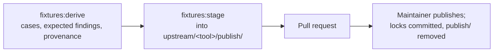
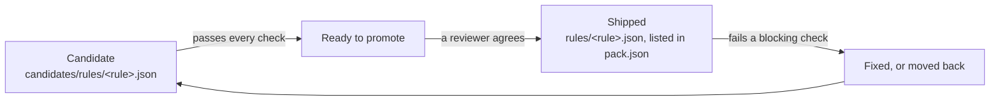

# Adding rules to a pack

This guide is for anyone adding rules to a Rerail pack, and for the coding agent working with them. A pack rule is
either written for Rerail and proven by examples, or ported from another tool (a linter, a security scanner, a
complexity metric) and proven against that tool's own tests. Four kinds of contribution, each with its own steps:

| You want to | Section |
| --- | --- |
| Write a rule of the pack's own | [A rule of the pack's own](#a-rule-of-the-packs-own) |
| Port one more rule of a tool a pack already ports | [One rule into an existing tool-pack](#one-rule-into-an-existing-tool-pack) |
| Port a tool a pack does not have yet | [A new tool-pack](#a-new-tool-pack) |
| Start a pack for a language or framework Rerail has no pack for | [A new pack](#a-new-pack) |

A rule of the pack's own ships when the validation contract passes and a reviewer agrees. A ported rule starts as a
candidate, the **Conformance** comment on the pull request judges it, and a reviewer promotes it when it passes every
check ([How a port moves](#how-a-port-moves)).

The reference documents define the files and their schemas; this guide only orders the steps. Read them as you go:

| Document | What it defines |
| --- | --- |
| [pack-format.md](pack-format.md) | The pack layout, every file's schema, pack data, provenance, and the validation contract (checks 1 to 8) |
| [conformance/README.md](../conformance/README.md) | The conformance check, its pull request comment, divergences, candidates and promotion |
| [CONTRIBUTING.md, "Pack test data"](../CONTRIBUTING.md#pack-test-data) | Getting the data, and adding or changing a pack |
| [language-packs.md, "Start a pack"](language-packs.md#start-a-pack) | A new pack's skeleton, with a complete example, and what a ported pack adds |
| [upstream.md](upstream.md) | Upstream snapshots, the generators, samples, the publish workflow |
| [writing-rules.md](writing-rules.md), [code-rule DSL reference](code-rule-dsl-reference.html) | How a rule document is written |
| [publishing-a-new-pack.md](publishing-a-new-pack.md) | A new pack's first publish to npm (maintainers) |

Below, `<id>` is the pack (`packs/<id>/`), `<tool>` the upstream tool, `<rule>` the Rerail rule id
(`ruff-f401-unused-import`), and "upstream rule" the tool's own name for it (`F401`).

## Who does what

Pack test data (a tool's tests and the findings the pinned tool reported on them) is not in git. Reading it needs
access a maintainer grants, writing it is a publish a maintainer dispatches, and a fork's pull request runs no CI
([How contribution works](../CONTRIBUTING.md#how-contribution-works)). So:

| Step | Who |
| --- | --- |
| Write a rule of the pack's own, with its examples | Contributor; needs no data |
| Write ported rules, their port entries, upstream facts and README sections; name their upstream tests | Contributor |
| Write a new tool-pack's generator, manifest and licence records; a new pack's skeleton | Contributor |
| Derive one rule's data and stage it | Maintainer |
| Derive and stage a new tool-pack's whole set; a maintainer derives it again before publishing | Contributor |
| Dispatch and approve the publish | Maintainer |
| Read the Conformance comment; fix the rules, declare checked divergences, add clean samples | Contributor |
| Promote a candidate that passes every check | Contributor proposes, a reviewer decides |
| Merge; a new pack's first publish to npm | Maintainer |

A branch here has the data and CI. A fork's pull request is judged once a maintainer ports it onto a branch here and
publishes its data; until then, check ported rules against the tool's own tests in upstream's repository and say in
the pull request which cases you checked and how.

## Before you start

1. **Check the licence** of anything copied: the tool and its tests must be under a licence on
   `scripts/check/licence-allowlist.json`. Copyleft tests are not copied, and their rules cannot be ported with them
   ([Third-party material](../CONTRIBUTING.md#third-party-material)).

2. **Pull the pack test data, if you can.** Without it the pack tests and the conformance check fail, so nothing run
   locally proves anything.

   ```sh
   npm run fixtures:pull    # -- --pack <id> for one pack; needs read access to the bucket, which a maintainer grants
   ```

   Archives cache in `.rerail/pack-data/archives/`; copy that directory into a fresh worktree to skip the download. A
   fresh worktree also needs `npm ci` and `npm run build:native`
   ([Pack test data](../CONTRIBUTING.md#pack-test-data)).

3. **Check for another open pull request on the same pack.** Two that both change the pack's listing, its README or
   the native anchors pin conflict. Land the smaller first, then merge `main` into the other.

## A rule of the pack's own

A rule Rerail writes for the pack: no upstream, no test data, proven by its examples. No shipped pack carries one
yet, so this is the contract's path, not a walked one. The model is the complete example in
[language-packs.md, "A pack for a supported language"](language-packs.md#a-pack-for-a-supported-language).

1. **Write the document** at `packs/<id>/rules/<rule>.json` ([writing-rules.md](writing-rules.md)). The description
   and messages follow the [text criteria](pack-format.md#description) (check 8).
2. **List it in `pack.json`** with a caught example and a passing one, each at a path inside the rule's scope
   (check 3). A conversation rule's examples carry no path.
3. **Add its README section** under `## Rule details` in `packs/<id>/README.md` (check 5).
4. **Add a changeset**: the rule changes what the pack publishes.
5. **Run the contract.** In a pack with a tool-pack, the test also needs the pulled data; without it, say so.

   ```sh
   npx vitest run test/engine/catalog/packs.test.ts -t "pack <id>"
   ```

The pull request carries what the examples show and what they leave out. The rule starts on unless its listing says
otherwise; nothing judges it against a tool.

## One rule into an existing tool-pack

Copy any document of the same tool in `packs/<id>/rules/`. No changeset: a candidate changes nothing the pack
publishes.

1. **Check the rule can be ported.** The tool's upstream manifest (`packs/<id>/upstream/<tool>/gates.yaml`) does not
   list it as deprecated; its tests are not under a `Not copied` prefix in the pack's licence record; nobody has
   ported it and recorded in `packs/<id>/candidates/README.md` why it waits.

2. **Write the document** at `packs/<id>/candidates/rules/<rule>.json`, with the tool's suppression key on each
   violation so the tool's own suppression comment silences it (check 4). Match the construct, not the tests: a rule
   that matches the test cases' names fails `holds-under-rename`, and one that matches their shape fails on the
   real-code samples.

3. **Add the port entry** to `packs/<id>/conformance.json`, pointing at the candidate document
   ([schema](pack-format.md#conformancejson-divergencesjson-upstream)). If the tool's tests never exercise the rule at
   the pin, give the entry an example pair; it moves to `pack.json` at promotion.

4. **Name the rule's upstream tests.** The generator records findings only for the rules it knows, on the tests it is
   told to read; a rule it does not know gets a scoring error. The manifest's `watch.tests` says where: a hand-kept
   list beside the generator (`fixtures.json`, for Ruff, Bandit, PHPStan and Clippy) or a path convention (the
   ESLint-family tools). For Ruff and Bandit, also add the rule's suppression case to the generator's table: the
   generator refuses to derive while a shipped rule has none, and CI does not catch a missing case.

5. **Add the manifest entry**, when the rule has none: whether upstream deprecates it, and which approved
   configuration turns it on ([Declared upstream facts](../conformance/README.md#declared-upstream-facts-gatesyaml)).
   Without one the rule can never start on. Take the values from upstream at the pinned release, and say how.

6. **Add the README section** under `## Rule details` in `packs/<id>/candidates/README.md`: what the rule matches
   beyond its description, and what it waits on.

Then open the pull request. A maintainer derives the data in a sandbox, stages it and publishes
([For maintainers](#for-maintainers-publishing-and-merging)); the Conformance comment on the published commit is the
rule's first verdict.

## A new tool-pack

A tool-pack is one upstream tool inside a pack, `packs/<id>/upstream/<tool>/`, with its own data, manifest and
licence record ([language-packs.md, "A ported pack"](language-packs.md#a-ported-pack)). Models:
`packs/python/upstream/ruff/` (a Python generator) and `packs/javascript/upstream/` (the ESLint-family generators,
which share a module).

### What to write

1. **The licence record**, `packs/<id>/licenses/<project>/`: the upstream licence verbatim, and an `UPSTREAM.md` that
   records the source commit, the globs of copied files and a `Not copied` line for every part under a refused
   licence ([UPSTREAM.md](pack-format.md#upstreammd)). Add the licence to the pack's `package.json` and annotate the
   documents in the root `REUSE.toml`.

2. **The upstream manifest**, `upstream/<tool>/gates.yaml`: the pin, the runtime, the approved configurations, the
   file types, what the nightly upstream report watches, and one entry per rule the pack ports or may port
   ([schema](../conformance/README.md#declared-upstream-facts-gatesyaml)). Copy a sibling's header comments: they say
   where each value was read.

3. **The generator**, `upstream/<tool>/generate.*`, and its recipe in `scripts/pack-data/recipes/`. The recipe
   installs the pinned runtime from `scripts/pack-data/runtimes/` and checks out upstream at the pinned commit; the
   generator refuses any other. It copies the tool's tests for each ported rule, runs the pinned tool on them under the
   approved configuration, writes the expected findings with each unit's upstream origin, writes Rerail's own cases
   (suppression cases, probes) and lists them in the tool's `UPSTREAM.md`, and writes the provenance last through the
   shared writer, which fails the derive when a file disagrees with the licence record: no entry, outside its globs,
   a glob matching nothing ([What the generators write](upstream.md#what-the-generators-write)).

4. **`conformance.json`** with the tool and its version, the capabilities the ports exercise, and the port entries;
   **`divergences.json`** starts empty.

5. **Real-code samples**, optional but what `stays-silent` usually needs: whole files from recorded repositories,
   labelled per rule, built with the sample builders ([Samples](upstream.md#samples)). A new source repository's
   licence entry in `scripts/samples/licences.ts` lands on `main` in its own pull request first: the publish's prep
   validates staged samples with `main`'s code and refuses a repository it does not know. The same holds for any
   change under `scripts/samples/` the staged samples need.

6. **The rules**, each as [One rule into an existing tool-pack](#one-rule-into-an-existing-tool-pack) describes, all
   as candidates.

### The first data



```sh
npm run fixtures:derive -- --pack <id> --tool <tool>          # in a sandbox, on the pinned runtime
npm run fixtures:stage -- --pack <id> --tool <tool> --all    # the whole set: a first publish is a `replace`
git add packs/<id>/upstream/<tool>/publish
```

- The derive runs upstream's code: run it in a sandbox with no credentials, neither the bucket's nor GitHub's
  ([Derive in a sandbox](upstream.md#derive-in-a-sandbox)). It stops if an authored file the tool's `UPSTREAM.md`
  lists is missing on disk: pull first, or, for a generator that writes its own authored cases (Ruff's and Bandit's),
  run that part first and check the written set equals the listing.
- Staging reads the locked archive to say what a publish would drop, so it needs the bucket read even with `--all`.
  While `publish/` is tracked, structure metric #3 fails by design; every path in its failures must be under
  `publish/`.
- Rules the pack already ships are judged on the new data too. Run the pack's conformance check on the derived data
  before asking for the publish; a shipped rule that fails on a file you add is fixed, given a checked divergence, or
  moved back to candidates in the same pull request.

Then run the contract and the gate:

```sh
npm run conformance:languages -- --pack <id> --rule <rule> --fixtures   # every false positive and miss of one port
npx vitest run test/engine/catalog/packs.test.ts -t "pack <id>"
npm run conformance:languages -- --check --pack <id>
```

### A port of many rules

A port that takes weeks outlives `main`, which ships rules of the same pack meanwhile. Merge `main` in and resolve
each conflict as data, never as text:

| File | How to resolve |
| --- | --- |
| `pack.json` | From the index stages (`git show :1:`, `:2:`, `:3:`): the branch's rules, plus `main`'s new ones in place |
| `README.md`, `candidates/README.md` | Rebuild both from the two sides; each rule's section goes to the file the merged `pack.json` puts it in (check 5) |
| The generator's test list | A superset of `main`'s, with identical shared entries |
| The licence record | `main`'s, with globs that cover the branch's new files |
| Code `main` deleted | Take the deletions, then check no branch-added file under a deleted directory survives |
| The anchors pin | Last, by running the test |

- Never resolve rule or README text with a JavaScript `String.replace(x, string)`: `` $` `` and `$'` in the text
  expand. Slice, or pass a function.
- **A pull request with conflicts gets no CI**: `ci.yml` runs on `pull_request`, which GitHub skips when it cannot
  build the merge commit. Check `gh pr view <n> --json mergeStateStatus` (`DIRTY` means conflicts) before waiting on
  a comment.
- After the merge: `npm ci` if the lock file changed; add a suppression case for each rule `main` shipped since the
  last derive; re-derive, and check the expected findings differ from the staged ones only by the new cases.

## A new pack

A pack is a directory `packs/<id>/` that passes the validation contract and is published as its own npm package.
The skeleton, with a complete example, is
[language-packs.md, "A pack for a supported language"](language-packs.md#a-pack-for-a-supported-language); a pack for
a language core does not read yet lands the same way, its rules skipped as `not supported yet`
(["A pack for a planned language"](language-packs.md#a-pack-for-a-planned-language)). Models: `packs/python/` (a
language pack) and `packs/node/` (a framework pack over a supported language).

1. **The skeleton**: the package manifest, the pack listing with no rules yet, README, LICENSE and NOTICE
   ([Layout](pack-format.md#layout)). The listing's `match` is what set-up recommends the pack by (check 7).

2. **Register it**: `packs/*` are npm workspaces, and core lists the packs by name.

   ```sh
   npm install --package-lock-only --ignore-scripts
   npm run generate:packs                             # check 7 fails when the list is stale
   ```

3. **A changeset** for the new pack, `patch`; its first release is `0.1.1`
   ([versioning](pack-format.md#versioning-and-release)). Every later change to what the pack publishes adds one too.

4. **Its rules**: of the pack's own ([above](#a-rule-of-the-packs-own)), or a tool-pack
   ([A new tool-pack](#a-new-tool-pack)) with every port a candidate. A pack may ship no rules while all its ports are
   candidates; such a pack is never recommended.

5. **The repository's own lists**: the pack tables in [rule-packs.md](rule-packs.md#the-packs) and the root README,
   `packs/README.md`, and the first paragraph of `docs/pack-format.md`. Grep for a sibling pack's id to find them all.

Then run the contract (`npx vitest run test/engine/catalog/packs.test.ts -t "pack <id>"`). The first publish to npm
is by hand, once, by a maintainer, after the merge ([publishing-a-new-pack.md](publishing-a-new-pack.md)); every
version after that goes out with the release workflow.

## How a port moves



- **Candidate**: under `candidates/`, not listed in `pack.json`. Every check scores it, the Conformance comment reports
  it, and it never blocks CI and never ships
  ([Candidates and promotion](../conformance/README.md#candidates-and-promotion)).
- **Ready to promote**: it passes every check. Necessary, not sufficient
  ([Who decides what ships](#who-decides-what-ships)).
- **Shipped**: under `rules/` and listed. It starts on when `upstream-status` holds (the pinned release has the rule,
  not deprecated, an approved configuration turns it on); otherwise it ships off. A failing blocking check now fails
  CI on every pull request.
- **Moved back**: a shipped rule that fails is fixed in the same pull request, or returned to `candidates/`
  ([Moving a shipped rule back](#moving-a-shipped-rule-back)).

## Reading the Conformance comment

CI keeps one **Conformance** comment on a same-repository pull request
([The pull request comment](../conformance/README.md#the-pull-request-comment)).

- A rule's verdict is the first blocking check it fails. Work a candidate down one check at a time.
- The run's `conformance-summary` artifact has every detail, and its `summary.json` lists what is promotable:
  `gh run download <run id> -n conformance-summary`.
- Locally, with the data pulled:

  ```sh
  npm run conformance:languages -- --check --pack <id>                   # the same judgement
  npm run conformance:languages -- --pack <id> --rule <rule>             # every false positive and miss
  npm run conformance:languages -- --pack <id> --rule <rule> --samples   # the samples too
  ```

Read the pack's own scoring errors first: a rule cannot pass on a pack that does not score. Then, per check:

| Check | What to do when it fails |
| --- | --- |
| `loads`, `in-scope` | Widen the scope to every file type the tool lints, or declare the port's own types when it covers fewer by design |
| `compact` | A document over 15 KiB lists cases: replace them with the construct they share |
| `no-unexplained-false-positives`, `no-unexplained-misses` | Fix the rule. Declare a divergence only after checking the tool's own answer on that line, with the evidence ([Divergences](../conformance/README.md#divergences)) |
| `catches-something` | Give the rule a true positive: a test of the tool, or an authored case the tool confirms. A candidate's example pair does not count until it ships |
| `holds-under-rename` | The rule matched the cases' names: match the construct. When the renaming takes every finding, the check fails unless the manifest gives the rule a `rename_exempt` reason (its findings are the very names the variants change) |
| `samples-catch-labelled`, `samples-silent-on-clean` | Fix the rule, or declare a samples divergence after checking the label ([How samples are judged](../conformance/README.md#how-samples-are-judged)) |
| `stays-silent` | When every upstream test for the rule has findings, add a clean real-code sample labelled for it ([Samples](upstream.md#samples)); other rules' units and Rerail's probes do not count |
| `divergences-current` | A fix that makes the rule agree removes its divergence in the same pull request |
| `upstream-status` (never blocks) | Add or correct the manifest entry. **On or off** lists shipped rules whose listing disagrees |

## Promoting a candidate

The steps are [Candidates and promotion](../conformance/README.md#candidates-and-promotion); this is the checklist.
Promote from the judged commit's promotable list, and confirm `main` has not moved since.

1. **Move the document, never regenerate it**: `git mv packs/<id>/candidates/rules/<rule>.json packs/<id>/rules/`.
   For a pack whose documents a generator writes (`scripts/generate/README.md` lists them), change the generator's
   candidate flag, regenerate, and check that the diff is the move alone; if the generator rewrites something the
   committed document carries, move by hand.
2. **Point the port entry** at the new path, and move its example pair, if any, to the listing.
3. **List it in `pack.json`**, off when the comment's **Starts** column says off, in log mode only when upstream's
   recommended configuration warns rather than errors ([pack.json](pack-format.md#packjson)). Keep the pack's order.
   The title follows the pack's pattern, from upstream's rule metadata at the pinned version.
4. **Move the README section** from `candidates/README.md` to `README.md` and drop its "waits on" sentence (check 5).
5. **Recount hand-kept text** from the data: the README's opening counts, the candidates README's opening, any
   divergence claim, the pack tables in [rule-packs.md](rule-packs.md) and the root README.
6. **Grep for the old path** (`git grep -F candidates/rules/<rule>.json`): a native `include_str!`, a test that builds
   the path.
7. **Re-pin the native anchors test**, last: `native/src/code_rule_dsl/matcher/anchors/tests.rs` pins the number of
   `ast` queries in the shipped documents, and any move between `rules/` and `candidates/` changes it.

   ```sh
   cargo test --manifest-path Cargo.toml -p rerail-engine anchors::tests    # pin the `left` value the failure prints
   ```

8. **A changeset per pack**, `patch` while the pack is below 1.0.0 ([.changeset/README.md](../.changeset/README.md)).
   Its summary is the release note: what changed for the person upgrading, at most 60 words, no ticket id, pull
   request number or commit hash; the **Changesets** job fails one that says otherwise.
9. **The suppression case**, for the tools whose generator demands one.
10. **Evidence in the pull request**: the results against the tool's expected findings, the rename variants and
    samples, every divergence checked, and, for a `rename_exempt` rule, why the reason holds
    ([REVIEW.md](../REVIEW.md#what-blocks-a-merge-here)).

## Moving a shipped rule back

For a shipped rule that fails a blocking check and is not fixed in the same pull request:

1. `git mv packs/<id>/rules/<rule>.json packs/<id>/candidates/rules/`.
2. Point the port entry back. It stays: candidates are scored, not gated.
3. Remove the listing; its example pair, if any, goes back on the port entry.
4. Move the README section to `candidates/README.md`, at its sorted place, with one sentence saying what sent it back,
   file and line.
5. Recount the README's opening and the candidates row.
6. A test that loads the rule by id reads `rules/` only: pass the pack's `candidates/` directory too
   (`test/engine/code-rule/pack-rules/python-harmful-steers.test.ts` does).
7. Re-pin the anchors test (step 7 above).
8. The changeset states the net effect against `main`; `main`'s changeset for the promotion stays.

No re-derive: the generator's authored output does not depend on which rules ship.

## Before you open the pull request

For a rule of the pack's own, the first and third commands are the whole list, and in a pack with no tool-pack they
run without any data. For a port, with the data pulled (and the derived data in `publish/`, for a new tool-pack):

```sh
npx vitest run test/engine/catalog/packs.test.ts -t "pack <id>"   # checks 1 to 8, each rule's status
npm run conformance:languages -- --check --pack <id>
npm run check              # metric #3 is red by design while publish/ is tracked; the chain stops there, so also:
npm run check:windows-paths && npm run check:internal-refs && npm run check:pins
npm run check:native       # a shorter rules/ path in an include_str! needs cargo fmt
cargo test --manifest-path Cargo.toml -p rerail-engine anchors::tests
```

Then grep for stale counts, table rows included, and for moved rule details that still say "candidate".

In the pull request body:

- which rules it covers and which it leaves out, with the reason for each omission;
- for a new tool-pack: the licence record checked against the repository (the source commit and licence, each glob
  against what the generator copies, a `Not copied` line for every part under another licence);
- without the data: which of the tool's own tests you checked the rules against, and how;
- the evidence a promotion needs ([Promoting a candidate](#promoting-a-candidate), step 10);
- which of the checks above ran locally, and which CI must judge.

## For maintainers: publishing and merging

The steps are [Merging (maintainers)](upstream.md#merging-maintainers) and
[Approving a data upload](upstream.md#approving-a-data-upload-code-owners).

1. **A one-rule pull request needs its data derived.** The document, port entry, test list line and suppression case
   are in the pull request; the expected findings are not. In a sandbox, on the pull request's branch (or the branch
   you port a fork's onto):

   ```sh
   npm run fixtures:derive -- --pack <id> --tool <tool>
   npm run fixtures:stage -- --pack <id> --tool <tool>     # the new cases and the changed expected findings
   ```

   Commit `publish/` to the branch, then publish. A new tool-pack's pull request stages its whole set itself: review
   its generator and recipe, then derive it again in a sandbox before publishing.

2. **Dispatch after the head is final**: prep packs whatever head the pull request has when it runs.

   ```sh
   gh pr view <n> --json headRefOid                 # the pushed commit
   gh workflow run pack-data-publish.yml -R neralabs/rerail -f pr=<n> [-f replace=true]
   ```

3. **Choose `replace` or overlay by what `publish/` holds**, not by what changed:

   | `publish/` holds | Choose | Prep's summary when it is wrong |
   | --- | --- | --- |
   | The tool-pack's whole set (a first publish or a regeneration staged with `--all`, about as many files as the lock counts), or files must leave the archive | `replace` | Overlay lists no drops where the regeneration deleted files |
   | Only what is new (a one-rule derive, samples beside the locked ones, a few new cases) | overlay (default) | `replace` lists every earlier file as dropped |

   Read the drop list against the intent before approving: on a `replace`, every drop is something the regeneration
   meant to remove.

4. **Approve.** Nothing reaches the bucket before the approval, and no CI job derives the data again
   ([REVIEW.md](../REVIEW.md#approving-a-pack-data-upload)).

5. **If the finish step fails after the upload** ("Pack data published: action needed"): every object is uploaded and
   confirmed. Commit by hand what the comment carries: each lock verbatim, `git rm -r` each tool-pack's `publish/`,
   the `SAMPLES.md` lock lines; push without force. Re-running the publish also works (puts are create-only) but costs
   another approval.

6. **Merge when CI is green on the finish commit**, with `publish/` gone and no blocking failure in the comment.
   - The finish step writes each `samples.lock`, not `SAMPLES.md`: after a samples publish, paste the lock's archive
     name, file count and bytes into the tool-pack's `SAMPLES.md` by hand; no check compares the two.
   - An overlay never restages `LICENSES.md`, so a samples archive's keeps listing the earlier samples until a
     `replace` repack. Note it in the pull request; do not hand-edit it.
   - A move of unchanged documents between `rules/` and `candidates/` changes no verdict, so an earlier run's comment
     stands for it. Name the run.

7. **A new pack's first npm publish** is by hand, once, when the Release packs run on `main` fails at
   **First publish needed** ([publishing-a-new-pack.md](publishing-a-new-pack.md)).

## Who decides what ships

A rule of the pack's own ships when the contract passes and a reviewer agrees its examples show what it claims.

A candidate ships when it passes every check and a reviewer agrees its evidence is enough: the results against the
tool's expected findings, the rename variants and samples, the divergences checked, and any `rename_exempt` reason
confirmed ([REVIEW.md](../REVIEW.md#what-blocks-a-merge-here)). A rule the reviewer is not sure of stays a candidate,
and its section in `candidates/README.md` says what it waits on.

Whether a shipped port starts on is not a judgement call: `upstream-status` decides from the manifest's declared
facts, and a listing that disagrees is reported.
