# The final-shape version against Rerail 0.1.5: benchmark results

**At `f06640857`, the head of this pull request when these runs were made (17 November, 23:00 UTC).** The branch
has since moved to `0e2cdfec2`, whose commits change how the release-form Linux engine is built and linked;
nothing below is measured there yet, and the link result is the next thing we run. On Linux the shippability bar
fails 2 of 6 packs. The
typescript pack went from 2.03 to 1.18 times 0.1.5's wall time (8.51 s against 7.19 s, 4 cores, cold; CPU warm 1.20
times), and `typescript-eslint-no-shadow` alone now takes what it takes at 0.1.5. The node pack went the other way,
from 1.10 to 2.38 times (26.09 s against 10.98 s; warm 2.41 times), and the shippability bar's drill-down names two rules:
`n-no-unsupported-features-node-builtins` (7.23 s more alone) and `n-no-deprecated-api` (6.92 s more). The six
`typescript-eslint-no-shadow` findings `aad1dd6ef` missed are found again, and no finding of 0.1.5 is missing. Under
the same 10-minute load on Linux the new version sits beside 0.1.5 run the same evening: hook p95 7,220 ms against
8,703 ms, the daemon at 95% of a core against 96%, peak memory 1,888 MB against 1,832 MB, one hook lost against none.
That 0.1.5 run's machine record says NOT ALONE (other test runs started on the machine in its last minute); 0.1.5's
run of the pass before, alone, reads 8,437 ms, 96% and 1,807 MB.

| Linux x64, real code, 4 cores pinned | 0.1.5 | New version at `f06640857` | ÷ 0.1.5 | At `aad1dd6ef` (÷ 0.1.5 there) | Runs |
|---|---:|---:|---:|---:|---|
| the node pack, wall time cold | 10.98 s | 26.09 s | **2.38x** | 12.01 s (1.10x) | `eng3-4c/ships/node/real/wall-cold/N`, `eng3-4c/ships/node/real/wall-cold/P`, `eng-4c/ships/node/real/wall-cold/N`, `eng-4c/ships/node/real/wall-cold/P` |
| the typescript pack, wall time cold | 7.19 s | 8.51 s | **1.18x** | 14.68 s (2.03x) | `eng3-4c/ships/typescript/real/wall-cold/N`, `eng3-4c/ships/typescript/real/wall-cold/P`, `eng-4c/ships/typescript/real/wall-cold/N`, `eng-4c/ships/typescript/real/wall-cold/P` |
| the javascript pack, wall time cold | 13.24 s | 11.32 s | 0.85x | 10.94 s (0.83x) | `eng3-4c/ships/javascript/real/wall-cold/N`, `eng3-4c/ships/javascript/real/wall-cold/P`, `eng-4c/ships/javascript/real/wall-cold/N`, `eng-4c/ships/javascript/real/wall-cold/P` |
| the rust pack, wall time cold | 4.81 s | 3.95 s | 0.82x | 3.65 s (0.77x) | `eng3-4c/ships/rust/real/wall-cold/N`, `eng3-4c/ships/rust/real/wall-cold/P`, `eng-4c/ships/rust/real/wall-cold/N`, `eng-4c/ships/rust/real/wall-cold/P` |
| the complexity pack, wall time cold | 0.92 s | 0.81 s | 0.88x | 0.80 s (0.88x) | `eng3-4c/ships/complexity/real/wall-cold/N`, `eng3-4c/ships/complexity/real/wall-cold/P`, `eng-4c/ships/complexity/real/wall-cold/N`, `eng-4c/ships/complexity/real/wall-cold/P` |
| the rerail pack, wall time cold | 1.72 s | 1.53 s | 0.89x | 1.52 s (0.89x) | `eng3-4c/ships/rerail/real/wall-cold/N`, `eng3-4c/ships/rerail/real/wall-cold/P`, `eng-4c/ships/rerail/real/wall-cold/N`, `eng-4c/ships/rerail/real/wall-cold/P` |
| `n-no-unsupported-features-node-builtins` alone, cold | 5,095 ms | 12,329 ms | 2.42x | not timed alone | `eng3-4c/ships/node/real/rule/n-no-unsupported-features-node-builtins/N`, `eng3-4c/ships/node/real/rule/n-no-unsupported-features-node-builtins/P` |
| `n-no-deprecated-api` alone, cold | 3,000 ms | 9,924 ms | 3.31x | not timed alone | `eng3-4c/ships/node/real/rule/n-no-deprecated-api/N`, `eng3-4c/ships/node/real/rule/n-no-deprecated-api/P` |
| `typescript-eslint-no-shadow` alone, cold | 3,255 ms | 3,285 ms | 1.01x | 9,295 ms (2.90x) | `eng3-4c/ships/typescript/real/rule/typescript-eslint-no-shadow/N`, `eng3-4c/ships/typescript/real/rule/typescript-eslint-no-shadow/P`, `eng-4c/ships/typescript/real/rule/typescript-eslint-no-shadow/N`, `eng-4c/ships/typescript/real/rule/typescript-eslint-no-shadow/P` |

The shippability bar at `f06640857` ran on the same machine with the same command as at `aad1dd6ef`, each with its own 0.1.5 side
(3 runs a side, 3 confirmation runs, the machine alone). Its findings, key by key against 0.1.5: 0 missing; 301 found
only at `f06640857`, all in `src/cli/rule-draft.ts`, a file 0.1.5 cannot parse (#735 lets a variable be named
`using`); the 5 typescript rule runs `aad1dd6ef` ended at their work budget now finish, and the new version ends the
same 8 rule runs 0.1.5 ends (1 javascript, 7 node). Checked again at `f06640857` on machines that do not time
anything: the release-form Linux build still fails to link, on the same symbols; the Linux engine is 142.7 MB (135.1
MB at `aad1dd6ef`, 53.0 MB at 0.1.5); 370 of the 382 rules of four common packs run, as before; the content store is
now `content-v5.sqlite`; 0.1.5 merges in clean, and four of our nine fixes merge as they are. The tables below show
each figure at both heads where both were measured.

**Measured at `aad1dd6ef` only, not measured again at `f06640857`:** the engine bar on Linux at 1 and 8 cores and on
corpora of 226 and 2,312 files; the engine bar on Windows 11 (typescript 1.68 times 0.1.5, node 1.04, four packs
faster); the load on Windows 11, and main + six fixes under load; the daemon, CLI, hook and upgrade waits on Linux;
the builds' times, the test suites on Linux and Windows 11, and each fix's tests merged into the new version.

**Still being measured:** the engine bar on Windows 11 at `f06640857`, queued; a later commit to this folder adds it.

What this pull request costs and changes for a person running Rerail, measured against Rerail 0.1.5 and against
main with six fixes that are not on main yet, at two heads of its branch: `aad1dd6ef`, the head of our first results,
and `f06640857`, its head now. Every figure below is a run in [data/](data/), with its command and commit; each table
says at which head its figures were taken. A question with no run yet says *not measured yet*. Later commits to this
folder add results as the measuring finishes.

## At `aad1dd6ef`: the answer per question

Each answer below was measured at `aad1dd6ef`, the head of our first results. The tables after it add a column for
`f06640857` wherever the same measure was taken there.

Measured at `aad1dd6ef`: 16 of 18 answers below, and 2 in part (builds; main + six fixes' tests not run on Windows 11; the new version fails to link; main + six fixes not built this way yet); the other 0 say *not measured yet*.

| Question | New version against 0.1.5 | New version against main + six fixes |
|---|---|---|
| Speed | worse, 2.90x: 9,295 ms against 3,210 ms: one rule alone (evaluate_ms): typescript-eslint-no-shadow, the typescript pack (65 rules at the new version, 65 at 0.1.5) on real code, 4 cores pinned (one thread per core, RERAIL_THREADS=4), 3 runs a side taken in turn, cold, Linux x64 | worse, 1.20x: 1,167 ms against 974 ms: rerail start --repository, answered as set-up answers (a 300-file repository, 382 rules set up), warm store, Linux x64 |
| CPU | worse, 1.90x: 33,250 ms against 17,530 ms: CPU time, user and system: the typescript pack (65 rules at the new version, 65 at 0.1.5) on real code, 8 cores pinned (one thread per core, RERAIL_THREADS=8), 3 runs a side taken in turn, cold, Linux x64 | worse, 1.16x: 122% of one core against 105% of one core: the daemon's CPU in the 120 s after the first event, a fresh daemon, as after a restart, fresh daemon, Linux x64 |
| Memory | worse, 1.22x: 768 MB against 629 MB: peak resident memory: the node pack (37 rules at the new version, 37 at 0.1.5) on real code, 8 cores pinned (one thread per core, RERAIL_THREADS=8), 3 runs a side taken in turn, cold, Linux x64 | better, 0.93x: 2,495 MB against 2,691 MB: the daemon's peak resident memory over the run, a fresh daemon, as after a restart, fresh daemon, Linux x64 |
| Findings | differs on 2 of 2: rules on at a session's start, after set-up with the four pinned packs (set-up reports 382): 370 rules against 382 rules | differs on 1 of 1: rules on at a session's start, after set-up with the four pinned packs (set-up reports 382): 370 rules against 382 rules |
| Windows 11 | builds; of the engine and daemon tests, 3 fail at the new version only, 0 at 0.1.5 only | builds; main + six fixes' tests not run on Windows 11 |
| Linux release build | fails to link after 705 s; 0.1.5 builds in 242 s | the new version fails to link; main + six fixes not built this way yet |
| Upgrade | worse, 1.13x: 8,167 ms against 7,225 ms: the large repository's first tool call, after the upgrade from 0.1.5 against 0.1.5 after a restart, Linux x64 | worse, 8.11x: 8,167 ms against 1,007 ms: the large repository's first tool call, after the upgrade from 0.1.5 against main + six fixes after a restart, Linux x64 |
| A hook's cost | worse, 1.13x: 1,123 ms against 992 ms: the first hook (SessionStart) in a started repository after a daemon start: the daemon compiles the repository's rules then, rules not yet compiled in this daemon, Linux x64 | worse, 9.96x: 2,135 ms against 214 ms: the slowest hook of those sessions in the same 300 s, a fresh daemon, as after a restart, fresh daemon, Linux x64 |
| Fixes on top | 0.1.5 merges into it with 3 files in conflict: docs/privacy.md, docs/rule-packs.md, src/engine/catalog/rule-packs.ts | 4 of 6 fixes merge clean: 2 conflict in 4 files |

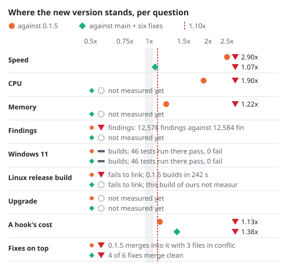

## The versions

| Name | Commit | What it is |
|---|---|---|
| New version at `aad1dd6ef` | `aad1dd6ef` | The head of this pull request when our first results were measured. It holds main up to `71e0822ce`, eight commits before the 0.1.5 release. |
| New version at `f06640857` | `f06640857` | The head of this pull request now, 406 commits later: the no-shadow fix (`8df0e8092`, `5b0f9b550`), the merged hub branch (`0e5b1f09e`) and main up to `39b59e9d7` (#735), which holds 0.1.5. |
| 0.1.5 | `9cad73564` | Rerail 0.1.5, tag `v0.1.5`. Built from source the same way as the new version: when the measuring started (15:50 UTC on 17 November), npm listed the core package up to 0.1.4; 0.1.5 was published at 15:57 UTC. |
| main + six fixes | `58a435201` | Main at `e2f067440`, five commits before the 0.1.5 release commit (those five bring release notes, docs, set-up messages and how a pack made for a newer Rerail loads), with the six fixes below merged. Not on GitHub yet. |

The six fixes, each a change to how Rerail behaves with many worktrees or on Windows:

1. Placing worktrees asks Git once per question, not once per worktree for every session.
2. A folder outside any Git checkout is placed from the disk, with no Git process per hook event (issue #699).
3. With many worktrees, one read of the checkouts serves each event, and Git is asked again only when its files change.
4. A first look at another worktree skips the files Git shows unchanged and already read elsewhere.
5. A hook in a stopped checkout repeats the daemon's last answer when the daemon is late (#674).
6. On Windows, Git for Windows' own `git.exe` runs directly: one process per Git call (issue #662).

## Speed per pack, cold and warm

| Measure | New version at `aad1dd6ef` | New version at `f06640857` | 0.1.5 | main + six fixes | `aad1dd6ef` ÷ 0.1.5 | `f06640857` ÷ 0.1.5 (its own bar) | `aad1dd6ef` ÷ main + fixes | Runs |
|---|---:|---:|---:|---:|---:|---:|---:|---|
| Linux x64: rerail daemon start, the command's own time (a 300-file repository, 382 rules set up), warm store (rerail daemon start, the command's own time) | 1,496 ms (worst 1,500 ms) | not measured at this head | 1,451 ms (worst 1,463 ms) | 1,397 ms (worst 1,414 ms) | 1.03x within |  | 1.07x | 5 each; data/linux.json: `hc/waits/daemon-start/N`, `hc/waits/daemon-start/P`, `hc/waits/daemon-start/B` |
| Linux x64: wall time: the complexity pack (8 rules at the new version, 8 at 0.1.5) on real code, 4 cores pinned (one thread per core, RERAIL_THREADS=4), 3 runs a side taken in turn, cold / warm (wall time) | 800 ms (worst 1,050 ms) / 810 ms | 810 ms (worst 1,050 ms) / 820 ms | 910 ms (worst 1,180 ms) / 920 ms | not measured yet | 0.88x within / 0.88x within | 0.88x within / 0.90x within |  | 3 each; data/linux.json, data/new-head.json: `eng-4c/ships/complexity/real/wall-cold/N`, `eng3-4c/ships/complexity/real/wall-cold/N`, `eng-4c/ships/complexity/real/wall-cold/P`, `eng3-4c/ships/complexity/real/wall-cold/P`; warm: `eng-4c/ships/complexity/real/wall-warm/N`, `eng3-4c/ships/complexity/real/wall-warm/N`, `eng-4c/ships/complexity/real/wall-warm/P`, `eng3-4c/ships/complexity/real/wall-warm/P` |
| Linux x64: wall time: the javascript pack (121 rules at the new version, 121 at 0.1.5) on real code, 4 cores pinned (one thread per core, RERAIL_THREADS=4), 3 runs a side taken in turn, cold / warm (wall time) | 10,940 ms (worst 11,240 ms) / 10,720 ms (worst 10,960 ms) | 11,320 ms (worst 11,350 ms) / 11,360 ms (worst 11,420 ms) | 13,250 ms (worst 13,680 ms) / 13,060 ms (worst 14,190 ms) | not measured yet | 0.83x within / 0.82x within | 0.85x within / 0.87x within |  | 3 each; data/linux.json, data/new-head.json: `eng-4c/ships/javascript/real/wall-cold/N`, `eng3-4c/ships/javascript/real/wall-cold/N`, `eng-4c/ships/javascript/real/wall-cold/P`, `eng3-4c/ships/javascript/real/wall-cold/P`; warm: `eng-4c/ships/javascript/real/wall-warm/N`, `eng3-4c/ships/javascript/real/wall-warm/N`, `eng-4c/ships/javascript/real/wall-warm/P`, `eng3-4c/ships/javascript/real/wall-warm/P` |
| Linux x64: wall time: the node pack (37 rules at the new version, 37 at 0.1.5) on real code, 1 core pinned (RERAIL_THREADS=1), 3 runs a side taken in turn, cold / warm (wall time) | 23,920 ms (worst 24,080 ms) / 24,050 ms (worst 25,020 ms) | not measured at this head | 23,180 ms (worst 23,250 ms) / 23,080 ms (worst 23,310 ms) | not measured yet | 1.03x within / 1.04x within |  |  | 3 each; data/linux.json: `eng-1c/ships/node/real/wall-cold/N`, `eng-1c/ships/node/real/wall-cold/P`; warm: `eng-1c/ships/node/real/wall-warm/N`, `eng-1c/ships/node/real/wall-warm/P` |
| Linux x64: wall time: the node pack (37 rules at the new version, 37 at 0.1.5) on real code, 4 cores pinned (one thread per core, RERAIL_THREADS=4), 3 runs a side taken in turn, cold / warm (wall time) | 12,010 ms (worst 12,110 ms) / 11,920 ms (worst 12,080 ms) | 26,090 ms (worst 26,350 ms) / 25,960 ms (worst 26,330 ms) | 10,950 ms (worst 11,040 ms) / 10,920 ms (worst 11,040 ms) | not measured yet | 1.10x within / 1.09x within | 2.38x **over 1.10** / 2.41x **over 1.10** |  | 3 each; data/linux.json, data/new-head.json: `eng-4c/ships/node/real/wall-cold/N`, `eng3-4c/ships/node/real/wall-cold/N`, `eng-4c/ships/node/real/wall-cold/P`, `eng3-4c/ships/node/real/wall-cold/P`; warm: `eng-4c/ships/node/real/wall-warm/N`, `eng3-4c/ships/node/real/wall-warm/N`, `eng-4c/ships/node/real/wall-warm/P`, `eng3-4c/ships/node/real/wall-warm/P` |
| Linux x64: wall time: the node pack (37 rules at the new version, 37 at 0.1.5) on real code, 4 cores pinned; a larger corpus: the rerail-repository corpus of the shippability bar (conformance, packs, scripts, src, test: 2,312 files), 3 runs a side, cold / warm (wall time) | 14,080 ms (worst 14,250 ms) / 14,270 ms (worst 14,490 ms) | not measured at this head | 12,800 ms (worst 13,190 ms) / 13,310 ms (worst 13,330 ms) | not measured yet | 1.10x within / 1.07x within |  |  | 3 each; data/linux.json: `eng-size2312/ships/node/real/wall-cold/N`, `eng-size2312/ships/node/real/wall-cold/P`; warm: `eng-size2312/ships/node/real/wall-warm/N`, `eng-size2312/ships/node/real/wall-warm/P` |
| Linux x64: wall time: the node pack (37 rules at the new version, 37 at 0.1.5) on real code, 4 cores pinned; a smaller corpus: src/ of the same commit with package.json and tsconfig.json (226 files), 3 runs a side, cold / warm (wall time) | 5,140 ms (worst 5,170 ms) / 5,150 ms (worst 5,190 ms) | not measured at this head | 4,510 ms (worst 4,550 ms) / 4,580 ms (worst 4,660 ms) | not measured yet | 1.14x **over 1.10** / 1.12x **over 1.10** |  |  | 3 each; data/linux.json: `eng-size226/ships/node/real/wall-cold/N`, `eng-size226/ships/node/real/wall-cold/P`; warm: `eng-size226/ships/node/real/wall-warm/N`, `eng-size226/ships/node/real/wall-warm/P` |
| Linux x64: wall time: the node pack (37 rules at the new version, 37 at 0.1.5) on real code, 8 cores pinned (one thread per core, RERAIL_THREADS=8), 3 runs a side taken in turn, cold / warm (wall time) | 10,720 ms (worst 10,770 ms) / 10,780 ms (worst 10,980 ms) | not measured at this head | 10,800 ms (worst 10,900 ms) / 10,880 ms (worst 11,000 ms) | not measured yet | 0.99x within / 0.99x within |  |  | 3 each; data/linux.json: `eng-8c/ships/node/real/wall-cold/N`, `eng-8c/ships/node/real/wall-cold/P`; warm: `eng-8c/ships/node/real/wall-warm/N`, `eng-8c/ships/node/real/wall-warm/P` |
| Linux x64: wall time: the rerail pack (34 rules at the new version, 34 at 0.1.5) on real code, 4 cores pinned (one thread per core, RERAIL_THREADS=4), 3 runs a side taken in turn, cold / warm (wall time) | 1,520 ms (worst 1,530 ms) / 1,520 ms | 1,530 ms (worst 1,550 ms) / 1,530 ms (worst 1,540 ms) | 1,710 ms / 1,700 ms (worst 1,720 ms) | not measured yet | 0.89x within / 0.89x within | 0.89x within / 0.88x within |  | 3 each; data/linux.json, data/new-head.json: `eng-4c/ships/rerail/real/wall-cold/N`, `eng3-4c/ships/rerail/real/wall-cold/N`, `eng-4c/ships/rerail/real/wall-cold/P`, `eng3-4c/ships/rerail/real/wall-cold/P`; warm: `eng-4c/ships/rerail/real/wall-warm/N`, `eng3-4c/ships/rerail/real/wall-warm/N`, `eng-4c/ships/rerail/real/wall-warm/P`, `eng3-4c/ships/rerail/real/wall-warm/P` |
| Linux x64: wall time: the rust pack (33 rules at the new version, 33 at 0.1.5) on real code, 4 cores pinned (one thread per core, RERAIL_THREADS=4), 3 runs a side taken in turn, cold / warm (wall time) | 3,650 ms (worst 3,680 ms) / 3,640 ms (worst 3,700 ms) | 3,950 ms (worst 4,040 ms) / 3,900 ms (worst 4,010 ms) | 4,740 ms (worst 4,760 ms) / 4,700 ms (worst 4,740 ms) | not measured yet | 0.77x within / 0.77x within | 0.82x within / 0.80x within |  | 3 each; data/linux.json, data/new-head.json: `eng-4c/ships/rust/real/wall-cold/N`, `eng3-4c/ships/rust/real/wall-cold/N`, `eng-4c/ships/rust/real/wall-cold/P`, `eng3-4c/ships/rust/real/wall-cold/P`; warm: `eng-4c/ships/rust/real/wall-warm/N`, `eng3-4c/ships/rust/real/wall-warm/N`, `eng-4c/ships/rust/real/wall-warm/P`, `eng3-4c/ships/rust/real/wall-warm/P` |
| Linux x64: wall time: the typescript pack (65 rules at the new version, 65 at 0.1.5) on real code, 1 core pinned (RERAIL_THREADS=1), 3 runs a side taken in turn, cold / warm (wall time) | 29,790 ms (worst 30,060 ms) / 29,650 ms (worst 29,720 ms) | not measured at this head | 17,030 ms (worst 17,310 ms) / 16,880 ms (worst 17,110 ms) | not measured yet | 1.75x **over 1.10** / 1.76x **over 1.10** |  |  | 3 each; data/linux.json: `eng-1c/ships/typescript/real/wall-cold/N`, `eng-1c/ships/typescript/real/wall-cold/P`; warm: `eng-1c/ships/typescript/real/wall-warm/N`, `eng-1c/ships/typescript/real/wall-warm/P` |
| Linux x64: wall time: the typescript pack (65 rules at the new version, 65 at 0.1.5) on real code, 4 cores pinned (one thread per core, RERAIL_THREADS=4), 3 runs a side taken in turn, cold / warm (wall time) | 14,680 ms (worst 14,880 ms) / 14,100 ms (worst 14,950 ms) | 8,510 ms (worst 8,540 ms) / 8,500 ms (worst 8,590 ms) | 7,240 ms (worst 7,300 ms) / 7,210 ms (worst 7,250 ms) | not measured yet | 2.03x **over 1.10** / 1.96x **over 1.10** | 1.18x **over 1.10** / 1.17x **over 1.10** |  | 3 each; data/linux.json, data/new-head.json: `eng-4c/ships/typescript/real/wall-cold/N`, `eng3-4c/ships/typescript/real/wall-cold/N`, `eng-4c/ships/typescript/real/wall-cold/P`, `eng3-4c/ships/typescript/real/wall-cold/P`; warm: `eng-4c/ships/typescript/real/wall-warm/N`, `eng3-4c/ships/typescript/real/wall-warm/N`, `eng-4c/ships/typescript/real/wall-warm/P`, `eng3-4c/ships/typescript/real/wall-warm/P` |
| Linux x64: wall time: the typescript pack (65 rules at the new version, 65 at 0.1.5) on real code, 4 cores pinned; a larger corpus: the rerail-repository corpus of the shippability bar (conformance, packs, scripts, src, test: 2,312 files), 3 runs a side, cold / warm (wall time) | 18,230 ms (worst 18,720 ms) / 17,900 ms (worst 18,730 ms) | not measured at this head | 9,300 ms (worst 9,520 ms) / 9,440 ms (worst 9,570 ms) | not measured yet | 1.96x **over 1.10** / 1.90x **over 1.10** |  |  | 3 each; data/linux.json: `eng-size2312/ships/typescript/real/wall-cold/N`, `eng-size2312/ships/typescript/real/wall-cold/P`; warm: `eng-size2312/ships/typescript/real/wall-warm/N`, `eng-size2312/ships/typescript/real/wall-warm/P` |
| Linux x64: wall time: the typescript pack (65 rules at the new version, 65 at 0.1.5) on real code, 4 cores pinned; a smaller corpus: src/ of the same commit with package.json and tsconfig.json (226 files), 3 runs a side, cold / warm (wall time) | 5,860 ms (worst 5,930 ms) / 5,790 ms (worst 5,930 ms) | not measured at this head | 3,440 ms (worst 3,600 ms) / 3,450 ms (worst 3,510 ms) | not measured yet | 1.70x **over 1.10** / 1.68x **over 1.10** |  |  | 3 each; data/linux.json: `eng-size226/ships/typescript/real/wall-cold/N`, `eng-size226/ships/typescript/real/wall-cold/P`; warm: `eng-size226/ships/typescript/real/wall-warm/N`, `eng-size226/ships/typescript/real/wall-warm/P` |
| Linux x64: wall time: the typescript pack (65 rules at the new version, 65 at 0.1.5) on real code, 8 cores pinned (one thread per core, RERAIL_THREADS=8), 3 runs a side taken in turn, cold / warm (wall time) | 12,660 ms (worst 12,880 ms) / 12,810 ms (worst 13,110 ms) | not measured at this head | 7,090 ms (worst 7,170 ms) / 7,200 ms (worst 7,260 ms) | not measured yet | 1.79x **over 1.10** / 1.78x **over 1.10** |  |  | 3 each; data/linux.json: `eng-8c/ships/typescript/real/wall-cold/N`, `eng-8c/ships/typescript/real/wall-cold/P`; warm: `eng-8c/ships/typescript/real/wall-warm/N`, `eng-8c/ships/typescript/real/wall-warm/P` |
| Linux x64: rerail daemon stop (a 300-file repository, 382 rules set up), warm store (rerail daemon stop) | 273 ms (worst 278 ms) | not measured at this head | 268 ms (worst 271 ms) | 269 ms (worst 276 ms) | 1.02x within |  | 1.01x | 5 each; data/linux.json: `hc/waits/daemon-stop/N`, `hc/waits/daemon-stop/P`, `hc/waits/daemon-stop/B` |
| Linux x64: rerail start --repository, answered as set-up answers (a 300-file repository, 382 rules set up), warm store (rerail start --repository, answered as set-up answers) | 1,167 ms (worst 1,174 ms) | not measured at this head | 1,130 ms (worst 1,144 ms) | 974 ms (worst 987 ms) | 1.03x within |  | 1.20x | 5 each; data/linux.json: `hc/waits/repo-start/N`, `hc/waits/repo-start/P`, `hc/waits/repo-start/B` |
| Linux x64: rerail status in a started repository (a 300-file repository, 382 rules set up), warm store (rerail status in a started repository) | 190 ms (worst 192 ms) | not measured at this head | 186 ms (worst 191 ms) | 182 ms (worst 192 ms) | 1.02x within |  | 1.04x | 5 each; data/linux.json: `hc/waits/status/N`, `hc/waits/status/P`, `hc/waits/status/B` |
| Linux x64: rerail stop --repository (a 300-file repository, 382 rules set up), warm store (rerail stop --repository) | 198 ms (worst 203 ms) | not measured at this head | 190 ms (worst 195 ms) | 185 ms (worst 193 ms) | 1.04x within |  | 1.07x | 5 each; data/linux.json: `hc/waits/repo-stop/N`, `hc/waits/repo-stop/P`, `hc/waits/repo-stop/B` |
| Linux x64: a daemon's start to its first answer on /healthz, warm store (start to first answer) | 1,498 ms (worst 1,509 ms) | not measured at this head | 1,453 ms (worst 1,472 ms) | 1,399 ms (worst 1,418 ms) | 1.03x within |  | 1.07x | 5 each; data/linux.json: `hc/waits/first-answer/N`, `hc/waits/first-answer/P`, `hc/waits/first-answer/B` |
| Windows 11: wall time: the complexity pack (8 rules at the new version, 8 at 0.1.5) on real code, Windows 11 VM, 4 pinned CPUs, 3 runs, cold / warm (wall time) | 894 ms (worst 2,314 ms) / 869 ms (worst 872 ms) | not measured at this head | 1,004 ms (worst 2,549 ms) / 979 ms (worst 1,005 ms) | not measured yet | 0.89x within / 0.89x within |  |  | 3 each; data/windows.json: `win-bar/ships/complexity/real/wall-cold/N`, `win-bar/ships/complexity/real/wall-cold/P`; warm: `win-bar/ships/complexity/real/wall-warm/N`, `win-bar/ships/complexity/real/wall-warm/P` |
| Windows 11: wall time: the javascript pack (121 rules at the new version, 121 at 0.1.5) on real code, Windows 11 VM, 4 pinned CPUs, 3 runs, cold / warm (wall time) | 11,006 ms (worst 11,042 ms) / 10,818 ms (worst 10,919 ms) | not measured at this head | 13,847 ms (worst 14,187 ms) / 13,589 ms (worst 13,602 ms) | not measured yet | 0.79x within / 0.80x within |  |  | 3 each; data/windows.json: `win-bar/ships/javascript/real/wall-cold/N`, `win-bar/ships/javascript/real/wall-cold/P`; warm: `win-bar/ships/javascript/real/wall-warm/N`, `win-bar/ships/javascript/real/wall-warm/P` |
| Windows 11: wall time: the node pack (37 rules at the new version, 37 at 0.1.5) on real code, Windows 11 VM, 4 pinned CPUs, 3 runs, cold / warm (wall time) | 11,766 ms (worst 11,823 ms) / 11,731 ms (worst 11,880 ms) | not measured at this head | 11,267 ms (worst 11,443 ms) / 11,075 ms (worst 11,239 ms) | not measured yet | 1.04x within / 1.06x within |  |  | 3 each; data/windows.json: `win-bar/ships/node/real/wall-cold/N`, `win-bar/ships/node/real/wall-cold/P`; warm: `win-bar/ships/node/real/wall-warm/N`, `win-bar/ships/node/real/wall-warm/P` |
| Windows 11: wall time: the rerail pack (34 rules at the new version, 34 at 0.1.5) on real code, Windows 11 VM, 4 pinned CPUs, 3 runs, cold / warm (wall time) | 1,539 ms (worst 1,675 ms) / 1,538 ms (worst 1,551 ms) | not measured at this head | 1,801 ms (worst 2,480 ms) / 1,787 ms (worst 1,792 ms) | not measured yet | 0.85x within / 0.86x within |  |  | 3 each; data/windows.json: `win-bar/ships/rerail/real/wall-cold/N`, `win-bar/ships/rerail/real/wall-cold/P`; warm: `win-bar/ships/rerail/real/wall-warm/N`, `win-bar/ships/rerail/real/wall-warm/P` |
| Windows 11: wall time: the rust pack (33 rules at the new version, 33 at 0.1.5) on real code, Windows 11 VM, 4 pinned CPUs, 3 runs, cold / warm (wall time) | 3,986 ms (worst 4,092 ms) / 3,838 ms (worst 3,912 ms) | not measured at this head | 5,570 ms (worst 5,592 ms) / 5,207 ms (worst 5,319 ms) | not measured yet | 0.72x within / 0.74x within |  |  | 3 each; data/windows.json: `win-bar/ships/rust/real/wall-cold/N`, `win-bar/ships/rust/real/wall-cold/P`; warm: `win-bar/ships/rust/real/wall-warm/N`, `win-bar/ships/rust/real/wall-warm/P` |
| Windows 11: wall time: the typescript pack (65 rules at the new version, 65 at 0.1.5) on real code, Windows 11 VM, 4 pinned CPUs, 3 runs, cold / warm (wall time) | 13,030 ms (worst 13,332 ms) / 12,862 ms (worst 13,022 ms) | not measured at this head | 7,778 ms (worst 7,988 ms) / 7,839 ms (worst 7,884 ms) | not measured yet | 1.68x **over 1.10** / 1.64x **over 1.10** |  |  | 3 each; data/windows.json: `win-bar/ships/typescript/real/wall-cold/N`, `win-bar/ships/typescript/real/wall-cold/P`; warm: `win-bar/ships/typescript/real/wall-warm/N`, `win-bar/ships/typescript/real/wall-warm/P` |

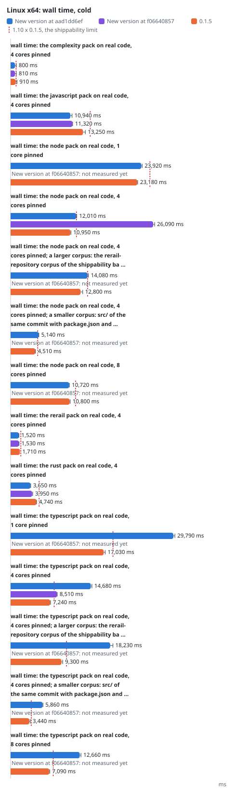 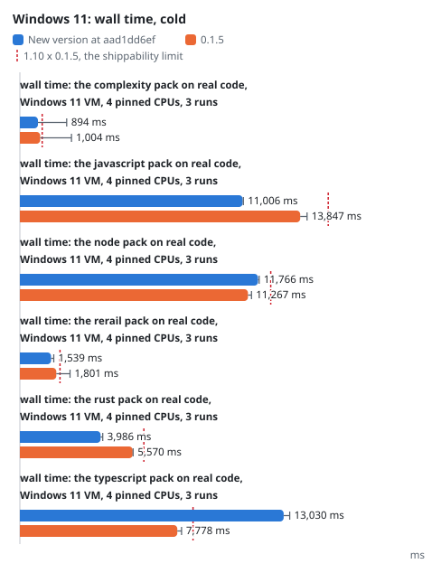 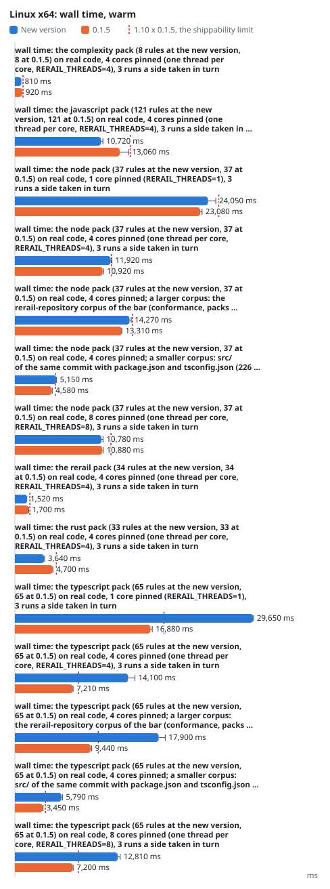 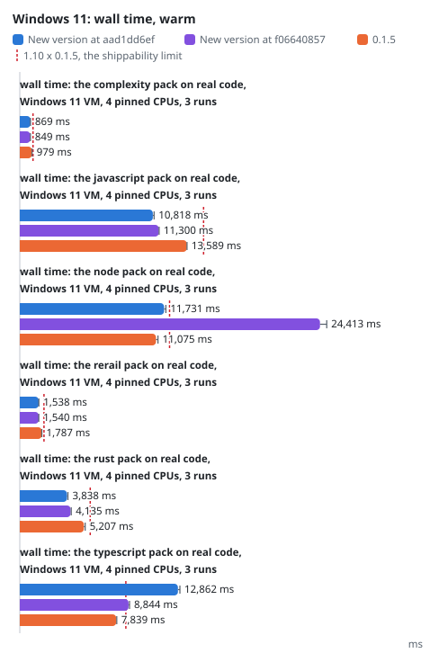

## The slow rules

| Measure | New version at `aad1dd6ef` | New version at `f06640857` | 0.1.5 | `aad1dd6ef` ÷ 0.1.5 | `f06640857` ÷ 0.1.5 (its own bar) | Runs |
|---|---:|---:|---:|---:|---:|---|
| Linux x64: one rule alone (evaluate_ms): n-no-deprecated-api, the node pack (37 rules at the new version, 37 at 0.1.5) on real code, 4 cores pinned (one thread per core, RERAIL_THREADS=4), 3 runs a side taken in turn, cold (time of one rule alone (evaluate_ms)) | not measured yet | 9,924 ms | 3,000 ms |  | 3.31x | 1 each; data/new-head.json: `eng3-4c/ships/node/real/rule/n-no-deprecated-api/N`, `eng3-4c/ships/node/real/rule/n-no-deprecated-api/P`, `eng3-4c/ships/node/real/rule/n-no-deprecated-api/P` |
| Linux x64: one rule alone (evaluate_ms): n-no-unsupported-features-node-builtins, the node pack (37 rules at the new version, 37 at 0.1.5) on real code, 4 cores pinned (one thread per core, RERAIL_THREADS=4), 3 runs a side taken in turn, cold (time of one rule alone (evaluate_ms)) | not measured yet | 12,329 ms | 5,095 ms |  | 2.42x | 1 each; data/new-head.json: `eng3-4c/ships/node/real/rule/n-no-unsupported-features-node-builtins/N`, `eng3-4c/ships/node/real/rule/n-no-unsupported-features-node-builtins/P`, `eng3-4c/ships/node/real/rule/n-no-unsupported-features-node-builtins/P` |
| Linux x64: one rule alone (evaluate_ms): typescript-eslint-member-ordering, the typescript pack (65 rules at the new version, 65 at 0.1.5) on real code, 4 cores pinned (one thread per core, RERAIL_THREADS=4), 3 runs a side taken in turn, cold (time of one rule alone (evaluate_ms)) | 331 ms | 335 ms | 455 ms | 0.73x | 0.76x | 1 each; data/linux.json, data/new-head.json: `eng-4c/ships/typescript/real/rule/typescript-eslint-member-ordering/N`, `eng3-4c/ships/typescript/real/rule/typescript-eslint-member-ordering/N`, `eng-4c/ships/typescript/real/rule/typescript-eslint-member-ordering/P`, `eng3-4c/ships/typescript/real/rule/typescript-eslint-member-ordering/P` |
| Linux x64: one rule alone (evaluate_ms): typescript-eslint-no-redeclare, the typescript pack (65 rules at the new version, 65 at 0.1.5) on real code, 4 cores pinned (one thread per core, RERAIL_THREADS=4), 3 runs a side taken in turn, cold (time of one rule alone (evaluate_ms)) | 604 ms | 653 ms | 766 ms | 0.79x | 0.85x | 1 each; data/linux.json, data/new-head.json: `eng-4c/ships/typescript/real/rule/typescript-eslint-no-redeclare/N`, `eng3-4c/ships/typescript/real/rule/typescript-eslint-no-redeclare/N`, `eng-4c/ships/typescript/real/rule/typescript-eslint-no-redeclare/P`, `eng3-4c/ships/typescript/real/rule/typescript-eslint-no-redeclare/P` |
| Linux x64: one rule alone (evaluate_ms): typescript-eslint-no-shadow, the typescript pack (65 rules at the new version, 65 at 0.1.5) on real code, 4 cores pinned (one thread per core, RERAIL_THREADS=4), 3 runs a side taken in turn, cold (time of one rule alone (evaluate_ms)) | 9,295 ms | 3,285 ms | 3,210 ms | 2.90x | 1.01x | 1 each; data/linux.json, data/new-head.json: `eng-4c/ships/typescript/real/rule/typescript-eslint-no-shadow/N`, `eng3-4c/ships/typescript/real/rule/typescript-eslint-no-shadow/N`, `eng-4c/ships/typescript/real/rule/typescript-eslint-no-shadow/P`, `eng3-4c/ships/typescript/real/rule/typescript-eslint-no-shadow/P` |
| Linux x64: one rule alone (evaluate_ms): typescript-eslint-no-unused-private-class-members, the typescript pack (65 rules at the new version, 65 at 0.1.5) on real code, 4 cores pinned (one thread per core, RERAIL_THREADS=4), 3 runs a side taken in turn, cold (time of one rule alone (evaluate_ms)) | 613 ms | 648 ms | 698 ms | 0.88x | 0.92x | 1 each; data/linux.json, data/new-head.json: `eng-4c/ships/typescript/real/rule/typescript-eslint-no-unused-private-class-members/N`, `eng3-4c/ships/typescript/real/rule/typescript-eslint-no-unused-private-class-members/N`, `eng-4c/ships/typescript/real/rule/typescript-eslint-no-unused-private-class-members/P`, `eng3-4c/ships/typescript/real/rule/typescript-eslint-no-unused-private-class-members/P` |
| Linux x64: one rule alone (evaluate_ms): typescript-eslint-no-use-before-define, the typescript pack (65 rules at the new version, 65 at 0.1.5) on real code, 4 cores pinned (one thread per core, RERAIL_THREADS=4), 3 runs a side taken in turn, cold (time of one rule alone (evaluate_ms)) | not measured yet | 949 ms | 1,005 ms |  | 0.94x | 1 each; data/new-head.json: `eng3-4c/ships/typescript/real/rule/typescript-eslint-no-use-before-define/N`, `eng3-4c/ships/typescript/real/rule/typescript-eslint-no-use-before-define/P`, `eng3-4c/ships/typescript/real/rule/typescript-eslint-no-use-before-define/P` |
| Linux x64: one rule alone (evaluate_ms): typescript-eslint-unified-signatures, the typescript pack (65 rules at the new version, 65 at 0.1.5) on real code, 4 cores pinned (one thread per core, RERAIL_THREADS=4), 3 runs a side taken in turn, cold (time of one rule alone (evaluate_ms)) | 247 ms | not measured at this head | 464 ms | 0.53x |  | 1 each; data/linux.json: `eng-4c/ships/typescript/real/rule/typescript-eslint-unified-signatures/N`, `eng-4c/ships/typescript/real/rule/typescript-eslint-unified-signatures/P` |
| Linux x64: one rule alone (evaluate_ms): vitest-expect-expect, the typescript pack (65 rules at the new version, 65 at 0.1.5) on real code, 4 cores pinned (one thread per core, RERAIL_THREADS=4), 3 runs a side taken in turn, cold (time of one rule alone (evaluate_ms)) | 322 ms | 435 ms | 462 ms | 0.70x | 0.90x | 1 each; data/linux.json, data/new-head.json: `eng-4c/ships/typescript/real/rule/vitest-expect-expect/N`, `eng3-4c/ships/typescript/real/rule/vitest-expect-expect/N`, `eng-4c/ships/typescript/real/rule/vitest-expect-expect/P`, `eng3-4c/ships/typescript/real/rule/vitest-expect-expect/P` |
| Linux x64: one rule alone (evaluate_ms): vitest-no-disabled-tests, the typescript pack (65 rules at the new version, 65 at 0.1.5) on real code, 4 cores pinned (one thread per core, RERAIL_THREADS=4), 3 runs a side taken in turn, cold (time of one rule alone (evaluate_ms)) | 643 ms | 905 ms | 735 ms | 0.87x | 1.22x | 1 each; data/linux.json, data/new-head.json: `eng-4c/ships/typescript/real/rule/vitest-no-disabled-tests/N`, `eng3-4c/ships/typescript/real/rule/vitest-no-disabled-tests/N`, `eng-4c/ships/typescript/real/rule/vitest-no-disabled-tests/P`, `eng3-4c/ships/typescript/real/rule/vitest-no-disabled-tests/P` |
| Linux x64: one rule alone (evaluate_ms): vitest-no-focused-tests, the typescript pack (65 rules at the new version, 65 at 0.1.5) on real code, 4 cores pinned (one thread per core, RERAIL_THREADS=4), 3 runs a side taken in turn, cold (time of one rule alone (evaluate_ms)) | 255 ms | 311 ms | 417 ms | 0.61x | 0.73x | 1 each; data/linux.json, data/new-head.json: `eng-4c/ships/typescript/real/rule/vitest-no-focused-tests/N`, `eng3-4c/ships/typescript/real/rule/vitest-no-focused-tests/N`, `eng-4c/ships/typescript/real/rule/vitest-no-focused-tests/P`, `eng3-4c/ships/typescript/real/rule/vitest-no-focused-tests/P` |
| Windows 11: one rule alone (evaluate_ms): typescript-eslint-member-ordering, the typescript pack (65 rules at the new version, 65 at 0.1.5) on real code, Windows 11 VM, 4 pinned CPUs, 3 runs, cold (time of one rule alone (evaluate_ms)) | 310 ms | not measured at this head | 480 ms | 0.65x |  | 2 each; data/windows.json: `win-bar/ships/typescript/real/rule/typescript-eslint-member-ordering/N`, `win-bar/ships/typescript/real/rule/typescript-eslint-member-ordering/P` |
| Windows 11: one rule alone (evaluate_ms): typescript-eslint-no-redeclare, the typescript pack (65 rules at the new version, 65 at 0.1.5) on real code, Windows 11 VM, 4 pinned CPUs, 3 runs, cold (time of one rule alone (evaluate_ms)) | 560 ms | not measured at this head | 866 ms | 0.65x |  | 2 each; data/windows.json: `win-bar/ships/typescript/real/rule/typescript-eslint-no-redeclare/N`, `win-bar/ships/typescript/real/rule/typescript-eslint-no-redeclare/P` |
| Windows 11: one rule alone (evaluate_ms): typescript-eslint-no-shadow, the typescript pack (65 rules at the new version, 65 at 0.1.5) on real code, Windows 11 VM, 4 pinned CPUs, 3 runs, cold (time of one rule alone (evaluate_ms)) | 7,996 ms | not measured at this head | 3,338 ms | 2.40x |  | 2 each; data/windows.json: `win-bar/ships/typescript/real/rule/typescript-eslint-no-shadow/N`, `win-bar/ships/typescript/real/rule/typescript-eslint-no-shadow/P` |
| Windows 11: one rule alone (evaluate_ms): typescript-eslint-no-unused-private-class-members, the typescript pack (65 rules at the new version, 65 at 0.1.5) on real code, Windows 11 VM, 4 pinned CPUs, 3 runs, cold (time of one rule alone (evaluate_ms)) | 602 ms | not measured at this head | 824 ms | 0.73x |  | 2 each; data/windows.json: `win-bar/ships/typescript/real/rule/typescript-eslint-no-unused-private-class-members/N`, `win-bar/ships/typescript/real/rule/typescript-eslint-no-unused-private-class-members/P` |
| Windows 11: one rule alone (evaluate_ms): typescript-eslint-no-unused-vars, the typescript pack (65 rules at the new version, 65 at 0.1.5) on real code, Windows 11 VM, 4 pinned CPUs, 3 runs, cold (time of one rule alone (evaluate_ms)) | 338 ms | not measured at this head | 670 ms | 0.50x |  | 2 each; data/windows.json: `win-bar/ships/typescript/real/rule/typescript-eslint-no-unused-vars/N`, `win-bar/ships/typescript/real/rule/typescript-eslint-no-unused-vars/P` |
| Windows 11: one rule alone (evaluate_ms): vitest-expect-expect, the typescript pack (65 rules at the new version, 65 at 0.1.5) on real code, Windows 11 VM, 4 pinned CPUs, 3 runs, cold (time of one rule alone (evaluate_ms)) | 288 ms | not measured at this head | 536 ms | 0.54x |  | 2 each; data/windows.json: `win-bar/ships/typescript/real/rule/vitest-expect-expect/N`, `win-bar/ships/typescript/real/rule/vitest-expect-expect/P` |
| Windows 11: one rule alone (evaluate_ms): vitest-no-disabled-tests, the typescript pack (65 rules at the new version, 65 at 0.1.5) on real code, Windows 11 VM, 4 pinned CPUs, 3 runs, cold (time of one rule alone (evaluate_ms)) | 572 ms | not measured at this head | 804 ms | 0.71x |  | 2 each; data/windows.json: `win-bar/ships/typescript/real/rule/vitest-no-disabled-tests/N`, `win-bar/ships/typescript/real/rule/vitest-no-disabled-tests/P` |
| Windows 11: one rule alone (evaluate_ms): vitest-no-focused-tests, the typescript pack (65 rules at the new version, 65 at 0.1.5) on real code, Windows 11 VM, 4 pinned CPUs, 3 runs, cold (time of one rule alone (evaluate_ms)) | 218 ms | not measured at this head | 479 ms | 0.46x |  | 2 each; data/windows.json: `win-bar/ships/typescript/real/rule/vitest-no-focused-tests/N`, `win-bar/ships/typescript/real/rule/vitest-no-focused-tests/P` |

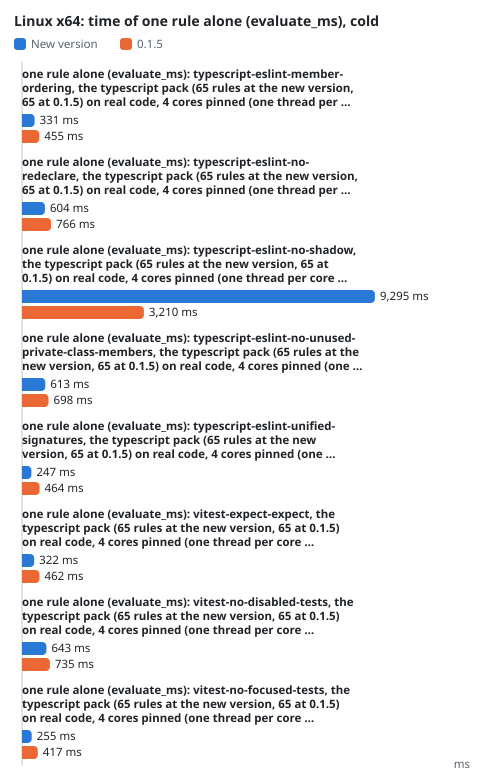 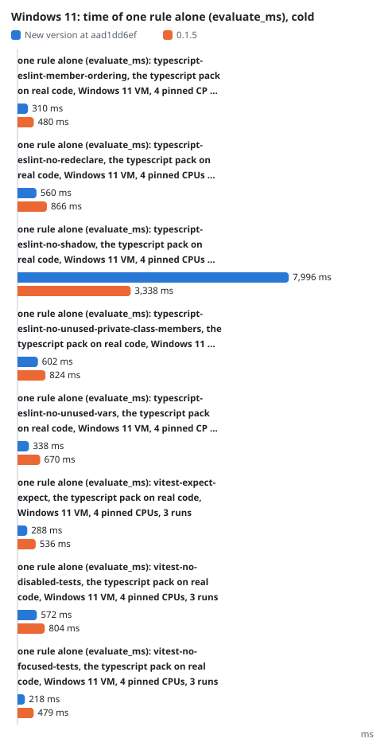

## CPU

| Measure | New version at `aad1dd6ef` | New version at `f06640857` | 0.1.5 | main + six fixes | `aad1dd6ef` ÷ 0.1.5 | `f06640857` ÷ 0.1.5 (its own bar) | `aad1dd6ef` ÷ main + fixes | Runs |
|---|---:|---:|---:|---:|---:|---:|---:|---|
| Linux x64: CPU time, user and system: the complexity pack (8 rules at the new version, 8 at 0.1.5) on real code, 4 cores pinned (one thread per core, RERAIL_THREADS=4), 3 runs a side taken in turn, cold / warm (CPU time, user and system) | 1,430 ms (worst 1,600 ms) / 1,410 ms (worst 1,420 ms) | 1,430 ms (worst 1,620 ms) / 1,450 ms (worst 1,460 ms) | 1,750 ms (worst 1,930 ms) / 1,760 ms (worst 1,770 ms) | not measured yet | 0.82x / 0.80x | 0.80x / 0.83x |  | 3 each; data/linux.json, data/new-head.json: `eng-4c/ships/complexity/real/cpu-cold/N`, `eng3-4c/ships/complexity/real/cpu-cold/N`, `eng-4c/ships/complexity/real/cpu-cold/P`, `eng3-4c/ships/complexity/real/cpu-cold/P`; warm: `eng-4c/ships/complexity/real/cpu-warm/N`, `eng3-4c/ships/complexity/real/cpu-warm/N`, `eng-4c/ships/complexity/real/cpu-warm/P`, `eng3-4c/ships/complexity/real/cpu-warm/P` |
| Linux x64: CPU time, user and system: the javascript pack (121 rules at the new version, 121 at 0.1.5) on real code, 4 cores pinned (one thread per core, RERAIL_THREADS=4), 3 runs a side taken in turn, cold / warm (CPU time, user and system) | 29,370 ms (worst 29,950 ms) / 29,030 ms (worst 29,540 ms) | 30,300 ms (worst 30,550 ms) / 30,470 ms (worst 30,700 ms) | 35,320 ms (worst 36,870 ms) / 35,930 ms (worst 36,630 ms) | not measured yet | 0.83x / 0.81x | 0.85x / 0.86x |  | 3 each; data/linux.json, data/new-head.json: `eng-4c/ships/javascript/real/cpu-cold/N`, `eng3-4c/ships/javascript/real/cpu-cold/N`, `eng-4c/ships/javascript/real/cpu-cold/P`, `eng3-4c/ships/javascript/real/cpu-cold/P`; warm: `eng-4c/ships/javascript/real/cpu-warm/N`, `eng3-4c/ships/javascript/real/cpu-warm/N`, `eng-4c/ships/javascript/real/cpu-warm/P`, `eng3-4c/ships/javascript/real/cpu-warm/P` |
| Linux x64: CPU time, user and system: the node pack (37 rules at the new version, 37 at 0.1.5) on real code, 1 core pinned (RERAIL_THREADS=1), 3 runs a side taken in turn, cold / warm (CPU time, user and system) | 23,890 ms (worst 24,050 ms) / 24,040 ms (worst 24,990 ms) | not measured at this head | 23,150 ms (worst 23,220 ms) / 23,050 ms (worst 23,280 ms) | not measured yet | 1.03x / 1.04x |  |  | 3 each; data/linux.json: `eng-1c/ships/node/real/cpu-cold/N`, `eng-1c/ships/node/real/cpu-cold/P`; warm: `eng-1c/ships/node/real/cpu-warm/N`, `eng-1c/ships/node/real/cpu-warm/P` |
| Linux x64: CPU time, user and system: the node pack (37 rules at the new version, 37 at 0.1.5) on real code, 4 cores pinned (one thread per core, RERAIL_THREADS=4), 3 runs a side taken in turn, cold / warm (CPU time, user and system) | 26,470 ms (worst 26,550 ms) / 26,440 ms (worst 26,450 ms) | 50,350 ms (worst 50,410 ms) / 50,230 ms (worst 51,080 ms) | 24,280 ms (worst 24,290 ms) / 24,400 ms (worst 24,530 ms) | not measured yet | 1.09x / 1.08x | 2.05x / 2.05x |  | 3 each; data/linux.json, data/new-head.json: `eng-4c/ships/node/real/cpu-cold/N`, `eng3-4c/ships/node/real/cpu-cold/N`, `eng-4c/ships/node/real/cpu-cold/P`, `eng3-4c/ships/node/real/cpu-cold/P`; warm: `eng-4c/ships/node/real/cpu-warm/N`, `eng3-4c/ships/node/real/cpu-warm/N`, `eng-4c/ships/node/real/cpu-warm/P`, `eng3-4c/ships/node/real/cpu-warm/P` |
| Linux x64: CPU time, user and system: the node pack (37 rules at the new version, 37 at 0.1.5) on real code, 4 cores pinned; a larger corpus: the rerail-repository corpus of the shippability bar (conformance, packs, scripts, src, test: 2,312 files), 3 runs a side, cold / warm (CPU time, user and system) | 31,550 ms (worst 31,650 ms) / 31,570 ms (worst 31,630 ms) | not measured at this head | 29,270 ms (worst 29,290 ms) / 29,270 ms (worst 29,290 ms) | not measured yet | 1.08x / 1.08x |  |  | 3 each; data/linux.json: `eng-size2312/ships/node/real/cpu-cold/N`, `eng-size2312/ships/node/real/cpu-cold/P`; warm: `eng-size2312/ships/node/real/cpu-warm/N`, `eng-size2312/ships/node/real/cpu-warm/P` |
| Linux x64: CPU time, user and system: the node pack (37 rules at the new version, 37 at 0.1.5) on real code, 4 cores pinned; a smaller corpus: src/ of the same commit with package.json and tsconfig.json (226 files), 3 runs a side, cold / warm (CPU time, user and system) | 9,220 ms (worst 9,290 ms) / 9,310 ms | not measured at this head | 8,460 ms (worst 8,470 ms) / 8,570 ms (worst 8,720 ms) | not measured yet | 1.09x / 1.09x |  |  | 3 each; data/linux.json: `eng-size226/ships/node/real/cpu-cold/N`, `eng-size226/ships/node/real/cpu-cold/P`; warm: `eng-size226/ships/node/real/cpu-warm/N`, `eng-size226/ships/node/real/cpu-warm/P` |
| Linux x64: CPU time, user and system: the node pack (37 rules at the new version, 37 at 0.1.5) on real code, 8 cores pinned (one thread per core, RERAIL_THREADS=8), 3 runs a side taken in turn, cold / warm (CPU time, user and system) | 28,840 ms (worst 29,000 ms) / 28,820 ms (worst 29,270 ms) | not measured at this head | 24,380 ms (worst 24,610 ms) / 24,210 ms (worst 24,910 ms) | not measured yet | 1.18x / 1.19x |  |  | 3 each; data/linux.json: `eng-8c/ships/node/real/cpu-cold/N`, `eng-8c/ships/node/real/cpu-cold/P`; warm: `eng-8c/ships/node/real/cpu-warm/N`, `eng-8c/ships/node/real/cpu-warm/P` |
| Linux x64: CPU time, user and system: the rerail pack (34 rules at the new version, 34 at 0.1.5) on real code, 4 cores pinned (one thread per core, RERAIL_THREADS=4), 3 runs a side taken in turn, cold / warm (CPU time, user and system) | 2,720 ms (worst 2,730 ms) / 2,720 ms | 2,790 ms (worst 2,800 ms) / 2,780 ms (worst 2,790 ms) | 3,260 ms (worst 3,280 ms) / 3,250 ms (worst 3,270 ms) | not measured yet | 0.83x / 0.84x | 0.85x / 0.85x |  | 3 each; data/linux.json, data/new-head.json: `eng-4c/ships/rerail/real/cpu-cold/N`, `eng3-4c/ships/rerail/real/cpu-cold/N`, `eng-4c/ships/rerail/real/cpu-cold/P`, `eng3-4c/ships/rerail/real/cpu-cold/P`; warm: `eng-4c/ships/rerail/real/cpu-warm/N`, `eng3-4c/ships/rerail/real/cpu-warm/N`, `eng-4c/ships/rerail/real/cpu-warm/P`, `eng3-4c/ships/rerail/real/cpu-warm/P` |
| Linux x64: CPU time, user and system: the rust pack (33 rules at the new version, 33 at 0.1.5) on real code, 4 cores pinned (one thread per core, RERAIL_THREADS=4), 3 runs a side taken in turn, cold / warm (CPU time, user and system) | 9,740 ms (worst 9,930 ms) / 9,770 ms (worst 10,110 ms) | 10,510 ms (worst 10,710 ms) / 10,460 ms (worst 10,560 ms) | 13,170 ms (worst 13,190 ms) / 13,170 ms (worst 13,270 ms) | not measured yet | 0.74x / 0.74x | 0.78x / 0.79x |  | 3 each; data/linux.json, data/new-head.json: `eng-4c/ships/rust/real/cpu-cold/N`, `eng3-4c/ships/rust/real/cpu-cold/N`, `eng-4c/ships/rust/real/cpu-cold/P`, `eng3-4c/ships/rust/real/cpu-cold/P`; warm: `eng-4c/ships/rust/real/cpu-warm/N`, `eng3-4c/ships/rust/real/cpu-warm/N`, `eng-4c/ships/rust/real/cpu-warm/P`, `eng3-4c/ships/rust/real/cpu-warm/P` |
| Linux x64: CPU time, user and system: the typescript pack (65 rules at the new version, 65 at 0.1.5) on real code, 1 core pinned (RERAIL_THREADS=1), 3 runs a side taken in turn, cold / warm (CPU time, user and system) | 29,770 ms (worst 30,040 ms) / 29,630 ms (worst 29,680 ms) | not measured at this head | 17,010 ms (worst 17,280 ms) / 16,850 ms (worst 17,090 ms) | not measured yet | 1.75x / 1.76x |  |  | 3 each; data/linux.json: `eng-1c/ships/typescript/real/cpu-cold/N`, `eng-1c/ships/typescript/real/cpu-cold/P`; warm: `eng-1c/ships/typescript/real/cpu-warm/N`, `eng-1c/ships/typescript/real/cpu-warm/P` |
| Linux x64: CPU time, user and system: the typescript pack (65 rules at the new version, 65 at 0.1.5) on real code, 4 cores pinned (one thread per core, RERAIL_THREADS=4), 3 runs a side taken in turn, cold / warm (CPU time, user and system) | 32,880 ms (worst 33,210 ms) / 31,590 ms (worst 33,240 ms) | 21,400 ms (worst 21,470 ms) / 21,230 ms (worst 21,260 ms) | 17,640 ms (worst 17,770 ms) / 17,620 ms (worst 17,810 ms) | not measured yet | 1.86x / 1.79x | 1.20x / 1.20x |  | 3 each; data/linux.json, data/new-head.json: `eng-4c/ships/typescript/real/cpu-cold/N`, `eng3-4c/ships/typescript/real/cpu-cold/N`, `eng-4c/ships/typescript/real/cpu-cold/P`, `eng3-4c/ships/typescript/real/cpu-cold/P`; warm: `eng-4c/ships/typescript/real/cpu-warm/N`, `eng3-4c/ships/typescript/real/cpu-warm/N`, `eng-4c/ships/typescript/real/cpu-warm/P`, `eng3-4c/ships/typescript/real/cpu-warm/P` |
| Linux x64: CPU time, user and system: the typescript pack (65 rules at the new version, 65 at 0.1.5) on real code, 4 cores pinned; a larger corpus: the rerail-repository corpus of the shippability bar (conformance, packs, scripts, src, test: 2,312 files), 3 runs a side, cold / warm (CPU time, user and system) | 39,010 ms (worst 40,310 ms) / 38,660 ms (worst 40,240 ms) | not measured at this head | 21,900 ms / 22,020 ms (worst 22,160 ms) | not measured yet | 1.78x / 1.76x |  |  | 3 each; data/linux.json: `eng-size2312/ships/typescript/real/cpu-cold/N`, `eng-size2312/ships/typescript/real/cpu-cold/P`; warm: `eng-size2312/ships/typescript/real/cpu-warm/N`, `eng-size2312/ships/typescript/real/cpu-warm/P` |
| Linux x64: CPU time, user and system: the typescript pack (65 rules at the new version, 65 at 0.1.5) on real code, 4 cores pinned; a smaller corpus: src/ of the same commit with package.json and tsconfig.json (226 files), 3 runs a side, cold / warm (CPU time, user and system) | 13,360 ms (worst 13,430 ms) / 13,360 ms (worst 13,390 ms) | not measured at this head | 7,930 ms (worst 8,030 ms) / 7,920 ms (worst 7,990 ms) | not measured yet | 1.68x / 1.69x |  |  | 3 each; data/linux.json: `eng-size226/ships/typescript/real/cpu-cold/N`, `eng-size226/ships/typescript/real/cpu-cold/P`; warm: `eng-size226/ships/typescript/real/cpu-warm/N`, `eng-size226/ships/typescript/real/cpu-warm/P` |
| Linux x64: CPU time, user and system: the typescript pack (65 rules at the new version, 65 at 0.1.5) on real code, 8 cores pinned (one thread per core, RERAIL_THREADS=8), 3 runs a side taken in turn, cold / warm (CPU time, user and system) | 33,250 ms (worst 33,860 ms) / 32,950 ms (worst 34,050 ms) | not measured at this head | 17,530 ms (worst 17,690 ms) / 17,760 ms (worst 17,810 ms) | not measured yet | 1.90x / 1.86x |  |  | 3 each; data/linux.json: `eng-8c/ships/typescript/real/cpu-cold/N`, `eng-8c/ships/typescript/real/cpu-cold/P`; warm: `eng-8c/ships/typescript/real/cpu-warm/N`, `eng-8c/ships/typescript/real/cpu-warm/P` |
| Linux x64: the daemon's CPU in the 120 s after the first event, a fresh daemon, as after a restart, fresh daemon (daemon CPU, first 120 s) | 122% of one core | not measured at this head | 118% of one core | 105% of one core | 1.03x |  | 1.16x | 1 each; data/linux.json: `hc/cg/cpu-120s/N`, `hc/cg/cpu-120s/P`, `hc/cg/cpu-120s/B` |
| Windows 11: CPU time, user and system: the complexity pack (8 rules at the new version, 8 at 0.1.5) on real code, Windows 11 VM, 4 pinned CPUs, 3 runs, cold / warm (CPU time, user and system) | 1,499 ms (worst 2,374 ms) / 1,546 ms (worst 1,655 ms) | not measured at this head | 2,093 ms (worst 2,734 ms) / 1,827 ms (worst 1,859 ms) | not measured yet | 0.72x / 0.85x |  |  | 3 each; data/windows.json: `win-bar/ships/complexity/real/cpu-cold/N`, `win-bar/ships/complexity/real/cpu-cold/P`; warm: `win-bar/ships/complexity/real/cpu-warm/N`, `win-bar/ships/complexity/real/cpu-warm/P` |
| Windows 11: CPU time, user and system: the javascript pack (121 rules at the new version, 121 at 0.1.5) on real code, Windows 11 VM, 4 pinned CPUs, 3 runs, cold / warm (CPU time, user and system) | 29,249 ms (worst 29,358 ms) / 28,937 ms (worst 29,218 ms) | not measured at this head | 36,718 ms (worst 36,875 ms) / 36,718 ms (worst 37,296 ms) | not measured yet | 0.80x / 0.79x |  |  | 3 each; data/windows.json: `win-bar/ships/javascript/real/cpu-cold/N`, `win-bar/ships/javascript/real/cpu-cold/P`; warm: `win-bar/ships/javascript/real/cpu-warm/N`, `win-bar/ships/javascript/real/cpu-warm/P` |
| Windows 11: CPU time, user and system: the node pack (37 rules at the new version, 37 at 0.1.5) on real code, Windows 11 VM, 4 pinned CPUs, 3 runs, cold / warm (CPU time, user and system) | 25,421 ms (worst 25,640 ms) / 25,468 ms (worst 26,030 ms) | not measured at this head | 25,327 ms (worst 25,640 ms) / 25,280 ms (worst 25,296 ms) | not measured yet | 1.00x / 1.01x |  |  | 3 each; data/windows.json: `win-bar/ships/node/real/cpu-cold/N`, `win-bar/ships/node/real/cpu-cold/P`; warm: `win-bar/ships/node/real/cpu-warm/N`, `win-bar/ships/node/real/cpu-warm/P` |
| Windows 11: CPU time, user and system: the rerail pack (34 rules at the new version, 34 at 0.1.5) on real code, Windows 11 VM, 4 pinned CPUs, 3 runs, cold / warm (CPU time, user and system) | 2,640 ms (worst 2,702 ms) / 2,593 ms (worst 2,655 ms) | not measured at this head | 3,374 ms (worst 3,609 ms) / 3,468 ms (worst 3,639 ms) | not measured yet | 0.78x / 0.75x |  |  | 3 each; data/windows.json: `win-bar/ships/rerail/real/cpu-cold/N`, `win-bar/ships/rerail/real/cpu-cold/P`; warm: `win-bar/ships/rerail/real/cpu-warm/N`, `win-bar/ships/rerail/real/cpu-warm/P` |
| Windows 11: CPU time, user and system: the rust pack (33 rules at the new version, 33 at 0.1.5) on real code, Windows 11 VM, 4 pinned CPUs, 3 runs, cold / warm (CPU time, user and system) | 10,327 ms (worst 10,436 ms) / 10,171 ms | not measured at this head | 15,171 ms (worst 15,296 ms) / 14,421 ms (worst 14,781 ms) | not measured yet | 0.68x / 0.71x |  |  | 3 each; data/windows.json: `win-bar/ships/rust/real/cpu-cold/N`, `win-bar/ships/rust/real/cpu-cold/P`; warm: `win-bar/ships/rust/real/cpu-warm/N`, `win-bar/ships/rust/real/cpu-warm/P` |
| Windows 11: CPU time, user and system: the typescript pack (65 rules at the new version, 65 at 0.1.5) on real code, Windows 11 VM, 4 pinned CPUs, 3 runs, cold / warm (CPU time, user and system) | 29,218 ms (worst 29,359 ms) / 29,030 ms (worst 29,405 ms) | not measured at this head | 19,217 ms (worst 19,218 ms) / 19,375 ms (worst 19,421 ms) | not measured yet | 1.52x / 1.50x |  |  | 3 each; data/windows.json: `win-bar/ships/typescript/real/cpu-cold/N`, `win-bar/ships/typescript/real/cpu-cold/P`; warm: `win-bar/ships/typescript/real/cpu-warm/N`, `win-bar/ships/typescript/real/cpu-warm/P` |

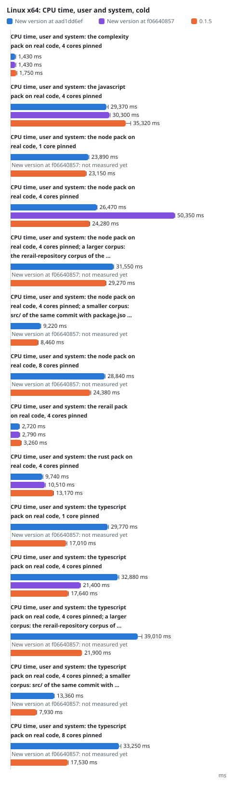  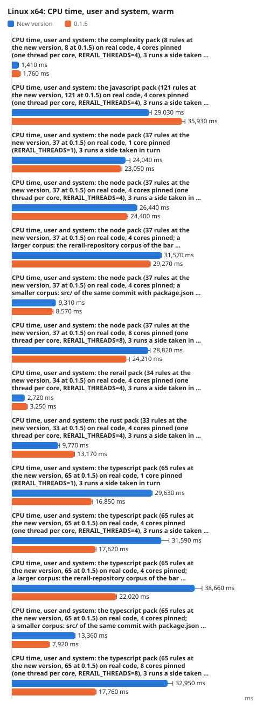 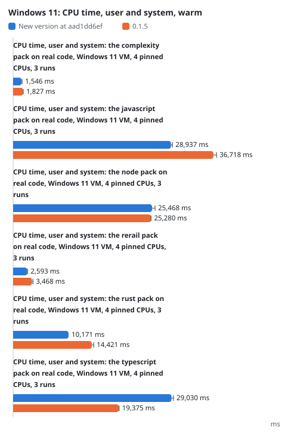

## Memory

| Measure | New version at `aad1dd6ef` | New version at `f06640857` | 0.1.5 | main + six fixes | `aad1dd6ef` ÷ 0.1.5 | `f06640857` ÷ 0.1.5 (its own bar) | `aad1dd6ef` ÷ main + fixes | Runs |
|---|---:|---:|---:|---:|---:|---:|---:|---|
| Linux x64: peak resident memory: the complexity pack (8 rules at the new version, 8 at 0.1.5) on real code, 4 cores pinned (one thread per core, RERAIL_THREADS=4), 3 runs a side taken in turn, cold / warm (peak resident memory) | 348 MB (worst 386 MB) / 348 MB (worst 349 MB) | 348 MB (worst 388 MB) / 348 MB (worst 349 MB) | 334 MB (worst 371 MB) / 333 MB (worst 334 MB) | not measured yet | 1.04x / 1.05x | 1.03x / 1.05x |  | 3 each; data/linux.json, data/new-head.json: `eng-4c/ships/complexity/real/rss-cold/N`, `eng3-4c/ships/complexity/real/rss-cold/N`, `eng-4c/ships/complexity/real/rss-cold/P`, `eng3-4c/ships/complexity/real/rss-cold/P`; warm: `eng-4c/ships/complexity/real/rss-warm/N`, `eng3-4c/ships/complexity/real/rss-warm/N`, `eng-4c/ships/complexity/real/rss-warm/P`, `eng3-4c/ships/complexity/real/rss-warm/P` |
| Linux x64: peak resident memory: the javascript pack (121 rules at the new version, 121 at 0.1.5) on real code, 4 cores pinned (one thread per core, RERAIL_THREADS=4), 3 runs a side taken in turn, cold / warm (peak resident memory) | 859 MB (worst 922 MB) / 853 MB (worst 874 MB) | 861 MB (worst 863 MB) / 855 MB (worst 857 MB) | 1,232 MB (worst 1,233 MB) / 1,231 MB (worst 1,233 MB) | not measured yet | 0.70x / 0.69x | 0.70x / 0.70x |  | 3 each; data/linux.json, data/new-head.json: `eng-4c/ships/javascript/real/rss-cold/N`, `eng3-4c/ships/javascript/real/rss-cold/N`, `eng-4c/ships/javascript/real/rss-cold/P`, `eng3-4c/ships/javascript/real/rss-cold/P`; warm: `eng-4c/ships/javascript/real/rss-warm/N`, `eng3-4c/ships/javascript/real/rss-warm/N`, `eng-4c/ships/javascript/real/rss-warm/P`, `eng3-4c/ships/javascript/real/rss-warm/P` |
| Linux x64: peak resident memory: the node pack (37 rules at the new version, 37 at 0.1.5) on real code, 1 core pinned (RERAIL_THREADS=1), 3 runs a side taken in turn, cold / warm (peak resident memory) | 533 MB (worst 537 MB) / 538 MB (worst 539 MB) | not measured at this head | 591 MB (worst 594 MB) / 600 MB (worst 614 MB) | not measured yet | 0.90x / 0.90x |  |  | 3 each; data/linux.json: `eng-1c/ships/node/real/rss-cold/N`, `eng-1c/ships/node/real/rss-cold/P`; warm: `eng-1c/ships/node/real/rss-warm/N`, `eng-1c/ships/node/real/rss-warm/P` |
| Linux x64: peak resident memory: the node pack (37 rules at the new version, 37 at 0.1.5) on real code, 4 cores pinned (one thread per core, RERAIL_THREADS=4), 3 runs a side taken in turn, cold / warm (peak resident memory) | 658 MB (worst 667 MB) / 642 MB (worst 671 MB) | 642 MB (worst 666 MB) / 664 MB (worst 680 MB) | 634 MB (worst 641 MB) / 631 MB (worst 632 MB) | not measured yet | 1.04x / 1.02x | 1.03x / 1.04x |  | 3 each; data/linux.json, data/new-head.json: `eng-4c/ships/node/real/rss-cold/N`, `eng3-4c/ships/node/real/rss-cold/N`, `eng-4c/ships/node/real/rss-cold/P`, `eng3-4c/ships/node/real/rss-cold/P`; warm: `eng-4c/ships/node/real/rss-warm/N`, `eng3-4c/ships/node/real/rss-warm/N`, `eng-4c/ships/node/real/rss-warm/P`, `eng3-4c/ships/node/real/rss-warm/P` |
| Linux x64: peak resident memory: the node pack (37 rules at the new version, 37 at 0.1.5) on real code, 4 cores pinned; a larger corpus: the rerail-repository corpus of the shippability bar (conformance, packs, scripts, src, test: 2,312 files), 3 runs a side, cold / warm (peak resident memory) | 738 MB (worst 782 MB) / 763 MB (worst 779 MB) | not measured at this head | 704 MB (worst 724 MB) / 689 MB (worst 727 MB) | not measured yet | 1.05x / 1.11x |  |  | 3 each; data/linux.json: `eng-size2312/ships/node/real/rss-cold/N`, `eng-size2312/ships/node/real/rss-cold/P`; warm: `eng-size2312/ships/node/real/rss-warm/N`, `eng-size2312/ships/node/real/rss-warm/P` |
| Linux x64: peak resident memory: the node pack (37 rules at the new version, 37 at 0.1.5) on real code, 4 cores pinned; a smaller corpus: src/ of the same commit with package.json and tsconfig.json (226 files), 3 runs a side, cold / warm (peak resident memory) | 647 MB (worst 666 MB) / 634 MB (worst 670 MB) | not measured at this head | 632 MB (worst 636 MB) / 612 MB (worst 632 MB) | not measured yet | 1.02x / 1.04x |  |  | 3 each; data/linux.json: `eng-size226/ships/node/real/rss-cold/N`, `eng-size226/ships/node/real/rss-cold/P`; warm: `eng-size226/ships/node/real/rss-warm/N`, `eng-size226/ships/node/real/rss-warm/P` |
| Linux x64: peak resident memory: the node pack (37 rules at the new version, 37 at 0.1.5) on real code, 8 cores pinned (one thread per core, RERAIL_THREADS=8), 3 runs a side taken in turn, cold / warm (peak resident memory) | 768 MB (worst 770 MB) / 759 MB (worst 781 MB) | not measured at this head | 629 MB (worst 630 MB) / 633 MB (worst 643 MB) | not measured yet | 1.22x / 1.20x |  |  | 3 each; data/linux.json: `eng-8c/ships/node/real/rss-cold/N`, `eng-8c/ships/node/real/rss-cold/P`; warm: `eng-8c/ships/node/real/rss-warm/N`, `eng-8c/ships/node/real/rss-warm/P` |
| Linux x64: peak resident memory: the rerail pack (34 rules at the new version, 34 at 0.1.5) on real code, 4 cores pinned (one thread per core, RERAIL_THREADS=4), 3 runs a side taken in turn, cold / warm (peak resident memory) | 494 MB (worst 494 MB) / 494 MB (worst 494 MB) | 489 MB (worst 490 MB) / 488 MB (worst 490 MB) | 494 MB (worst 495 MB) / 496 MB (worst 496 MB) | not measured yet | 1.00x / 1.00x | 0.98x / 0.98x |  | 3 each; data/linux.json, data/new-head.json: `eng-4c/ships/rerail/real/rss-cold/N`, `eng3-4c/ships/rerail/real/rss-cold/N`, `eng-4c/ships/rerail/real/rss-cold/P`, `eng3-4c/ships/rerail/real/rss-cold/P`; warm: `eng-4c/ships/rerail/real/rss-warm/N`, `eng3-4c/ships/rerail/real/rss-warm/N`, `eng-4c/ships/rerail/real/rss-warm/P`, `eng3-4c/ships/rerail/real/rss-warm/P` |
| Linux x64: peak resident memory: the rust pack (33 rules at the new version, 33 at 0.1.5) on real code, 4 cores pinned (one thread per core, RERAIL_THREADS=4), 3 runs a side taken in turn, cold / warm (peak resident memory) | 472 MB (worst 474 MB) / 476 MB (worst 500 MB) | 480 MB (worst 497 MB) / 476 MB (worst 496 MB) | 493 MB (worst 499 MB) / 491 MB (worst 510 MB) | not measured yet | 0.96x / 0.97x | 0.97x / 0.96x |  | 3 each; data/linux.json, data/new-head.json: `eng-4c/ships/rust/real/rss-cold/N`, `eng3-4c/ships/rust/real/rss-cold/N`, `eng-4c/ships/rust/real/rss-cold/P`, `eng3-4c/ships/rust/real/rss-cold/P`; warm: `eng-4c/ships/rust/real/rss-warm/N`, `eng3-4c/ships/rust/real/rss-warm/N`, `eng-4c/ships/rust/real/rss-warm/P`, `eng3-4c/ships/rust/real/rss-warm/P` |
| Linux x64: peak resident memory: the typescript pack (65 rules at the new version, 65 at 0.1.5) on real code, 1 core pinned (RERAIL_THREADS=1), 3 runs a side taken in turn, cold / warm (peak resident memory) | 477 MB (worst 478 MB) / 479 MB (worst 480 MB) | not measured at this head | 519 MB (worst 522 MB) / 517 MB (worst 519 MB) | not measured yet | 0.92x / 0.93x |  |  | 3 each; data/linux.json: `eng-1c/ships/typescript/real/rss-cold/N`, `eng-1c/ships/typescript/real/rss-cold/P`; warm: `eng-1c/ships/typescript/real/rss-warm/N`, `eng-1c/ships/typescript/real/rss-warm/P` |
| Linux x64: peak resident memory: the typescript pack (65 rules at the new version, 65 at 0.1.5) on real code, 4 cores pinned (one thread per core, RERAIL_THREADS=4), 3 runs a side taken in turn, cold / warm (peak resident memory) | 595 MB (worst 597 MB) / 595 MB (worst 596 MB) | 649 MB (worst 678 MB) / 648 MB (worst 649 MB) | 578 MB (worst 588 MB) / 575 MB (worst 589 MB) | not measured yet | 1.03x / 1.04x | 1.12x / 1.14x |  | 3 each; data/linux.json, data/new-head.json: `eng-4c/ships/typescript/real/rss-cold/N`, `eng3-4c/ships/typescript/real/rss-cold/N`, `eng-4c/ships/typescript/real/rss-cold/P`, `eng3-4c/ships/typescript/real/rss-cold/P`; warm: `eng-4c/ships/typescript/real/rss-warm/N`, `eng3-4c/ships/typescript/real/rss-warm/N`, `eng-4c/ships/typescript/real/rss-warm/P`, `eng3-4c/ships/typescript/real/rss-warm/P` |
| Linux x64: peak resident memory: the typescript pack (65 rules at the new version, 65 at 0.1.5) on real code, 4 cores pinned; a larger corpus: the rerail-repository corpus of the shippability bar (conformance, packs, scripts, src, test: 2,312 files), 3 runs a side, cold / warm (peak resident memory) | 667 MB (worst 668 MB) / 666 MB (worst 668 MB) | not measured at this head | 713 MB (worst 722 MB) / 716 MB (worst 741 MB) | not measured yet | 0.94x / 0.93x |  |  | 3 each; data/linux.json: `eng-size2312/ships/typescript/real/rss-cold/N`, `eng-size2312/ships/typescript/real/rss-cold/P`; warm: `eng-size2312/ships/typescript/real/rss-warm/N`, `eng-size2312/ships/typescript/real/rss-warm/P` |
| Linux x64: peak resident memory: the typescript pack (65 rules at the new version, 65 at 0.1.5) on real code, 4 cores pinned; a smaller corpus: src/ of the same commit with package.json and tsconfig.json (226 files), 3 runs a side, cold / warm (peak resident memory) | 585 MB (worst 591 MB) / 586 MB (worst 590 MB) | not measured at this head | 483 MB (worst 492 MB) / 491 MB (worst 492 MB) | not measured yet | 1.21x / 1.19x |  |  | 3 each; data/linux.json: `eng-size226/ships/typescript/real/rss-cold/N`, `eng-size226/ships/typescript/real/rss-cold/P`; warm: `eng-size226/ships/typescript/real/rss-warm/N`, `eng-size226/ships/typescript/real/rss-warm/P` |
| Linux x64: peak resident memory: the typescript pack (65 rules at the new version, 65 at 0.1.5) on real code, 8 cores pinned (one thread per core, RERAIL_THREADS=8), 3 runs a side taken in turn, cold / warm (peak resident memory) | 656 MB (worst 656 MB) / 649 MB | not measured at this head | 567 MB (worst 578 MB) / 570 MB (worst 608 MB) | not measured yet | 1.16x / 1.14x |  |  | 3 each; data/linux.json: `eng-8c/ships/typescript/real/rss-cold/N`, `eng-8c/ships/typescript/real/rss-cold/P`; warm: `eng-8c/ships/typescript/real/rss-warm/N`, `eng-8c/ships/typescript/real/rss-warm/P` |
| Linux x64: the daemon's peak resident memory over the run, a fresh daemon, as after a restart, fresh daemon (peak resident memory) | 2,495 MB | not measured at this head | 2,421 MB | 2,691 MB | 1.03x |  | 0.93x | 1 each; data/linux.json: `hc/cg/memory-peak/N`, `hc/cg/memory-peak/P`, `hc/cg/memory-peak/B` |
| Windows 11: peak resident memory: the complexity pack (8 rules at the new version, 8 at 0.1.5) on real code, Windows 11 VM, 4 pinned CPUs, 3 runs, cold / warm (peak resident memory) | 287 MB (worst 324 MB) / 283 MB (worst 285 MB) | not measured at this head | 270 MB (worst 334 MB) / 268 MB (worst 274 MB) | not measured yet | 1.06x / 1.06x |  |  | 3 each; data/windows.json: `win-bar/ships/complexity/real/rss-cold/N`, `win-bar/ships/complexity/real/rss-cold/P`; warm: `win-bar/ships/complexity/real/rss-warm/N`, `win-bar/ships/complexity/real/rss-warm/P` |
| Windows 11: peak resident memory: the javascript pack (121 rules at the new version, 121 at 0.1.5) on real code, Windows 11 VM, 4 pinned CPUs, 3 runs, cold / warm (peak resident memory) | 786 MB (worst 786 MB) / 787 MB | not measured at this head | 1,038 MB (worst 1,043 MB) / 1,040 MB (worst 1,046 MB) | not measured yet | 0.76x / 0.76x |  |  | 3 each; data/windows.json: `win-bar/ships/javascript/real/rss-cold/N`, `win-bar/ships/javascript/real/rss-cold/P`; warm: `win-bar/ships/javascript/real/rss-warm/N`, `win-bar/ships/javascript/real/rss-warm/P` |
| Windows 11: peak resident memory: the node pack (37 rules at the new version, 37 at 0.1.5) on real code, Windows 11 VM, 4 pinned CPUs, 3 runs, cold / warm (peak resident memory) | 608 MB (worst 624 MB) / 606 MB (worst 624 MB) | not measured at this head | 574 MB (worst 580 MB) / 582 MB (worst 592 MB) | not measured yet | 1.06x / 1.04x |  |  | 3 each; data/windows.json: `win-bar/ships/node/real/rss-cold/N`, `win-bar/ships/node/real/rss-cold/P`; warm: `win-bar/ships/node/real/rss-warm/N`, `win-bar/ships/node/real/rss-warm/P` |
| Windows 11: peak resident memory: the rerail pack (34 rules at the new version, 34 at 0.1.5) on real code, Windows 11 VM, 4 pinned CPUs, 3 runs, cold / warm (peak resident memory) | 446 MB (worst 447 MB) / 446 MB (worst 448 MB) | not measured at this head | 449 MB (worst 450 MB) / 449 MB (worst 450 MB) | not measured yet | 0.99x / 0.99x |  |  | 3 each; data/windows.json: `win-bar/ships/rerail/real/rss-cold/N`, `win-bar/ships/rerail/real/rss-cold/P`; warm: `win-bar/ships/rerail/real/rss-warm/N`, `win-bar/ships/rerail/real/rss-warm/P` |
| Windows 11: peak resident memory: the rust pack (33 rules at the new version, 33 at 0.1.5) on real code, Windows 11 VM, 4 pinned CPUs, 3 runs, cold / warm (peak resident memory) | 414 MB (worst 422 MB) / 410 MB (worst 420 MB) | not measured at this head | 429 MB (worst 438 MB) / 422 MB (worst 447 MB) | not measured yet | 0.96x / 0.97x |  |  | 3 each; data/windows.json: `win-bar/ships/rust/real/rss-cold/N`, `win-bar/ships/rust/real/rss-cold/P`; warm: `win-bar/ships/rust/real/rss-warm/N`, `win-bar/ships/rust/real/rss-warm/P` |
| Windows 11: peak resident memory: the typescript pack (65 rules at the new version, 65 at 0.1.5) on real code, Windows 11 VM, 4 pinned CPUs, 3 runs, cold / warm (peak resident memory) | 539 MB (worst 540 MB) / 538 MB (worst 538 MB) | not measured at this head | 505 MB (worst 516 MB) / 505 MB (worst 506 MB) | not measured yet | 1.07x / 1.07x |  |  | 3 each; data/windows.json: `win-bar/ships/typescript/real/rss-cold/N`, `win-bar/ships/typescript/real/rss-cold/P`; warm: `win-bar/ships/typescript/real/rss-warm/N`, `win-bar/ships/typescript/real/rss-warm/P` |

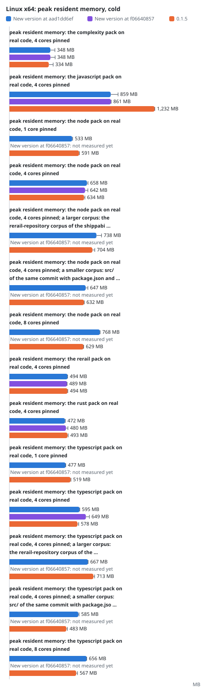 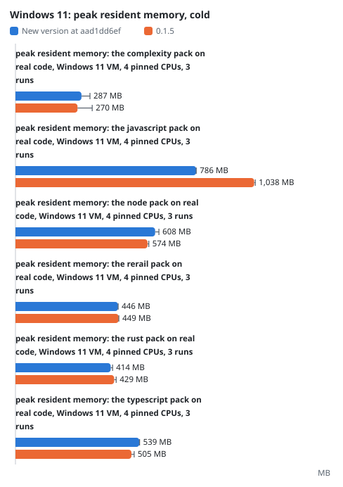  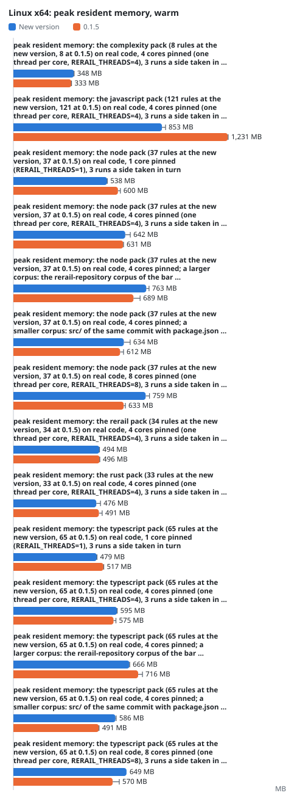 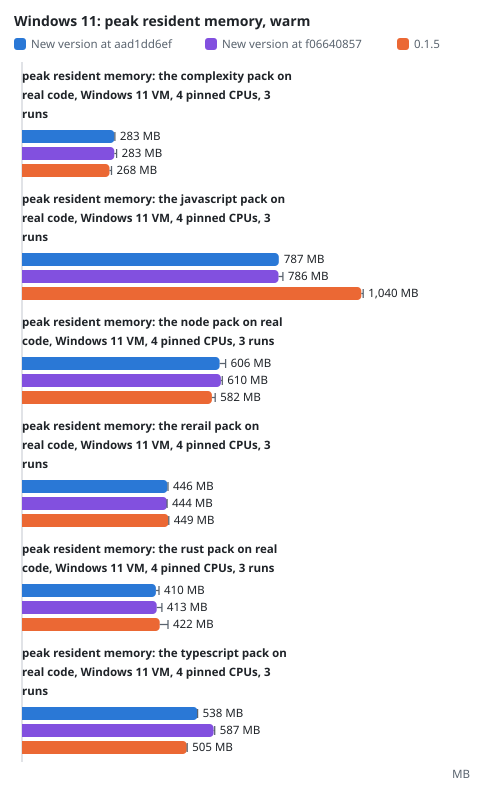

## Findings

| Measure | New version at `aad1dd6ef` | 0.1.5 | main + six fixes | `aad1dd6ef` ÷ 0.1.5 | `aad1dd6ef` ÷ main + fixes | Runs |
|---|---:|---:|---:|---:|---:|---|
| Linux x64: rules on after set-up of a small Python and TypeScript repository with the four packs a 153-worktree repository on a Windows 11 laptop used on 16 November (typescript 0.1.7, python 0.1.9, complexity 0.1.7, javascript 0.1.8): set-up reports 382 rules, a session's start reports the rules the engine runs, after set-up (rules on) | 370 rules | not measured yet | not measured yet |  |  | 3 each; data/linux.json: `check/rules-on/N` |
| Linux x64: rules on at a session's start, after set-up with the four pinned packs (set-up reports 382), after set-up (rules on) | 370 rules | 382 rules | 382 rules | 0.97x | 0.97x | 5 each; data/linux.json: `hc/waits/rules-on/N`, `hc/waits/rules-on/P`, `hc/waits/rules-on/B` |
| Windows 11: findings of the typescript pack (65 rules) over this repository's own src and test at 53f5b92a1 (602 files, the shippability bar's rerail-typescript corpus), through the product's evaluation path (scripts/ship/product-run.ts); three runs of the new version (map off, map on, warm) and one of 0.1.5, cold and warm, beside other runs (counts, not times) (findings) | 12,578 findings | 12,584 findings | not measured yet | 1.00x |  | 3 each; data/windows.json: `w-ts-findings`, `w-ts-findings` |

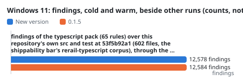

## The wait at an upgrade

| Measure | New version at `aad1dd6ef` | 0.1.5 | `aad1dd6ef` ÷ 0.1.5 | Runs |
|---|---:|---:|---:|---|
| Linux x64: the daemon's CPU in the 120 s after the first event, after an upgrade from 0.1.5, with the content store to rebuild, upgrade (daemon CPU, first 120 s) | 122% of one core | not measured yet |  | 1 each; data/linux.json: `hc/upg/cpu-120s/N` |
| Linux x64: the large repository's first event (SessionStart), after an upgrade from 0.1.5, with the content store to rebuild, upgrade (first event's hook) | 507 ms | not measured yet |  | 1 each; data/linux.json: `hc/upg/first-event/N` |
| Linux x64: the large repository's first tool call (PreToolUse, right after the SessionStart), after an upgrade from 0.1.5, with the content store to rebuild, upgrade (first tool call's hook) | 8,167 ms | not measured yet |  | 1 each; data/linux.json: `hc/upg/first-tool-call/N` |
| Linux x64: the daemon's longest silence (health reads unanswered over 1 s), after an upgrade from 0.1.5, with the content store to rebuild, upgrade (longest silence) | 7.20 s | not measured yet |  | 1 each; data/linux.json: `hc/upg/longest-silence/N` |
| Linux x64: hooks of the four sessions in a stopped checkout in the 300 s after the first event, p95 (438 hooks), after an upgrade from 0.1.5, with the content store to rebuild, upgrade (other sessions' hook p95) | 403 ms | not measured yet |  | 1 each; data/linux.json: `hc/upg/other-hooks-p95/N` |
| Linux x64: the slowest hook of those sessions in the same 300 s, after an upgrade from 0.1.5, with the content store to rebuild, upgrade (other sessions' slowest hook) | 2,136 ms | not measured yet |  | 1 each; data/linux.json: `hc/upg/other-hooks-max/N` |
| Linux x64: the daemon's peak resident memory over the run, after an upgrade from 0.1.5, with the content store to rebuild, upgrade (peak resident memory) | 2,460 MB | not measured yet |  | 1 each; data/linux.json: `hc/upg/memory-peak/N` |
| Windows 11: the daemon's memory right after it set up a 3,000-file repository (4 packs, 382 rules), before any check reads the content store; map at its default and off; 0.1.5 the same way, after set-up, beside other runs (memory, not times) (committed memory now / at the peak) | 90 MB | not measured yet |  | 2 each; data/windows.json: `w-daemon-after-setup` |
| Windows 11: an upgrade on one home, behaviour check: 0.1.5 sets up a 300-file repository and runs hooks, its daemon stops, then the new version starts on the same home. the new version's rerail daemon start exits 1 ("Rerail daemon did not become ready within 15s") after 16.2 s; the daemon answers 26.3 s after that; its first PreToolUse hook takes 9.8 s, the next ones 0.5 to 2.3 s. 0.1.5 on the same home before: daemon start 4.3 s, first hook 4.0 s, then 0.6 s. One run, beside other work: a reading to confirm alone, not a measurement, first start after the upgrade, not alone (daemon start to first answer) | 42,536 ms | not measured yet |  | 1 each; data/windows.json: `w-upgrade-smoke` |

## A hook's cost

| Measure | New version at `aad1dd6ef` | 0.1.5 | main + six fixes | `aad1dd6ef` ÷ 0.1.5 | `aad1dd6ef` ÷ main + fixes | Runs |
|---|---:|---:|---:|---:|---:|---|
| Linux x64: the large repository's first event (SessionStart), a fresh daemon, as after a restart, fresh daemon (first event's hook) | 1,105 ms | 992 ms | 812 ms | 1.11x | 1.36x | 1 each; data/linux.json: `hc/cg/first-event/N`, `hc/cg/first-event/P`, `hc/cg/first-event/B` |
| Linux x64: the first hook (SessionStart) in a started repository after a daemon start: the daemon compiles the repository's rules then, rules not yet compiled in this daemon (first hook after a start) | 1,123 ms (worst 1,129 ms) | 992 ms (worst 1,012 ms) | 811 ms (worst 812 ms) | 1.13x | 1.38x | 5 each; data/linux.json: `hc/waits/first-hook/N`, `hc/waits/first-hook/P`, `hc/waits/first-hook/B` |
| Linux x64: the large repository's first tool call (PreToolUse, right after the SessionStart), a fresh daemon, as after a restart, fresh daemon (first tool call's hook) | 7,668 ms | 7,225 ms | 1,007 ms | 1.06x | 7.61x | 1 each; data/linux.json: `hc/cg/first-tool-call/N`, `hc/cg/first-tool-call/P`, `hc/cg/first-tool-call/B` |
| Linux x64: the next five hooks (PreToolUse and PostToolUse) in the same repository, rules compiled (hook after the first) | 155 ms (worst 175 ms) | 149 ms (worst 160 ms) | 151 ms (worst 160 ms) | 1.04x | 1.03x | 25 each; data/linux.json: `hc/waits/later-hooks/N`, `hc/waits/later-hooks/P`, `hc/waits/later-hooks/B` |
| Linux x64: the daemon's longest silence (health reads unanswered over 1 s), a fresh daemon, as after a restart, fresh daemon (longest silence) | 7.20 s | 6.60 s | 0 s | 1.09x |  | 1 each; data/linux.json: `hc/cg/longest-silence/N`, `hc/cg/longest-silence/P`, `hc/cg/longest-silence/B` |
| Linux x64: hooks of the four sessions in a stopped checkout in the 300 s after the first event, p95 (437 hooks), a fresh daemon, as after a restart, fresh daemon (other sessions' hook p95) | 299 ms | 373 ms | not measured yet | 0.80x |  | 1 each; data/linux.json: `hc/cg/other-hooks-p95/N`, `hc/cg/other-hooks-p95/P` |
| Linux x64: hooks of the four sessions in a stopped checkout in the 300 s after the first event, p95 (452 hooks), a fresh daemon, as after a restart, fresh daemon (other sessions' hook p95) | not measured yet | not measured yet | 171 ms |  |  | 1 each; data/linux.json: `hc/cg/other-hooks-p95/B` |
| Linux x64: the slowest hook of those sessions in the same 300 s, a fresh daemon, as after a restart, fresh daemon (other sessions' slowest hook) | 2,135 ms | 2,131 ms | 214 ms | 1.00x | 9.96x | 1 each; data/linux.json: `hc/cg/other-hooks-max/N`, `hc/cg/other-hooks-max/P`, `hc/cg/other-hooks-max/B` |
| Windows 11: processes a hook starts at the new version, the daemon answering: one PreToolUse hook in a started, a stopped, a never set up and a non-Git folder, the registered Node first on PATH; each Node of the hook records what it starts (a counting pass, not timed), daemon answers (processes per hook) | 1 processes | not measured yet | not measured yet |  |  | 4 each; data/windows.json: `w-hook-procs-n` |

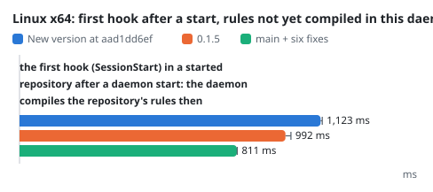 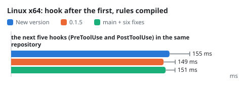

## Builds

Each version built as the tests and the release build it, on the machines in "How it was measured". A size is
exact; a time is one run, or the median of 3 with the worst beside it where the Runs column says 3. Each Linux build
is held to 4 jobs at low priority beside other work (the host's 1-minute load at the end of each run: 2.3 to 9.7); the
Windows builds ran beside other narrow runs. The release's own Linux command (`package.yml`: `--use-napi-cross
--strip`, linked against glibc 2.17) is the row marked failed: see "What a person would notice". The debug builds
use each version's own dev profile: the new version builds every dependency and 16 of its own crates at opt-level 3,
0.1.5 builds everything at opt-level 0, so the cold debug build compares two profiles, while the one-line edit
rebuilds only opt-level 0 crates on both sides.

| Measure | New version at `aad1dd6ef` | 0.1.5 | main + six fixes | `aad1dd6ef` ÷ 0.1.5 | `aad1dd6ef` ÷ main + fixes | Runs |
|---|---:|---:|---:|---:|---:|---|
| Linux x64: integration tests (test:integration:built with the pinned OMP host): summed time of the 90 tests passing at both (test time) | 194 s | 196 s | not measured yet | 0.99x |  | 1 each; data/build.json: `suite-integration-n-time-shared`, `suite-integration-p-time-shared` |
| Linux x64: cold debug build of the engine library (cargo build --lib, each version's own dev profile) (wall time) | 233 s | 76.7 s | not measured yet | 3.04x |  | 1 each; data/build.json: `lx-build-n-dev-cold`, `lx-build-p-dev-cold` |
| Linux x64: cold release build of the engine, empty target folder (host toolchain, as CI builds it) (wall time) | 700 s | 234 s | not measured yet | 2.99x |  | 1 each; data/build.json: `lx-host-n-cold`, `lx-host-p-cold` |
| Linux x64: cold release build of the engine, empty target folder (release form, as package.yml builds it) (wall time) | **fails** after 705 s | 242 s | not measured yet |  |  | 1 each; data/build.json: `lx-build-n-cold`, `lx-build-p-cold` |
| Linux x64: debug rebuild (dev profile) after the same one-line edit in the logic crate (wall time) | 6.70 s (worst 7.20 s) | not measured yet | not measured yet |  |  | 3 each; data/build.json: `lx-build-n-dev-edit-logic` |
| Linux x64: debug rebuild (dev profile) after the same one-line edit in the matcher (wall time) | 5.20 s (worst 5.80 s) | 19.6 s (worst 19.9 s) | not measured yet | 0.27x |  | 3 each; data/build.json: `lx-build-n-dev-edit-w`, `lx-build-p-dev-edit-w` |
| Linux x64: npm ci of the checkout (host toolchain, as CI builds it) (wall time) | 9.20 s | 9 s | not measured yet | 1.02x |  | 1 each; data/build.json: `lx-host-n-install`, `lx-host-p-install` |
| Linux x64: npm ci of the checkout (release form, as package.yml builds it) (wall time) | 12.5 s | 8.60 s | not measured yet | 1.45x |  | 1 each; data/build.json: `lx-build-n-install`, `lx-build-p-install` |
| Linux x64: npm pack (host toolchain, as CI builds it) (wall time) | 6.30 s | 2.90 s | not measured yet | 2.17x |  | 1 each; data/build.json: `lx-host-n-pack`, `lx-host-p-pack` |
| Linux x64: npm pack (release form, as package.yml builds it) (wall time) | not measured yet | 3.10 s | not measured yet |  |  | 1 each; data/build.json: `lx-build-p-pack` |
| Linux x64: release rebuild after a one-line edit in the new engine's logic crate (native/src/code_rule_dsl/logic/costs.rs) (host toolchain, as CI builds it) (wall time) | 503 s (worst 510 s) | not measured yet | not measured yet |  |  | 3 each; data/build.json: `lx-host-n-edit-logic` |
| Linux x64: release rebuild after a one-line edit in the present engine's matcher (native/src/code_rule_dsl/matcher/mod.rs) (host toolchain, as CI builds it) (wall time) | 327 s (worst 337 s) | 161 s (worst 163 s) | not measured yet | 2.04x |  | 3 each; data/build.json: `lx-host-n-edit-w`, `lx-host-p-edit-w` |
| Linux x64: release rebuild after a one-line edit in the present engine's matcher (native/src/code_rule_dsl/matcher/mod.rs) (release form, as package.yml builds it) (wall time) | not measured yet | 162 s (worst 164 s) | not measured yet |  |  | 3 each; data/build.json: `lx-build-p-edit-w` |
| Linux x64: the package's JavaScript (build:clean, build:js) (host toolchain, as CI builds it) (wall time) | 7.80 s | 7.30 s | not measured yet | 1.07x |  | 1 each; data/build.json: `lx-host-n-js`, `lx-host-p-js` |
| Linux x64: the package's JavaScript (build:clean, build:js) (release form, as package.yml builds it) (wall time) | not measured yet | 8.20 s | not measured yet |  |  | 1 each; data/build.json: `lx-build-p-js` |
| Linux x64: the same release build again, nothing changed (host toolchain, as CI builds it) (wall time) | 265 s | 152 s | not measured yet | 1.74x |  | 1 each; data/build.json: `lx-host-n-warm`, `lx-host-p-warm` |
| Linux x64: the same release build again, nothing changed (release form, as package.yml builds it) (wall time) | not measured yet | 162 s | not measured yet |  |  | 1 each; data/build.json: `lx-build-p-warm` |
| Linux x64: cargo's release target folder after the builds (host-toolchain build, as CI builds it) (size) | 2,109 MB | 916 MB | not measured yet | 2.30x |  | 1 each; data/build.json: `lx-host-size-n-release-target-mb`, `lx-host-size-p-release-target-mb` |
| Linux x64: cargo's release target folder after the builds (release-form build, as package.yml builds it) (size) | not measured yet | 902 MB | not measured yet |  |  | 1 each; data/build.json: `lx-size-p-release-target-mb` |
| Linux x64: the engine binary as `npm run build:native` builds it (napi build --platform --release, host toolchain, not stripped), as the test and load runs use it (size) | 135 MB | 53.0 MB | 53.0 MB | 2.55x | 2.55x | 1 each; data/build.json: `size-lx-cache-n`, `size-lx-cache-p`, `size-lx-cache-b` |
| Linux x64: the engine binary as a person's package holds it (host-toolchain build, as CI builds it) (size) | 135 MB | 53 MB | not measured yet | 2.55x |  | 1 each; data/build.json: `lx-host-size-n-engine-bytes`, `lx-host-size-p-engine-bytes` |
| Linux x64: the engine binary as a person's package holds it (release-form build, as package.yml builds it) (size) | not measured yet | 41.3 MB | not measured yet |  |  | 1 each; data/build.json: `lx-size-p-engine-bytes` |
| Linux x64: the npm package (tarball) with this platform's engine only (host-toolchain build, as CI builds it) (size) | 49.6 MB | 23.5 MB | not measured yet | 2.11x |  | 1 each; data/build.json: `lx-host-size-n-package-bytes`, `lx-host-size-p-package-bytes` |
| Linux x64: the npm package (tarball) with this platform's engine only (release-form build, as package.yml builds it) (size) | not measured yet | 23.6 MB | not measured yet |  |  | 1 each; data/build.json: `lx-size-p-package-bytes` |
| Linux x64: the npm package unpacked, this platform's engine only (host-toolchain build, as CI builds it) (size) | 148 MB | 74.2 MB | not measured yet | 1.99x |  | 1 each; data/build.json: `lx-host-size-n-unpacked-bytes`, `lx-host-size-p-unpacked-bytes` |
| Linux x64: the npm package unpacked, this platform's engine only (release-form build, as package.yml builds it) (size) | not measured yet | 74.1 MB | not measured yet |  |  | 1 each; data/build.json: `lx-size-p-unpacked-bytes` |
| Linux x64: the package's JavaScript (dist/) (host-toolchain build, as CI builds it) (size) | 24.7 MB | 24.5 MB | not measured yet | 1.01x |  | 1 each; data/build.json: `lx-host-size-n-dist-bytes`, `lx-host-size-p-dist-bytes` |
| Linux x64: the package's JavaScript (dist/) (release-form build, as package.yml builds it) (size) | not measured yet | 24.5 MB | not measured yet |  |  | 1 each; data/build.json: `lx-size-p-dist-bytes` |
| Linux x64: main + six fixes merged into the new version with its four conflicts resolved by keeping both sides (a probe commit on no branch): the engine build with fix 1's Rust module beside the new version's crate split (engine build (npm run build:native, 4 jobs, shared dependency cache)) | not measured yet | not measured yet | 10 min |  |  | 1 each; data/build.json: `b-on-n-engine` |
| Linux x64: npm run check, check:ui-tokens and check:reference (CI's lint job) (exit code) | 1 | 0 | not measured yet |  |  | 1 each; data/build.json: `suite-lint-check-n`, `suite-lint-check-p` |
| Linux x64: git_ignore::tests::follows_nested_gitignores_negation_and_exclude_but_never_tracked_paths run alone 20 times (the new version and 0.1.5 in turn, debug build) (failed runs) | 0 runs of 20 | 0 runs of 20 | not measured yet |  |  | 20 each; data/build.json: `repeat-gitignore-n`, `repeat-gitignore-p` |
| Linux x64: rules of the 12 published packs (latest on npm) the engine will not run: compiled one by one as the catalog does before it loads a pack (rules not run) | 40 rules | 0 rules | not measured yet |  |  | 1 each; data/build.json: `packs-n`, `packs-p` |
| Linux x64: integration tests (test:integration:built with the pinned OMP host): tests failing at the new version that pass at 0.1.5 or that 0.1.5 does not hold (tests) | 0 tests | not measured yet | not measured yet |  |  | 1 each; data/build.json: `suite-integration-n-only-failures` |
| Linux x64: integration tests (test:integration:built with the pinned OMP host) (tests skipped) | 4 tests | 4 tests | not measured yet | 1.00x |  | 1 each; data/build.json: `suite-integration-n-skipped`, `suite-integration-p-skipped` |
| Linux x64: the simdjson shim compiled three ways and linked with -z defs against the release toolchain's glibc 2.17 and libstdc++ 6.0.19 (undefined references) | 6 symbols (worst 13 symbols) | not measured yet | not measured yet |  |  | 3 each; data/build.json: `probe-simdjson-shim` |
| Windows 11: cold release build of the engine, empty target folder (wall time) | 1,221 s | 420 s | not measured yet | 2.90x |  | 1 each; data/build.json: `win-build-n-cold`, `win-build-p-cold` |
| Windows 11: npm ci of the checkout (wall time) | 70 s | 71.3 s | not measured yet | 0.98x |  | 1 each; data/build.json: `win-build-n-install`, `win-build-p-install` |
| Windows 11: release build of the new version's Windows engine with the Windows virtual machine's shared cargo target (dependencies built before for other versions) (wall time) | 1,184 s | not measured yet | not measured yet |  |  | 1 each; data/build.json: `time-win-n-build-shared` |
| Windows 11: release check: the engine needs no Visual C++ runtime (wall time) | 0.1 s | 0.1 s | not measured yet | 1.00x |  | 1 each; data/build.json: `win-build-n-no-vc-runtime`, `win-build-p-no-vc-runtime` |
| Windows 11: release rebuild after a one-line edit in the present engine's matcher (native/src/code_rule_dsl/matcher/mod.rs) (wall time) | 619 s | 325 s | not measured yet | 1.90x |  | 1 each; data/build.json: `win-build-n-edit-w`, `win-build-p-edit-w` |
| Windows 11: the same release build again, nothing changed (wall time) | 456 s | 348 s | not measured yet | 1.31x |  | 1 each; data/build.json: `win-build-n-warm`, `win-build-p-warm` |
| Windows 11: SQLite's give-back of free pages on Windows with the new store's settings (WAL, incremental auto-vacuum, mmap_size 4 GB; incremental_vacuum then wal_checkpoint(TRUNCATE)), Node's SQLite 3.53.4: half the rows of a 256.9 MB file deleted, then the give-back, with no other connection, with another process or a second connection holding the file mapped or unmapped. File size after the give-back (MB): alone 128.8; other process mapped 256.9 (still 256.9 after it closed and the give-back ran again); other process unmapped 128.8; second connection mapped 256.9 (also after it closed); second connection unmapped 128.8. Every give-back reported success. The mapping process's working set after reading the file: 309 MB with the map, 54 MB without, behaviour, beside other runs (file size after the give-back) | 129 MB (worst 257 MB) | not measured yet | not measured yet |  |  | 5 each; data/windows.json: `w-sqlite-map` |
| Windows 11: the engine binary as `npm run build:native` builds it (napi build --platform --release, host toolchain, not stripped), as the test and load runs use it (size) | 122 MB | 42.3 MB | 42.3 MB | 2.89x | 2.89x | 1 each; data/build.json: `size-win-cache-n`, `size-win-cache-p`, `size-win-cache-b` |
| Windows 11: the first alone run of the shippability bar on the measuring machine (six packs, real code, three runs): an older copy of the job skipped Git LFS files, so the .rr side's engine program did not build (an LFS grammar) and the shippability bar stopped at the rust corpus before any run; the two other real-code corpora (602 and 2,312 files) matched their pins on Windows, alone; ended before measuring (bar exit code) | 2 code | not measured yet | not measured yet |  |  | 1 each; data/windows.json: `w-bar-measure-1` |
| Windows 11: the shippability bar's rerail-native corpus (native/src at 53f5b92a1) as the shippability bar makes it with git archive, hashed as the shippability bar hashes it: with Git LFS files it is the pinned corpus (385 files, df111caf...); with Git LFS downloads skipped, names.bin is a 131-byte pointer and the hash is bb80e5e4..., which the shippability bar refuses before it measures anything, behaviour (corpus matches corpora.json) | 1 yes/no (worst 0 yes/no) | not measured yet | not measured yet |  |  | 2 each; data/windows.json: `w-bar-corpus-lfs` |
| any (git): bytes Git stores for the commit's files (git ls-tree -r -l; Git LFS files counted as their pointers) (checkout size) | 356 MB | 78 MB | not measured yet | 4.56x |  | 1 each; data/build.json: `checkout-n`, `checkout-p` |
| any (git): Rust packages in Cargo.lock: 327 at 0.1.5, 477 at the new version (cranelift's JIT, Ruff's Python parser, mimalloc, lz4, ed25519 and 38 crates of the engine's own split); workspace members 1 at 0.1.5, 42 at the new version (packages) | 477 crates | 327 crates | not measured yet | 1.46x |  | 1 each; data/build.json: `cargo-lock-crates`, `cargo-lock-crates-p` |

Each step's CPU time and largest process's peak memory: 52 runs in data/build.json (`-cpu` and `-rss` beside each step's run id).

 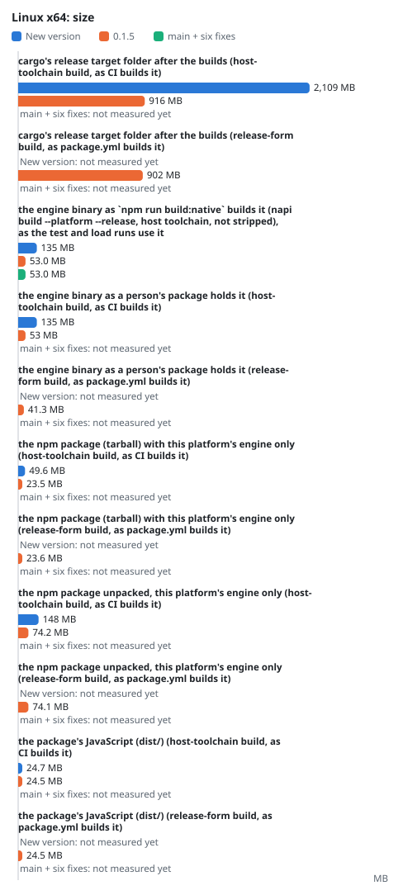 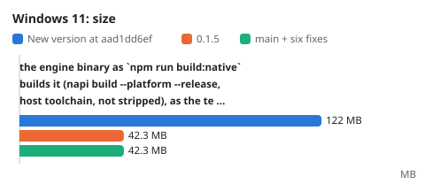

## Test suites

| Measure | New version at `aad1dd6ef` | 0.1.5 | main + six fixes | `aad1dd6ef` ÷ 0.1.5 | `aad1dd6ef` ÷ main + fixes | Runs |
|---|---:|---:|---:|---:|---:|---|
| Linux x64: unit tests, both shards (vitest --dir test --shard k/2, RERAIL_PACK_FIXTURES_IN_CONFORMANCE=1): summed time of the 8580 tests passing at both (test time) | 1,100 s | 1,063 s | not measured yet | 1.03x |  | 1 each; data/build.json: `suite-unit-n-time-shared`, `suite-unit-p-time-shared` |
| Linux x64: unit tests, both shards (vitest --dir test --shard k/2, RERAIL_PACK_FIXTURES_IN_CONFORMANCE=1): tests failing at the new version that pass at 0.1.5 or that 0.1.5 does not hold (tests) | 0 tests | not measured yet | not measured yet |  |  | 1 each; data/build.json: `suite-unit-n-only-failures` |
| Linux x64: #665: its test files at the new version with only its tests (the fix taken out) (tests failed) | 9 tests | not measured yet | not measured yet |  |  | 1 each; data/build.json: `fx-ecr665-without` |
| Linux x64: #665: its test files at the new version with the fix merged (tests failed) | 0 tests | not measured yet | not measured yet |  |  | 1 each; data/build.json: `fx-ecr665-with` |
| Linux x64: #674: its test files at the new version with only its tests (the fix taken out) (tests failed) | 126 tests | not measured yet | not measured yet |  |  | 1 each; data/build.json: `fx-sch674-without` |
| Linux x64: #674: its test files at the new version with the fix merged (tests failed) | 0 tests | not measured yet | not measured yet |  |  | 1 each; data/build.json: `fx-sch674-with` |
| Linux x64: #676: its test files at the new version with only its tests (the fix taken out) (tests failed) | 3 tests | not measured yet | not measured yet |  |  | 1 each; data/build.json: `fx-fss676-without` |
| Linux x64: #676: its test files at the new version with the fix merged (tests failed) | 0 tests | not measured yet | not measured yet |  |  | 1 each; data/build.json: `fx-fss676-with` |
| Linux x64: #677: its test files at the new version with only its tests (the fix taken out) (tests failed) | 1 tests | not measured yet | not measured yet |  |  | 1 each; data/build.json: `fx-wpc677-without` |
| Linux x64: #677: its test files at the new version with the fix merged (tests failed) | 0 tests | not measured yet | not measured yet |  |  | 1 each; data/build.json: `fx-wpc677-with` |
| Linux x64: fix 2: its test files at the new version with only its tests (the fix taken out) (tests failed) | 19 tests | not measured yet | not measured yet |  |  | 1 each; data/build.json: `fx-ncng-without` |
| Linux x64: fix 2: its test files at the new version with the fix merged (tests failed) | 0 tests | not measured yet | not measured yet |  |  | 1 each; data/build.json: `fx-ncng-with` |
| Linux x64: fix 6: its test files at the new version with only its tests (the fix taken out) (tests failed) | 22 tests | not measured yet | not measured yet |  |  | 1 each; data/build.json: `fx-wgnl-without` |
| Linux x64: fix 6: its test files at the new version with the fix merged (tests failed) | 0 tests | not measured yet | not measured yet |  |  | 1 each; data/build.json: `fx-wgnl-with` |
| Linux x64: integration tests (test:integration:built with the pinned OMP host) (tests failed) | 0 tests | 0 tests | not measured yet |  |  | 1 each; data/build.json: `suite-integration-n-failed`, `suite-integration-p-failed` |
| Linux x64: the 10 test files of fix 1 and fix 3 (the two fixes that conflict with the new version) at main + six fixes merged into the new version with the conflicts resolved (tests failed) | not measured yet | not measured yet | 0 tests |  |  | 1 each; data/build.json: `b-on-n-tests` |
| Linux x64: the engine's Rust tests (npm run test:native: cargo test --workspace, every test binary) (tests failed) | 11 tests | 3 tests | not measured yet | 3.67x |  | 1 each; data/build.json: `suite-rust-n`, `suite-rust-p` |
| Linux x64: the fix that reads a new worktree from Git's index: its test files at the new version with only its tests (the fix taken out) (tests failed) | 6 tests | not measured yet | not measured yet |  |  | 1 each; data/build.json: `fx-mfr-without` |
| Linux x64: the fix that reads a new worktree from Git's index: its test files at the new version with the fix merged (tests failed) | 0 tests | not measured yet | not measured yet |  |  | 1 each; data/build.json: `fx-mfr-with` |
| Linux x64: unit tests, both shards (vitest --dir test --shard k/2, RERAIL_PACK_FIXTURES_IN_CONFORMANCE=1) (tests failed) | 46 tests | 49 tests | not measured yet | 0.94x |  | 1 each; data/build.json: `suite-unit-n-failed`, `suite-unit-p-failed` |
| Linux x64: integration tests (test:integration:built with the pinned OMP host) (tests passed) | 90 tests | 90 tests | not measured yet | 1.00x |  | 1 each; data/build.json: `suite-integration-n-passed`, `suite-integration-p-passed` |
| Linux x64: unit tests, both shards (vitest --dir test --shard k/2, RERAIL_PACK_FIXTURES_IN_CONFORMANCE=1) (tests passed) | 8,711 tests | 8,652 tests | not measured yet | 1.01x |  | 1 each; data/build.json: `suite-unit-n-passed`, `suite-unit-p-passed` |
| Linux x64: unit tests, both shards (vitest --dir test --shard k/2, RERAIL_PACK_FIXTURES_IN_CONFORMANCE=1) (tests skipped) | 54 tests | 36 tests | not measured yet | 1.50x |  | 1 each; data/build.json: `suite-unit-n-skipped`, `suite-unit-p-skipped` |
| Windows 11: time of that step from a cold target folder: the debug test build, then the tests, cold, 4 build jobs, beside 8 test runs of other work on the same machine (not alone: the times are an upper reading, not a measurement of a CI runner) (build and test time) | 3,154 s | not measured yet | not measured yet |  |  | 1 each; data/windows.json: `w-engine-windows-tests-time` |
| Windows 11: the engine and daemon test files on Windows 11 (test/engine/native, test/daemon, three daemon start files, test/cli/audit-cli.test.ts), one run, 4 test workers (tests failed) | 8 tests | 5 tests | not measured yet | 1.60x |  | 1 each; data/windows-tests.json: `wt/N/failed`, `wt/P/failed` |
| Windows 11: the same test files: tests that fail at this version and pass at the other, one run, 4 test workers (tests failing at this version only) | 3 tests | 0 tests | not measured yet |  |  | 1 each; data/windows-tests.json: `wt/N/only-here`, `wt/P/only-here` |
| Windows 11: the engine and daemon test files on Windows 11 (test/engine/native, test/daemon, three daemon start files, test/cli/audit-cli.test.ts), one run, 4 test workers (tests passed) | 540 tests | 504 tests | not measured yet | 1.07x |  | 1 each; data/windows-tests.json: `wt/N/passed`, `wt/P/passed` |
| Windows 11: the engine tests only Windows compiles (process starts, Windows import roots, the tree watch, the .rr library path), the step Engine Windows tests of the CI Windows unit shard 2, same command and settings: 46 tests, all pass, cold debug build, 4 build jobs, beside other test runs (not alone) (tests passed) | 46 tests | not measured yet | not measured yet |  |  | 1 each; data/windows.json: `w-engine-windows-tests` |
| Windows 11: the engine and daemon test files on Windows 11 (test/engine/native, test/daemon, three daemon start files, test/cli/audit-cli.test.ts), one run, 4 test workers (tests skipped) | 29 tests | 12 tests | not measured yet | 2.42x |  | 1 each; data/windows-tests.json: `wt/N/skipped`, `wt/P/skipped` |

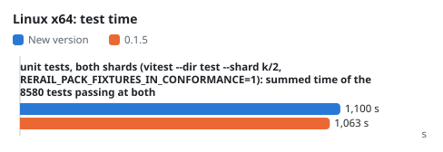 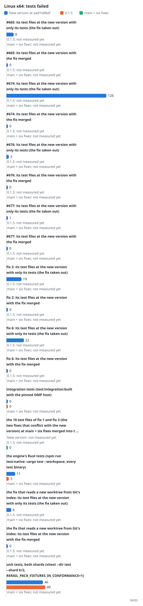 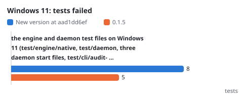 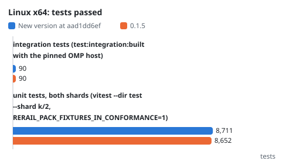 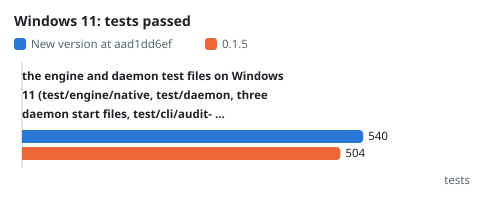 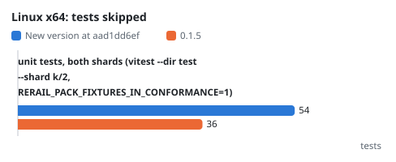 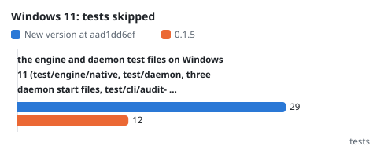

## Under load

The daemon under the same load for each version, one machine per system. The new version at `f06640857` ran once
on Linux; at `aad1dd6ef` it ran twice on each system (the median, then both runs); main + six fixes ran once; 0.1.5
ran once in the pass at `aad1dd6ef` and, on Linux, once more right after `f06640857`'s run. Lower is better in every
row but hooks answered; the hook floor is a hook's own start with no daemon in it, the least any hook can take on
that machine.

The load: 10 minutes: one repository of 2,500 files with 190 worktrees, 17 repositories in all, 8 coding-agent sessions with 26 tool-call streams; four pinned rule packs (typescript 0.1.7, python 0.1.9, complexity 0.1.7, javascript 0.1.8).

| Linux x64, 10 minutes | 0.1.5 | 0.1.5, right after `f06640857`'s run (NOT ALONE) | New version at `f06640857` | New version at `aad1dd6ef` | main + six fixes | Runs |
|---|---:|---:|---:|---:|---:|---|
| hook p95 after warm-up (ms) | 8,437 ms | 8,703 ms | 7,220 ms | 9,744 ms (10,050, 9,437) | 2,073 ms | `load2/lx/P/hook-p95`, `load3/lx/P/hook-p95`, `load3/lx/N/hook-p95`, `load2/lx/N/hook-p95`, `load2/lx/B/hook-p95` |
| slowest hook (ms) | 15,747 ms | 17,339 ms | 22,423 ms | 17,542 ms (18,984, 16,101) | 11,756 ms | `load2/lx/P/hook-slowest`, `load3/lx/P/hook-slowest`, `load3/lx/N/hook-slowest`, `load2/lx/N/hook-slowest`, `load2/lx/B/hook-slowest` |
| failed, timed-out or lost hooks (hooks) | 0 hooks | 0 hooks | 1 hooks | 0 hooks (0, 0) | 0 hooks | `load2/lx/P/hook-failed`, `load3/lx/P/hook-failed`, `load3/lx/N/hook-failed`, `load2/lx/N/hook-failed`, `load2/lx/B/hook-failed` |
| hooks answered (hooks) | 1,818 hooks | 1,776 hooks | 1,802 hooks | 1,761 hooks (1,812, 1,710) | 2,678 hooks | `load2/lx/P/hooks-answered`, `load3/lx/P/hooks-answered`, `load3/lx/N/hooks-answered`, `load2/lx/N/hooks-answered`, `load2/lx/B/hooks-answered` |
| daemon CPU, mean (% of one core) | 96% of one core | 96% of one core | 95% of one core | 96.5% of one core (98, 95) | 49% of one core | `load2/lx/P/cpu-mean`, `load3/lx/P/cpu-mean`, `load3/lx/N/cpu-mean`, `load2/lx/N/cpu-mean`, `load2/lx/B/cpu-mean` |
| daemon CPU, busiest minute (% of one core) | 107% of one core | 106% of one core | 107% of one core | 108% of one core (107, 109) | 104% of one core | `load2/lx/P/cpu-busiest`, `load3/lx/P/cpu-busiest`, `load3/lx/N/cpu-busiest`, `load2/lx/N/cpu-busiest`, `load2/lx/B/cpu-busiest` |
| daemon memory at its peak (MB) | 1,807 MB | 1,832 MB | 1,888 MB | 1,812 MB (1,782, 1,841) | 4,246 MB | `load2/lx/P/rss-peak`, `load3/lx/P/rss-peak`, `load3/lx/N/rss-peak`, `load2/lx/N/rss-peak`, `load2/lx/B/rss-peak` |
| heap growth after forced collections (MB a minute) | 14.1 MB a minute | 13.4 MB a minute | 15.6 MB a minute | 12.9 MB a minute (13.7, 12.2) | 1.80 MB a minute | `load2/lx/P/heap-growth`, `load3/lx/P/heap-growth`, `load3/lx/N/heap-growth`, `load2/lx/N/heap-growth`, `load2/lx/B/heap-growth` |
| hook floor: a hook's own start, no daemon (ms) | 108 ms | 108 ms | 112 ms | 108 ms (107, 109) | 110 ms | `load2/lx/P/hook-floor`, `load3/lx/P/hook-floor`, `load3/lx/N/hook-floor`, `load2/lx/N/hook-floor`, `load2/lx/B/hook-floor` |

Every Linux run had the machine alone but one: 0.1.5's run right after `f06640857`'s, whose machine record says NOT
ALONE, since other test runs started on the machine in its last minute.

Each Windows run's machine record says NOT ALONE: a monitoring process of the host, not Rerail, used 50 to 68 percent of a core in 1 or 2 of its 13 one-minute samples. Read its figures as beside that work, not as Rerail alone.

| Windows 11, 10 minutes | 0.1.5 | New version at `aad1dd6ef` | main + six fixes | Runs |
|---|---:|---:|---:|---|
| hook p95 after warm-up (ms) | 5,793 ms | 5,506 ms (6,044, 4,968) | 703 ms | `load2/win/P/hook-p95`, `load2/win/N/hook-p95`, `load2/win/B/hook-p95` |
| slowest hook (ms) | 12,209 ms | 25,514 ms (41,673, 9,356) | 12,892 ms | `load2/win/P/hook-slowest`, `load2/win/N/hook-slowest`, `load2/win/B/hook-slowest` |
| failed, timed-out or lost hooks (hooks) | 24 hooks | 25 hooks (37, 13) | 2 hooks | `load2/win/P/hook-failed`, `load2/win/N/hook-failed`, `load2/win/B/hook-failed` |
| hooks answered (hooks) | 1,766 hooks | 1,777 hooks (1,750, 1,804) | 2,658 hooks | `load2/win/P/hooks-answered`, `load2/win/N/hooks-answered`, `load2/win/B/hooks-answered` |
| daemon CPU, mean (% of one core) | 94% of one core | 92.5% of one core (91, 94) | 69% of one core | `load2/win/P/cpu-mean`, `load2/win/N/cpu-mean`, `load2/win/B/cpu-mean` |
| daemon CPU, busiest minute (% of one core) | 98% of one core | 98% of one core (98, 98) | 90% of one core | `load2/win/P/cpu-busiest`, `load2/win/N/cpu-busiest`, `load2/win/B/cpu-busiest` |
| daemon memory at its peak (MB) | 1,180 MB | 1,236 MB (1,199, 1,272) | 4,038 MB | `load2/win/P/rss-peak`, `load2/win/N/rss-peak`, `load2/win/B/rss-peak` |
| heap growth after forced collections (MB a minute) | 11.2 MB a minute | 11.3 MB a minute (10.8, 11.8) | 34.2 MB a minute | `load2/win/P/heap-growth`, `load2/win/N/heap-growth`, `load2/win/B/heap-growth` |
| hook floor: a hook's own start, no daemon (ms) | 114 ms | 115 ms (117, 113) | 117 ms | `load2/win/P/hook-floor`, `load2/win/N/hook-floor`, `load2/win/B/hook-floor` |

## The six fixes on top of the new version

Each fix in main + six fixes, and three open pull requests of ours, merged into the new version with
`git merge-tree --write-tree --name-only aad1dd6ef <commit>`. A merge is clean when Git resolves every file itself;
a hand merge's lines are the conflicting lines of both sides, without Git's marker lines. Fix 1 conflicts where the
crate split moved code (`native/src/lib.rs`, where `panic_boundary` now comes from the `rerail-w` crate and fix 1
adds its `path_owner` module beside it; `ci.yml`'s Windows test command, which now names the crates) and in
`native.ts`, where fix 1 adds a method beside a comment the new version changed; fix 3 in one import line of a test
that both sides changed. The smallest resolution keeps both sides of each hunk.

The fixes' commits are not on GitHub yet: for #665, #674, #676 and #677 they are later than the heads GitHub shows.
Whether each fix's tests pass at the new version is in "What a person would notice".

| Change | Into `aad1dd6ef` | Files in conflict there | Into `f06640857` | Files in conflict there | Commit | Runs |
|---|---|---|---|---|---|---|
| Placing worktrees asks Git once per question, not once per worktree for every session | by hand: 3 files, 4 hunks (23 lines) | `.github/workflows/ci.yml`, `native/src/lib.rs`, `src/engine/native/native.ts` | by hand: 4 files, 6 hunks | `.github/workflows/ci.yml`, `native/src/lib.rs`, `src/engine/catalog/repository-identity.ts`, `src/engine/native/native.ts` | `29bc262a5` | data/build.json: `merge-fix-1`, data/new-head.json: `nh/merge-fix-1` |
| A folder outside any Git checkout is placed from the disk, with no Git process per hook event (issue #699) | clean | none | clean | none | `729ed32c0` | data/build.json: `merge-fix-2`, data/new-head.json: `nh/merge-fix-2` |
| With many worktrees, one read of the checkouts serves each event, and Git is asked again only when its files change | by hand: 1 file, 1 hunk (2 lines: one import line on each side) | `test/engine/code-rule/code-rule-dsl-catalog.test.ts` | by hand: 3 files, 3 hunks | `src/engine/catalog/repository-registry.ts`, `test/engine/catalog/repository-registry.test.ts`, `test/engine/code-rule/code-rule-dsl-catalog.test.ts` | `b6b32f3aa` | data/build.json: `merge-fix-3`, data/new-head.json: `nh/merge-fix-3` |
| A first look at another worktree skips the files Git shows unchanged and already read elsewhere | clean | none | clean | none | `3e290652e` | data/build.json: `merge-fix-4`, data/new-head.json: `nh/merge-fix-4` |
| A hook in a stopped checkout repeats the daemon's last answer when the daemon is late (#674) | clean | none | by hand: 1 file, 1 hunks | `src/engine/catalog/repository-registry.ts` | `6c4da9132` | data/build.json: `merge-fix-5`, data/new-head.json: `nh/merge-fix-5` |
| On Windows, Git for Windows' own git.exe runs directly: one process per Git call (issue #662) | clean | none | clean | none | `4847cc540` | data/build.json: `merge-fix-6`, data/new-head.json: `nh/merge-fix-6` |
| All six fixes together (main + six fixes) | by hand: 4 files, 5 hunks (25 lines) | `.github/workflows/ci.yml`, `native/src/lib.rs`, `src/engine/native/native.ts`, `test/engine/code-rule/code-rule-dsl-catalog.test.ts` | by hand: 7 files, 10 hunks | `.github/workflows/ci.yml`, `native/src/lib.rs`, `src/engine/catalog/repository-identity.ts`, `src/engine/catalog/repository-registry.ts`, `src/engine/native/native.ts`, `test/engine/catalog/repository-registry.test.ts`, `test/engine/code-rule/code-rule-dsl-catalog.test.ts` | `58a435201` | data/build.json: `merge-B`, data/new-head.json: `nh/merge-B` |
| #665: an edit made while the rules open is checked at its result | clean | none | by hand: 2 files, 2 hunks | `src/engine/code-rule/code-rule-bridge.ts`, `src/runtime/runtime.ts` | `9e0059c26` | data/build.json: `merge-665`, data/new-head.json: `nh/merge-665` |
| #676: a folder's settings are kept under the spelling they were saved with | clean | none | by hand: 1 file, 2 hunks | `src/engine/catalog/repository-registry.ts` | `bdf38a7b5` | data/build.json: `merge-676`, data/new-head.json: `nh/merge-676` |
| #677: the engine proof on Windows ends within its bound | by hand: 3 files, the same three as 0.1.5 (its own changes merge clean; its branch holds 0.1.5's last commits) | `docs/privacy.md`, `docs/rule-packs.md`, `src/engine/catalog/rule-packs.ts` | clean | none | `70ea4819a` | data/build.json: `merge-677`, data/new-head.json: `nh/merge-677` |
| 0.1.5 merged into the new version | by hand: 3 files | `docs/privacy.md`, `docs/rule-packs.md`, `src/engine/catalog/rule-packs.ts` | clean | none | `9cad73564` | data/build.json: `merge-n-with-p`, data/new-head.json: `nh/merge-n-with-p` |

## What a person would notice

Each finding as measured at `aad1dd6ef`; the next column says what the same check found at `f06640857`, or that it
was not measured again.

| Finding, at `aad1dd6ef` | What a person or maintainer sees | Severity | At `f06640857` | Runs |
|---|---|---|---|---|
| The new version's Linux x64 engine does not build the way the release builds it | The release workflow (package.yml, and release-cache.yml on main and nightly) links the Linux engine with napi-rs's cross toolchain (glibc 2.17, GCC 4.8.5, libstdc++ 6.0.19) so it loads on old distributions; 0.1.5 builds that way in 241.7 s on the same machine (4 jobs), its engine needing nothing past glibc 2.17. At the new version the link of the new rerail-engine command-line binary fails after 705 s, on two causes and one more symbol. (1) gettid, which glibc exports from 2.30, is called in native/src/code_rule_dsl/logic/profile.rs:1125, native/src/threads.rs:34 and native/src/test_watchdog.rs:40; libc::syscall(libc::SYS_gettid) gives the same id on every glibc. Even if it linked, the engine would need glibc 2.30, above the 2.28 floor docs/installation.md states. (2) The simdjson shim (simdjson 5.0.5, C++17): the cross toolchain's g++ 4.8.5 has no -std=c++17, and cc ignores the TARGET_CXX napi sets when host and target match, so the host's g++ compiles it and the link misses sized operator delete and std::__cxx11::basic_string members (13 references). SQLite's C code, compiled the same way, adds a reference to fcntl64 (glibc 2.28). 0.1.5's published engine holds the same fcntl64 reference: a shared library may leave it to load time, an executable must resolve it at the link. A probe of the shim alone: with the old string ABI and -fno-sized-deallocation, 6 references to __libc_single_threaded (glibc 2.32) remain. No compiler flag alone fixes it; the choices are to build the Linux engine on a newer floor (a glibc 2.28 toolchain with a C++17 compiler, Node 24's own floor), to leave the simdjson part out of the old-glibc build as MSVC builds already do, or to link a newer libstdc++ statically against the sysroot's headers (not tried). The pull request's checks and CI's build job use the host's toolchain (npm run build:native), so none shows it; the first release after the merge, and the nightly release cache on main, would fail. | high | Still fails to link the `rerail-engine` program, cold, after 995 s (4 jobs, on another machine than the 705 s): undefined `gettid` 5 times, sized `operator delete` 8, `std::__cxx11::basic_string::_M_create` 2, `fcntl64` 1. | `lx-build-n-cold`, `lx-build-p-cold`, `probe-simdjson-shim`, `nh/lx-release-cold/N`, `nh/lx-release-link/N` |
| TypeScript rules on real code take twice as long: 7.2 s at 0.1.5, 14.7 s at the new version | The typescript pack (65 rules) over Rerail's own 600 TypeScript files: wall time cold 7.24 s to 14.68 s (2.03 times; 1.93 in three confirmation runs), warm 1.96 times, CPU 1.86 times; peak memory the same (578 to 595 MB). One rule makes most of it: typescript-eslint-no-shadow alone takes 3.21 s at 0.1.5 and 9.29 s at the new version, 6.1 s of the 7.4 s gap. The pack fails the branch's own bar of 1.10 times. | high: a person whose repository uses the TypeScript pack waits twice as long for a scan | 1.18 times: 8.51 s against 7.19 s, cold (warm 1.17, CPU warm 1.20); `typescript-eslint-no-shadow` alone 3,285 ms against 3,255 ms. | `eng-4c/ships/typescript/real/wall-cold/N`, `eng-4c/ships/typescript/real/wall-cold/P`, `eng-4c/ships/typescript/real/rule/typescript-eslint-no-shadow/N`, `eng-4c/ships/typescript/real/rule/typescript-eslint-no-shadow/P`, `eng3-4c/ships/typescript/real/wall-cold/N`, `eng3-4c/ships/typescript/real/wall-cold/P`, `eng3-4c/ships/typescript/real/rule/typescript-eslint-no-shadow/N`, `eng3-4c/ships/typescript/real/rule/typescript-eslint-no-shadow/P` |
| The typescript gap holds at every corpus size and core count measured: 1.7 to 2.0 times | typescript pack, wall time cold, 0.1.5 to the new version. Corpus size at 4 cores: 226 files 3.44 s to 5.86 s (1.70 times), 600 files 7.24 to 14.68 (2.03), 2,312 files 9.30 to 18.23 (1.96). Cores on the 600 files: 1 core 17.0 to 29.8 s (1.75), 4 cores 7.24 to 14.68 (2.03), 8 cores 7.09 to 12.66 (1.79). 0.1.5 gains nothing past 4 cores (7.2 s to 7.1 s); the new version gains 14% (14.7 s to 12.7 s). The node pack sits at the shippability bar everywhere: 1.03 times at 1 core, 1.10 at 4, 0.99 at 8 cores (where its CPU is 1.18 times and its peak memory 1.22 times 0.1.5's, 629 to 768 MB), 1.14 on 226 files and 1.10 on 2,312. | high: the slowdown is not an effect of one corpus or one machine size | Measured again at 4 cores on the 600 files only: 1.18 times. | `eng-size226/ships/typescript/real/wall-cold/N`, `eng-4c/ships/typescript/real/wall-cold/N`, `eng-size2312/ships/typescript/real/wall-cold/N`, `eng-1c/ships/typescript/real/wall-cold/N`, `eng-8c/ships/typescript/real/wall-cold/N`, `eng-8c/ships/node/real/rss-cold/N`, `eng-8c/ships/node/real/cpu-cold/N`, `eng3-4c/ships/typescript/real/wall-cold/N`, `eng3-4c/ships/typescript/real/wall-cold/P` |
| The new version does not merge cleanly with 0.1.5 | Merging 0.1.5 into the new version conflicts in src/engine/catalog/rule-packs.ts, docs/rule-packs.md and docs/privacy.md: 0.1.5 leaves out a pack made for a newer Rerail (#715), and the new version changes how the same loader treats a pack whose token rules it refuses. The branch needs main merged again, with these three files resolved by hand, before it can land on 0.1.5. | medium | Merges clean: 0.1.5 is an ancestor of `f06640857`. | `merge-n-with-p`, `nh/merge-n-with-p` |
| Six of our nine fixes merge into the new version as they are; two conflict in a few lines, and #677 brings 0.1.5's three | fix 2, fix 4, fix 5 (#674), fix 6, #665 and #676 merge clean; #677's own changes merge clean, but its branch brings 0.1.5's last commits and their conflicts in docs/privacy.md, docs/rule-packs.md and src/engine/catalog/rule-packs.ts. With each fix merged, its test files pass at the new version (1,027 tests in all, 0 failed, Linux). With the fix taken out and its tests kept, they fail at the new version (fix 2: 19 tests, fix 5: 126, fix 6: 22, #665: 9, #676: 3, #677: 1; fix 4's 6 new test files cannot load), so the new version has every defect these fixes remove. fix 1 conflicts in ci.yml, native/src/lib.rs and native.ts (4 hunks, 23 lines), fix 3 in one import line of a test; main + six fixes as a whole conflicts in exactly those four files (5 hunks, 25 lines). | medium | Four merge as they are (fix 2, fix 4, fix 6, #677); fix 1, fix 3, fix 5, #665 and #676 meet merge conflicts, every new one in lines main changed after 0.1.5 (#708, #680), so each meets it merging into main alone too. | `merge-fix-1`, `merge-fix-2`, `merge-fix-3`, `merge-fix-4`, `merge-fix-5`, `merge-fix-6`, `merge-665`, `merge-676`, `merge-677`, `merge-B`, `fx-ncng-with`, `fx-ncng-without`, `fx-mfr-with`, `fx-mfr-without`, `fx-sch674-with`, `fx-sch674-without`, `fx-wgnl-with`, `fx-wgnl-without`, `fx-ecr665-with`, `fx-ecr665-without`, `fx-fss676-with`, `fx-fss676-without`, `fx-wpc677-with`, `fx-wpc677-without`, `b-on-n-engine`, `b-on-n-tests`, `nh/merge-fix-1`, `nh/merge-fix-2`, `nh/merge-fix-3`, `nh/merge-fix-4`, `nh/merge-fix-5`, `nh/merge-fix-6`, `nh/merge-665`, `nh/merge-676`, `nh/merge-677` |
| On Linux no test fails at the new version that passes at 0.1.5 | Same host, same commands, one after the other: unit tests 8,711 passed, 46 failed at the new version against 8,652 passed, 49 failed at 0.1.5, every failure at the new version also failing at 0.1.5 (they need the pack test data no test host has); integration 90 passed at both. The 8,580 unit tests that pass at both took 1,099.6 s at the new version against 1,063.2 s (+3.4%). Rust tests: the new version 4,236 passed and 11 failed against 1,588 and 3 at 0.1.5; 10 of the new version's failures read the missing pack test data, and the eleventh (git_ignore ... the index is re-read once it changes) failed once in the full run and passed 20 of 20 alone at the new version, as at 0.1.5: a test that depends on timing under load. | info | not measured again | `suite-unit-n-failed`, `suite-unit-p-failed`, `suite-unit-n-only-failures`, `suite-integration-n-failed`, `suite-integration-p-failed`, `suite-unit-n-time-shared`, `suite-unit-p-time-shared`, `suite-rust-n`, `suite-rust-p`, `repeat-gitignore-n`, `repeat-gitignore-p` |
| An upgrade starts every repository from an empty content store | The new version opens content-v4.sqlite where 0.1.5 opens content-v1.sqlite, so the first checks after the upgrade derive every repository's content again; the old file and its -wal and -shm stay on disk until the person deletes them. | medium | Still so: the store is now `content-v5.sqlite`; after an upgrade from 0.1.5, `content-v1.sqlite` stays on disk. | `store-name-n`, `store-name-p`, `nh/store-file/N` |
| 40 of the 942 rules in the 12 published packs do not run at the new version until their packs are republished | Compiled one by one as the catalog does before it loads a pack: at the new version, 15 javascript, 16 python, 8 typescript and 1 php rule are refused as testing a token the new version's syntax trees leave out; each pack still loads and the rule is reported as skipped. At 0.1.5 all 942 compile. | medium | not measured again | `packs-n`, `packs-p` |
| The new version builds on Windows 11 and its engine needs no Visual C++ runtime | A real MSVC build (not only a type-check): 1,221 s cold on 8 virtual CPUs against 420 s for 0.1.5; the engine is 122.3 MB against 42.3 MB and passes the release's check-windows-runtime.mjs. MSVC leaves simdjson's native part out, so Windows reads JSON without it. | info | not measured again | `win-build-n-cold`, `win-build-p-cold`, `win-build-n-no-vc-runtime`, `size-win-cache-n`, `size-win-cache-p` |
| The new version runs 370 of the 382 rules of four commonly used packs (typescript 0.1.7, python 0.1.9, complexity 0.1.7, javascript 0.1.8) | A person who keeps today's packs (typescript 0.1.7, python 0.1.9, complexity 0.1.7, javascript 0.1.8) gets 12 rules fewer: the engine skips each rule whose token test reads a token the new tape may leave out, and says so in the daemon log. Set-up still says 382 rules; the session's start says 370. The 12: eslint-no-self-assign, eslint-no-sparse-arrays, eslint-no-unexpected-multiline, eslint-no-with, ruff-f633-invalid-print-syntax, ruff-ruf008-mutable-dataclass-default, ruff-ruf009-function-call-in-dataclass-default-argument, ruff-ruf013-implicit-optional, ruff-sim905-split-static-string, ruff-up034-extraneous-parentheses, typescript-eslint-no-require-imports, typescript-eslint-prefer-namespace-keyword. They come back once their packs are republished for the new engine. | medium: findings a person had at 0.1.5 are not made until the packs are republished; set-up's count (382) does not match what runs (370) | 370 of 382, the same 12 rules skipped. | `check/rules-on/N`, `nh/rules-on/N` |
| Four packs are faster on real code at the new version, and javascript uses 30% less memory | Wall time cold, new against 0.1.5: rust 4.74 s to 3.65 s (0.77 times), javascript 13.25 s to 10.94 s (0.83), complexity 0.88, rerail 0.89. The javascript pack's peak memory falls from 1,232 MB to 859 MB. node is at the shippability bar: 10.95 s to 12.01 s (1.10 times), CPU 1.09. | positive | The same four, cold: javascript 0.85, rust 0.82, complexity 0.88, rerail 0.89 times 0.1.5; javascript's peak memory 861 MB against 1,228 MB. The node pack is now 2.38 times. | `eng-4c/ships/rust/real/wall-cold/N`, `eng-4c/ships/javascript/real/wall-cold/N`, `eng-4c/ships/javascript/real/rss-cold/N`, `eng-4c/ships/node/real/wall-cold/N`, `eng-4c/ships/complexity/real/wall-cold/N`, `eng-4c/ships/rerail/real/wall-cold/N`, `eng3-4c/ships/javascript/real/wall-cold/N`, `eng3-4c/ships/rust/real/wall-cold/N`, `eng3-4c/ships/complexity/real/wall-cold/N`, `eng3-4c/ships/rerail/real/wall-cold/N`, `eng3-4c/ships/javascript/real/rss-cold/N`, `eng3-4c/ships/node/real/wall-cold/N` |
| A fresh daemon's first event in a 153-checkout repository: 7.7 s at the new version, 7.2 s at 0.1.5, 1.0 s at main + six fixes | One repository of 153 checkouts of 7,502 files, set up and started (382 rules set up), the daemon started fresh, four sessions in a stopped checkout sending a tool call's two hooks every 4 s; 60 s in, one session's SessionStart in the large repository, then a tool call every 20 s, for 300 s. The first PreToolUse after the SessionStart waited 7.67 s at the new version, 7.23 s at 0.1.5 and 1.01 s at main + six fixes; the daemon gave no answer for 7.2 s at the new version and 6.6 s at 0.1.5, and never over 1 s at main + six fixes. Peak resident memory 2.5, 2.4 and 2.7 GB; the daemon's CPU over the 120 s after the first event 122%, 118% and 105% of one core. Hooks of the other sessions in the first 300 s: p95 299 ms at the new version, 373 ms at 0.1.5, 171 ms at main + six fixes; worst 2.1, 2.1 and 0.2 s. One run each. | medium: the new version keeps 0.1.5's stall here; the fixes we hold remove it | not measured again | `hc/cg/first-tool-call/N`, `hc/cg/first-tool-call/P`, `hc/cg/first-tool-call/B`, `hc/cg/longest-silence/N`, `hc/cg/longest-silence/P`, `hc/cg/longest-silence/B`, `hc/cg/memory-peak/N`, `hc/cg/memory-peak/P`, `hc/cg/memory-peak/B`, `hc/cg/cpu-120s/N`, `hc/cg/cpu-120s/P`, `hc/cg/cpu-120s/B`, `hc/cg/other-hooks-p95/N`, `hc/cg/other-hooks-p95/P`, `hc/cg/other-hooks-p95/B` |
| On Windows 11, 3 engine and daemon tests fail at the new version that pass at 0.1.5 | One run of each version on a shared Windows 11 workstation with a hard disk: test/cli/audit-cli.test.ts: rerail scan and settings CLI > fails a repository scan where a rule finds more than it may report on a file, w (Error: Test timed out in 30000ms. If this is a long-running ); test/daemon/native-session-server.test.ts: NativeSessionServer request boundary > retires an abandoned session and closes its session store resources aft (Error: Test timed out in 30000ms. If this is a long-running ); test/runtime/daemon-control/daemon-home.test.ts: the daemons of a Rerail home > leaves a daemon started beside a busy one to exit, and keeps the record and the (AssertionError: expected undefined to match object { pid: 47). Two are 30-second timeouts and one a daemon-record assertion; none was repeated, so a slow disk may explain the timeouts. No test fails at 0.1.5 only (0). | medium: one run each, not repeated | not measured again | `wt/N/only-here`, `wt/P/only-here`, `wt/N/failed`, `wt/P/failed` |
| A build with nothing changed recompiles the whole engine crate, at 0.1.5 and at the new version | Running npm run build:native (or the release command) a second time with no change rebuilds the rerail-engine crate: 162 s at 0.1.5 on Linux (4 jobs), 456 s at the new version on Windows (8 virtual CPUs), about the cost of a one-line edit. Something the engine's build script watches changes on every build. A contributor pays it on every build; it is not new in the new version, but the new version's larger engine crate makes it longer. | low | not measured again | `lx-build-p-warm`, `win-build-n-warm` |
| On Windows, the engine library and the new rerail-engine binary write the same PDB file | the new version's Windows build warns twice: 'output filename collision at ...\\release\\rerail_engine.pdb' (and in deps/): the cdylib and the CLI binary of the same name both write rerail_engine.pdb, so one overwrites the other's debug symbols. Cargo says this may become a hard error. Renaming the binary's target or its PDB removes it. | low | not measured again | `win-build-n-cold` |
| npm run check fails at the new version | check:structure refuses the rule documents under docs/rule-syntax/ and gate/data-layer/ (outside packs/<id>/rules/ and fixtures/), as the pull request's known red checks say; at 0.1.5 the same command passes. | low | not measured again | `suite-lint-check-n`, `suite-lint-check-p` |
| The shippability bar's own summary hides the slow rule: it says no rule is slower in total | report.md names the typescript slowdown's biggest contributor as 'no rule slower in total (-9.82 s over 65 rules)'. Its own table below shows typescript-eslint-no-shadow +6.08 s. The hint adds each rule's time alone, and every other rule alone runs about 0.25 s faster at the new version (the corpus's fixed cost in each one-rule run), so the 64 savings cancel the one slow rule. A maintainer reading the summary line would look in the wrong place. | low: a defect of the report text in scripts/ship | The typescript pack has no slow rule now (`typescript-eslint-no-shadow` 30 ms more alone), and the node pack's line names its two slow rules. | `eng-4c/ships/typescript/real/rule/typescript-eslint-no-shadow/N`, `eng3-4c/ships/typescript/real/rule/typescript-eslint-no-shadow/N`, `eng3-4c/ships/node/real/rule/n-no-unsupported-features-node-builtins/N`, `eng3-4c/ships/node/real/rule/n-no-deprecated-api/N` |
| Upgrading from 0.1.5 costs no more than a restart: the first event after the upgrade waits 8.2 s | The same repository set up by 0.1.5, its daemon stopped, then the new version's daemon started on that home with its content store empty (the store moves from content-v1.sqlite to content-v4.sqlite, so nothing of 0.1.5's is read): start 3.8 s; the first hooks in a small started repository 1.17 s (SessionStart), then 0.15 to 0.18 s; the large repository's first PreToolUse 8.17 s, a 7.2 s silence, peak 2.5 GB, as a fresh daemon of the new version on its own home (7.67 s, 7.2 s). The old store stays on disk (2 MB here; its file is not removed). One run. | low | not measured again | `hc/upg/first-tool-call/N`, `hc/upg/longest-silence/N`, `hc/upg/small/0-SessionStart/N`, `hc/upg/memory-peak/N`, `hc/cg/first-tool-call/N` |

## Not measured yet

- **Conformance scoring (npm run test:conformance and its 8 shards) at the new version and at 0.1.5** (build). Why: every pack's scoring stops at the tool packs' test data, which lives in S3 behind read credentials no test host has (1,351 and 1,350 blocking failures, each 'the AWS CLI is not installed'). It would take read access to the pack test data (npm run fixtures:pull), then the same two runs.
- **The unit and Rust tests that read the pack test data** (build). Why: the same missing data: they fail at load at both versions, so they compare nothing. It would take the pack test data on the test host.
- **The release-form Linux engine of the new version: its size, its warm and one-line-edit rebuild times, its glibc floor** (build). Why: its link fails (the release-build finding under What a person would notice). It would take the gettid fix and one of the simdjson choices; the host-toolchain build stands in for the times.
- **macOS, Linux arm64 and Windows arm64 engines, and so the whole six-engine package the new version would publish** (build). Why: no such build host; the new version's Linux arm64 release build uses the same cross toolchain and would meet the same two link problems, not checked. It would take a macOS host and an arm64 Linux host, or the release workflow run on the branch.
- **The one-line edit in the new engine's logic crate on Windows** (build). Why: measured on Linux only, to keep the Windows build machine free for the load runs. It would take one more rebuild on the Windows build machine (about 10 minutes).
- **The installed-packs integration test (packs installed from npm through setup)** (build). Why: it needs RERAIL_INSTALLED_PACKS_NPM=1 and npm read credentials in CI; the published packs were instead compiled rule by rule at both versions. It would take the CI job's token, or the packs being public to the test.
- **main + six fixes merged into the new version on Windows 11** (build). Why: fix 1's path-owner read is Windows-only; no Windows build of the resolved merge within the time. It would take its Windows engine build and the same test files on Windows 11.
- **the packs' fixtures corpora (every pack) and the sample corpora of blade, next, php, python, react, sql and vue** (linux). Why: they come from the pack data archives, which need read access to the project's pack data storage; this machine has none. It would take a run of npm run bench:ship -- run --corpus fixtures on a machine signed in to the pack data storage.
- **the engine bar for main + six fixes** (linux). Why: main + six fixes' rule engine is 0.1.5's: main + six fixes' native changes add only native/src/path_owner.rs (where a checkout's files belong), no rule evaluation. It would take one more bar run with main + six fixes' checkout as the baseline, about 15 minutes of the measuring machine.
- **a hook's cost per daemon state (idle, busy, silent, ended with or without its record) in started, stopped, never set up and non-Git folders** (linux). Why: the phase was cut so that the 10-minute load runs could take the measuring machine; the program measured it at 0.1.5's predecessor on 16 November. It would take the measuring script's daemon-state step for the new version, 0.1.5 and main + six fixes on the measuring machine, about 36 minutes held alone.
- **three rounds of the large-repository first event (one run per build was made)** (linux). Why: each run holds the measuring machine about 6 minutes; time went to the engine bar and the waits. It would take the measuring script's its steps for each version twice more, about 36 minutes.
- **the final-shape engine on the javascript pack to its end, and three rounds of it on typescript** (linux). Why: javascript's first run passed the 24 GB memory cap the shippability bar sets and was ended after 235 s; the run was stopped after typescript's first run to give the machine to the load. It would take the shippability bar's .rr side with --mem-cap near the machine's 30 GB and about 25 minutes held alone.
- **the shippability bar on the fixtures corpora of every pack, and on the sample corpora of blade, next, php, python, react, sql and vue** (windows). Why: both come from the pack data archives, which need read access to the project's pack data storage; no machine of ours has it (an unsigned request is refused, 403). It would take the same Windows run with the pack data pulled: npm run fixtures:pull on a machine signed in to the storage, then npm run bench:ship -- run --corpus all.
- **the shippability bar's user waits (W1 to W8: hooks, CLI and daemon through each build) on Windows** (windows). Why: shipbar.ts refuses them off Linux by design: "waits measure on Linux only (taskset, the page cache drop)" (scripts/ship/shipbar.ts, main()). It would take a Windows way to pin and to empty the file cache in waits.ts; the hook and CLI waits on Windows will be measured with the hook-cost harness instead.
- **a hook's cost per daemon state on the slowed Windows machine for the new version, 0.1.5 and main + six fixes, processes per hook for 0.1.5 and main + six fixes, the upgrade wait measured alone, and a fresh daemon's first event in a repository of 153 worktrees** (windows). Why: the slowed machine saturates its CPUs, a run only the workstation that schedules our measuring machines can start; the measuring script was checked at the new version here, not alone. It would take one alone run of several hours on the second Windows machine.
- **the Windows unit test set's time at the new version against 0.1.5, for the CI shards' 60 and 90 minute limits** (windows). Why: a whole unit set holds a Windows machine for about an hour per build; the check machines were full all afternoon, and our machines are not the CI runner. It would take the unit set at the new version and at 0.1.5 alone on the measuring machine; vitest.log gives each file's time.
- **the audit-cli repository scan's time at the new version against 0.1.5 on Windows (the description's 11.8 s against 10.0 s)** (windows). Why: both Windows test machines were full all afternoon: a five-round repeat waited in line on each and never started (one was cancelled while it waited, the other gave up its caller after 90 minutes). It would take five rounds of the new version and 0.1.5 in turn, alone, about 20 minutes.
- **the store's give-back beside the new version's own daemon (a scan through a session fills the store, then half its pages freed and given back while the daemon runs, with the map on and off), and the upgrade from 0.1.5 to the new version beside a plain restart of 0.1.5** (windows). Why: the only Windows machine free for it, a workstation on a hard disk shared with about 20 test runs, took over 40 minutes per dependency install; the run was stopped at this part's time limit. It would take the hook-cost harness's ST and UP phases on a machine with a fast disk; the slowed-machine run already holds its steps for each version.
- **Still running:** the engine bar on Windows 11 at `f06640857`, queued. Its results come in a later commit to this folder.

## How it was measured

| Machine | What | Cores | Memory |
|---|---|---|---|
| `linux-build` | Linux x64 (Ubuntu 26.04, glibc 2.43), AMD Ryzen 9 9950X | 16 cores, 32 threads; builds held to 4 jobs at low priority beside other work | 121 GB |
| `linux-tests` | Linux x64 (Debian 13, glibc 2.41), Intel Core i5-14400 | 10 cores, 16 threads; test runs held to 6 jobs | 31 GB |
| `windows-build` | Windows 11 virtual machine, Visual Studio 2022 Build Tools, Rust 1.95.0 | 8 virtual CPUs | 16 GB |
| `windows-tests` | Windows 11 workstation (build 26300), runs on a hard disk | 24 logical cores; 4 test workers | 64 GB |
| `linux-8c` | AMD Ryzen 7 8845HS laptop-class CPU, Ubuntu 26.04.1 LTS, kernel 7.0, Node 24.21.0, Git 2.53.0 | 8 cores, 16 threads | 30 GB |
| `linux-check` | Intel Core i5-14400, Debian 13, used for behaviour checks only (no timing from it is compared) | 10 cores, 16 threads | 31 GB |
| `win-measure` | virtual machine on a desktop with an AMD Ryzen 9 7950X, NVMe disks, Microsoft Defender on | 8 virtual CPUs | 16 GB |
| `win-check` | a second virtual machine on the same desktop, its CPUs on cores of its own, Microsoft Defender on | 8 virtual CPUs | 16 GB |
| `win-workstation` | a Windows workstation shared with other test runs, runs on a hard disk | 24 logical cores | 64 GB |

- **0.1.5 on npm.** When the measuring started (15:50 UTC on 17 November) the npm registry listed @neralabs/rerail up to 0.1.4; 0.1.5 was published at 15:57 UTC. 0.1.5 is built here from tag v0.1.5 (9cad73564) the same way as the new version (release engine from npm run build:native, npm ci); its release-form Linux engine (41.3 MB) matches the published package's to 0.2%.

## How to repeat it

Each comparison runs in a checkout of each version: this branch at `aad1dd6ef` or `f06640857`, and tag `v0.1.5`.

| Comparison | Command, in each version's checkout |
|---|---|
| The engine bar on Linux, both heads | from the new version's checkout, with 0.1.5's checkout and engine built the same way (`npm run build:native`): `npm run bench:ship -- run --baseline <0.1.5 checkout> --corpus real --packs complexity,javascript,node,typescript,rerail,rust --runs 3 --confirm 3 --drill 1 --cpus 8-11 --mem-cap 24G`, on a machine with nothing else running |
| The engine bar on Windows 11 | the same with `--drill 2 --cpus 4-7 --mem-cap 12G --build`; that run also timed the new engine on its `.rr` rewrites as well, which this folder does not compare |
| The release's Linux build (`package.yml`) | `npm ci && ./node_modules/.bin/napi build --platform --release --target x86_64-unknown-linux-gnu --use-napi-cross --strip --manifest-path native/Cargo.toml --output-dir native`, with `CARGO_BUILD_JOBS=4`, first in an empty `target/`, then again unchanged |
| A one-line edit, release and debug | append `// one-line edit` to `native/src/code_rule_dsl/matcher/mod.rs`, then the command above, or `cargo build --manifest-path native/Cargo.toml --lib` for debug (each version's own dev profile) |
| The engine as CI and the tests build it | `npm run build:native`; the size is that of `native/rerail_engine.*.node` |
| The package | `npm run build:clean && npm run build:js && npm pack --json` |
| A fix merged into the new version | `git merge-tree --write-tree --name-only <head> <commit>`, with the head (`aad1dd6ef` or `f06640857`) and the commit from the fixes' table |
| 0.1.5 merged into the new version | `git merge-tree --write-tree --name-only <head> v0.1.5` |

Times are wall time from the build's start to its end; CPU is user and system time of the build and its children;
memory is the largest single process's peak resident set.
The load runs use a harness of ours outside this repository; `data/load.json` gives each run's load, packs and
machine record.
