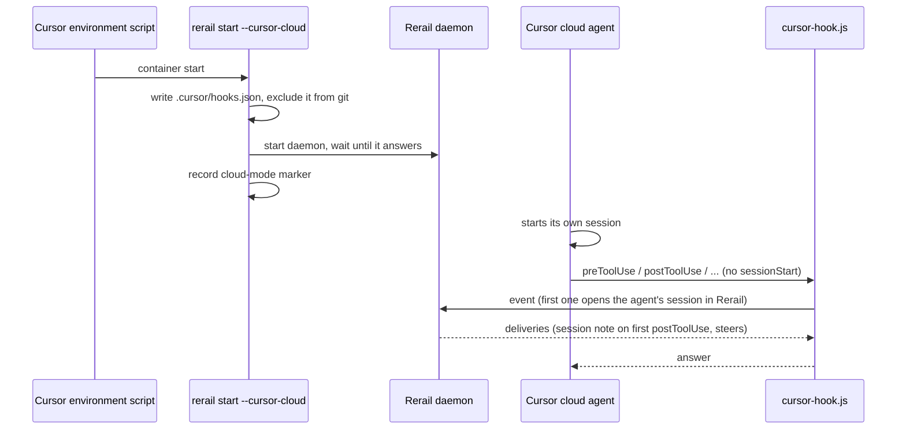

# Cursor cloud agents: PRD

**Document type:** Product requirements, in progress. The issue log at the end stays open while more problems come in
from the field.

**Status:** In progress on branch `jeffreysnell/cursor-cloud-agents`: R1, R2, R3 and R6 built; stage 2 of the test plan
not run yet.

## Problem

A customer ran Rerail with a Cursor cloud agent. The agent wrote a file (`/rerail-show-me` wrote `rerail-show-me.js`).
No hook ran, the daemon received nothing, the database stayed empty (0 sessions, 0 events), no steer went out, and the
dashboard showed the repository's rules but no session. The same demo works with a local Cursor IDE agent.

We have no access to the customer's account and no transcript from the run. The cause below comes from Cursor's
documentation and Rerail's code, not from the customer's logs.

### Cause

Rerail registers its Cursor hooks only in `~/.cursor/hooks.json` (`planCursor` in
`src/setup/harness-registration.ts`). Cursor cloud agents never load user hooks. They load only project hooks
(`.cursor/hooks.json` in the repository) and, on Enterprise plans, team and enterprise hooks
([Cursor hooks: cloud agent support](https://cursor.com/docs/hooks#cloud-agent-support)).

### What Cursor cloud agents do and don't run

From [Cursor's hooks docs](https://cursor.com/docs/hooks#cloud-agent-support), against the eight events Rerail
registers (`hooks/cursor.json`):

| Rerail hook | Runs in cloud agents |
|---|---|
| `preToolUse`, `postToolUse`, `postToolUseFailure` | Yes |
| `beforeSubmitPrompt`, `afterAgentResponse`, `stop` | Yes |
| `sessionStart` | No: deferred, since a cloud agent can start in a read-only environment |
| `sessionEnd` | No: cloud agents have no editor-session boundary |

Also from the same page:

- Hooks don't run during a cloud agent's early exploratory turns in a read-only environment. They start once the agent
  has a writable environment.
- Project hooks run from the project root.
- Hooks from every source run, and Cursor merges their answers.
- Self-hosted pool workers are different: they run user hooks from the worker's home, and fire `sessionStart` and
  `sessionEnd` when a session claims and releases the worker.

### What Rerail does today without `sessionStart` and `sessionEnd`

| Job | Today | Code |
|---|---|---|
| Record the agent's session | Already works: the agent's first event opens its session in Rerail, under the agent's own session id | `runtime.ts:1622` |
| Close a session | The idle sweep closes quiet sessions, checked every 60 s | `engine-service.ts`, `closeIdleSession` |
| Wait for the daemon | **Only `sessionStart` waits.** Any other hook that finds no daemon answers `{}` at once, logs the event as lost, and starts a daemon in the background. | `hook-host.ts:182`, `:399` |
| Tell the model the rules (session note) | Sent with the `sessionStart` answer | `cursorHookOutput` |

## Goal

A Cursor cloud agent working in a repository where Rerail is set up is recorded, checked and steered from its first
event on the VM, just like a local Cursor IDE agent.

## Non-goals

- A mode that runs without hooks. Steers reach the model only through a hook's answer.
- Starting or opening a session. The Cursor cloud agent starts its own session; Rerail only monitors it.
- Changing local Cursor. Nothing in this work writes to a developer's machine or changes their `~/.cursor/hooks.json`.
- Committing Rerail hooks to the customer's repository. The hooks file is written on the VM only.
- Self-hosted pool workers. They already fire user hooks, `sessionStart` and `sessionEnd`.
- Windows cloud VMs.

## Design

The environment script that Cursor runs when the container starts calls one Rerail command. That command prepares the
VM so the agent's hooks reach a running daemon. The agent starts its own session, and Rerail records it from the
agent's first event, under the agent's own session id, as it already does.



## Requirements

### R1. `rerail start --cursor-cloud`

Run from the checkout by Cursor's environment script when the container starts. In order:

1. Starts Rerail in the checkout, as `rerail start` does.
2. Writes Rerail's Cursor hook entries into `<checkout>/.cursor/hooks.json`, with this VM's absolute paths: the same
   entries `planCursor` writes to `~/.cursor/hooks.json`, merged into any entries already there.
3. Keeps that file out of git:
   - untracked: adds `.cursor/hooks.json` to `.git/info/exclude`;
   - tracked (the repository commits its own hooks): `git update-index --skip-worktree .cursor/hooks.json`.
4. Starts the daemon and waits until it answers, as the `sessionStart` hook waits today.
5. Records the cloud-mode marker where every hook of this checkout reads it. It is a file, not an environment
   variable: we don't know that variables exported by the environment script reach hook processes.

It opens no session. It must be idempotent: running it again on a container restart rewrites nothing that is already
right.

### R2. Hooks in cloud mode

When the marker is there:

- Every hook waits for the daemon the way `sessionStart` does now (`startsSession` behavior in `hookDaemon`), so no
  event is dropped while the daemon boots or restarts.
- Events keep the agent's own session id (`session_id`, else `conversation_id`), as today.

### R3. Session note

The note that `sessionStart` normally returns goes out with the first `postToolUse` answer in each of the agent's
sessions. `cursorHookOutput` already combines a note with steers for `postToolUse`. It goes out once per session.

### R4. Session end

There is no `sessionEnd` in the cloud. The idle sweep closes the agent's session once it goes quiet. Any later event
reopens it, as today.

### R5. Local machines are unchanged

Without the marker, every hook behaves as it does today. Developers' local Cursor never sees the VM's hooks file,
since it is never committed (R1.3).

### R6. Set-up in one command

Today the platform engineer had to paste three `rerail setup` runs:

```sh
npx -y @neralabs/rerail@latest setup --relay --agents claude-code --repo "$PWD" --answer allow && \
npx -y @neralabs/rerail@latest setup --relay --agents claude-code --repo "$PWD" --answer pick-myself && \
npx -y @neralabs/rerail@latest setup --relay --agents claude-code --repo "$PWD" --answer choose \
  --packs react@0.1.12,rerail-pack-team@0.1.0
```

Why it takes several runs (`src/cli/repository-setup.ts`):

- Set-up without a terminal is built for a coding agent to relay: each run answers one question and stops at the next
  (`--relay`, or no TTY). `--answer` takes one value.
- Agreeing that Rerail may read sessions is itself an `--answer` (`allow`). It uses up the run's one answer
  (`approveSessions`), and the same run deliberately doesn't count `--repo` as the go-ahead to read the repository
  (`runSetup`, `request.answer !== "allow"`). So the first run always stops at the next question.
- The second run, `pick-myself` without `--packs`, only prints the pack list and stops. With `--packs`, the same answer
  installs those packs and starts in one run (`pickPacksMyself`; test `repository-setup.test.ts:444`). So two runs
  are enough today, but no script can do it in one.

Requirement:

1. A flag that agrees to session reading without using up `--answer`, e.g. `--allow-sessions`. It records the
   agreement as `--answer allow` does, and the run goes on with its own `--answer`, `--repo` and `--packs`.
2. With that flag, a folder named with `--repo` in the same command is the go-ahead to read it, as it is in any other
   run that names one.
3. A run started for a script fails with a non-zero exit when it would stop at a question, and the message names the
   flag that answers it. An environment script must not pass with Rerail half set up.

The environment script's set-up then becomes one command:

```sh
npx -y @neralabs/rerail@latest setup --agents cursor --repo "$PWD" --allow-sessions \
  --answer pick-myself --packs react@0.1.12,rerail-pack-team@0.1.0
```

`--relay` isn't needed there: without a terminal, set-up already uses the agent lane. On a cloud VM, `--agents cursor`
only writes `~/.cursor/hooks.json`, which cloud agents ignore. The hooks that run there come from R1.

## Acceptance criteria

1. **Cold start:** on a VM with no daemon running, `rerail start --cursor-cloud` leaves a running daemon, a hooks file
   with all eight events, no session, and a clean `git status`.
2. **No `sessionStart`:** a simulated cloud run that sends only `preToolUse`, `postToolUse` and `stop` gets every event
   recorded under the agent's session id, and a rule violation in an edit is steered.
3. **Boot race:** a `postToolUse` that arrives while the daemon is still starting is recorded and checked, not
   logged as lost.
4. **Session note:** the first `postToolUse` answer in the session carries the note; later answers don't.
5. **Idempotent:** running the command twice changes nothing on the second run.
6. **Existing hooks:** a repository that commits its own `.cursor/hooks.json` keeps its entries; Rerail's are added, and
   `git status` stays clean.
7. **Local unchanged:** without the marker, the existing Cursor hook tests pass unchanged.
8. **On a real cloud VM:** one end-to-end run on our own Cursor cloud account, with the environment script calling the
   command, shows the agent's session on the dashboard and a steer for a planted violation.
9. **One-command set-up:** on a machine where session reading was never agreed, the R6 command installs the packs,
   starts Rerail in the repository and exits 0, in one run.
10. **Set-up fails loudly:** the same command with a missing or bad value (no `--packs`, an unknown pack, a version
    that doesn't exist) exits non-zero and names what to fix.

## Pre-merge test plan

Three stages, in order. A stage that fails stops the PR.

### Stage 1. Automated

Acceptance criteria 2–7, 9 and 10 as tests in the existing suites (`test/hosts/cursor/`, `test/cli/repository-setup.test.ts`,
`test/harness/`). The simulated cloud run feeds hook payloads to `runCursorHook` with no `sessionStart`, starting with a
`postToolUse` while no daemon runs.

```sh
nice -n 19 npx vitest run test/hosts/cursor test/cli/repository-setup.test.ts test/harness
```

### Stage 2. The PR's build on a real Cursor cloud VM

**Build the package from the PR branch.** `env-matrix.yml` builds the same package a release ships (`package.yml`) and
uploads it as the `rerail-package` artifact: core and the six engine tarballs.

```sh
gh workflow run env-matrix.yml --ref <pr-branch> -f environments=ubuntu-24.04-x64
gh run download <run-id> -n rerail-package -D bundle
```

**A test repository of our own**, never the customer's, with:

- the packs the customer uses, and a rule with a violation we can plant on request;
- the core tarball and the engine tarball for the VM's processor (check `uname -m` on a cloud agent first) committed
  under `.rerail-pr-bundle/`;
- `scripts/dev/cursor-cloud/install.sh` copied in, and a `.cursor/environment.json` of

  ```json
  {
    "install": "RERAIL_PR_BUNDLE=.rerail-pr-bundle RERAIL_PACKS=<id@version,…> ./install.sh",
    "start": "~/.rerail/bin/rerail start --cursor-cloud"
  }
  ```

  The script serves the bundle from a Verdaccio on the VM for set-up only (as `start_registry` in
  `scripts/host/azure/guest.sh` does), runs the R6 command and `rerail start --cursor-cloud`, then stops Verdaccio and
  takes it out of `~/.npmrc`: a Build keeps disk state only. Without `RERAIL_PR_BUNDLE` it installs from npmjs, which
  is run F.
- a temporary payload logger in the repository's own `.cursor/hooks.json`, e.g.
  `{"command": "sh -c 'cat >> /tmp/cursor-hook-payloads.jsonl; echo {}'"}` on every event. It answers open
  questions 1 and 4, and covers acceptance criterion 6, since the file is then tracked.

**Runs**, each started as a new cloud agent from the active Build:

| Run | Do | Check |
|---|---|---|
| A. First prompt | First prompt asks for an edit with the planted violation | Session recorded under the agent's id; events > 0 (the customer had 0); the steer is relayed in the chat; the session note is in the first `postToolUse` answer. Whether a `user-prompt` event exists for this prompt answers open question 2. |
| B. Follow-up | Second prompt in the same agent | Same session, new events |
| C. Daemon down | The agent runs `rerail daemon stop`, then makes an edit | The edit's event is recorded once the daemon is back, not logged as lost (R2) |
| D. PR | The agent opens a PR | The diff has no Rerail hook entries and no `.cursor/hooks.json` change; `git status` was clean before the PR |
| E. Second agent | A new agent from the same Build | Works without the install step running again (`start` runs on every boot) |
| F. Customer's script | `install` with exactly the command we'll send the customer | Same as run A |

Check the database from the agent's terminal (`rerail status`, and session and event counts in
`~/.rerail/rerail.sqlite`), and the dashboard through the agent's remote desktop.

### Stage 3. Local Cursor still works

On a Mac, install the same bundle through a local registry (`scripts/dev/rerail-smoke.sh` packs and publishes this
way), run set-up without `--cursor-cloud`, and run a local Cursor IDE agent in the test repository. Check that:

- sessions, steers and the session note at `sessionStart` work as before;
- no `.cursor/hooks.json` is written to the repository;
- every event is recorded once.

Not used for PR testing: publishing a preview to npm's `next`. A release needs approval and moves `next` for everyone
who follows it (docs/release.md).

## Risks

- **Hooks-file load timing.** If Cursor reads `.cursor/hooks.json` before the file is written, the hooks only apply
  after Cursor reads it again. Writing the file in `install` rather than `start` would avoid this, since the Build
  captures it before any agent boots (open question 1). Run A checks it.
- **Every hook waiting on the daemon.** A daemon that is down then delays every tool call by up to the hook deadline,
  where today only `sessionStart` waits. This is bounded by the existing deadline (`withDaemonDeadline`).

## Open questions

1. When does Cursor read the project `.cursor/hooks.json` relative to the environment script: once before it runs, or
   again later?
2. Does `beforeSubmitPrompt` fire on the VM for the first prompt? Cursor's docs list it as supported; field notes say
   the first prompt is sent before the VM exists. If it doesn't fire, that prompt's text never reaches the VM and
   isn't recorded. The first turn's tool calls and edits still are.
3. ~~Which environment step runs on every container start?~~ Answered by
   [Cursor's environment docs](https://cursor.com/docs/cloud-agent/setup): `install` runs when Cursor creates a Build,
   which keeps disk state only, with no running processes or exported variables. `start` runs after every agent boots
   from a Build. Set-up goes in `install`; the daemon has to start in `start`.
4. Which fields do cloud hook payloads carry: `session_id`, `conversation_id`, `cwd`, `workspace_roots`,
   `transcript_path`?
5. Ship behind an internal-testing gate (`RERAIL_EXPERIMENTAL_…`, as [headless scan](headless-scan.md) does) until
   acceptance criterion 8 passes?
6. ~~Can set-up and `rerail start --cursor-cloud` be one command?~~ No: they run in different steps (open question 3).
   Still open: should the hooks file be written in `install` (with set-up) rather than in `start` (risk above)?

## Issue log

Add new issues here as they come in. Each one is either covered by a requirement above or stays open.

| ID | Issue | Covered by | Status |
|---|---|---|---|
| CC-1 | Cloud agents don't load `~/.cursor/hooks.json`, so no Rerail hook ran on the VM (the customer incident) | R1.2 | Open |
| CC-2 | `sessionStart` and `sessionEnd` don't fire in cloud agents | Sessions already open on the first event; R4 | Open |
| CC-3 | Without `sessionStart`, the first hooks find no daemon and their events are dropped while it boots | R1.4, R2 | Open |
| CC-4 | The session note is only sent at `sessionStart`, so a cloud agent never gets it | R3 | Open |
| CC-5 | Hook entries hold machine-specific absolute paths, so they can't be committed for both cloud and local use | R1.2, R1.3 (VM-only file) | Open |
| CC-6 | The first prompt's text may never reach the VM | Open question 2 | Open |
| CC-7 | Set-up in a script needs several `npx` runs: session agreement uses up the one `--answer`, and every run stops at the next question | R6 | Open |
