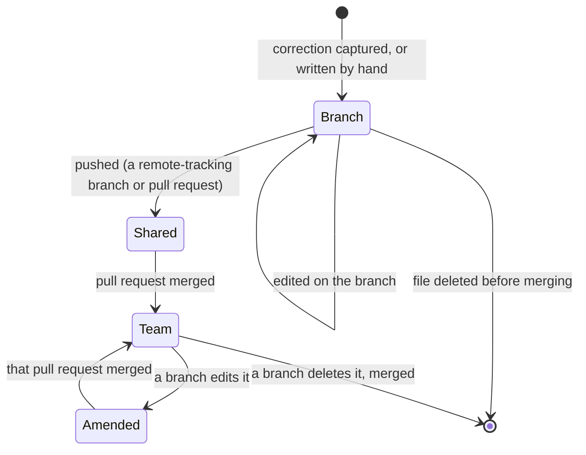
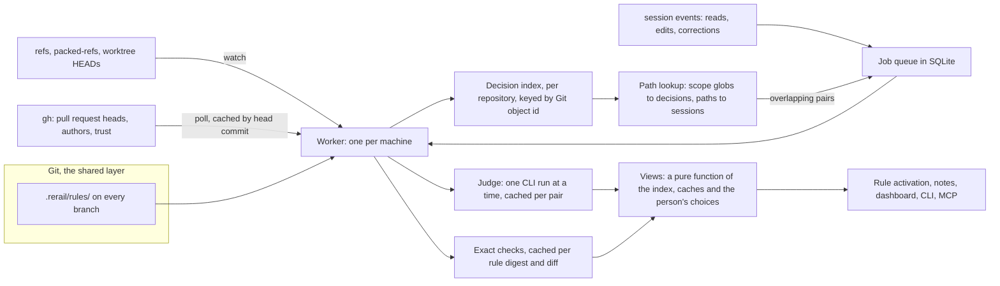

# PRD: Merge Assist — shared decisions between branches, before they merge

**Document type:** Product requirements and target design for an experimental feature.

**Delivery status:** Design. A first version runs on the demo branch, specified in
[merge-assist-v1-build.md](merge-assist-v1-build.md); [§14](#14-build-status) lists what it builds and what this
design changes. Experimental and internal testing; off unless a person turns it on for a repository. This design
builds on two features of `main` that the demo branch predates, a worktree's own rules (#340) and rule approval
(#362); the branch is rebased onto `main` before any of it is built.

**Prior art:** [Amp comparison](branch-coordination-amp-comparison.md).

## 1. Summary

When several people and their coding agents work on parallel branches, they remake the same decisions, and they find
the ones they made differently only when the branches merge. Merge Assist makes each decision a **rule** that lives on
the branch, in `.rerail/rules/`, next to the code it governs:

- When a developer corrects their agent ("no, do it this way"), Rerail turns the correction into a rule on their
  branch. The agent follows it for the rest of the branch's work.
- The rule travels with the branch's commits. Merging the pull request makes it a team decision, reviewed in the
  same diff as the code.
- When an agent opens a file, Rerail gives it the decisions other branches made about that file. A compatible one
  from a trusted teammate steers it (**absorb**); one it already breaks, or from someone Rerail cannot vouch for,
  waits for the developer (**review**); one that contradicts this branch's own decision goes to the two people to
  settle (**talk**).
- Changing an earlier decision is an edit to its rule, reviewed like code, never a switch on one machine.

Exact checks (Rerail's engine, `git merge-tree`) decide what they can. The developer's own coding agent CLI, on their
own sign-in, judges only what they cannot. Git is the only shared layer: no server, no Rerail account.

## 2. Problem

- **Learnings are not shared across sessions.** A teammate leaves notes in the repository; another person's agent
  does not read them, or reads them as prose with no way to check its work against them.
- **Discovery is sequential.** The same decisions are remade, and contradictory ones meet at merge time, after both
  sides built on them.
- **Existing tools act after the fact.** Amp's Ship rebases, tests and resolves textual conflicts when a branch lands,
  one branch against `main` ([shipping](https://ampcode.com/docs/orbs/shipping)). Nothing compares two branches that
  are both still in progress, and nothing compares what they decided rather than which lines they changed.

**Intended value:** move coordination left. Re-steering an agent while it works is cheaper than reconciling two
architectures after both land.

## 3. Users and goals

**Primary user:** a developer whose coding agent works on a branch while teammates work on others in the same
repository, with any mix of Claude Code, Codex, Cursor, OMP and Pi.

Goals:

1. A decision made once on a branch holds for the rest of that branch's work without being repeated.
2. A teammate's decision reaches an agent when the agent works on the code it governs, before it builds against it.
3. Real disagreements become a conversation between people, early, with both decisions side by side.
4. Overlapping or adjacent lines alone are never reported as a disagreement.
5. Decisions are reviewed where code is reviewed, and change the way code changes.
6. Nothing leaves the machine that the developer's own tools would not already send.
7. A session never waits for Merge Assist.

Non-goals for this version: resolving conflicts automatically, rebasing, writing to pull requests, blocking a push or
a merge, a hosted service, Git hosts other than GitHub for pull requests.

## 4. Principles

- **Rules are the shared intent.** A decision is a rule document: the same format, checks, approval and settings as
  every other rule. No second format.
- **Git is the sync layer and the source of truth.** Where a decision lives, who made it and how it changed come from
  Git history, never from what a file says about itself. Rerail never commits or pushes.
- **Reviewed where code is reviewed.** A decision enters the team by a merged pull request, and changes the same way.
- **Relevant, not exhaustive.** Work follows what agents touch, not how many branches exist.
- **Deterministic before intelligent.** The engine and Git decide what they can; the judge sees only the rest.
- **Never stronger than steer, never invisible.** Shared decisions steer; they never block. Everything Rerail applies
  automatically is listed, with Undo.
- **People decide disagreements.** Rerail never picks between two developers' decisions.
- **No credentials of its own.** Rerail runs tools the developer already has (`git`, `gh`, their agent CLI) under
  their sign-in.

## 5. The model: a decision is a rule

### 5.1 What a decision is

A decision is one rule document in `.rerail/rules/<name>.json`, the folder Rerail already loads as a checkout's own
rules ([rule packs, "A worktree's own rules"](rule-packs.md#a-worktrees-own-rules)).

| Decision | Rule | Checked by |
| --- | --- | --- |
| One code can break: "callers don't wrap API calls in retry loops" | A `rerail.policy/v1` code rule. `description` is the decision; `scope.include` the folders it governs; `scope.exclude` the places it allows, such as the transport layer the decision says retries belong in | Rerail's engine, exactly |
| Guidance: "API errors are returned as `Result` values" | A conversation rule that matches the agent's tool calls on a path in scope and whose action is the decision's text, sent once per session | The agent, which reads it; the judge, when it is compared with another decision |
| A decision about a diff as a whole | The reserved `llm` clause of a code rule, once it is implemented | The judge |

A decision's rule always steers; Merge Assist never writes one that blocks. A person may commit one in Log for a
transition ([§6.5](#65-changing-a-decision)).

### 5.2 Where a decision lives

Its place comes from Git, relative to the repository's base branch (`origin/HEAD`, else `main` or `master`):

- **Team decision:** a rule in the base branch's tree. It got there through a merged pull request.
- **Branch decision:** a rule this branch added or changed since its merge base with the base branch
  (`git diff --name-status <base>...HEAD -- .rerail/rules`), committed or not.
- **Peer decision:** a rule another live branch added or changed since its own merge base.

A rule's **author** is the author of the commit that last changed its file on that branch (`git log -1`), or, for a
pull request, the author GitHub reports. The **same id on two branches is the same decision**; different content under
one id is an amendment ([§6.5](#65-changing-a-decision)).

A **live branch** is a local branch, a remote-tracking branch (`refs/remotes/origin/*`) or an open pull request that is
not merged into the base, not stacked with this branch, and whose tip is less than 30 days old (a setting).

### 5.3 Lifecycle



There is no promotion step and no "rejected" state: merging is promotion, and deleting the file in a pull request is
withdrawal. Both are diffs a reviewer sees.

### 5.4 Trust and approval

Rules Rerail did not publish run in Log until a person approves their content, on this machine, by digest
([rule scoping, "Approval"](rule-scoping.md#approval)). Merge Assist keeps that and adds an approval policy a person
turns on with Merge Assist (recorded, listed on the page, revocable):

| Rule | Approved automatically when |
| --- | --- |
| Written by capture from this person's correction | Rerail wrote these exact bytes for this person |
| A team decision | Its content is in the base branch and the commit that brought it was authored by someone with write access |
| A peer decision | Never by approval: it applies only through absorb or adopt ([§6.4](#64-the-three-tiers)) |

**Trusted** means: a local branch with no pull request behind it from someone without write access, and whose upstream
is the repository's `origin`; a remote-tracking branch whose last commit is by someone with write access; or a pull
request whose author has write access (`gh api repos/{o}/{r}/collaborators/{login}/permission`).

## 6. Experience

### 6.1 Turning it on

Merge Assist is off for every repository. A person turns it on in the dashboard or with `rerail merge-assist on`; a
coding agent cannot. Before the switch, the page says what it does:

- Rerail reads corrections you give your coding agent in this repository and asks **your agent's CLI** (Claude Code
  or Codex) to state each as a decision. That sends the correction and the code it corrected to your agent's
  provider, as your session already does.
- Each decision becomes a rule in `.rerail/rules/`. Commit it to share it; Rerail never commits.
- Rerail reads other branches through Git, and open pull requests through **`gh`**, read-only, with your sign-in.
- Decisions from teammates with write access can steer your agent, and you can undo each one.

It shows what Rerail found: the agent CLI it will use, `gh` state and login, whether Git ignores `.rerail/rules/`
(then decisions stay local), and whether Rerail is set up and started here. It offers one optional line for the
repository's `AGENTS.md`, which a person adds themselves:

```markdown
Team decisions are rules in .rerail/rules/: follow each rule's description where its scope applies.
```

With it, agents without Rerail follow merged decisions too, as guidance.

### 6.2 Capturing a decision

1. **At each turn end**, a free filter (the correction phrases `rerail rules evidence` recognises) marks corrections.
   The agent gets an immediate acknowledgement, with no model call: *"Rerail will save this as a decision when you
   commit."*
2. **At a batch point** (the agent's `git commit` tool call, the session going idle, or the person asking "save that
   as a decision"), the judge reads the marked corrections with the code before and after each and the decisions
   already in force, and answers one of:

   | Outcome | What Rerail does |
   | --- | --- |
   | One-off fix | Nothing |
   | Restates a decision in force | Nothing; it may tighten that rule's scope |
   | New decision | Writes a rule |
   | Contradicts a team decision | Writes an amendment of that rule ([§6.5](#65-changing-a-decision)) |

3. **A code rule is validated before it is kept:** it compiles; it catches the code the agent wrote before the
   correction and passes the code after; and it matches nothing in the checkout as it is. A failure goes back to the
   judge once, with the concrete failure (compile error, failing case, or up to three matches as `path:line: text`);
   a match in a place the decision allows becomes a `scope.exclude` entry rather than a narrower scope. A rule that
   still fails is kept as guidance, with the reason.
   **Signals** are kept with every decision: short code fragments whose presence in new code means the decision is at
   stake. Rerail takes the judge's fragments plus those the correction removed, widens each to its most general form,
   and drops any that occur in the corrected code or in more than 20% of the files in scope.
4. Rerail writes the file and tells the agent, which tells the person in one line and includes the file in the commit
   it is making:

```text
Rerail saved your correction as a decision for this branch: "Retries live in the transport layer; callers don't
wrap requests in retry loops." It is in .rerail/rules/retries-in-transport.json; include it in this commit.
```

### 6.3 Decisions when they are relevant

Decisions reach the agent as context, injected into its loop; code rules are optional on top. The protocol, chosen by
the context-injection eval ([§6.3.1](#631-what-the-eval-showed)):

- **Session focus.** When a session starts, Rerail asks the person's agent CLI once, in the background, which decisions
  in force this task will most likely need: the person's prompt and the decisions whose scope covers the repository,
  under opaque ids, answered as at most 12 ids, most relevant first (`rankPrompt` with `max` 12). These picks are the
  session's *focus*. The session never waits for it; the answer usually arrives within the agent's first few tool calls
  (4–8 s).
- **Area orientation.** The first time the agent reads or edits a file in an *area* (the file's folder cut to two
  segments, such as `src/ui`), Rerail ranks that area once more, in the background: the decisions whose scope covers
  that file or a project file in its area, with the session focus's picks listed first, answered as at most 3 ids. It
  gives the agent those decisions, once, so a task spanning several areas gets each area's own. An area touched
  before its ranking arrived is served at the next tool call after it does. One line each. Directory listings and
  searches do not count as touching.
- **Fallback.** If the focus is not there when the agent is about to edit, Rerail waits up to 15 s, then ranks that
  area's decisions by the bundled embedding model's similarity to the prompt and gives the top 3. If the agent CLI is
  unavailable, the fallback serves the whole session.
- **Conflicts first, the ask last.** A decision this branch contradicts is given at the first touch of its scope,
  whether or not it is in the focus, with this branch's own; the last line asks the agent to end its final message with
  one line naming who decided differently and where.
- A decision without a scope covers the repository and is a focus candidate like any other.

#### 6.3.1 What the eval showed

`benchmark/merge-assist-context.ts` runs Codex on real tasks in a fixture project with a hook that injects as above,
against a decision index the product built (capture's decision text, scope and signals; nothing hand-written on the
protocol side), plus distractor decisions. Choices were made on a dev split; the numbers are the held-out split
(9 tempting tasks, 2 neutral, 2 conflict, 3 trials).

With 40 decisions in the index:

| Protocol | Violations of the decision | Injected tokens | Conflict named in the final message |
| --- | --- | --- | --- |
| None | 15/27 | 0 | 0/6 |
| Every decision at session start | 0/27 | 1,221 | 6/6 |
| Area orientation, index order | 2/27 | 485 | 6/6 |
| Signals at the edit only | 9/27 | 61 | 5/6 |

With 224 decisions in the index (about 40 in `src/ui` alone):

| Protocol | Violations | Target delivered before the edit | Irrelevant decisions per run (median) | Injected tokens (median) |
| --- | --- | --- | --- | --- |
| None | 13/27 | — | 0 | 0 |
| Area orientation, index order, cap 12 | 8/27 | 15/33 | ~24 | 734 |
| Area orientation, ranked by prompt words (BM25) | 7/27 | 21/33 | ~24 | 747 |
| Area orientation, ranked by prompt embedding | 2/27 | 31/33 | ~24 | 757 |
| **Session focus, top 3** | **1/27** | **32/33** | **2** | **102** |
| Session focus, top 3, another distractor draw and order (180 distractors, seed 2) | 1/27 | 30/33 | 2 | 105 |

For session focus, the conflict was kept 6/6 and named in the final message 6/6 (5/6 on the second draw); done rate
was 36/39 against the control's 35/39. Each session costs one agent-CLI call of about 3,800 prompt tokens, outside the
agent's own context.

- A decision that reached the agent before it wrote the code was followed almost every time; delivery, not
  compliance, is the problem.
- Every decision at session start stops working at scale: at 224 decisions it is about 6,700 tokens, past Codex's
  per-hook limit of about 2,500 tokens, so Codex saves it to disk and shows the model a preview. On dev it did worse
  than no injection. An injection must stay under the host's limit.
- Relevance needs a model that reasons about the task. Offline, over each dev task's 46–126 candidate decisions, the
  bundled embedding model put the target in the top 8 for 4 of 9 tasks; one agent-CLI ranking call put it first for 8
  of 9 and fourth for the ninth. Ranking by prompt words fitted the dev prompts' wording (dev 0/27, held-out 7/27).
- Signals at the edit deliver late and fix after the fact: fewest injected tokens, most total tokens.
- An embedding match between the decision and *code* (the patch) found nothing within the noise budget.

#### 6.3.2 Confirmed against fixing after the fact

Pre-registered in `benchmark/README.md` before any run, on 18 tasks never used in design (6 small, 6 medium, 6 large
spanning 3–4 areas), 224 decisions in the index. Each arm ran to a clean, finished result: after the agent's first
finish, anything that still broke a decision got a reviewer message naming every violating line, up to 3 rounds.
Human review time is not counted, which favours fixing after the fact. Two looks, 4 trials per task and arm, 144
runs, no errors; all four primaries rejected at the Pocock boundary (one-sided, 0.0221 per look), so the stopping rule
fired at look 2.

| Primary (session focus against fixing after) | Effect | 95% CI | Holm p |
| --- | --- | --- | --- |
| First pass clean | +0.39 | [+0.22, +0.57] | 0.0002 |
| Total tokens to completion | ×0.74 | [×0.61, ×0.91] | 0.0002 |
| Time to completion, not worse than ×1.10 | ×0.90 | [×0.77, ×1.04] | 0.0002 |
| Large tasks needing a fix round | −0.33 | [−0.63, −0.04] | 0.0049 |

| Size | Arm | First pass clean | Needing a fix round | Median time | Median tokens |
| --- | --- | --- | --- | --- | --- |
| Small | fix after | 13/24 | 11/24 | 36 s | 143k |
| Small | session focus | 23/24 | 1/24 | 36 s | 131k |
| Medium | fix after | 9/24 | 15/24 | 54 s | 313k |
| Medium | session focus | 19/24 | 5/24 | 41 s | 149k |
| Large | fix after | 1/24 | 23/24 | 105 s | 537k |
| Large | session focus | 9/24 | 15/24 | 93 s | 475k |

- Every arm ended clean; the difference is how much rework it took. Fixes after the fact changed 10.7 more lines per
  task (CI [−17.7, −4.7]).
- Time is not worse, and is likely better (×0.90), but time *superiority* did not reach the per-look bar (p 0.025).
- Session focus with a single top 5 across the session (no per-area cap) did as well as the per-area version on the
  held-out large tasks (needing a fix round 12/24 against 15/24, not significant either way): the per-area cap that won
  on the design tasks did not carry over. Both are far better than fixing after.

**Across agents.** A second check runs two agents on two branches. Agent A works, its person corrects it, and the
product's capture turns the correction into a decision on A's branch; agent B, on another branch cut from `main`,
gets it only through the index (its original entry removed). B either has session focus or nothing. Capture produced
the decision in 18/18 trials (all 9 graded decisions, 2 trials each). B broke the decision 4/46 times with session
focus against 19/46 without (−0.38, CI [−0.61, −0.16], p 5e−5, 14 B tasks); every one of those 4 was a run in which
the decision was not among the focus picks.

#### 6.3.3 Large tasks

Large tasks (3–4 decisions at stake across at least 3 areas) are where aligning early has the most to gain. A second
pre-registered comparison ran on 16 more unseen large tasks, three looks of 2 trials per task and arm (96 runs per
arm, no errors). It included a diagnostic arm that delivers exactly the decisions each task puts at stake, to measure
the ceiling. Ranking each area's decisions at its first touch (5 picks per area) was the candidate to replace session
focus.

| Arm (96 runs each) | First pass clean | Needing a fix round | Median time | Median tokens |
| --- | --- | --- | --- | --- |
| Fix after | 19 | 77 | 96 s | 484k |
| Session focus | 56 | 40 | 86 s | 277k |
| Per-area ranking | 60 | 36 | 89 s | 309k |
| Exactly the decisions at stake (ceiling) | 85 | 11 | 75 s | 206k |

- Against fixing after, per-area ranking held up: first pass clean +0.43 (CI [+0.24, +0.60]), tokens ×0.81, time not
  worse (×0.99, under the ×1.10 margin), all at Holm p ≤ 0.01.
- Against session focus it did not: first pass clean +0.04 (CI [−0.10, +0.20], p 0.30), tokens ×1.08, so the stopping
  rule ended at look 3 without success. Session focus stays: one ranking call per session against about seven.
- The two fail in opposite ways. Session focus left 136 of 378 decisions at stake undelivered, and 42 of those were
  broken, most of them the SQL decision. Per-area ranking delivered 326, but sent 18 decisions per run against 7, and
  more delivered decisions were broken (28 against 16): more decisions, less attention to each.
- The ceiling is 25 points of first pass clean and a third of the tokens above either. Outside dates, the ceiling's
  agents broke almost nothing they were given (2 of 378). So the gain is in *which* few decisions arrive, not in more
  of them.
- Dates are broken even when delivered (10 of 64 at the ceiling). The tasks ask for formats such as "Tue 4 Nov,
  08:30", and the captured decision says to use `formatDate` without saying to add a format there. That is an
  amendment for the decision's author to make, not a delivery problem.

#### 6.3.4 Ranking each area, session picks first

After the dates decision was amended through capture (its author's correction "the format goes into formatDate, not
into the screen", drafted by capture into a decision that supersedes the old one), delivered decisions were almost
never broken; what was left was which decisions arrive. Ranking each area at its first touch, with the session's
picks listed first and 3 per area, was tuned on the 25 large tasks above and pre-registered on 16 more unseen large
tasks. The stopping rule fired for success at look 1 (3 trials per task and arm, 48 runs per arm, no errors):

| Arm (48 runs each) | First pass clean | Needing a fix round | Target decisions delivered | Median time | Median tokens |
| --- | --- | --- | --- | --- | --- |
| Fix after | 5 | 43 | — | 112 s | 498k |
| Session focus | 26 | 22 | 117/189 | 89 s | 246k |
| Per-area ranking, session first | 36 | 12 | 145/189 | 94 s | 282k |

| Primary (per-area ranking, session first) | Effect | 95% CI | Holm p |
| --- | --- | --- | --- |
| First pass clean, against fixing after | +0.65 | [+0.46, +0.81] | 0.0002 |
| Total tokens, against fixing after | ×0.65 | [×0.51, ×0.81] | 0.0002 |
| Time, not worse than ×1.10 fixing after | ×0.85 | [×0.68, ×1.03] | 0.0002 |
| First pass clean, against session focus | +0.21 | [−0.02, +0.44] | 0.0149 |

- Against session focus, tokens (×0.94) and time (×0.98) are about the same: it sends 11 decisions per run against
  8, one more ranking call per area, and saves fix rounds (12 against 22 runs).
- Of the decisions delivered, 3 of 145 were broken; the 14 violations left are mostly decisions no ranking picked.
- The amendment did its job: with the old dates decision, delivered dates were broken 10 times in 64 even at the
  ceiling; with the amendment, 3 in 24.

#### 6.3.5 Telling an agent its edits would conflict with an open pull request

The simplest in-flight mechanism was tested on real history: 14 pairs of open-source pull requests (13 repositories,
TypeScript, JavaScript, Python, Go and Rust) where a second pull request clashed with the design of an earlier one
that was already public, curated by agents that never saw the mechanism. Each run replays the second pull request's
task from its base, with every pull request open at the time visible, on Codex 0.158 with `openai.gpt-6-luna` on
Amazon Bedrock; a blind grader judges whether the result conflicts with the first pull request's design.
Pre-registered, three looks, 252 runs; 17 excluded by the leak guard (agents searching system folders for a Go
toolchain), with the same direction when they are included.

| Arm | Conflicts with the first pull request | Effect (95% CI) | Holm p | Tokens | Time |
| --- | --- | --- | --- | --- | --- |
| Nothing | 48/77 | — | — | — | — |
| **Push**: after each edit, overlapping hunks with another open pull request are injected with its hunk and intent, and "make your code compatible with theirs unless that is contrary to your task" | **36/80** | **−0.18 (−0.37, −0.01)** | **0.0016** | ×1.33 | ×1.27 |
| Pull: one line says a conflict exists; the agent reads `git conflicts` when it wants | 40/78 | −0.10 (−0.32, +0.09) | 0.044 | ×1.60 | ×1.42 |

- Identifying overlapping hunks, nothing more, is enough to change outcomes significantly when pushed. The gain sits
  where the clash is on the same lines: `fd` went from 6/6 conflicting runs to 0/6, a pytest option contract from 6/6
  to 2/6. Clashes of design in different code (two session designs in Starlette, duplicate features in chi and Task)
  did not move: the agents never touched the other side's lines, so nothing was identified.
- Agents given the pull interface looked (74 of 78 runs ran `git conflicts`) and cut textual conflicts with the first
  pull request (−0.3 files per run, nominal p 0.0007), but resolved few of the design conflicts and spent more.
- The push arm sent a median of 2 injections per run; done was not worse (+0.05).
- This is the floor the alignment units (hand-offs, positions, contracts, artefacts) must beat: they exist for the
  clashes this one cannot see.
- **Correction.** This comparison graded "conflicts with the first pull request", which assumes the first one was
  right. Relabelled from history, 2 of its 14 pairs had the later design adopted (Starlette #3069/#3166, pytest
  #14860/#14934) and one had neither (pytest #14543/#14749). The completion run below measures against the design
  the project adopted, to completion, and supersedes this result.

#### 6.3.6 The same push, measured to completion against the adopted design

Measured as the session-focus comparison was: every task run to a finished result, then what is left and what it
cost. 26 open-source pairs, both pull requests public at once, the later one's task replayed with every open pull
request visible: in 11 (D1) the earlier design was adopted, in 15 (D2) the later one was and the earlier was closed
for it. Up to 3 review rounds from a reviewer that knows the adopted design and lists the violated conflict items;
Codex 0.158 with `openai.gpt-6-luna` on Bedrock throughout. Pre-registered, three looks, 282 runs used (29 excluded
by the leak guard for reading environment variables or the Go module cache; none favoured an arm, 14 against 15).
D1 and D2 weighted equally.

| Primary (push against nothing) | Effect (95% CI) | Holm p | Result |
| --- | --- | --- | --- |
| Conflict items with the adopted design left after completion | −0.0 (−0.2, +0.1) | 0.78 | no difference |
| Agent cost per task | ×1.08 (×0.99, ×1.18) | 1.00 | not lower |
| Agent time per task, not worse than ×1.10 | ×1.02 (×0.92, ×1.12) | 0.037 | not shown at the per-look bar |
| D2: ended on the adopted design, no more than 0.10 worse | −0.04 (−0.16, +0.07) | 0.33 | harm not ruled out |

| Scenario | Arm | Conflict items after the first pass | After completion | Ended on the adopted design | Review rounds | Agent cost | Agent time |
| --- | --- | --- | --- | --- | --- | --- | --- |
| D1 | nothing | 2.83 | 0.14 | 55/59 | 1.14 | $0.01 | 1.9 min |
| D1 | push | 1.71 | 0.05 | 53/56 | 0.77 | $0.01 | 1.9 min |
| D2 | nothing | 1.58 | 0.10 | 76/83 | 1.06 | $0.03 | 3.1 min |
| D2 | push | 1.42 | 0.15 | 73/85 | 0.98 | $0.03 | 2.9 min |

- At equal outcomes the push buys nothing the agent pays for: review takes both arms to almost no remaining
  conflicts, at the same cost and time.
- What it buys is review: first-pass conflict items −0.7 (CI −1.1, −0.2) and review rounds −0.3 per task (−0.5,
  −0.1), nominal p ≤ 0.0001, almost all of it where the earlier design was the adopted one (D1: 2.83 → 1.71 items,
  1.14 → 0.77 rounds). Human review time is not counted here, and it is the cost this saves.
- Where the earlier design lost (D2), the push neither helped the first pass (1.58 → 1.42) nor clearly hurt the end
  result (76/83 → 73/85); the run can't rule out a harm of up to 0.16.
- Agent cost is pennies per task on this model; any case for in-flight conflict identification rests on reviewer
  rounds and on the person, not on agent spend.

#### 6.3.7 Can a policy settle a conflict objectively?

A resolver runs the repository's policy (`.rerail/policy.yaml`) on a conflict and either names the design that wins or
escalates to a person; every outcome goes to the decision log on `refs/rerail/decisions`. Steps, in order: precedent,
hard checks (tests, build, public contract breaks), measurable criteria (compatibility with existing callers), a panel
of three judges that must agree in both orders, and escalation, including for reserved classes (public API, data
model). It never sees which pull request came first or what happened to them. Tuned on 15 open-source conflicts,
pre-registered, then run on the 26 held-out ones (11 where the earlier design was adopted, 15 the later), 3 panel
seeds × both orders.

| Policy | Correct / wrong / escalated per run | Wrong (bar ≤ 1 in 26) | Accuracy when it decides (bar ≥ 0.60) | Escalated (bar < 0.50) |
| --- | --- | --- | --- | --- |
| Full | 4–6 / 4–5 / 15–18 | 0.15–0.19 | 0.50–0.56 | 0.58–0.69 |
| Hard checks only | 2 / 4 / 20 | 0.15 | 0.33 | 0.77 |

| Step that decided (156 runs) | Right / wrong |
| --- | --- |
| Hard checks | 6 / 24 |
| Compatibility with existing callers | 6 / 0 |
| Judge panel, unanimous in both orders | 18 / 3 |
| Escalated | 99 |

- Both policies fail every bar: objective resolution, as built, is not safe to apply without a person.
- The steps expected to be safe are the dangerous ones. In-flight work is unfinished: the design a project ended up
  adopting often failed its build or changed signatures at the time the conflict arose (Task, mdBook, Vue), so
  "the side that breaks tests loses" picks the wrong side four times in five. One loss was the check runner's own
  fault (a side without a lockfile counted as failing).
- The panel is the strong part: right 18 of 21 times when its three judges agree in both orders, but it agrees on
  few conflicts.
- Most conflicts need a person: about two thirds escalate even with the full policy. The useful shape is a decision
  log where the person decides, with the panel's verdict shown as a recommendation when it is unanimous, not a
  resolver that decides alone. Hard checks belong at merge time, when the work is finished, not in flight.
#### 6.3.8 Coordination units from other pull requests, surfaced

The coordination units (hand-offs, positions, contracts, retirements, artefacts extracted from every pull request open
at the work's start, now also from their descriptions) were tested as built, although two of the five links had not
met their bars: delivered at an area's first touch, 3 per area, framed as other work to know about and to tell the
person about, not as an instruction. Same 26 OSS pairs and completion protocol as §6.3.6, pre-registered, three
looks, arms nothing, push (§6.3.5) and units; 270 runs used for the primaries (57 excluded by the leak guard, 25 of
them in the units arm, mostly agents printing temp-folder variables).

| Primary (units against nothing) | Effect (95% CI) | Holm p | Result |
| --- | --- | --- | --- |
| Conflict items with the adopted design after the first pass | +0.1 (−0.3, +0.6) | 0.81 | no effect |
| D2: ended on the adopted design, no more than 0.10 worse | −0.09 (−0.25, +0.05) | 0.81 | harm not ruled out |
| Agent cost per task, not worse than ×1.10 | ×1.04 (×0.95, ×1.14) | 0.21 | not shown |

| Scenario | Arm | First-pass items | Ended on the adopted design | Told the person |
| --- | --- | --- | --- | --- |
| D1 (earlier design won) | nothing / units / push | 2.73 / 2.14 / 1.93 | 50/55 / 44/49 / 51/56 | 0 / 3 / 0 |
| D2 (later design won) | nothing / units / push | 1.51 / 2.17 / 1.60 | 78/85 / 68/82 / 73/84 | 0 / 29 / 9 |

Where each run lost the thread (units runs, leaks excluded; units judged blind against the labels):

| Step | D1: the adopted design | D2: the rejected design |
| --- | --- | --- |
| A unit stating it was in the ledger | 26/49 | 76/82 |
| It was a candidate where the agent worked | 23/49 | 65/82 |
| It made the area's top 3 | 16/49 | 65/82 |
| It arrived before the area's first edit | 16/49 | 63/82 |
| The first pass followed it | 12/49 | 38/82 |
| The person was told (all runs) | 3/49 | 29/82 |

- The units help where the earlier design won (first-pass items 2.73 → 2.14) and hurt where it lost (1.51 → 2.17):
  surfaced, not instructed, the agent still follows another pull request's stated design about half the time it
  arrives. Averaged over both, nothing.
- The asymmetry is in extraction, not delivery: a unit stating the rejected design was in the ledger for 76 of 82 D2
  runs (the later work's rival had usually written its design down in its description), the adopted design for only
  26 of 49 D1 runs. Units carry what was written, not what was right.
- Surfacing works where it matters most: in D2 the agent told the person it diverged from another pull request in 29
  of 82 runs (push 9, nothing 0). That is the channel a decision log and a resolver (deciding which design wins) need.
- Against push, units cost less (×0.93) and leave more first-pass items (+0.4): on these small, local conflicts the
  overlapping hunk is the better signal.
- In-house (5 new Rerail conflicts involving Jeff Snell's and Gabriel Giangi's work, never used in tuning; descriptive):
  no arm helps. First-pass items 2.67 (nothing), 3.03 (units), 2.87 (push) with every run counted; the rejected-design
  pattern repeats on the pair where the later design won (#138/#445: 2.67 → 4.17). The leak guard excluded 50 of 90
  runs here, mostly for relative documentation links it read as `/tmp` paths and agents printing temp-folder
  variables, so the pre-registered view (leaks excluded) is too thin to read.

The same lookup drives comparison: a peer decision is compared with this branch's only when an agent here works in
its scope. A branch nobody's work touches costs nothing.

A person can see everything at once with **Scan now** on the page, which compares every live branch.

### 6.4 The three tiers

For a peer decision relevant to this checkout:

| Tier | When | What happens |
| --- | --- | --- |
| Absorb | Trusted, new (not an amendment of a team decision), this branch's changes pass its code rule, and it does not contradict a decision in force here | It applies in this checkout: a code rule steers, guidance is given when relevant. Listed under **Added from other branches**, with Undo |
| Review | This branch already breaks it; or it is untrusted; or it amends a team decision; or the judge cannot tell | Listed under **Needs your review** with the evidence. **Adopt** copies the rule into this branch's `.rerail/rules/`, so it is reviewed with this branch's pull request; **Dismiss** hides it until its content changes |
| Talk | It contradicts a decision in force here (this branch's, or a team decision), and its author is trusted | Listed first under **Decided differently**: both decisions, the author and branch or pull request, the judge's explanation, files `git merge-tree` reports conflicting in the scope, and a message to send. Nothing is applied |

An absorbed decision is judged again whenever either side changes; it moves to Review or Talk when trust, the exact
check or the comparison stops allowing it. An untrusted author's contradiction is a Review item, and its text never
reaches the agent.

Contradictions between two code rules are exact: each side's rule runs against the other side's changes in its scope.
Two branches editing the same rule file differently is exact too (`git merge-tree` on `.rerail/rules/`). The judge
compares only guidance, and only pairs whose scopes overlap.

### 6.5 Changing a decision

A design change is an edit to the decision's rule on a branch, not a setting:

| What the developer means | How | Who sees it |
| --- | --- | --- |
| "Right, but not here" | Add the path to `scope.exclude`, or a suppression comment where the rule honours them | Everyone, in the diff |
| "We are moving away from this" | Set `"mode": "log"` in the file: violations are still recorded, which measures the migration, and it stops steering | Everyone |
| "This decision is wrong now" | Edit the rule and raise its `revision`, replace it, or delete the file | Everyone; a reviewed change to a team decision |
| Trying something locally | The checkout's own Log or off setting | Only this person |

The usual path is capture: the developer contradicts a team decision in a session ("no, we're switching to
exceptions"), and capture writes an **amendment**, the same file with the new decision and `revision + 1`, instead of
a second, contradictory rule. This branch follows the new version at once. The note says:

```text
This changes a team decision by Jeremy Barnes, merged in #412. Your branch carries the change; branches that rely on
it will see it for review.
```

An amendment is never absorbed. Its original author sees it under **Decided differently**; other live branches see it
under **Needs your review**, with the places their code follows the old version and breaks the new one, from the exact
check. When the pull request merges, every checkout loads the new version, approved again under the policy of
[§5.4](#54-trust-and-approval). Undo is reverting the commit.

Turning a team decision to Log or off in one checkout asks once: *"Propose changing this decision for the team?"* Yes
writes the amendment; the setting itself is never shared.

### 6.6 At landing

The agent's `gh pr create` and `git push`, and **Check now**, run the expensive exact work once:

- this branch's changes against every decision in force and every live peer's code rules, and theirs against this
  branch's, in scope;
- `git merge-tree` against each live peer that touches the same scopes;
- the repository's own checks are not run.

A result counts only when it is new against the base branch: a rule the base already breaks is not this branch's
finding. Findings go to the session as one note and to the page. Nothing blocks.

### 6.7 The dashboard page

**Merge Assist**, under Experimental in the sidebar, for the selected checkout:

- **Status strip:** on or off; branch and base; the agent CLI used for judgment; `gh` state and login; how current the
  index is (*"remote branches as of the last fetch, 12 min ago"*); what waits in the queue (*"comparing 2 new
  decisions"*); judgment calls this hour against the budget; **Check now**; Turn off.
- **Decided differently**, **Needs your review**, **Added from other branches** (Undo), **Team decisions** (from the
  base branch, each with its author and the pull request that merged it, and **Propose a change**), and **This
  branch's decisions** (added or amended here; committed or not; Delete).
- A notice when automatic approvals happened, with each approval listed and revocable.
- Every string another person wrote is text, never markup; a pull request links only to its GitHub URL.

Merge Assist rules do not appear under **Created by you**; team and branch decisions appear with the checkout's own
rules under **This worktree**, where every rule setting works on them.

### 6.8 CLI and MCP

```sh
rerail merge-assist [status] [--json]        # this checkout: state, decisions, findings
rerail merge-assist on | off                 # people only on the dashboard and API
rerail merge-assist check [--json]           # the landing checks, now
rerail merge-assist find <path>              # decisions and live sessions or branches touching a path
rerail merge-assist adopt | dismiss | undo <finding-id>
```

MCP tools carry the same operations: `merge_assist_get`, `merge_assist_check`, `merge_assist_find` (an agent may ask
which decisions and branches touch a file before it starts), `merge_assist_finding_set`, and the people-only
`merge_assist_settings_set`. An agent may dismiss an open finding when the person asks; it may not adopt, undo, or
turn Merge Assist on. The CLI runs as the person, so an agent with a shell can run any of it, as it can any Rerail
command; the people-only guarantee covers the MCP and HTTP API.

### 6.9 Notes the agent reads

Each starts by saying it comes from Rerail, not the user; another person's text appears only quoted, escaped, and
labelled with its author.

| When | What the agent reads |
| --- | --- |
| A correction is marked | Rerail will save it as a decision at the next commit |
| A decision is saved | The decision, its file, and to include it in the commit |
| A file is opened that a decision in force covers (guidance only, once per session) | The decision, whose it is, and to follow it where it applies |
| Talk | Who decided differently, on which branch, both decisions; tell the person and keep the current approach until they decide |
| Review | How many decisions wait for the person's review; mention it, apply none |
| Amendment saved | That it changes a team decision, whose, and that other branches will review it |
| Landing check found something | The findings, one line each |

## 7. Architecture



### 7.1 The worker

One `rerail merge-assist worker` per machine, supervised by the daemon, does all slow work: Git, `gh`, the judge and
exact checks, with asynchronous processes only. Hooks and the daemon enqueue jobs and read results from SQLite; a hook
never waits on Merge Assist. The worker keeps no state of its own, so a restart loses nothing. While it is down the
page says so and nothing blocks. A process rather than worker threads, because the judge and the engine can each use a
lot of memory.

### 7.2 The decision index

Per repository, shared by its checkouts:

- **Refresh on change only.** A watch on `refs/`, `packed-refs` and `worktrees/*/HEAD` (with a slow timer as a
  safety net) marks branches whose tip moved. One `git for-each-ref` lists tips; one
  `git cat-file --batch-check` resolves `<tip>:.rerail/rules` for every moved branch at once. A branch whose folder
  has the same tree id as the base adds nothing and costs nothing.
- **Keyed by content.** Each rule is indexed by its blob id, with the branches that carry it, its place
  ([§5.2](#52-where-a-decision-lives)), author and trust. Parsed and compiled once per blob.
- **Remote work through Git first.** Remote-tracking branches are already on the machine, so a pushed branch is
  visible without a pull request and without a network call. `gh` adds pull request numbers, titles and author
  permissions, and is asked for file content only when a head commit is not local. Its answers are cached by head
  commit, which never changes.
- **Scopes as one matcher.** Every indexed rule's `scope.include` and `scope.exclude` compile into one linear-time
  matcher per repository, so a path lookup costs microseconds.

### 7.3 The file-touch index

From the `events` table, which already records every tool call: path → sessions, branches and times. It gives
`merge_assist_find`, overlap between live sessions on this machine including uncommitted work, and, when two live
sessions edit the same files, one note suggesting they coordinate, following Amp's advice to keep same-file work in
one thread.

### 7.4 Caches and filters

- **Comparisons** are cached per unordered pair of rule blob ids plus the prompt version. A pair is judged only when
  both are guidance (code rules compare exactly), their scopes intersect, and an agent works in that intersection;
  the bundled embedding model orders the queue by similarity. Pairs are batched into one call.
- **Exact checks** are cached per rule digest plus a hash of the branch's changed files in the rule's scope.
- **Capture** answers are cached by their input; a repair round has its own key.

### 7.5 The judge

The developer's Claude Code or Codex CLI, run headless with no tools, MCP servers included, in an empty `0700`
temporary folder, with a JSON schema, a 120-second timeout and a 1 MiB output cap. The invocations are those of the
v1 build ([v1 §9.4](merge-assist-v1-build.md#94-agent-cli-invocations)), each checked against a real run. OMP and Pi
are not judges: their MCP servers stay connected in print mode. At most one run at a time per machine, queued;
40 runs an hour per repository by default. A comparison's schema names only the ids it was given.

### 7.6 Views

Tiers, findings and the page's status are a function of the index, the caches and the person's choices (adopt,
dismiss, undo). `status()` is one database read; the dashboard's poll runs no process.

### 7.7 Applying decisions

- **Team and branch decisions** are the checkout's own rules, loaded by the existing worktree pack from the working
  tree; nothing extra is needed.
- **Absorbed peer decisions** load as one read-only pack per peer branch, built from its Git tree and cached by tree
  id, present in this checkout only, in Steer at most. A rule id already in force here wins over a peer's: same id,
  different content is an amendment, which is never absorbed.
- **Adopted** peer decisions are copied into this branch's folder and become branch decisions.

## 8. Security

Merge Assist reads what other people wrote (rule files, pull request metadata, branch names, logins) and passes some
of it to the judge and, when applied, into the developer's agent session.

| Threat | Mitigation |
| --- | --- |
| A rule file injects instructions into the developer's agent | Peer rules apply only from trusted authors, else wait for review; nothing above Steer; another person's text is quoted, escaped and labelled with its author; an untrusted author's text never reaches the agent |
| A rule file injects instructions into the judge | No tools and no MCP servers; per-call nonce fences around all data; JSON schema; the answer is only a verdict |
| A branch rewrites a team decision to widen what an agent may do | Changes to team decisions are amendments, never absorbed, always reviewed |
| Self-declared authorship | Authors come from Git commits and GitHub, never from the file |
| A local copy of an outsider's pull request passes as one's own branch | A local branch that holds an untrusted pull request's commits, or tracks a remote other than `origin`, inherits its distrust |
| Costly or malformed scopes, regexes, files | The worktree pack's checks (regular files, size, valid document, compile); scope globs capped at four wildcards and matched in linear time; per-branch count limits |
| An agent widening its own latitude through MCP | Turning on, adopting, undoing and approval are people's operations; an agent may only dismiss an open finding |
| An enterprise `gh` token sent to a look-alike host | `GH_ENTERPRISE_TOKEN` and `GITHUB_ENTERPRISE_TOKEN` are stripped; a non-github.com host is read only through a stored `gh` login for it |
| Runaway spending of the developer's tokens | Path relevance, pair caching, one run at a time, an hourly budget shown on the page |

The v1 build's two security and correctness reviews, and their fixes, carry over
([v1 §7](merge-assist-v1-build.md#7-security)).

## 9. Privacy and data

**What leaves the machine:**

| Path | What | To whom |
| --- | --- | --- |
| Capture | The marked corrections; summaries of the calls before them; up to four edits with the code before and after (2,000 characters a side); the decisions in force | The developer's agent CLI provider, under their sign-in |
| Comparison | Pairs of decision texts and scopes; names of conflicting files | The same |
| `gh` | Repository name, commit ids, logins; read-only | GitHub |
| Committed rules | A decision's text, scope, check and mode | The Git host, when the developer pushes |

Never sent: the transcript, the session's first prompt, agent replies, tool output, files under secret-looking paths,
files outside the checkout. A committed decision is the judge's wording of a correction and can name identifiers or
files.

**What stays on the machine** (`~/.rerail/rerail.sqlite`, readable by the user only): the index, job queue, judgment
cache (whose capture answers hold snippets of code), comparisons, exact-check results, findings, the person's choices
and approvals. Cached entries for content no live branch holds are removed; judgments expire after 30 days; per-session
entries go with their session; `rerail reset` and turning Merge Assist off remove everything for the repository.

For a session to stay entirely local, Merge Assist stays off: capture needs a model, and Rerail uses only the
developer's agent CLI. A local-model judge (Codex with `--oss`) is an open question.

## 10. Performance and scale budgets

| Measure | Budget |
| --- | --- |
| Time Merge Assist adds to any hook | 0 (enqueue only) |
| `status()` | One database read; no process |
| Path lookup on a read or edit | Under 1 ms for 1,000 indexed rules |
| Index refresh | Proportional to branches whose tip moved; nothing for unchanged ones |
| Judge runs | Proportional to new overlapping guidance pairs an agent works in, plus captures; one at a time |
| `gh` | Pull request list on a slow poll; content only for heads not local; cached by head commit |
| Target repository | 150 branches, 20 open pull requests, 10 live sessions, 200 decisions |

## 11. Prior art

From Amp ([comparison](branch-coordination-amp-comparison.md)), Merge Assist borrows:

- **Guidance in the repository, loaded when relevant.** `AGENTS.md` files and their glob-scoped mentions load when
  the agent reads a matching file ([AGENTS.md](https://ampcode.com/docs/customize/agents-md)). Merge Assist's path
  lookup does the same with rules, and offers the `AGENTS.md` line so agents without Rerail follow merged decisions.
- **Which threads touched a file.** `find_thread` by file ([Find Threads](https://ampcode.com/news/find-threads))
  becomes the file-touch index and `merge_assist_find`.
- **Exact checks once, at landing, counted against the base.** Ship ignores a failure that also fails on the base
  branch ([shipping](https://ampcode.com/docs/orbs/shipping)).
- **Ask a person only about substantive conflicts.**

It differs from Amp where Amp has no answer: it compares branches that are all still in progress, it compares
decisions rather than lines, it works across coding agents, and its shared layer is Git rather than a hosted index.

## 12. Alternatives considered

| Alternative | Why not |
| --- | --- |
| A landing gate only | Finds conflicts after both sides are built. Kept as [§6.6](#66-at-landing) |
| A radar comparing every pair of branches continuously | Cost grows with branches squared; noisy. Replaced by path relevance |
| Intent claims declared at plan time, published in pull request bodies | Plans are vague, many pull request bodies are empty, and it writes to GitHub. Corrections are firmer evidence of a decision |
| Merging branches speculatively and type-checking the result | Exact but blind to design; costly per pair. Its baseline rule survives in the landing checks |
| A separate decision format (the v1 `rerail.candidate/v1` files) | Duplicates rules, needs its own activation and trust, and is not reviewable as a rule |
| Changing a decision by switching its rule to Log locally | Invisible to everyone else; the decision never changes for the team |
| A central server holding the index | Breaks local-first; Git already carries the decisions |
| Fetching from remotes in the background | Breaks "no remote Git operations" and moves the user's refs. Remote-tracking refs plus read-only `gh` suffice |

## 13. Migration from the demo build

- `.rerail/candidates/*.json` files are converted once into rules in `.rerail/rules/` (the candidate's `rule`, or a
  guidance rule from its decision), in the working tree, for the person to commit.
- The v1 activation (library rules with `~tag` ids, repository-off and checkout-on settings, explicit offs in nested
  checkouts) is removed on first start, as v1 itself removes its rules when turned off.
- v1's tables are replaced by the index, queue and caches; v1 findings are re-derived.

## 14. Build status

| Part | v1 demo build | This design |
| --- | --- | --- |
| Decision format | `rerail.candidate/v1` in `.rerail/candidates/` | Rules in `.rerail/rules/` |
| Own versus team versus peer | Every file in the checkout counts as own | From Git history against the base |
| Applying decisions | Library rules with per-checkout settings | Worktree pack; a read-only pack per absorbed peer |
| When work happens | Scan at every session start and after each save | Index refresh on ref changes; comparisons when an agent works in scope |
| Where it runs | In the daemon, with synchronous Git | A worker process, asynchronous |
| Remote work | Open pull requests through `gh` only | Remote-tracking branches first, `gh` for metadata |
| Comparisons | One judge call per peer; any new decision invalidates all | Per pair of rule contents; exact for code rules |
| Capture | At every turn end with a correction | Marked at turn end, judged in a batch at commit or idle; amendments |
| Changing a decision | Capture writes an amendment of a decision in force in the checkout (its own or merged from the base): a new candidate whose `supersedes` names it, which takes it out of force there and on a branch that scans this one; rejecting the amendment restores it. Another branch triages an amendment like any other decision (being an amendment does not send it to review); `revision` is not used | Amendments, reviewed |
| Exact checks | At each scan | At landing and on demand, counted against the base |
| Approval | Not used (library rules) | Rerail's approval, with an opt-in policy |
| Built and carried over | Judge runner and prompts with fences and repair; `gh` client; capture validation; tier model and its tests; notes' framing and escaping; agent guards; dashboard page structure | |

## 15. Plan and demo

Order of work:

0. Rebase the demo branch onto `main`, which brings a worktree's own rules and rule approval.
1. Decisions as rules in `.rerail/rules/`, with place and author from Git history; team decisions on the page.
2. The index, with remote-tracking branches and the refs watch.
3. Path relevance: decisions given when a file is opened; comparisons scoped to it.
4. Amendments.
5. The worker process and job queue.
6. Pair caches, batched capture, landing checks.
7. The approval policy, retention, and the v1 migration.

The demo, on two machines:

1. Jeremy, on `jbarnes/session-retry`, corrects his agent: "don't wrap API calls in retry loops; retries belong in the
   transport". Rerail saves a code rule in `.rerail/rules/`; his agent commits it with the change and he pushes.
2. Tim's machine fetches. When Tim's agent opens `src/api/users.ts`, the rule is absorbed; when it writes a retry
   loop, Rerail steers it with Jeremy's rule.
3. Jeremy also decided "API errors are returned as `Result` values". Tim tells his agent the opposite; capture sees a
   contradiction with Jeremy's branch, and the page shows **Decided differently** with a message to send.
4. After Jeremy's pull request merges, Tim says "no, we're switching to exceptions": capture writes an amendment of the
   team decision, and Jeremy's next branch sees it for review.

## 16. Open questions

- Should the approval policy for team decisions be on by default once Merge Assist is on?
- A short `rationale` field in rule documents, so reviewers read why and not only what?
- Guidance needs conversation rules that match tool calls on a path out of internal testing; is that the next step for
  them, or should guidance be its own rule kind?
- Should reviewers' pull request comments be a source of decisions?
- Is a local-model judge worth supporting for teams that cannot send code to a provider?
- How should decisions that span repositories (a shared library and its callers) be scoped?
