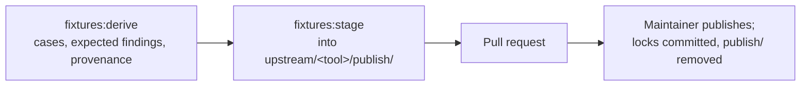
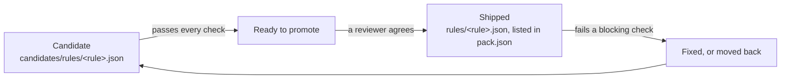

# Porting a tool's rules into a pack

This guide is for anyone adding a linter's rules to Rerail, and for the coding agent working with them. It covers the
three kinds of contribution, each with its own steps:

| You want to | Section | What you write |
| --- | --- | --- |
| Port one more rule of a tool a pack already ports ("port Ruff's F841") | [One rule into an existing tool-pack](#one-rule-into-an-existing-tool-pack) | One document and four entries |
| Port a tool a pack does not have yet (Bandit into the Python pack was one) | [A new tool-pack](#a-new-tool-pack) | A generator, the upstream manifest, licence records, the first data, then its rules |
| Start a pack for a language or framework Rerail has no pack for | [A new pack](#a-new-pack) | The pack skeleton, then a tool-pack inside it |

Every path ends the same way: each rule is a candidate, the **Conformance** comment on the pull request judges it,
and when it passes every check a reviewer promotes it ([How a port moves](#how-a-port-moves)).

The reference documents are not repeated here. Read them as you need them:

| Document | What it defines |
| --- | --- |
| [pack-format.md](pack-format.md) | The pack layout, `pack.json`, `conformance.json`, pack data, provenance records, and the validation contract (checks 1 to 8) |
| [conformance/README.md](../conformance/README.md) | The conformance check: its per-rule checks, the pull request comment, divergences, candidates and promotion |
| [CONTRIBUTING.md, "Pack test data"](../CONTRIBUTING.md#pack-test-data) | Getting the data, how it is published, adding or changing a pack, the maintainers' steps |
| [language-packs.md, "Start a pack"](language-packs.md#start-a-pack) | A new pack's skeleton, and what a ported pack adds |
| [upstream.md](upstream.md) | Upstream snapshots, the generators, samples and their licences, the publish workflow, bumps |
| [writing-rules.md](writing-rules.md), [code-rule DSL reference](code-rule-dsl-reference.html) | How a rule document is written |
| [publishing-a-new-pack.md](publishing-a-new-pack.md) | A new pack's first publish to npm (maintainers) |

In commands and paths below, `<id>` is the pack (`packs/<id>/`), `<tool>` the upstream tool, and `<rule>` the Rerail
rule id (`ruff-f401-unused-import`); "upstream rule" is the tool's own name for it (`F401`).

## Who does what

Pack test data (the tool's tests and the findings the pinned tool reported on them) is not in git. Reading it needs
credentials a maintainer grants, writing it is a publish a maintainer dispatches, and a fork's pull request runs no
CI ([How contribution works](../CONTRIBUTING.md#how-contribution-works)). So the work splits:

| Step | Who |
| --- | --- |
| Write the rule documents, their port entries, their `gates.yaml` entries and README sections; name their upstream tests | Contributor |
| Write a new tool-pack's generator, upstream manifest and licence records; a new pack's skeleton | Contributor |
| Derive the data (it runs upstream's code, in a sandbox), stage it, dispatch and approve the publish | Maintainer |
| Read the Conformance comment; fix the rules, declare checked divergences, add clean samples | Contributor |
| Promote a candidate that passes every check | Contributor proposes, a reviewer decides |
| Merge; a new pack's first publish to npm | Maintainer |

A contributor with a branch here has the data and CI, and the Conformance comment answers on every push. From a fork,
the pull request is judged after a maintainer ports it onto a branch here and publishes its data. Until then, write
the rules against the tool's own tests in upstream's repository, and say in the pull request which cases you checked
and how.

## Before you start

1. **Check the tool's licence.** The tool, and every test file a port copies, must be under a licence on
   `scripts/check/licence-allowlist.json`. Tests under a copyleft licence are not copied: the pack's
   `licenses/<project>/UPSTREAM.md` lists them under `Not copied`, and their rules cannot be ported with upstream's
   tests ([Third-party material](../CONTRIBUTING.md#third-party-material)).

2. **Pull the pack test data, if you can.** Without it every pack test and the conformance check fail, and nothing
   you ran locally proves anything.

   ```sh
   aws sso login            # or any credentials with read access to the bucket; ask a maintainer
   npm run fixtures:pull    # -- --pack <id> for one pack
   ```

   Archives cache in `.rerail/pack-data/archives/`; copy that directory into a fresh worktree to skip the download. A
   fresh worktree also needs `npm ci` and `npm run build:native` before the pack tests run
   ([Getting the data](../CONTRIBUTING.md#getting-the-data)).

3. **Check for another open pull request on the same pack.** Two pull requests that both change a pack's `pack.json`,
   `README.md` or the native anchors pin (see [Promoting a candidate](#promoting-a-candidate)) conflict. Land the
   smaller one first, then merge `main` into the other.

## One rule into an existing tool-pack

The model to copy is any document of the same tool in `packs/<id>/rules/`. No changeset: a candidate changes nothing
the pack publishes.

1. **Check the rule can be ported.** In `packs/<id>/upstream/<tool>/gates.yaml`, under `rules`: the upstream rule has
   an entry, or you add one (step 5); it is not `deprecated`. In `packs/<id>/licenses/<project>/UPSTREAM.md`, its
   upstream tests are under no `Not copied` prefix. In `packs/<id>/candidates/README.md`, nobody has already ported
   it and recorded why it waits.

2. **Write the document** at `packs/<id>/candidates/rules/<rule>.json`:
   - `format` is `rerail.policy/v1`; `id` is `<rule>`, `<tool>-<upstream rule>` in lowercase, and the file is named for
     it ([rule ids](pack-format.md#packjson)).
   - Each violation's `code` is the upstream rule's code, and each carries the tool's suppression key (`noqa.codes`,
     `eslint.rules`, …: the table under [check 4](pack-format.md#the-validation-contract)), so the tool's own
     suppression comment silences it.
   - `description` is one sentence, under 200 characters, no backticks, naming no tool
     ([description](pack-format.md#description)); `message` follows the [message criteria](pack-format.md#message).
   - Match the construct, not the tests: a rule that matches the test files' names or literals fails
     `holds-under-rename` where variants exist, and the real-code samples everywhere.

3. **Add the port entry** to `packs/<id>/conformance.json` `rules[]`: `id`, `upstream: { tool, rule }`,
   `policy: "candidates/rules/<rule>.json"`, `match` (`line` or `line+column`, as the tool-pack's other ports), and the
   `capabilities` it exercises ([schema](pack-format.md#conformancejson-divergencesjson-upstream)). If the tool's tests
   never exercise the rule at the pin, add an `examples` pair here (check 3 runs it; it moves to `pack.json` at
   promotion).

4. **Name the rule's upstream tests.** The generator records the tool's findings only for the rules it selects, and
   only on the tests it is told to read; a rule it does not know has no expected findings, and the conformance check
   reports a scoring error for its port. Where the tests are named is what `gates.yaml` `watch.tests` says: a
   hand-kept list beside the generator (`fixtures.json`: `{ "rules": { "<upstream rule>": ["<upstream path>", …] } }`,
   for Ruff, Bandit, PHPStan and Clippy), or a path convention (`test/{rule}.js`, the ESLint-family tools), where the
   generator finds the test from the port entry alone. For Ruff and Bandit, also add the rule's suppression case to the
   generator's table (`NOQA`, `NOSEC`): the generator refuses to derive while a shipped rule has none, and CI does not
   catch a missing case.

5. **Add the `gates.yaml` entry**, when the rule has none: `deprecated` (upstream's message, or `null`) and
   `recommended` (the first approved configuration that turns it on, with the option values that configuration uses,
   or `null`). No entry means the rule fails `upstream-rule` and can never start on. Take the values from upstream's
   rule table and default settings at the pinned release, and say how in the pull request
   ([Declared upstream facts](../conformance/README.md#declared-upstream-facts-gatesyaml)).

6. **Add the README section**: `### \`<rule>\`` under `## Rule details` in `packs/<id>/candidates/README.md`: what the
   rule matches beyond its description, its settings, and what it waits on. A heading there names only rules
   `pack.json` does not list (check 5).

Then open the pull request. A maintainer derives the data from the pins in a sandbox, stages it and publishes
([For maintainers](#for-maintainers-publishing-and-merging)); the Conformance comment on the published commit is the
rule's first verdict ([Reading the Conformance comment](#reading-the-conformance-comment)).

## A new tool-pack

A tool-pack is one upstream tool inside a pack: `packs/<id>/upstream/<tool>/`, with its own data, manifest and
licence record. The files are listed in [language-packs.md, "A ported pack"](language-packs.md#a-ported-pack); the
models to copy are `packs/python/upstream/ruff/` (a Python generator) and `packs/javascript/upstream/` (the
ESLint-family generators, which share `scripts/pack-data/eslint-expected.mjs`).

### What to write

1. **The licence record**, `packs/<id>/licenses/<project>/`: the upstream licence verbatim, and `UPSTREAM.md` with its
   `License:` SPDX expression, the `Source` row (repository, tag, 40-hex commit, licence), the `Taken from it` globs
   (each pack-relative glob of copied files, its upstream path, how it was copied) and a `Not copied` line for every
   part of the repository under a licence the allowlist refuses ([UPSTREAM.md](pack-format.md#upstreammd)). Add the
   tool's licence to `package.json`'s `license` (`Apache-2.0 AND MIT` for an MIT tool) and annotate the rule documents
   in `REUSE.toml` with the same expression.

2. **The upstream manifest**, `upstream/<tool>/gates.yaml`
   ([schema](../conformance/README.md#declared-upstream-facts-gatesyaml)): `upstream` (`repository`, `commit`,
   `version`, `license`, `runtime`, `recommended_configs` in order, `lints`), the `watch` block the nightly upstream
   report reads (which tests, which code, which shared code; `{ file: fixtures.json }` when the generator keeps a
   list), and `rules`: one entry per upstream rule the pack ports or may port, with its `deprecated` and `recommended`
   facts. Copy a sibling's header comments: they say where each value was read.

3. **The generator**, `upstream/<tool>/generate.*`, and its recipe in `scripts/pack-data/recipes/<id>.ts` (one module
   per pack, listed in `index.ts`). The recipe installs the runtime `gates.yaml` names from
   `scripts/pack-data/runtimes/` (every direct dependency at an exact version; a Python runtime pins its interpreter
   in `.python-version`) and checks out upstream at the pinned commit; the generator refuses any other version or
   commit. It then
   ([What the generators write](upstream.md#what-the-generators-write)):
   - copies the tool's tests for each ported rule into `fixtures/`, keeping their upstream paths;
   - runs the pinned tool on them with every ported rule selected, under upstream's recommended configuration, and
     writes `fixtures.expected.json` (`expectedFindingsSchema` in `conformance/languages/pack.ts`), with each unit's
     upstream origin in `source.units`, so the unit counts as the rule's own for `stays-silent`;
   - writes Rerail's own cases (suppression cases, probes) into `fixtures/rerail/` and lists them in the tool's
     `upstream/<tool>/UPSTREAM.md`, one row each: they are authored data, which nothing regenerates;
   - writes the provenance last, through the shared writer (`writeProvenance`, or `write_provenance` from Python):
     `provenance.json` and `LICENSES.md`, from the licence record. The derive fails when a file disagrees with the
     record: a file with no entry, one outside its `Taken from it` globs, a glob matching nothing.

4. **`conformance.json`**: the tool in `tools[]` (`name`, `version` equal to `gates.yaml`'s), the engine capabilities
   the ports exercise (every declared capability needs a port or an `exemptCapabilities` entry with evidence), and the
   port entries. **`divergences.json`** starts as `[]`.

5. **Real-code samples**, optional but what `stays-silent` usually needs: whole files from repositories in
   `scripts/samples/licences.ts`, labelled per rule, built with the sample builders and published like test data
   (`samples.lock`, `SAMPLES.md`; [Samples](upstream.md#samples)). A new source repository needs its licence read at
   the samples' commits and an entry in the same pull request ([Sample licences](upstream.md#sample-licences)).

6. **The rules**, each as [One rule into an existing tool-pack](#one-rule-into-an-existing-tool-pack) describes, all
   as candidates.

### The first data

The data is of two kinds, neither in git ([Pack data](pack-format.md#pack-data)): **derived** (the tool's tests and
the findings on them, remade from the pins by `npm run fixtures:derive`) and **authored** (the cases Rerail wrote,
listed in the tool's `UPSTREAM.md`). A new tool-pack's first data goes in like any other:



```sh
npm run fixtures:derive -- --pack <id> --tool <tool>          # in a sandbox, on the pinned runtime
npm run fixtures:stage -- --pack <id> --tool <tool> --all    # the whole set: a first publish is a `replace`
git add packs/<id>/upstream/<tool>/publish
```

- The derive runs upstream's code, so it runs in a sandbox with no AWS or GitHub credentials
  ([Derive in a sandbox](upstream.md#derive-in-a-sandbox)). It stops before running if any authored file the tool's
  `UPSTREAM.md` lists is missing on disk.
- Staging reads the locked archive to say what a publish would drop, so it needs the AWS CLI even with `--all`. While
  `publish/` is tracked, structure metric #3 fails by design; every path in its failures must be a `publish/` path.
- A file the archive holds is in no diff. Renaming or merging an authored case waits for the next derive and a
  `replace` publish.
- Every file under the tool's test directories is authored or under a `Taken from it` glob, and every glob matches a
  file (check 6).
- Rules the pack already ships are judged on the new data too. Run the pack's conformance check on the derived data
  before asking for the publish; a shipped rule that fails on a file you add is fixed, given a checked divergence, or
  moved back to candidates in the same pull request.

Then run the contract and the gate on one rule, and on the pack:

```sh
npm run conformance:languages -- --pack <id> --rule <rule> --fixtures   # every false positive and miss of one port
npx vitest run test/engine/catalog/packs.test.ts -t "pack <id>"
npm run conformance:languages -- --check --pack <id>
```

### A port of many rules

A port that takes weeks outlives `main`, which ships rules of the same pack meanwhile. Merge `main` in; expect
conflicts in the pack's shared files, and resolve each as data:

| File | How to resolve |
| --- | --- |
| `pack.json` | From the index stages (`git show :1:`, `:2:`, `:3:`), never as text: the branch's rules, plus `main`'s new ones after their group; `main`'s version of an entry only `main` changed |
| `README.md`, `candidates/README.md` | Rebuild both from the two sides' stages. Each `### \`<rule>\`` goes to the file the merged `pack.json` puts it in. For a section both sides changed, the merge base says which side changed it. Check 5 validates |
| `fixtures.json` | The merged list is a superset of `main`'s, with identical shared entries |
| `licenses/<project>/UPSTREAM.md` | `main`'s record, with globs that cover the branch's new files and a `Not copied` line for what the branch leaves out |
| Code `main` deleted | Take the deletions, then check that no branch-added file under a deleted directory survives |
| The anchors pin | Last, by running the test |

- Never resolve a conflict in rule or README text with a JavaScript `String.replace(x, string)`: `` $` `` and `$'` in
  the text expand. Slice, or pass a function.
- **A pull request with conflicts gets no CI.** `ci.yml` runs on `pull_request`, which GitHub skips when it cannot
  build the merge commit. Check before waiting on a comment, and merge `main` first:

  ```sh
  gh pr view <n> --json mergeStateStatus    # DIRTY means conflicts
  ```

- After the merge: `npm ci` if `package-lock.json` changed; add a suppression case for each rule `main` shipped since
  the last derive; re-derive, and check that `fixtures.expected.json` differs from the staged one only by the new
  cases' findings.

## A new pack

A pack is a directory `packs/<id>/` that passes the validation contract and is published as its own npm package,
`@neralabs/rerail-pack-<id>`. The skeleton, with a complete example, is
[language-packs.md, "A pack for a supported language"](language-packs.md#a-pack-for-a-supported-language); a pack for
a language core does not read yet lands the same way, with its rules skipped as `not supported yet`
(["A pack for a planned language"](language-packs.md#a-pack-for-a-planned-language)). The models to copy are
`packs/python/` (a ported language pack) and `packs/node/` (a framework pack over a supported language).

1. **The skeleton**: `package.json` (`name`, `license`, `files`, `repository` with the pack's `directory`,
   `peerDependencies` on core's range, `publishConfig.access: "public"`), `pack.json` (`id`, `name`, `category`,
   `covers`, `reason`, `match`, `rules: []` to start), `README.md`, `LICENSE`, `NOTICE`
   ([Layout](pack-format.md#layout)). `match` is what set-up recommends the pack by: the files or dependencies that
   identify the project (check 7).

2. **Register it.** `packs/*` are npm workspaces, and core lists the packs by name:

   ```sh
   npm install --package-lock-only --ignore-scripts   # package-lock.json lists each workspace
   npm run generate:packs                             # src/engine/catalog/pack-list.generated.ts (check 7)
   ```

3. **A changeset** for the new pack, `patch`, "Add the <name> pack: …"; its first release is `0.1.1`
   ([versioning](pack-format.md#versioning-and-release)). Every later change to what the pack publishes adds one too.

4. **The tool-pack**, as [A new tool-pack](#a-new-tool-pack) describes, with every port a candidate. A pack may ship
   no rules (`"rules": []`) while all its ports are candidates; such a pack is never recommended.

5. **The repository's own lists**: the pack tables in [rule-packs.md, "The packs"](rule-packs.md#the-packs) and the
   root README's "Rule packs" section, `packs/README.md`'s list, and `docs/pack-format.md`'s first paragraph, which
   names every pack. Grep for a sibling pack's id to find them all.

Then run the contract:

```sh
npx vitest run test/engine/catalog/packs.test.ts -t "pack <id>"
```

The pack's first publish to npm is done by hand once, by a maintainer, after the pull request merges and the Release
packs run asks for it ([publishing-a-new-pack.md](publishing-a-new-pack.md)). Every version after that is published by
the release workflow.

## How a port moves



**Candidate.** The document is under `candidates/`, the port entry's `policy` names it, `pack.json` does not list it.
Every check scores and judges it, the Conformance comment reports it, and it never blocks CI and never ships
([Candidates and promotion](../conformance/README.md#candidates-and-promotion)).

**Ready to promote.** The candidate passes every check. Necessary, not sufficient: a reviewer reads the evidence and
decides ([Who decides what ships](#who-decides-what-ships)).

**Shipped.** The document is under `rules/` and `pack.json` lists it. It starts on when `upstream-status` holds (the
pinned release has the rule, it is not deprecated, an approved configuration turns it on); otherwise it ships with
`"on": false`. From now on a failing blocking check fails CI on every pull request, including one that only adds test
data.

**Moved back.** A shipped rule that fails is fixed in the same pull request, or returned to `candidates/`
([Moving a shipped rule back](#moving-a-shipped-rule-back)).

## Reading the Conformance comment

CI keeps one **Conformance** comment on a same-repository pull request
([The pull request comment](../conformance/README.md#the-pull-request-comment)).

- A rule's verdict is the first blocking gate it fails. Work a candidate down the **Candidates** section one gate at a
  time.
- The run's `conformance-summary` artifact has every detail: `gates.json` per check, and `summary.json`, whose
  `promotable` list is the list to promote from.

  ```sh
  gh run download <run id> -n conformance-summary
  ```

- Locally, with the data pulled, the same judgement and the detail of one rule:

  ```sh
  npm run conformance:languages -- --check --pack <id>
  npm run conformance:languages -- --pack <id> --rule <rule>     # every false positive and miss
  npm run conformance:languages -- --pack <id> --rule <rule> --samples   # the samples too
  ```

Read the pack's own scoring errors first (an engine failure, a finding on a clean sample, a stale divergence, a test
data error): a rule cannot pass on a pack that does not score. Then, per check:

| Check | It needs | What to do |
| --- | --- | --- |
| `loads` / `in-scope` | The scope covers every file type in `gates.yaml` `upstream.lints` | Widen the scope, or set the port's `lints` when the rule covers fewer types by design |
| `compact` | A document under 15 KiB, or one that states the logic | Replace listed cases with the construct they share |
| `no-unexplained-false-positives`, `no-unexplained-misses` | Agreement with the tool on its tests and Rerail's probes | Fix the rule. Declare a divergence in `divergences.json` only after checking the tool's own answer on that line, with the evidence in the entry ([Divergences](../conformance/README.md#divergences)) |
| `catches-something` | A true positive on the fixtures, or `examples` in `pack.json` | Give the rule a true positive: a test of the tool it should report, or an authored case the tool confirms. A candidate's pair on its port entry serves check 3, not this check; it counts once the rule ships |
| `holds-under-rename` | Agreement on the rename variants (ECMA tool-packs) | The rule matched names or literals: match the construct. A pass "without evidence" is reported; say in the pull request what other evidence stands in |
| `samples-catch-labelled`, `samples-silent-on-clean` | Agreement with the labelled lines of the real-code samples | Fix the rule, or declare a `"source": "samples"` divergence after checking the label ([How samples are judged](../conformance/README.md#how-samples-are-judged)) |
| `stays-silent` | One of the rule's own upstream units where the tool reports nothing, or one clean sample the rule is silent on | When every upstream test for the rule has findings, add a clean real-code sample labelled for it ([Samples](upstream.md#samples)). Other rules' units and Rerail's probes do not count |
| `divergences-current` | Every declared divergence still explains a disagreement | A fix that makes the rule agree removes its divergence in the same pull request |
| `upstream-status` (never blocks) | The `gates.yaml` entry: present, not deprecated, `recommended` | Add or correct the entry. The **On or off** section lists shipped rules whose `pack.json` `on` disagrees |

## Promoting a candidate

The steps are [Candidates and promotion](../conformance/README.md#candidates-and-promotion). This is the checklist.
Promote from the judged commit's `summary.json` `promotable` list, and confirm `main` has not moved since.

1. **Move the document, never regenerate it.**

   ```sh
   git mv packs/<id>/candidates/rules/<rule>.json packs/<id>/rules/<rule>.json
   ```

   For a pack whose documents a generator writes (`scripts/generate/README.md` lists them), change the generator's
   candidate flag, regenerate, and check that the diff is the move alone. If the generator rewrites something the
   committed document carries, move by hand.

2. **`conformance.json`.** Point the port's `policy` at `rules/<rule>.json`. Move its `examples` pair to the
   `pack.json` entry; the schema refuses it on a shipped port.

3. **`pack.json`.** Add `id`, `document`, `title`, `group`. Add `"on": false` when the comment's **Starts** column
   says off. Add `"mode": "log"` only when upstream's recommended configuration warns rather than errors
   ([pack.json](pack-format.md#packjson)). Keep the pack's order: sorted packs stay sorted, grouped packs take the rule
   after its group. The title follows the pack's pattern, `<Tool> <upstream rule>: <upstream's one-line description>`,
   taken from upstream's rule metadata at the pinned version.

4. **README sections.** Move the rule's `### \`<rule>\`` section from `candidates/README.md` to `README.md` and drop its
   "waits on" sentence. Check 5 fails a heading that names a rule on the wrong side.

5. **Hand-kept text.** Recount from the data, not by hand: the README's opening counts, the candidates README's
   opening paragraph, any divergence claim against `divergences.json`, the pack tables in [rule-packs.md](rule-packs.md)
   and the root README.

6. **Code that names the old path.**

   ```sh
   git grep -F candidates/rules/<rule>.json    # a native include_str!, a test that builds the path
   ```

7. **The native anchors pin.** `native/src/code_rule_dsl/matcher/anchors/tests.rs` pins the number of `ast` queries in
   the shipped documents (`"pinned catalog query inventory"`). Any move between `rules/` and `candidates/` changes it.
   Do this last:

   ```sh
   cargo test --manifest-path Cargo.toml -p rerail-engine anchors::tests    # pin the `left` value the failure prints
   ```

8. **A changeset per pack**, `patch` while the pack is below 1.0.0 ([.changeset/README.md](../.changeset/README.md)).

9. **The suppression case**, for the tools whose generator demands one, if the candidate has none.

10. **Evidence in the pull request.** The rule's results against the tool's expected findings, its rename variants and
    samples, every divergence checked, and each check listed under **Passing without evidence** with what stands in
    for it ([REVIEW.md](../REVIEW.md#what-blocks-a-merge-here)).

## Moving a shipped rule back

For a shipped rule that fails a blocking check and is not fixed in the same pull request:

1. `git mv packs/<id>/rules/<rule>.json packs/<id>/candidates/rules/<rule>.json`.
2. In `conformance.json`, point the port's `policy` back. The port entry stays: candidates are scored, not gated.
3. Remove the `pack.json` entry. Its `examples` pair, if any, moves back to the port entry.
4. Move the `### \`<rule>\`` section from `README.md` to `candidates/README.md`, at its sorted place, and add one
   sentence saying what sent it back, with the file and line.
5. Recount the README's opening (the rule count; the off count if the rule was off) and the candidates row.
6. A test that loads the rule by id reads `rules/` only: pass the pack's `candidates/` directory too
   (`test/engine/code-rule/pack-rules/python-harmful-steers.test.ts` does).
7. Re-pin the anchors test (step 7 above).
8. The changeset states the net effect against `main`: what ships, what went back. `main`'s changeset for the
   promotion stays.

No re-derive: the generator's authored output does not depend on which rules ship.

## Before you open the pull request

With the data pulled (and the derived data in `publish/`, for a new tool-pack):

```sh
npx vitest run test/engine/catalog/packs.test.ts -t "pack <id>"   # checks 1 to 8, each rule's status
npm run conformance:languages -- --check --pack <id>
npm run check              # metric #3 is red by design while publish/ is tracked; the chain stops there, so also:
npm run check:windows-paths && npm run check:internal-refs && npm run check:pins
npm run check:native       # a shorter rules/ path in an include_str! needs cargo fmt
cargo test --manifest-path Cargo.toml -p rerail-engine anchors::tests
```

Then grep for stale counts (table rows included) and for moved rule details that still say "candidate".

In the pull request body:

- which rules the port covers and which it leaves out, with the reason for each omission;
- for a new tool-pack: the licence record checked against the repository (the `Source` commit and licence, each glob
  against what the generator copies, a `Not copied` line for every part under another licence);
- without the data: which of the tool's own tests you checked the rules against, and how;
- the evidence a promotion needs ([Promoting a candidate](#promoting-a-candidate), step 10);
- which of the checks above ran locally, and which CI must judge.

## For maintainers: publishing and merging

The steps are [Merging (maintainers)](../CONTRIBUTING.md#merging-maintainers) and
[Approving a data upload](../CONTRIBUTING.md#approving-a-data-upload-code-owners).

1. **A one-rule pull request needs its data derived.** The contributor's document, port entry, `fixtures.json` line
   and suppression case are in the pull request; the expected findings are not. In a sandbox, on the pull request's
   branch (or, from a fork, on the branch you port it to):

   ```sh
   npm run fixtures:derive -- --pack <id> --tool <tool>
   npm run fixtures:stage -- --pack <id> --tool <tool>     # the new cases and the changed expected findings
   ```

   Commit `publish/` to the branch, then publish as below. The Conformance comment on the published commit is what the
   contributor works from. A new tool-pack's pull request stages its whole set itself; review its generator and
   recipe, then derive it again in a sandbox before publishing ([Derive in a sandbox](upstream.md#derive-in-a-sandbox)).

2. **Dispatch after the head is final.** Prep packs whatever head the pull request has when it runs.

   ```sh
   gh pr view <n> --json headRefOid                 # the pushed commit
   gh workflow run pack-data-publish.yml -R neralabs/rerail -f pr=<n> [-f replace=true]
   ```

3. **Choose `replace` or overlay by what `publish/` holds**, not by what changed:

   | `publish/` holds | Choose | Prep's summary when it is wrong |
   | --- | --- | --- |
   | The tool-pack's whole set: a first publish or a regeneration staged with `--all`, with `provenance.json` and `LICENSES.md`, about as many files as `test-data.lock` counts; or files must leave the archive | `replace` | Overlay lists no drops where the regeneration deleted files |
   | Only what is new: a one-rule derive, samples beside the locked ones, a few new cases | overlay (default) | `replace` lists every earlier file as dropped |

   Read the drop list against the intent before approving. On a `replace`, every drop is something the regeneration
   meant to remove.

4. **Approve.** Nothing reaches S3 before the approval, and no CI job derives the data again. The approver reads
   prep's summary against the pull request ([REVIEW.md](../REVIEW.md#approving-a-pack-data-upload)).

5. **If the finish step fails after the upload** ("Pack data published: action needed"): every object is in S3 and
   confirmed. Commit by hand what the comment carries: each lock verbatim, `git rm -r` each tool-pack's `publish/`,
   the `SAMPLES.md` lock lines; push without force. Re-running the publish also works (puts are create-only) but costs
   another approval.

6. **Merge when CI is green on the finish commit**, with `publish/` gone and the Conformance comment showing no
   blocking failure. Two notes:
   - An overlay never restages `LICENSES.md`, so a samples archive's keeps listing the earlier samples until a
     `replace` repack. Note it in the pull request; do not hand-edit it.
   - A move of unchanged documents between `rules/` and `candidates/` changes no verdict, so an earlier run's
     comment stands for it. Name the run.

7. **A new pack's first npm publish** is by hand, once, when the Release packs run on `main` fails at
   **First publish needed** ([publishing-a-new-pack.md](publishing-a-new-pack.md)).

## Who decides what ships

A candidate ships when it passes every check and a reviewer agrees that its evidence is enough: the results against
the tool's expected findings, the rename variants and samples, the divergences checked, and anything passing without
evidence accounted for ([REVIEW.md](../REVIEW.md#what-blocks-a-merge-here)).

Whether a shipped rule starts on is not a judgement call: `upstream-status` decides from `gates.yaml`'s declared facts,
and a `pack.json` `on` that disagrees is reported.

A rule the reviewer is not sure of stays a candidate. Its section in `candidates/README.md` says what it waits on.
