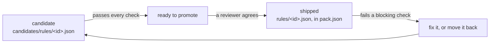
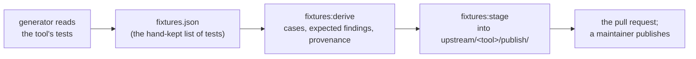

# Porting a tool's rules into a pack

This is the contributor's path for a rule pack port: taking a linter's rules into a pack as candidates, getting them
through the conformance check, shipping them, and keeping them shipped. It puts the references in the order you need
them and adds what the pack pull requests so far needed that no reference says. The references themselves stay where
they are:

- [pack-format.md](pack-format.md): the pack layout, `pack.json`, `conformance.json`, the pack data and provenance
  records, and the validation contract (checks 1 to 8) every pack passes.
- [conformance/README.md](../conformance/README.md): the conformance check, its per-rule checks, the pull request
  comment, divergences, and candidates and promotion.
- [CONTRIBUTING.md, "Pack test data"](../CONTRIBUTING.md#pack-test-data): getting the data, how it is published,
  adding or changing a pack, and the maintainers' steps.
- [language-packs.md, "Start a pack"](language-packs.md#start-a-pack): a new pack's skeleton, and what a ported pack
  adds.
- [upstream.md](upstream.md): snapshots of upstream, the generators, samples and their licences, the publish workflow
  and upstream bumps.
- [writing-rules.md](writing-rules.md) and the [code-rule DSL reference](code-rule-dsl-reference.html): how a rule
  document is written.

How a change reaches the repository is
[CONTRIBUTING.md, "How contribution works"](../CONTRIBUTING.md#how-contribution-works): contributors work on a branch
here with CI; anyone else proposes from a fork, where no CI runs, and a maintainer ports the change. Everything below
applies to both, and a fork's pull request says what was run by hand.

## Before you start

1. **Get the pack test data.** A ported rule is judged on its tool's test cases and on real code, none of which is in
   git. Without the data, every per-rule pack test and the conformance check fail for that reason alone, and nothing
   you ran proves anything. `aws sso login` (or any credentials with read access to the bucket; ask a maintainer), then
   `npm run fixtures:pull` ([Getting the data](../CONTRIBUTING.md#getting-the-data)). The archives cache in
   `.rerail/pack-data/archives/`, so copying that directory into a fresh worktree saves the second download. A fresh
   worktree also needs `npm ci` and `npm run build:native` before the pack tests run.
2. **Read the tool's licence first.** Only licences on `scripts/check/licence-allowlist.json` are accepted, for the
   tool and for every test file the port copies; a tool whose tests carry copyleft material is ported without those
   tests (`Not copied` lines), or not at all ([Third-party material](../CONTRIBUTING.md#third-party-material),
   [REVIEW.md](../REVIEW.md#what-blocks-a-merge-here)).
3. **One pack, one pull request at a time.** Two open pull requests that touch one pack's `pack.json`, `README.md` or
   the native anchors pin (below) conflict with each other: land the smaller one first, then merge `main` into the
   other.

## The life of a port

A port starts as a **candidate**: its document under `candidates/rules/<id>.json`, a port entry in `conformance.json`
whose `policy` names that document, and no entry in `pack.json`. Candidates are scored and judged by every check and
reported in the pull request's **Conformance** comment, but never block CI and never ship
([Candidates and promotion](../conformance/README.md#candidates-and-promotion)).

A candidate that passes every check is **ready to promote**. That is necessary, not sufficient: a reviewer still reads
the evidence ([REVIEW.md, "Unevaluated rules shipped"](../REVIEW.md#what-blocks-a-merge-here)) and decides. Promotion
moves the document to `rules/` and lists it in `pack.json` ([Promoting a candidate](#promoting-a-candidate)).

A **shipped** rule starts on or off as upstream's facts say: `upstream-status` holds (the tool's pinned release has the
rule, it is not deprecated, and an approved configuration turns it on) and it starts on; otherwise it ships
`"on": false`, as experimental. Once shipped, the rule blocks CI on any failing check, on every pull request, including
one that adds test data it has never seen. It is then fixed in that pull request, or moved back to candidates
([Moving a rule back](#moving-a-rule-back-to-candidates)).

## What a port adds to the pack

The layout is [pack-format.md, "Layout"](pack-format.md#layout); a ported pack's extra files are
[language-packs.md, "A ported pack"](language-packs.md#a-ported-pack). Per ported rule, these are the pieces:

| Piece | Where | What to know |
| --- | --- | --- |
| The rule document | `candidates/rules/<id>.json`, later `rules/<id>.json` | `rerail.policy/v1`; its `id` is the file name and the same string everywhere, `<tool>-<rule>` in lowercase ([rule ids](pack-format.md#packjson)). Each violation reports the upstream rule's code and carries the tool's suppression key (`noqa.codes`, `eslint.rules`, …; the table in [check 4](pack-format.md#the-validation-contract)). Its `description` meets the [description criteria](pack-format.md#description), which check 8 enforces in part. |
| The port entry | `conformance.json` `rules[]` | `id`, `upstream: { tool, rule }`, `policy`, `match` (`line` or `line+column`) and the `capabilities` it exercises ([schema](pack-format.md#conformancejson-divergencesjson-upstream)). A candidate's `examples` pair lives here until it ships, then moves to its `pack.json` entry. |
| The upstream facts | `upstream/<tool>/gates.yaml` `rules` | One entry per upstream rule the pack ports: `deprecated` (upstream's message, or `null`) and `recommended` (the first approved configuration that turns it on, with the option values that configuration uses, or `null`). A rule with no entry fails `upstream-rule`, so it can never start on. Derive the entries from upstream's own rule table and default settings at the pinned release, never from memory, and say in the pull request how ([Declared upstream facts](../conformance/README.md#declared-upstream-facts-gatesyaml)). |
| The provenance | `licenses/<project>/UPSTREAM.md`; `upstream/<tool>/UPSTREAM.md` | Per upstream repository, the licence, `Source` row, `Taken from it` globs and `Not copied` lines; per tool, one row for each case Rerail wrote for it ([UPSTREAM.md](pack-format.md#upstreammd)). Check 6 and the publish classify every data file by these records. |
| Divergences | `divergences.json` | One entry per line where the rule and the tool disagree on purpose, with its kind and the evidence checked ([Divergences](../conformance/README.md#divergences)). Start empty; a divergence you have not checked is a bug you have hidden. |
| The suppression case | The generator's table of cases (Ruff's `NOQA`, Bandit's `NOSEC`) | For the tools whose generator refuses to derive while a shipped rule has no case where the tool's suppression comment is honoured. Add the case with the port, shipped or candidate: CI does not catch a missing one, the next derive does. |
| The rule's section | `candidates/README.md`, later the pack's `README.md` | `### \`<id>\`` under `## Rule details`: what the rule matches beyond its description, its settings, and, while it is a candidate, what it waits on. Every heading there names rules in backticks, each one the file's side of the line (check 5). |
| A changeset | `.changeset/*.md` | Only when the pull request changes what the pack publishes (`rules/`, `pack.json`, `README.md`, …): a candidate alone needs none ([.changeset/README.md](../.changeset/README.md)). |

A rule option that upstream tests with several settings is several documents, one per setting, each scored on the
tests its setting ran through the port's `fixtures` globs
([conformance.json](pack-format.md#conformancejson-divergencesjson-upstream)).

## Reading the Conformance comment

CI keeps one **Conformance** comment on a same-repository pull request
([The pull request comment](../conformance/README.md#the-pull-request-comment)). Each rule's verdict is the first
blocking gate it fails, so work a candidate down the comment's **Candidates** section one gate at a time; the
`conformance-summary` artifact of the run (`gh run download <run id> -n conformance-summary`) has every check's detail
in `gates.json`, and `summary.json`'s `promotable` list is the list to promote from. Locally, the same judgement is
`npm run conformance:languages -- --check --pack <id>`, and every false positive and miss of one rule is
`npm run conformance:languages -- --pack <id> --rule <id>` (`--samples` adds the samples).

| The check says | It needs | What to do |
| --- | --- | --- |
| `loads` fails `in-scope` | The scope covers every file type `gates.yaml`'s `upstream.lints` names | Widen the scope, or set the port's `lints` when the rule covers fewer types by design |
| `compact` fails | A document under 15 KiB, or one that expresses the logic | Replace listed cases with the construct they share |
| `no-unexplained-false-positives`, `no-unexplained-misses` | Agreement with the tool's expected findings on its tests and Rerail's probes | Fix the rule. Declare a divergence only after checking the tool's own answer on that line, with the evidence in the entry |
| `catches-something` | A true positive on the fixtures, or an `examples` pair in `pack.json` | Get the rule a true positive: a case of the tool's tests it should report, or an authored case the tool confirms. The check reads `pack.json` only, so a candidate's pair on its port entry proves the rule to check 3 but does not pass this check; it counts once the rule ships |
| `holds-under-rename` | Agreement on the rename variants (ECMA tool-packs) | A failure means the rule matched the test's names or literals: match the construct. A pass "without evidence" (every finding renamed away) is reported; say in the pull request what other evidence stands in |
| `samples-catch-labelled`, `samples-silent-on-clean` | Agreement with the labelled lines of the real-code samples | Fix the rule, or a divergence with `"source": "samples"` after checking the label is right ([How samples are judged](../conformance/README.md#how-samples-are-judged)) |
| `stays-silent` | One of the rule's own upstream units where the tool reports nothing, or one clean sample the rule is silent on | When the tool's tests for the rule all have findings (common), add a clean real-code sample labelled for the rule ([Samples](upstream.md#samples)). Other rules' units and Rerail's probes do not count |
| `divergences-current` | Every declared divergence still explains a disagreement | A fix that makes the rule agree removes its divergence in the same pull request |
| `upstream-status` (never blocks) | The `gates.yaml` entry: present, not deprecated, `recommended` | Add or correct the entry. The comment's **On or off** section lists shipped rules whose `pack.json` `on` disagrees with it |

Besides the rules, the job fails on a pack's own scoring errors: an engine failure, a finding on a clean sample, a
stale divergence, a test data error. Read those first; a rule cannot pass on a pack that does not score.

## Test data for a new port

A port is judged on data that is not in git ([Pack data](pack-format.md#pack-data)): the tool's test cases copied by
the generator and the expected findings the pinned tool reported on them (**derived**, remade from the pins by
`npm run fixtures:derive`), and the cases Rerail wrote for the tool to score (**authored**: the suppression cases,
the probes a review pinned, a corpus with its ground truth), which nothing can regenerate and the tool's `UPSTREAM.md`
lists one per row. A new port needs its tests in the data and the tool's findings on them, so it ends in a publish:

1. **The generator** (`upstream/<tool>/generate.*`, with the tool-pack's recipe under `scripts/pack-data/recipes/`)
   copies the tool's tests for each ported rule, runs the pinned tool on them and writes `fixtures.expected.json`,
   with each unit's upstream origin in `source.units`, then the provenance through the shared writer
   ([What the generators write](upstream.md#what-the-generators-write)). Which tests it reads per rule is what
   `gates.yaml`'s `watch.tests` names, so the nightly upstream report watches the same files: a path convention
   (`test/{rule}.js`) or a hand-kept list beside the generator (`fixtures.json`,
   `{ "rules": { "<rule>": ["<upstream path>", …] } }`).
2. **Derive** runs upstream's code, so it runs in a sandbox with no AWS or GitHub credentials
   ([Derive in a sandbox](upstream.md#derive-in-a-sandbox)), on the pinned runtime. Before it runs, every authored
   file the tool's `UPSTREAM.md` lists must be on disk, or it stops and asks for a pull: a port pull request carries
   only its own new authored files, so pull the locked archive first. A generator that writes its authored cases from
   its own tables (Ruff's does) can regenerate them instead; a hand-written case needs the pull.
3. **Stage** what changed into `publish/` (`npm run fixtures:stage -- --pack <id> --tool <tool>`; `--all` for the
   whole set, to remove or rename files). Staging reads the locked archive to say what a publish would drop, so it
   needs the AWS CLI even with `--all`. Commit `publish/` and open the pull request; CI judges the data as it would be
   published, and the **Pack data waiting to publish** comment lists it. Structure metric #3 fails by design while
   `publish/` is tracked; read the failures to confirm every path is a `publish/` path, since anything else is real.
4. **A maintainer publishes** ([Maintainers](#maintainers-publishing-and-merging)); the workflow commits the locks and
   removes `publish/`, CI runs again, and the Conformance comment on that head is the verdict.

What this means for the data:

- A file the archive holds is in no diff, and the only way to change it is a new derive. So renaming or merging an
  authored case waits for the next derive and `replace` publish; do not stage a rename over the archive.
- Every file under the tool's test directories must be authored or covered by a `Taken from it` glob, and no glob may
  match nothing (check 6): a new fixture directory needs its glob, and a removed one loses its glob.
- Rules main already ships are judged on the port's larger fixture set too. A shipped rule can fail on a file the port
  adds; run the pack's conformance check on the derived data before asking for the publish, and fix the rule, declare a
  checked divergence, or move it back to candidates in the same pull request.
- The tools whose generator demands suppression cases refuse to derive until every shipped rule has one; main may lack
  cases for rules promoted since the last derive, and the port pull request adds them.

## Promoting a candidate

The steps are [Candidates and promotion](../conformance/README.md#candidates-and-promotion); this is the checklist a
promotion pull request has needed in practice. Promote from the judged commit's `summary.json` `promotable` list, and
confirm `main` has not moved since.

1. **Move the bytes, never regenerate.** `git mv candidates/rules/<id>.json rules/<id>.json`, so the diff is a rename.
   For a pack whose documents a generator writes (`scripts/generate/README.md` lists them), change only the generator's
   candidate flag and check that regenerating gives the move alone; a generator that rewrites what the committed
   document carries (a suppression block another generator added) is a reason to move by hand.
2. **`conformance.json`:** the port's `policy` to `rules/<id>.json`, one match per id; its `examples` pair moves to the
   `pack.json` entry (the schema refuses it on a shipped port).
3. **`pack.json`:** `id`, `document`, `title`, `group`; `"on": false` when the comment's **Starts** column says off;
   `"mode": "log"` only when upstream's recommended configuration warns rather than errors
   ([pack.json](pack-format.md#packjson)). Keep the pack's order (sorted packs stay sorted; grouped ones take the rule
   after its group). Titles follow the pack's pattern, `<Tool> <rule>: <upstream's one-line description>` at the pinned
   version, taken from upstream's rule metadata, not paraphrased.
4. **README details:** move the rule's `### \`<id>\`` section from `candidates/README.md` to the pack's `README.md`
   (check 5: every heading names only listed rules on its side), and take out the "what it waits on" sentence.
5. **Hand-kept text:** the README's opening counts, the candidates README's opening paragraph, any divergence claim
   ("one today") against `divergences.json`, and the pack tables in [rule-packs.md](rule-packs.md) and the root
   README. Recount from the data, not by hand.
6. **Code that names the old path:** `git grep -F candidates/rules/<id>.json` (a native `include_str!`, a test that
   builds the path from segments).
7. **The native anchors pin.** `native/src/code_rule_dsl/matcher/anchors/tests.rs` pins the number of `ast` queries in
   every shipped document (`"pinned catalog query inventory"`), so a move between `rules/` and `candidates/` changes
   it. Run `cargo test --manifest-path Cargo.toml -p rerail-engine anchors::tests` and pin the `left` value the failure
   prints. Do it last, after every move.
8. **A changeset per pack** (`patch` while the pack is below 1.0.0).
9. **The suppression case**, for the tools whose generator demands one (above), if the candidate has none.
10. **Evidence in the pull request:** the rule's results against the tool's expected findings, its rename variants and
    samples, every divergence declared and checked, and every check the comment lists under **Passing without
    evidence**, with what stands in for it ([REVIEW.md](../REVIEW.md#what-blocks-a-merge-here)).

## Moving a rule back to candidates

The inverse, for a shipped rule that fails a blocking check (one sentence in the conformance README, several files in
practice):

- `git mv rules/<id>.json candidates/rules/<id>.json`; the port entry stays, with its `policy` pointed back
  (candidates are scored, not gated); the `pack.json` entry goes, and its `examples` pair, if any, moves back to the
  port.
- Its `### \`<id>\`` section moves from the pack's `README.md` to `candidates/README.md`, at its sorted place, with
  one added sentence saying what sent it back, naming the file and line (`candidates/README.md` is "what each
  candidate is waiting on").
- Recount the README's opening (the rule count, the off count when the rule was off) and the candidates row.
- A test that loads the rule by id reads `rules/` only: pass the pack's `candidates/` directory too
  (`test/engine/code-rule/pack-rules/python-harmful-steers.test.ts` does).
- The anchors pin, and the pack's changeset, which states the net effect against `main` (what ships and what went
  back), since `main`'s own changeset for the promotion stays.
- No re-derive: the generator's authored output does not depend on what ships.

## A port branch that outlives main

A port of many rules takes weeks, and `main` ships rules of the same pack meanwhile. Merge `main` in rather than
rebase, and expect conflicts in the pack's shared files:

- `pack.json`: resolve as data, from the index stages (`git show :1:`, `:2:`, `:3:`), never as text: the branch's
  rules, plus `main`'s new ones after their group, taking `main`'s version of an entry only `main` changed.
- The split READMEs: rebuild `README.md` and `candidates/README.md` from the two sides' index stages, each
  `### \`<id>\`` going to the file whose side of the line the merged `pack.json` puts it; for a section both sides
  changed, the merge base says which side changed it. Check 5 is the validator.
- `fixtures.json`: the merged list is a superset of `main`'s with identical shared entries.
- `licenses/<project>/UPSTREAM.md`: `main`'s record, with globs that cover the branch's new files and a `Not copied`
  line for what the branch leaves out.
- Code `main` retired: take the deletions, then check no branch-added file under a retired directory survives.
- The anchors pin last, by running the test.
- Never resolve a conflict in rule or README text with a JavaScript `String.replace(x, string)`: `` $` `` and `$'` in
  the text expand. Slice, or pass a function.

A pull request with conflicts gets no CI: `ci.yml` runs on `pull_request`, which GitHub skips when it cannot build the
merge commit, so a push to a conflicting branch runs only the `push`-triggered workflows. Check
`gh pr view <n> --json mergeStateStatus` (`DIRTY` means conflicts) before waiting on a comment, and merge `main`
first. After a merge that changed `package-lock.json`, `npm ci` before running anything.

Each rule `main` shipped since the last derive needs its suppression case before the next derive, and the re-derive's
`fixtures.expected.json` should differ from the staged one only by the new cases' findings.

## Before you open the pull request

- `npx vitest run test/engine/catalog/packs.test.ts -t "pack <id>"` (checks 1 to 8 and each rule's status), the pack's
  own test files, and `npm run conformance:languages -- --check --pack <id>`, on the pulled data and the derived data
  in `publish/`.
- `npm run check` (metric #3 is red by design while `publish/` is tracked; the chain stops at the first failure, so run
  `check:windows-paths`, `check:internal-refs` and `check:pins` on their own then) and `npm run check:native`
  (a shorter `rules/` path in an `include_str!` needs `cargo fmt`).
- `cargo test --lib -- code_rule_dsl::matcher::anchors`, for the pin.
- A fresh grep for stale counts, including table rows, and for moved details that still say "candidate".
- In the pull request body: what the port covers and leaves out, with reasons; the evidence a promotion needs; which
  of the above ran locally and which the CI comment must judge (without the data, say so).

## Maintainers: publishing and merging

The steps are [Merging (maintainers)](../CONTRIBUTING.md#merging-maintainers) and
[Approving a data upload](../CONTRIBUTING.md#approving-a-data-upload-code-owners); what has mattered in practice:

- **Dispatch after the head is final.** Prep packs whatever head the pull request has when it runs; check
  `gh pr view <n> --json headRefOid` shows the pushed commit first.
- **`replace` or overlay is decided by what `publish/` holds, not by what changed.** Tick `replace` when `publish/`
  is the tool-pack's whole set (a regeneration staged with `--all`: `provenance.json` and `LICENSES.md` are in it, and
  its file count is about the archive's in `test-data.lock`), or when files must leave the archive. Leave it off when
  `publish/` holds only what is new (samples added beside the locked ones, a few new cases). Either way wrong is
  visible in prep's summary before anyone approves: `replace` over an overlay lists every earlier file as *dropped*;
  an overlay over a regeneration lists no drops where the regeneration deleted files. Read the drop list against the
  intent; on a `replace`, a drop must be something the regeneration meant to remove.
- **The approval is the review of the bytes.** Nothing reaches S3 before it, and no CI job derives the data again
  ([REVIEW.md, "Approving a pack data upload"](../REVIEW.md#approving-a-pack-data-upload)).
- **A finish that fails after a successful upload** ("Pack data published: action needed") has put every object in S3
  and confirmed it; nothing is lost and nothing needs re-running. Commit by hand what the comment carries: each lock
  verbatim, `git rm -r` each tool-pack's `publish/`, the `SAMPLES.md` lock lines, pushed without force. Re-running the
  publish also works (puts are create-only) but costs another approval.
- **An overlay never restages `LICENSES.md`**, so a samples archive's keeps listing the earlier samples until a
  `replace` repack; say so in the pull request rather than hand-edit it.
- **Merge when CI is green on the finish commit**, with `publish/` gone and the Conformance comment showing no blocking
  failure. A move of unchanged documents between `rules/` and `candidates/` changes no verdict, so an earlier run's
  comment stands for it; say which run.

## What ships, and who decides

A candidate ships when it passes every check *and* a reviewer agrees that its evidence is enough: the results against
the tool's expected findings, the rename variants and samples, the divergences checked, and anything passing without
evidence accounted for ([REVIEW.md](../REVIEW.md#what-blocks-a-merge-here)). Whether it starts on is not a judgement
call: `upstream-status` decides from `gates.yaml`'s declared facts, and a `pack.json` `on` that disagrees is reported.
A rule a reviewer is not sure of stays a candidate: it costs nothing there, and its section in `candidates/README.md`
says what it waits on.
