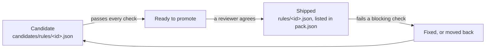
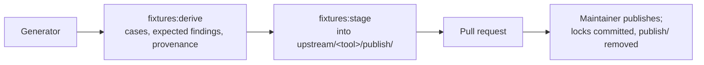

# Porting a tool's rules into a pack

This guide is for anyone adding a linter's rules to a rule pack: a person, or the coding agent working with them. It
walks the port from its first candidate to a shipped rule, in order, and says at each step what to run and what to
check.

It does not repeat the reference documents. Read these as you need them:

| Document | What it defines |
| --- | --- |
| [pack-format.md](pack-format.md) | The pack layout, `pack.json`, `conformance.json`, pack data, provenance records, and the validation contract (checks 1 to 8) |
| [conformance/README.md](../conformance/README.md) | The conformance check: its per-rule checks, the pull request comment, divergences, candidates and promotion |
| [CONTRIBUTING.md, "Pack test data"](../CONTRIBUTING.md#pack-test-data) | Getting the data, how it is published, adding or changing a pack, the maintainers' steps |
| [language-packs.md, "Start a pack"](language-packs.md#start-a-pack) | A new pack's skeleton, and what a ported pack adds |
| [upstream.md](upstream.md) | Upstream snapshots, the generators, samples and their licences, the publish workflow, bumps |
| [writing-rules.md](writing-rules.md), [code-rule DSL reference](code-rule-dsl-reference.html) | How a rule document is written |

In commands and paths below, `<id>` is the pack (`packs/<id>/`), `<tool>` the upstream tool, and `<rule>` the Rerail
rule id (`ruff-f401-unused-import`); "upstream rule" is the tool's own name for it (`F401`).

Who may push a branch here and how a change from a fork comes in is
[CONTRIBUTING.md, "How contribution works"](../CONTRIBUTING.md#how-contribution-works). Everything below applies to
both; a fork's pull request gets no CI, so it states what was run by hand.

## Before you start

1. **Pull the pack test data.** Ported rules are judged on data that is not in git. Without it, every pack test and
   the conformance check fail, and nothing you ran proves anything.

   ```sh
   aws sso login            # or any credentials with read access to the bucket; ask a maintainer
   npm run fixtures:pull    # -- --pack <id> for one pack
   ```

   Archives cache in `.rerail/pack-data/archives/`; copy that directory into a fresh worktree to skip the download.
   A fresh worktree also needs `npm ci` and `npm run build:native` before the pack tests run
   ([Getting the data](../CONTRIBUTING.md#getting-the-data)).

2. **Check the tool's licence.** The tool and every test file you copy must be under a licence on
   `scripts/check/licence-allowlist.json`. Tests under a copyleft licence are left out with a `Not copied` line
   ([Third-party material](../CONTRIBUTING.md#third-party-material)).

3. **Check for another open pull request on the same pack.** Two pull requests that both change a pack's `pack.json`,
   `README.md` or the native anchors pin (see [Promoting a candidate](#promoting-a-candidate)) conflict. Land the
   smaller one first, then merge `main` into the other.

## How a port moves



**Candidate.** The document is at `candidates/rules/<rule>.json`, `conformance.json` has a port entry whose `policy`
names it, and `pack.json` does not list it. Every check scores and judges it and the pull request's **Conformance**
comment reports it. It never blocks CI and never ships
([Candidates and promotion](../conformance/README.md#candidates-and-promotion)).

**Ready to promote.** The candidate passes every check. This is necessary, not sufficient: a reviewer reads the
evidence and decides ([Who decides what ships](#who-decides-what-ships)).

**Shipped.** The document is at `rules/<rule>.json` and `pack.json` lists it. It starts on when `upstream-status` holds
(the pinned release has the rule, it is not deprecated, an approved configuration turns it on), otherwise it ships
with `"on": false`. From now on, a failing blocking check fails CI on every pull request, including one that only adds
test data.

**Moved back.** A shipped rule that fails is fixed in the same pull request, or returned to `candidates/`
([Moving a shipped rule back](#moving-a-shipped-rule-back)).

## The files a port touches

The layout is [pack-format.md, "Layout"](pack-format.md#layout). For each ported rule:

| File | What to add |
| --- | --- |
| `candidates/rules/<rule>.json` (later `rules/<rule>.json`) | The rule document, `rerail.policy/v1`. `<rule>` is `<tool>-<upstream rule>` in lowercase, and the same string in the file name, the document, `pack.json` and the port entry ([rule ids](pack-format.md#packjson)). Each violation reports the upstream rule's code and carries the tool's suppression key (`noqa.codes`, `eslint.rules`, …: the table under [check 4](pack-format.md#the-validation-contract)). The `description` meets the [description criteria](pack-format.md#description). |
| `conformance.json`, `rules[]` | The port entry: `id`, `upstream: { tool, rule }`, `policy`, `match` (`line` or `line+column`), `capabilities` ([schema](pack-format.md#conformancejson-divergencesjson-upstream)). A candidate's `examples` pair lives here; it moves to `pack.json` when the rule ships. |
| `upstream/<tool>/gates.yaml`, `rules` | One entry per upstream rule: `deprecated` (upstream's message or `null`) and `recommended` (the first approved configuration that turns it on, with its option values, or `null`). No entry means the rule fails `upstream-rule` and can never start on. Derive the values from upstream's rule table and default settings at the pinned release, and say how in the pull request ([Declared upstream facts](../conformance/README.md#declared-upstream-facts-gatesyaml)). |
| `licenses/<project>/UPSTREAM.md`, `upstream/<tool>/UPSTREAM.md` | Provenance. Per upstream repository: licence, `Source` row, `Taken from it` globs, `Not copied` lines. Per tool: one row for each case Rerail wrote ([UPSTREAM.md](pack-format.md#upstreammd)). |
| `divergences.json` | One entry per line where the rule and the tool disagree on purpose: kind and evidence ([Divergences](../conformance/README.md#divergences)). Add an entry only after checking the tool's answer on that line. |
| The generator's case table (Ruff `NOQA`, Bandit `NOSEC`) | A suppression case for the rule. These generators refuse to derive while a shipped rule has none. CI does not catch a missing case; the next derive does. |
| `candidates/README.md` (later `README.md`) | A `### \`<rule>\`` section under `## Rule details`: what the rule matches beyond its description, its settings, and, while it is a candidate, what it waits on. A heading names only rules on its file's side (check 5). |
| `.changeset/*.md` | A changeset, only when the pull request changes what the pack publishes (`rules/`, `pack.json`, `README.md`, …). A candidate alone needs none ([.changeset/README.md](../.changeset/README.md)). |

A rule upstream tests under several option sets becomes several documents, one per set, each scored on its own tests
through the port's `fixtures` globs.

## Reading the Conformance comment

CI keeps one **Conformance** comment on a same-repository pull request
([The pull request comment](../conformance/README.md#the-pull-request-comment)).

- A rule's verdict is the first blocking gate it fails. Work a candidate down the **Candidates** section one gate at a
  time.
- The run's `conformance-summary` artifact has every detail: `gates.json` per check, and `summary.json`, whose
  `promotable` list is the list to promote from.

  ```sh
  gh run download <run id> -n conformance-summary
  ```

- Locally, the same judgement and the detail of one rule:

  ```sh
  npm run conformance:languages -- --check --pack <id>
  npm run conformance:languages -- --pack <id> --rule <rule>     # every false positive and miss
  npm run conformance:languages -- --pack <id> --rule <rule> --samples   # the samples too
  ```

Read the pack's own scoring errors first (an engine failure, a finding on a clean sample, a stale divergence, a test
data error): a rule cannot pass on a pack that does not score. Then, per check:

| Check | It needs | What to do |
| --- | --- | --- |
| `loads` / `in-scope` | The scope covers every file type in `gates.yaml` `upstream.lints` | Widen the scope, or set the port's `lints` when the rule covers fewer types by design |
| `compact` | A document under 15 KiB, or one that states the logic | Replace listed cases with the construct they share |
| `no-unexplained-false-positives`, `no-unexplained-misses` | Agreement with the tool on its tests and Rerail's probes | Fix the rule. Declare a divergence only after checking the tool's own answer on that line |
| `catches-something` | A true positive on the fixtures, or `examples` in `pack.json` | Give the rule a true positive: a test of the tool it should report, or an authored case the tool confirms. A candidate's pair on its port entry serves check 3, not this check; it counts once the rule ships |
| `holds-under-rename` | Agreement on the rename variants (ECMA tool-packs) | The rule matched names or literals: match the construct. A pass "without evidence" is reported; say in the pull request what other evidence stands in |
| `samples-catch-labelled`, `samples-silent-on-clean` | Agreement with the labelled lines of the real-code samples | Fix the rule, or declare a `"source": "samples"` divergence after checking the label ([How samples are judged](../conformance/README.md#how-samples-are-judged)) |
| `stays-silent` | One of the rule's own upstream units where the tool reports nothing, or one clean sample the rule is silent on | When every upstream test for the rule has findings, add a clean real-code sample labelled for it ([Samples](upstream.md#samples)). Other rules' units and Rerail's probes do not count |
| `divergences-current` | Every declared divergence still explains a disagreement | A fix that makes the rule agree removes its divergence in the same pull request |
| `upstream-status` (never blocks) | The `gates.yaml` entry: present, not deprecated, `recommended` | Add or correct the entry. The **On or off** section lists shipped rules whose `pack.json` `on` disagrees |

## Adding test data

A port is judged on two kinds of data, neither in git ([Pack data](pack-format.md#pack-data)):

- **Derived**: the tool's test cases, copied by the generator, and the findings the pinned tool reported on them.
  `npm run fixtures:derive` remakes it from the pins.
- **Authored**: cases Rerail wrote for the tool to score (suppression cases, probes, a corpus with its ground truth).
  Nothing regenerates them; the tool's `UPSTREAM.md` lists each one.

A new port adds its tests to the data, so it ends in a publish:



1. **Point the generator at the rule's tests.** The generator (`upstream/<tool>/generate.*`, with its recipe under
   `scripts/pack-data/recipes/`) copies the tool's tests, runs the pinned tool on them, writes `fixtures.expected.json`
   with each unit's upstream origin, then the provenance
   ([What the generators write](upstream.md#what-the-generators-write)). Which tests it reads per rule is what
   `gates.yaml` `watch.tests` names: a path convention (`test/{rule}.js`), or a hand-kept list beside the generator
   (`fixtures.json`: `{ "rules": { "<upstream rule>": ["<upstream path>", …] } }`).

2. **Derive.** The derive runs upstream's code, so run it in a sandbox with no AWS or GitHub credentials, on the
   pinned runtime ([Derive in a sandbox](upstream.md#derive-in-a-sandbox)).

   ```sh
   npm run fixtures:derive -- --pack <id> --tool <tool>
   ```

   It stops before running if any authored file the tool's `UPSTREAM.md` lists is missing on disk. A port pull
   request carries only its own new authored files, so pull the locked archive first. A generator that writes its
   authored cases from its own tables (Ruff's does) can regenerate them instead.

3. **Stage and commit.**

   ```sh
   npm run fixtures:stage -- --pack <id> --tool <tool>          # what the locked archive lacks or holds differently
   npm run fixtures:stage -- --pack <id> --tool <tool> --all    # the whole set
   git add packs/<id>/upstream/<tool>/publish
   ```

   Staging reads the locked archive to say what a publish would drop, so it needs the AWS CLI even with `--all`.
   While `publish/` is tracked, structure metric #3 fails by design and the **Pack data waiting to publish** comment
   lists the files. Read the metric's failures: every path must be a `publish/` path; any other is a real failure.

4. **A maintainer publishes** ([For maintainers](#for-maintainers-publishing-and-merging)). The workflow commits the
   locks and removes `publish/`; CI runs again, and the Conformance comment on that commit is the verdict.

What the archive's rules mean for you:

- A file the archive holds is in no diff. Renaming or merging an authored case waits for the next derive and a
  `replace` publish; do not stage a rename over the archive.
- Every file under the tool's test directories is authored or under a `Taken from it` glob, and every glob matches a
  file (check 6). A new fixture directory needs its glob; a removed one loses its glob.
- Rules `main` already ships are judged on your data too. Run the pack's conformance check on the derived data before
  asking for the publish. A shipped rule that fails on a file you add is fixed, given a checked divergence, or moved
  back to candidates in your pull request.
- Generators that demand suppression cases refuse to derive until every shipped rule has one. `main` may lack cases
  for rules promoted since the last derive; add them.

## Promoting a candidate

The steps are [Candidates and promotion](../conformance/README.md#candidates-and-promotion). This is the checklist.
Promote from the judged commit's `summary.json` `promotable` list, and confirm `main` has not moved since.

1. **Move the document, never regenerate it.**

   ```sh
   git mv packs/<id>/candidates/rules/<rule>.json packs/<id>/rules/<rule>.json
   ```

   For a pack whose documents a generator writes (`scripts/generate/README.md` lists them), change the generator's
   candidate flag, regenerate, and check that the diff is the move alone. If the generator rewrites something the
   committed document carries, move by hand.

2. **`conformance.json`.** Point the port's `policy` at `rules/<rule>.json`. Move its `examples` pair to the
   `pack.json` entry; the schema refuses it on a shipped port.

3. **`pack.json`.** Add `id`, `document`, `title`, `group`. Add `"on": false` when the comment's **Starts** column
   says off. Add `"mode": "log"` only when upstream's recommended configuration warns rather than errors
   ([pack.json](pack-format.md#packjson)). Keep the pack's order: sorted packs stay sorted, grouped packs take the rule
   after its group. The title follows the pack's pattern, `<Tool> <upstream rule>: <upstream's one-line description>`,
   taken from upstream's rule metadata at the pinned version.

4. **README sections.** Move the rule's `### \`<rule>\`` section from `candidates/README.md` to `README.md` and drop its
   "waits on" sentence. Check 5 fails a heading that names a rule on the wrong side.

5. **Hand-kept text.** Recount from the data, not by hand: the README's opening counts, the candidates README's
   opening paragraph, any divergence claim against `divergences.json`, the pack tables in [rule-packs.md](rule-packs.md)
   and the root README.

6. **Code that names the old path.**

   ```sh
   git grep -F candidates/rules/<rule>.json    # a native include_str!, a test that builds the path
   ```

7. **The native anchors pin.** `native/src/code_rule_dsl/matcher/anchors/tests.rs` pins the number of `ast` queries in
   the shipped documents (`"pinned catalog query inventory"`). Any move between `rules/` and `candidates/` changes it.
   Do this last:

   ```sh
   cargo test --manifest-path Cargo.toml -p rerail-engine anchors::tests    # pin the `left` value the failure prints
   ```

8. **A changeset per pack**, `patch` while the pack is below 1.0.0.

9. **The suppression case**, for the tools whose generator demands one, if the candidate has none.

10. **Evidence in the pull request.** The rule's results against the tool's expected findings, its rename variants and
    samples, every divergence checked, and each check listed under **Passing without evidence** with what stands in
    for it ([REVIEW.md](../REVIEW.md#what-blocks-a-merge-here)).

## Moving a shipped rule back

For a shipped rule that fails a blocking check and is not fixed in the same pull request:

1. `git mv packs/<id>/rules/<rule>.json packs/<id>/candidates/rules/<rule>.json`.
2. In `conformance.json`, point the port's `policy` back. The port entry stays: candidates are scored, not gated.
3. Remove the `pack.json` entry. Its `examples` pair, if any, moves back to the port entry.
4. Move the `### \`<rule>\`` section from `README.md` to `candidates/README.md`, at its sorted place, and add one
   sentence saying what sent it back, with the file and line.
5. Recount the README's opening (the rule count; the off count if the rule was off) and the candidates row.
6. A test that loads the rule by id reads `rules/` only: pass the pack's `candidates/` directory too
   (`test/engine/code-rule/pack-rules/python-harmful-steers.test.ts` does).
7. Re-pin the anchors test (step 7 above).
8. The changeset states the net effect against `main`: what ships, what went back. `main`'s changeset for the
   promotion stays.

No re-derive: the generator's authored output does not depend on which rules ship.

## Keeping a long port branch current

A port of many rules takes weeks, and `main` ships rules of the same pack meanwhile. Merge `main` in; expect conflicts
in the pack's shared files, and resolve each as data:

| File | How to resolve |
| --- | --- |
| `pack.json` | From the index stages (`git show :1:`, `:2:`, `:3:`), never as text: the branch's rules, plus `main`'s new ones after their group; `main`'s version of an entry only `main` changed |
| `README.md`, `candidates/README.md` | Rebuild both from the two sides' stages. Each `### \`<rule>\`` goes to the file the merged `pack.json` puts it in. For a section both sides changed, the merge base says which side changed it. Check 5 validates |
| `fixtures.json` | The merged list is a superset of `main`'s, with identical shared entries |
| `licenses/<project>/UPSTREAM.md` | `main`'s record, with globs that cover the branch's new files and a `Not copied` line for what the branch leaves out |
| Code `main` deleted | Take the deletions, then check that no branch-added file under a deleted directory survives |
| The anchors pin | Last, by running the test |

Two more things:

- Never resolve a conflict in rule or README text with a JavaScript `String.replace(x, string)`: `` $` `` and `$'` in
  the text expand. Slice, or pass a function.
- **A pull request with conflicts gets no CI.** `ci.yml` runs on `pull_request`, which GitHub skips when it cannot
  build the merge commit. Check before waiting on a comment, and merge `main` first:

  ```sh
  gh pr view <n> --json mergeStateStatus    # DIRTY means conflicts
  ```

After the merge: `npm ci` if `package-lock.json` changed; add a suppression case for each rule `main` shipped since the
last derive; re-derive, and check that `fixtures.expected.json` differs from the staged one only by the new cases'
findings.

## Before you open the pull request

Run, on the pulled data plus the derived data in `publish/`:

```sh
npx vitest run test/engine/catalog/packs.test.ts -t "pack <id>"   # checks 1 to 8, each rule's status
npm run conformance:languages -- --check --pack <id>
npm run check              # metric #3 is red by design while publish/ is tracked; the chain stops there, so also:
npm run check:windows-paths && npm run check:internal-refs && npm run check:pins
npm run check:native       # a shorter rules/ path in an include_str! needs cargo fmt
cargo test --manifest-path Cargo.toml -p rerail-engine anchors::tests
```

Then grep for stale counts (table rows included) and for moved rule details that still say "candidate".

In the pull request body:

- what the port covers and leaves out, with the reason for each omission;
- the evidence a promotion needs (step 10 above);
- which of the checks above ran locally, and which CI must judge. If you could not pull the data, say so.

## For maintainers: publishing and merging

The steps are [Merging (maintainers)](../CONTRIBUTING.md#merging-maintainers) and
[Approving a data upload](../CONTRIBUTING.md#approving-a-data-upload-code-owners).

1. **Dispatch after the head is final.** Prep packs whatever head the pull request has when it runs.

   ```sh
   gh pr view <n> --json headRefOid                 # the pushed commit
   gh workflow run pack-data-publish.yml -R neralabs/rerail -f pr=<n> [-f replace=true]
   ```

2. **Choose `replace` or overlay by what `publish/` holds**, not by what changed:

   | `publish/` holds | Choose | Prep's summary when it is wrong |
   | --- | --- | --- |
   | The tool-pack's whole set: a regeneration staged with `--all`, with `provenance.json` and `LICENSES.md`, about as many files as `test-data.lock` counts; or files must leave the archive | `replace` | Overlay lists no drops where the regeneration deleted files |
   | Only what is new: samples beside the locked ones, a few new cases | overlay (default) | `replace` lists every earlier file as dropped |

   Read the drop list against the intent before approving. On a `replace`, every drop is something the regeneration
   meant to remove.

3. **Approve.** Nothing reaches S3 before the approval, and no CI job derives the data again. The approver reads
   prep's summary against the pull request ([REVIEW.md](../REVIEW.md#approving-a-pack-data-upload)).

4. **If the finish step fails after the upload** ("Pack data published: action needed"): every object is in S3 and
   confirmed. Commit by hand what the comment carries: each lock verbatim, `git rm -r` each tool-pack's `publish/`,
   the `SAMPLES.md` lock lines; push without force. Re-running the publish also works (puts are create-only) but costs
   another approval.

5. **Merge when CI is green on the finish commit**, with `publish/` gone and the Conformance comment showing no
   blocking failure. Two notes:
   - An overlay never restages `LICENSES.md`, so a samples archive's keeps listing the earlier samples until a
     `replace` repack. Note it in the pull request; do not hand-edit it.
   - A move of unchanged documents between `rules/` and `candidates/` changes no verdict, so an earlier run's
     comment stands for it. Name the run.

## Who decides what ships

A candidate ships when it passes every check and a reviewer agrees that its evidence is enough: the results against
the tool's expected findings, the rename variants and samples, the divergences checked, and anything passing without
evidence accounted for ([REVIEW.md](../REVIEW.md#what-blocks-a-merge-here)).

Whether a shipped rule starts on is not a judgement call: `upstream-status` decides from `gates.yaml`'s declared facts,
and a `pack.json` `on` that disagrees is reported.

A rule the reviewer is not sure of stays a candidate. Its section in `candidates/README.md` says what it waits on.
