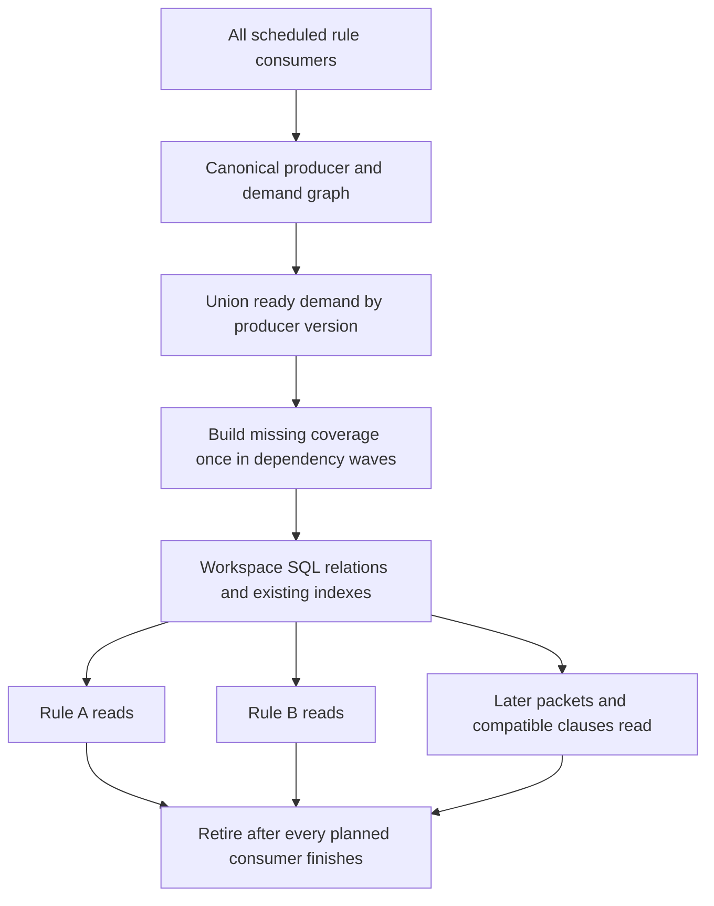

# SQL materialization ownership

Status: target design before implementation.
This design covers repeated inline CTEs and materialization across rule consumers.
The [compiled execution model](sql-execution-stages.md) defines stage planning, dynamic frontiers, and the specialized runtime controller.
The selected [named contract model](shared-producer-contracts.md) replaces general equivalence discovery as the primary sharing mechanism.
It extends the [current lifetime scheduler](sql-composition-implementation.md#candidate-relation-lifetimes).
It does not promote the [rejected retention experiments](sql-preparation-spikes.md).

## Decision and invariant

The workspace owns a canonical producer graph across the complete scheduled rule evaluation.
SQL statements and result packets consume that graph.
They do not define its sharing boundaries.

For each selected materialization, one owner produces each required version and coverage partition exactly once.
Every rule consumer reads that owner's rows.
No consumer embeds another materialized copy of the producer or reconstructs its dependencies.
Reading a relation several times is valid. Reconstructing its unchanged covered rows is not.

This invariant applies across property preparation, candidate selection, result packets, and compatible relational clause consumers.
A change of rule name, clause name, SQL alias, connection, or transport batch does not create a new producer.
Semantic scope and data changes can create a new producer version.
Exactly once applies to successful publication. Cancellation can require retry of unpublished work.

Materialization remains selective.
Existing indexes answer covered access paths directly.
Cheap single-use expressions remain pipelines unless semantics require a physical boundary.
Every selected materialization must have a named owner, consumers, coverage unit, and retirement point.

## Evidence and current gaps

The [placement audit](../fixtures/host/data-layer-port/profiling/sql-materialization-design-20261023.json) resolves local CTE dependencies and earlier physical producers.
It binds parameter types and values before comparing structural definitions.
Local names such as `needed` cannot identify equivalent producers without their complete dependency context.

| Captured workload | Materialized CTE placements | Definitions present in multiple statements | Extra placements across statements |
| --- | ---: | ---: | ---: |
| State | 10,320 | 248 | 1,672 |
| Ten rules | 19,001 | 420 | 2,745 |

One demanded-span definition appears in 61 state statements and 90 ten-rule statements.
A window frontier appears in 59 state statements and 60 ten-rule statements.
An empty-set definition appears in 670 state statements and 1,168 ten-rule statements.
These counts describe generated SQL placements, not measured evaluations or CPU savings.
They include cheap and empty work. They do not justify retaining every definition.

The [allocation measurements](data-layer-performance-journal.md#candidate-sql-relation-lifetimes-2026-10-23) identify the separate memory problem.
Result execution reaches 68.5 MiB for state and 98.6 MiB for ten rules.
The first state packet contains 1,101 inline materializations.
The current scheduler controls explicit SQL tables and cannot release these private intermediate relations separately.

Current sharing also ends at several architectural boundaries:

| Boundary | Current limitation | Target |
| --- | --- | --- |
| Generated definitions | Catalog compaction precedes SQL rendering, but rendering embeds live inline definitions into multiple statements | One physical owner for selected shared producers |
| Property fills | Each fill can reconstruct its demand subqueries | Shared demand producers and missing-key work across ready consumers |
| Result packets | Each packet can own another inline working set | Packets bind to already prepared outputs |
| Clause sessions | Each session opens a separate in-memory SQLite database | Shared facts and compatible stages have workspace SQL owners |
| Lifetimes | Local release knows local consumers | Retirement includes every consumer in the evaluation graph |

## Target execution shape

Planning collects consumer dependencies before it partitions execution.
Conditional consumers remain potential readers until their gates resolve.
Skipped consumers request no rows and do not force preparation of unused facts.
Dependency waves gather all currently ready demand for the same producer.
SQL computes missing coverage in batches and publishes rows with completion metadata atomically.
Consumers then read immutable producer versions through their scoped bindings.

Demand discovery can depend on earlier results.
Therefore, one producer can receive several disjoint missing-key batches.
Each covered input key still receives one successful materialization.
The planner must not force all future demand into an earlier wave or introduce a dependency cycle.

Native fact producers retain broad count, scan, and scatter passes over these frontiers.
The graph exposes dependency waves for future GPU execution.
It does not create one launch or SQL query per rule, node, or lookup.

## Identity, scope, and coverage

Producer identity uses a versioned contract name, input bindings, typed options, and any required semantic domain.
The contract defines the operation, schema, grammar or function versions, and completion rule.
Schema identity includes affinities, NULL behavior, multiplicity, and required ordering.
Negation includes its universe. Correlated producers include their bound key domain.
Source and scope filters remain semantic inputs.
Effective execution context includes limits or callback behavior that affect compatibility.

Hashes accelerate lookup. Full contract and binding equality resolves collisions.
Matcher exactness remains consumer metadata and cannot become stronger through row reuse.
Authored SQL shares through declared producers or proven exact structural equivalence with resolved dependencies.
The design does not assume general algebraic equivalence between arbitrary SQL queries.
Discovery tools suggest producer extractions. They do not authorize sharing automatically.

Contracts select keyed or complete-domain completion.
The keyed model supports independent input keys and complete independent partitions:

| Coverage form | Example | Completion rule |
| --- | --- | --- |
| Independent input keys | Node properties, spans, child fields, pure predicate facts | Compute only missing keys, including keys with no output |
| Complete partitions | File-local derived sets or reachability for a requested root | Complete each versioned partition once |
| Complete domains | Cross-file aggregates, scoped negation, global choices, non-distributive windows | Seal the exact input domain before publication |

File-local versions include a file identity and generation that survives integer-ID reuse safely.
Transport partitions do not enter file-local identity.
Domain-dependent versions include actual membership and relevant input generations.
A request-table name or path-filter spelling alone does not identify that domain.
Vocabulary and semantic-reference dependencies retain their own version stamps.

Completion metadata distinguishes an empty result from missing work.
It records covered inputs rather than inferring coverage from output rows.
Non-distributive results cannot accept appended keys without a proven incremental algorithm.
They require a new domain version or completion of the original sealed domain.

## Materialization choices

| Producer shape | Chosen representation |
| --- | --- |
| Existing kind, value, or vocabulary access | Direct indexed SQL access, without another expanded posting cache |
| Literal empty relation | Constant propagation, with no materialized rows or dedicated spool |
| Alias or cheap projection | Binding or pipeline, without copying the backing relation |
| Nontrivial producer with multiple physical consumers | One owned SQL materialization shared by all consumers |
| Required demand fence, algorithm boundary, or measured working-set cut | One explicit owner at that boundary |
| Cheap producer with one physical consumer | Inline pipeline within that consumer |
| Recursive algorithm | One producer owns the recursive component and its private work tables |

Consumer counting includes separate statements, rules, packets, fills, and repeated invocation contexts.
A single textual reference inside a correlated loop does not prove single execution.
Independent outer keys enter batched demand. Repeated keys reuse covered results.
Indexed probes remain reads and do not require another materialization.

Admission compares avoided computation with the complete storage cost.
That cost includes one write, required indexes, maintenance, retention, and consumer reads.
Expense alone does not justify storing a single-use result.
The existing rejected posting and utility caches demonstrate why reuse counts alone are insufficient.

Shared producer identity and placement decisions precede SQL generation.
The renderer substitutes a storage reference for every selected owned dependency.
It cannot embed that dependency's `AS MATERIALIZED` definition inside a consumer.
Inlining requires proof that it does not create another physical computation of an owned producer.

One producer statement can contain private CTEs for its own algorithm.
Required demand fences preserve the current source-predicate evaluation boundary.
Their rows and execution peaks remain visible in profiling.
Private scratch cannot silently become a second implementation of a shared producer.

A final single-use pipeline can stream directly into the existing compact candidate sink.
It does not require another SQL table merely to emit its results.
Output packets contain stored producer references, indexed reads, and cheap projections.
They cannot contain duplicated owned producer bodies or unrelated large algorithm workspaces.

Constant propagation preserves bag semantics.
For example, `empty UNION bag` still requires duplicate elimination.
Bag relations retain duplicate rows and row ordinals where required.
A `(producer,fid,pre)` uniqueness constraint is valid only for a proven set relation.

## SQL storage and publication

The workspace SQLite database owns reusable facts and selected shared materializations.
The target uses typed SQL backing relations with indexes selected for their actual consumers.
It does not require a universal row pool or JSON payloads.
Existing decoded-property tables and compact forest intervals remain authoritative representations.
Expanded root-descendant pairs are not required merely to share the forest producer.

Selector relations store keys and necessary computed columns.
They do not copy unchanged fact columns into a table for each rule.

Relations have stable producer bindings and versioned coverage.
Their schema and necessary indexes belong to the owner, rather than each consuming rule.
Repeated consumers do not run CTAS copies, import row vectors, or rebuild identical indexes.
Missing coverage uses batched SQL writes against the owner's existing backing storage.
Each index receives published rows once and remains available to every consumer.

The planner collects required index access paths across consumers before publication.
A new access path does not justify another copy of the producer rows.

Shared backing relations reside in the workspace database, rather than connection-local temporary storage.
Clause connections consume scoped views of those relations without copying their rows.
Publication uses one writer and dependency-wave barriers.
Readers acquire publication snapshots after a wave completes and release them before incompatible schema retirement.
File and domain generations remain pinned across these barriers.
The implementation must close incremental BLOB readers before incompatible writes or schema changes.

Reader counts, page caches, and snapshot leases contribute to admission and WAL limits.

Rule SQL retains its existing relation allowlist through registered view bindings.
It gains no access to other rule namespaces or internal catalog tables.
Function behavior, error attribution, cancellation, and per-rule logical limits remain explicit compatibility requirements.
Physical work accounting charges shared work once and records its consumers separately.
Changing existing budget semantics requires a separate decision.

## Lifetimes and memory limits

Retirement follows the last consumer in the complete execution graph.
Pending rules, later packets, and global consumers keep the producer alive.
Output packet completion alone cannot release shared rows.
Live materializations cannot be evicted and reconstructed to satisfy a RAM limit.
SQLite spills backing storage to disk, or the scheduler defers admission of independent work.
An exhausted hard budget returns the existing controlled engine failure.

Private algorithm workspaces also contribute to that budget.
File-backed tables alone do not bound every inline CTE allocation.
Partitioning a global algorithm requires a semantic decomposition, not an arbitrary file split.

Stable base facts retain their existing workspace invalidation rules.
Evaluation-derived rows remain available until their complete consumer set finishes.
A later evaluation can require new computation after retirement.
The exactly-once guarantee covers one evaluation and its dependency waves, not every future workspace request or process restart.
Known consumers within that evaluation cannot cause retirement followed by reconstruction.

Consumer output rows can repeat the same candidate under different rule IDs.
Those dispatch rows are required outputs, not separate materializations of the shared producer.
Packets stream those bindings while preserving required ordering.
Their size follows transport and output limits, without changing producer ownership.

## Implementation sequence

1. Register named producer contracts and explicit bindings, coverage, and consumer references before SQL rendering.
2. Extend canonical interning across the complete candidate frontier and build an owner-use ledger.
3. Promote repeated nontrivial inline producers and required fences into single SQL owners.
4. Replace repeated property-demand subqueries with ready-frontier demand producers and disjoint missing-key fills.
5. Emit stored producer bindings and single-use final pipelines through the streaming dispatch sink.
6. Extend workspace ownership to compatible shared facts and declared stages across clause databases.
7. Apply graph-wide retirement and memory admission, then repeat parity and paired CPU and allocation measurements.

Each step uses one production execution strategy. No experiment switch enters the engine.
Candidate ownership alone does not complete cross-clause sharing.
The implementation must report these milestones separately.

The integration points are:

| Current component | Required change |
| --- | --- |
| `graph.rs` and `lower.rs` | Retain explicit canonical producer references, coverage classes, consumers, and placement decisions before SQL text |
| `lower/render.rs` | Render owned dependencies as storage references and reject duplicate embedded owner bodies |
| `decode.rs` | Build ready demand frontiers and publish disjoint missing-key coverage |
| `lower/lifetime.rs` | Schedule explicit graph edges and complete consumer lifetimes instead of inferring ownership from SQL identifiers |
| `corpus.rs` | Keep workspace producer ownership independent of plan-pointer and result-packet identities |
| `relational.rs` and `relational/batch.rs` | Replace compatible fact imports with scoped bindings to shared SQL owners |
| `workspace/global.rs` | Plan cross-rule consumers and publication barriers before admitting clause jobs |

## Enforcement and acceptance

The planner records one owner for every selected materialization key.
It rejects duplicate owners, reads before completion, and retirement with pending consumers.
Its renderer rejects an owned dependency body embedded in another statement.
Instrumentation records materialization starts, coverage writes, completed empty keys, consumers, index maintenance, and retirement.
Repeated writes count as attempted writes, even when `INSERT OR IGNORE` hides them.

The TDD ladder covers:

1. Two rules and two packets share a diamond dependency with one owner for each shared producer.
2. A property fill and a result consumer share demand without rebuilding its selector.
3. Overlapping demand waves publish each key once, including empty and null results.
4. Different scopes, generations, types, regex flags, bag semantics, and window domains cannot alias incorrectly.
5. File batches change without changing file-local producer ownership or findings.
6. Later clause consumers read shared SQL backing rows without imports or copies.
7. Cancellation exposes no partial coverage, and retry preserves completed work.
8. Low memory forces spilling or admission delay without rebuilding live producers.
9. Expensive source predicates run only for demanded keys after the required fence.
10. Literal empty-set folding preserves `UNION`, `EXCEPT`, and bag behavior.

Performance acceptance compares the full execution cost, including planning, writes, indexes, maintenance, reads, and cleanup.
It requires fewer duplicate owner evaluations and bounded statement execution allocation peaks.
Moving CPU into preparation or moving materialization into another statement does not satisfy acceptance.
The existing positive and clean corpus, edits, public tests, typechecking, and native checks remain required.
Matched benchmarks retain the 115-second deadline and tracing-free CPU measurements.
