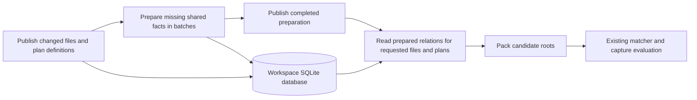

# Incremental SQL preparation for candidate selection

The [materialization ownership design](sql-materialization-shape.md) defines the next target across statements and rule consumers.
Its exactly-once contract replaces reconstruction of live owned producers as a memory-limit fallback.
It remains a design, without promotion of the rejected retention experiments.

Status: implemented and measured preparation changes; broader retention rejected for the tested workloads.
The [experiment results](../fixtures/host/data-layer-port/profiling/sql-preparation-20261022.json) record the matched CPU trials and SQL layout comparisons.
The sections below preserve the proposed architecture and its contracts.
The implementation promotes shared structural preparation, duplicate-expression removal, fixed request tables, and incremental vocabulary matches.
Expanded posting sets and generic shared utility sets remain isolated experiments because both increase measured CPU.
Their proposed catalog, retirement, and retention limits are not production features.
The [implementation spikes](sql-preparation-spikes.md) define the work and acceptance criteria.

## Decision

Keep reusable candidate relations in the workspace SQLite database.
Maintain these relations in a batched preparation phase.
Run candidate selection against prepared relations without cache fills or schema changes.
Keep request scope and cheap, single-consumer intermediates temporary within preparation.

SQLite remains the execution engine and owns the relations, indexes, joins, and set operations.
Rust coordinates dependencies, supplies batched inputs, and decodes packed facts through the existing SQLite extensions.
The design adds no alternate executor or runtime experiment switches.

The database remains temporary at the workspace level.
Retained relations survive rule batches and workspace edits, but the database disappears after workspace closure.
Durable reuse across process restarts requires a separate design.

## Evidence and scope

The [current evidence](../fixtures/host/data-layer-port/profiling/value-access-20261021.json) records these median cold process CPU totals:

| Workload | Before value access and shared properties | Current implementation |
| --- | ---: | ---: |
| Two rules, twelve files, 61 findings | 1.874 s | 2.504 s |
| Quality rule, five files | 3.004 s | 3.192 s |

The current positive diagnostic executes 550 SQL data statements, compared with 72 previously.
Those counts include property fills and final queries. They are not counts of temporary tables.
BLOB reads decrease from 2,791,126 to 51,444, but VM steps increase from 111,766,482 to 130,976,638.
The external sample also identifies SQLite comparison, VM, and file-write paths.
Its sample shares are not exact process CPU fractions.

The positive diagnostic attributes 1.299 CPU seconds to materialization and 0.203 seconds to index construction.
The largest structural fill alone costs approximately 0.390 CPU seconds.
That fill forms part of materialization, so those figures cannot all be added.
They come from an instrumented run and cannot be subtracted directly from the untraced baseline.
The spikes must identify the removable share within these costs.

The current corpus already retains base facts and final candidate roots.
An unchanged file with the same plan does not repeat candidate selection.
Intermediate sharing ends at the compiler batch boundary, which permits repeated work across plans and batches.
The proposed reuse must improve those cases and cold shared work, rather than demonstrate another unchanged-result cache.

This design changes the candidate-index subsystem in `native/src/code_rule_dsl/matcher/anchors/sql/`.
It does not automatically retain stages in the separate authored relational executor.
That executor has different input, capture, budget, and connection lifetimes.
Its later adoption requires separate evidence and dependency definitions.

## Execution boundary

Publication retains packed tapes and the existing FTS and value indexes.
Preparation computes missing facts and selected reusable relations in dependency order.
Selection reads prepared relations and produces the existing packed candidate roots.
File partitions continue to consume those roots without candidate SQL.
The authoritative matcher continues to check candidates and construct captures.

An already complete request bypasses both preparation and selection.
A new plan reuses existing dependencies before it computes its missing outputs.
A file edit replaces that file's facts and invalidates dependent preparation.

## Relation lifetimes

| Relation | Lifetime and maintenance |
| --- | --- |
| Packed tape, positional FTS, value segments, coverage | Existing workspace storage, replaced for changed files |
| Decoded structural properties | Retained per file revision, populated for the union of demanded nodes |
| Decoded spans and field-child results | Retained per file revision, sparse unless demand proves full coverage |
| Expanded kind or value hits | Retained only for selected shared access paths with measured benefit |
| Regex vocabulary matches | Retained by predicate and language, maintained from vocabulary changes |
| Literal vocabulary matches | Direct indexed seeks, without another retained match table |
| Shared file-local utility results | Retained by logical relation identity and file revision |
| Pattern anchor choice | Request-dependent unless its scope and statistics dependencies are explicit |
| File and plan request keys | Reusable scratch schema, replaced with batched request rows |
| Cheap single-consumer joins | Inline SELECT or preparation scratch, released after the last consumer |
| Final candidate roots | Existing compact cache, with logical plan identity added during migration |

The default admission rule retains decoded facts and relations with multiple consumers across the complete requested plan graph.
The compiler counts consumers before it splits work into bounded batches.
Repeated use of identical rows inside one expression also contributes to that count.
Posting expansion needs its own evidence because retained ordinals can duplicate a compact index many times.

There is no blanket retention of every generated stage.
The first implementation also retains the existing dependency boundaries that prevent exponential CTE expansion.
Moving a boundary into retained storage must preserve that protection.

## Logical graph and identities

Introduce a typed relation graph before SQL text generation.
A relation records its operation, child identities, parameters, column types, dependency class, and consumers.
SQL aliases and parameter positions do not contribute to its identity.

A canonical definition includes:

- The graph format and SQL compiler versions.
- The language and grammar identity, including kind and field mappings.
- The operator, constants, regex semantics, and field or traversal direction.
- Child definitions and expanded utility definitions.
- The interpretation of NULL, duplicates, and set operations.
- Any input domain that changes the meaning of the operation.

A hash accelerates catalog lookup. Exact canonical-definition equality resolves hash collisions.
Canonical definitions reference child identities instead of repeatedly embedding entire subgraphs.
The definition uses a versioned typed encoding, without per-node JSON fields.
Arc addresses remain local handles during migration, but they do not identify retained relations.
The matcher retains conservative exactness metadata separately from shared row identities.
An approximate candidate relation cannot become a proven exact relation through reuse.

Each relation has one dependency class:

| Class | Reuse boundary |
| --- | --- |
| File-local | Relation identity, file identity, and file revision |
| Vocabulary | Predicate identity, language, and vocabulary epoch |
| Request-scoped | Exact domain or request identity, temporary by default |
| Repository-wide | Explicit repository epoch and external dependencies, excluded from initial retention |

File-local classification requires proof that file restriction commutes with the operation.
Negation retains its universe. Context-sensitive utilities retain their input scope.
Pattern anchor selection currently uses posting counts across the batch, so its choice remains request-scoped initially.
Its stable posting dependencies can still be shared.
Unsupported classifications retain the existing bounded SQL shape within preparation.

## Storage contract

Add a monotonically increasing file revision to publication metadata and the SQL file row.
The revision prevents stale reuse even if SQLite reuses a deleted integer file ID.
File identity and revision form a unique SQL key.
Grammar changes require a new revision and invalidate all corresponding derived rows.

Use a relation catalog and a small number of typed row tables:

| Proposed table | Key and purpose |
| --- | --- |
| `prepared_relation` | Relation ID, definition hash, exact definition, dependency class, schema version |
| `prepared_dependency` | Parent and child relation IDs for planning and retirement |
| `prepared_node` | Primary key `(relation_id,fid,pre)`, with revision in the row payload |
| `prepared_ready` | Primary key `(relation_id,fid,revision)`, including complete empty sets |
| `predicate_term` | Primary key `(predicate_id,lang,term)` for successful regex vocabulary matches |
| `predicate_ready` | Predicate, language, and completed vocabulary epoch |

The node and completion tables reference the current file revision with cascading deletion.
The ordinal follows the file ID directly in the node key.
Revision remains an explicit dependency, but it cannot interrupt membership or ordinal range access.
Each file ID has one current revision. WAL snapshots preserve earlier reader views.
Completion markers also store a dependency stamp for dynamic inputs outside that file revision.
For example, corpus-dependent coverage changes invalidate affected value relations and their final roots.
Invalidation removes their rows and markers in one batched transaction before selection.
Unchanged source bytes alone do not prove validity for these relations.
All ordinal and revision columns have explicit INTEGER affinity.
The main node key supports membership and ordinal range access without another identical index.
Add a file-first maintenance index only after deletion plans demonstrate its need.
Keep spans, children, and structural properties in their existing typed tables.
Add another typed shape only for a relation that actually requires those columns.

Shared tables and their indexes are created once per schema version.
Preparation uses batched INSERT, DELETE, and joins instead of CTAS and index construction for each retained relation.
Changing a file deletes its affected rows through the revision key.
Changing a definition creates a new relation identity and retires unreachable definitions.

Initial storage limits are fixed internal limits established by the storage spike.
They are not user-facing experiment settings.
If retention exceeds a limit, preparation can compute that request through bounded scratch storage.
This changes physical storage only. SQL semantics and matcher execution remain the same.
Selection never repairs an evicted relation. Preparation must supply complete outputs before selection starts.

## Preparation protocol

1. Collect all requested plans and files before the existing 32-plan batching boundary.
2. Intern equivalent graph nodes and count their consumers across the request.
3. Classify dependencies and select retained relations.
4. Insert file, plan, and relation demand keys with bounded batched inputs.
5. Join demand keys against completion markers to obtain missing work.
6. Execute missing work in topological frontiers with SQL statements over complete batches.
7. Write completion markers after successful row construction within the same transaction.
8. Publish the prepared request and run candidate selection.

No host loop issues a SELECT for each node, file, predicate, or rule.
Statements scale with dependency frontiers and bounded input chunks, rather than individual input rows.
The plan scheduler can group operations with compatible typed SQL templates in one frontier.
It retains current parameter, SQL-size, cancellation, and work limits.

Structural demand takes the union of missing node keys across consumers.
A live all-node demand covers subset structural demands for the same files.
Sparse-only requests remain sparse.
Span and field-child demands use separate coverage because structural completeness does not imply their completeness.
A known missing child remains a complete NULL result.

Regex maintenance compares active predicates against newly introduced distinct terms in SQL batches.
New predicates compare against the current vocabulary once.
Deleted terms remove their match rows. Unchanged terms retain their earlier matches.
Vocabulary epochs advance only after the corresponding changes and match maintenance complete.
Coverage and residue confirmation remain mandatory for values outside the indexed vocabulary.
The implementation must preserve the existing corpus-dependent residue limits during vocabulary changes.

The initial implementation retains the corpus mutex and one writer connection.
Preparation transactions publish complete frontier results atomically.
Cancellation rolls back the active transaction and preserves only complete earlier frontiers.
A retry discovers missing work through markers, including complete empty results.
No asynchronous maintenance thread or connection pool is required for the first implementation.

## Read contract and invalidation

Candidate selection performs SELECTs against completed relations and the current request keys.
Preparation installs request keys before selection starts.
An integration test rejects candidate-selection DDL, DML, and calls to decoding functions.
Pure predicate functions remain available for transient final restrictions.
Selection failure preserves the existing error and budget behavior.

The scheduler freezes file revisions and plan definitions for the preparation and selection request.
The mutex prevents a concurrent publication from changing those inputs.
If later concurrency removes that serialization, readers require a consistent SQLite snapshot and an explicit revision lease.

| Change | Required invalidation |
| --- | --- |
| File edit, deletion, or language change | That file's facts, retained node sets, completion markers, and final roots |
| New file | Missing preparation for that file, plus affected vocabulary maintenance |
| Utility or rule change | Changed logical relations and their dependents, with unchanged dependencies reusable |
| New or deleted vocabulary term | Affected predicate matches and vocabulary completion epoch |
| File-filter change | Request scope, with file-local retained facts reusable |
| Grammar, compiler, or semantic-version change | Affected catalog identities and all incompatible derived rows |
| Corpus-dependent value coverage change | Affected value results, even for otherwise unchanged files |

Cache validity and admission are separate decisions.
Only proven dependencies permit reuse. A measured cost determines whether retention pays for itself.

## CPU and memory expectations

The expected savings come from fewer posting expansions, vocabulary scans, property-fill probes, and copies of shared relations.
Retained storage also removes repeated index construction for admitted relations.
These savings can occur during one cold apply when several batches consume the same relation.

Cold construction still costs CPU, and SQL B-tree insertion can cost more than a one-use temporary table.
Moving the same construction earlier does not establish an improvement.
The benchmark total therefore includes publication, preparation, selection, matching, and invalidation work.
Compilation CPU is reported separately and also included in a compile-plus-cold total.

The experiments report process CPU, peak RSS, allocation evidence, database growth, WAL growth, and retained row counts.
SQLite page-cache limits remain bounded and spill remains enabled.
Disk-backed retention does not guarantee lower RSS or lower write cost.
The storage experiment must demonstrate bounded growth across edits and rule changes.

The combined performance target is at least 30% less cold CPU on the positive control, relative to the current implementation.
That target is approximately 1.753 seconds, which also improves on the earlier 1.874-second baseline.
The quality target is at least 10% less cold CPU, approximately 2.872 seconds.
These are acceptance targets, not predictions or measured results.
An accepted optimization cannot regress another control by more than 5% without a specific reviewed tradeoff.

## Broad execution batches

Preparation exposes typed columns and a batch of demand keys to each operation.
Host coordination advances through dependency frontiers rather than individual nodes or rules.
This preserves a path to broad execution kernels without implementing a GPU executor here.
Bounded file and parameter chunks remain necessary and appear in the report.

CPU SQL statements are not equivalent to GPU kernel launches.
The experiments count frontiers, chunks, statements, and host callbacks separately.
A future device implementation still requires an explicit column transport and residency design.

## Implementation map

| Existing area | Change |
| --- | --- |
| `sql/plans.rs` and `sql/lower.rs` | Build typed graph identities before aliases, retain exactness and conservative fallback |
| `sql/corpus.rs` | Plan shared preparation before batching, request only missing file/plan pairs |
| `sql/schema.sql` and `sql/store.rs` | Add revisions, relation catalog, typed retained sets, and batched maintenance |
| `sql/decode.rs` | Export demand to preparation and compile read-only property views |
| `sql/access.rs` | Reuse admitted posting sets and maintained vocabulary matches |
| `sql/execute.rs` | Separate preparation mutations from read-only candidate selection |
| Profiling and conformance drivers | Record reuse, maintenance, bytes, frontiers, and full diagnostic parity |

Proposed new modules are `graph.rs`, `prepare.rs`, and `retained.rs` within the existing SQL subsystem.
The names describe boundaries, not a second execution engine.
The [spikes](sql-preparation-spikes.md) stage these changes so that each cost and correctness assumption receives a separate decision.
