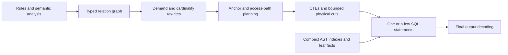

This review compares Rerail's current SQL architecture with ast-index-spike and data-layer PR 2539.
It records a proposed replacement for the compiler's central representation.
It does not report a new implementation or a new performance result.
The review date is 2026-10-22.

**The central problem is the unit of computation.**
Much of the current engine computes successive interpreter frames.
The required shape computes selective relations whose rows represent useful partial matches, demands, or answers.
A recursive SQL statement that dispatches frame operations reduces statement count but preserves those operations and their intermediate copies.
The compiler must choose relational identities and cardinality bounds before it chooses storage or SQL syntax.

The existing improvements remain useful components.
They include selective predicates, narrow witness keys, batched leaf facts, immutable fusion, and honest physical counters.
However, further local improvements to the frame scheduler cannot establish the required architecture.
The recommendation is one relational compiler with automatic physical planning, immutable relation boundaries, and specialized recursion operators.

The reviewed sources are pinned to these commits:

| Source | Revision | Main evidence |
|---|---|---|
| Rerail | `9207ff453e312f762c8347c67a60ee7665bf8070` | Frame IR, SQL emitters, immutable fusion, recursive driver, and the checked-in workload evidence |
| [ast-index-spike](https://github.com/neralabs/ast-index-spike/tree/9449260fea46fa81358fc638bf95a1566d475e27) | `9449260fea46fa81358fc638bf95a1566d475e27` | `bench/sql_rec.py`, `bench/plan_stmt.py`, and `LINTER_CASE_STUDY.md` |
| [data-layer PR 2539](https://github.com/neralabs/nera-data-layer/pull/2539) | `281f500d7c8d413f17c6a27de2f3c518bb45258a` | Declarative fact-query compiler, demand analysis, fact store, and ServerPlan CTE composition |

The PR review uses its exact head, rather than the later data-layer checkout used by some earlier notes.
The ast-index review uses executable code and the recovery analysis.
Its older `SQL_CORRECTNESS_PERFORMANCE_RECONSTRUCTION.md` explicitly declares itself superseded.

**The current engine meets the execution budget while retaining large internal amplification.**
The latest complete workload covers 138 files, 7,336,001 source bytes, 135 policies, and 141 grammar matchers.
It retains three existing unsupported-policy exclusions.
It produces the same complete native outcome: 580 findings, zero failures, and zero blind files.
This workload differs from Tim's original twelve policies and 818 clauses.

| Measurement | Current complete workload |
|---|---:|
| Actual SQL executions, across four workers | 72 |
| SQLite VM instructions | 2,060,142,394 |
| Published frame rows | 43,784,220 |
| Frame cursor advances | 86,522,912 |
| Frame column reads | 358,804,728 |
| Rows read to build frame indexes | 23,333,904 |
| Node cursor advances | 26,315,247 |
| Regex node requests | 2,207,076 |
| Median cold apply CPU, diagnostic configuration | 33.300 seconds |

The execution count includes setup, transactions, matching, and cleanup.
Profiler-generated EXPLAIN statements sit outside that count.
The current budget check runs after the job and does not interrupt execution at statement 101.
The proposed planner must also reject a plan whose complete execution budget exceeds 100.
The evidence and measurement limitations are in [sql-frontier-shape-evidence.json](../benchmark/sql-frontier-shape-evidence.json).

These counters establish substantial internal work, but they do not prove a hundredfold removable cost.
They count different operations, and some native work sits outside the SQLite VM counter.
Likewise, dividing publications by final findings does not measure amplification correctly.
A correct negative result can require substantial search.
Useful denominators are distinct demanded keys, visited relevant edges, and semantically distinct partial matches.

The latest change reduced median apply CPU from 37.632 to 33.300 seconds, or 11.5 percent.
Regex requests and node advances increased despite fewer frame operations.
That tradeoff illustrates why local frame improvements cannot substitute for a whole-plan work model.
These timings use the same diagnostic allocator override and a shared host.
They are neither production latency measurements nor a direct ast-index comparison.

**The frame representation explains the current SQL shape.**
The [frame IR](../native/src/code_rule_dsl/sql/plan.rs) defines operators over `(k, file, node, capture_slots...)`.
Each operator produces at most one output environment for each input key.
This accurately represents the native matcher's greedy behavior.
However, it also encourages the compiler to store another version of the environment at each operator boundary.
Unknown results add verdict and withheld-capture state to those environments.

The compiler emits frame producers, clears, publications, patches, demand updates, and answer joins.
The [large-plan compiler](../native/src/code_rule_dsl/sql/large/mod.rs) packs the remaining schedule into a recursive CTE.
Its actual recursive columns are `pc`, `tick`, `token`, `loops`, and `stack`.
The following schematic preserves the architectural structure but omits generated dispatch expressions:

```sql
WITH RECURSIVE driver(pc, tick, token, loops, stack) AS (
  VALUES (0, 0, 0, json('{}'), json('[]'))
  UNION ALL
  SELECT next_instruction(pc, ...),
         tick + 1,
         execute_frame_action(pc, ...),
         next_loop_state(...),
         next_call_stack(...)
  FROM driver
  WHERE pc >= 0 AND token IS NOT NULL
),
ready AS MATERIALIZED (
  SELECT token FROM driver WHERE pc = -1 LIMIT 1
)
SELECT results.* FROM ready CROSS JOIN results;
```

Here, recursion advances a program counter.
The callbacks publish and update native storage, rather than issue nested SQL or evaluate whole rules natively.
That distinction matters: the implementation is SQL-driven, but its relational shape still reflects an imperative interpreter.
SQLite sees many nested producers behind control dependencies instead of one graph of stable relations.

The [immutable fusion compiler](../native/src/code_rule_dsl/sql/fused/mod.rs) already handles an eligible subset differently.
It recovers a relation graph, shares producers, and selects physical cuts.
Its finite schedule for materialization barriers differs from the general recursive driver.
Nevertheless, both paths inherit decisions from frame-oriented emission.
Recovering a relational graph after storage operations loses information that a direct relational compiler must retain.

Mutable inputs also create a specific materialization conflict.
The [correlation rewrite](../native/src/code_rule_dsl/sql/large/dml.rs) ties mutable reads to `driver.tick` to prevent stale reuse across iterations.
In a rejected experiment, this dependence caused a materialized Boolean region to repeat for data rows.
One step performed 12,255,243 frame advances and took 4.76 CPU seconds while publishing zero rows.
The complete candidate timed out after 180 seconds, without complete parity or budget acceptance.
This was a failed candidate, not a baseline defect that the accepted changes fixed.

**ast-index-spike starts with selective evidence and controls the identity of intermediate rows.**
Its [SQL generator](https://github.com/neralabs/ast-index-spike/blob/9449260fea46fa81358fc638bf95a1566d475e27/bench/sql_rec.py#L4930) provides the strongest prior art for the replacement.
The useful ideas extend beyond CTE syntax:

| Design choice | Effect on generated work | Rerail application |
|---|---|---|
| Select a rare kind, literal, or value anchor | Avoid a broad root scan before a selective test | Estimate candidate domains before traversal |
| Preserve the known ancestor path | Avoid climbing from an anchor and then rediscovering unrelated descendants | Carry proven structural restrictions into subsequent joins |
| Reduce each subtree to its observable identity | Prevent child products from propagating upward | Define partial-match keys before choosing joins |
| Use semijoins for existence-only branches | Avoid multiplying rows by irrelevant witnesses | Emit `EXISTS` where captures, order, and multiplicity permit |
| Combine provably single-valued children by grouping | Avoid a general product for functional relationships | Record functional dependencies in the IR |
| Materialize selected reused or expensive relations | Avoid repeated scans and repeated expression expansion | Cost materialization against reuse, width, and preparation limits |

The subtree relation has the conceptual shape `sub(fid, root, node, observed_captures...)`.
It collapses duplicates at that identity before the next parent join.
It does not generate a broad embedding product and rely on one final `DISTINCT` to repair the result.
If two branches contribute independently observable captures, their genuine combinations remain distinct.
If a branch only proves existence, it contributes no extra match multiplicity.

These transformations have explicit preconditions.
The generator rejects its semijoin rewrite for relevant sibling-order constraints and wildcard completion identities.
Its grouped-child rewrite requires a proof of single-valued children.
Using `MAX` to select arbitrary captures from multiple matches changes semantics.
Rerail needs equivalent proofs for its own capture and greedy-selection rules.

A hypothetical branch shows why this matters.
Suppose 1,000 parents each have 20 matching children in one branch and 30 in another.
A flat join creates 600,000 combinations before a final parent-level `DISTINCT`.
If both branches only prove existence, two semijoins retain at most 1,000 parent rows.
If the first branch contributes observable captures, its relation retains up to 20,000 rows and probes the other branch for existence.
The cost of obtaining child facts remains, so these row bounds are not equivalent to a measured speedup.

The [anchor and probe helpers](https://github.com/neralabs/ast-index-spike/blob/9449260fea46fa81358fc638bf95a1566d475e27/bench/sql_rec.py#L1548) also distinguish logical operators from physical SQL forms.
The source records a SQLite case with 1,043 pattern rows and 13,155 postings.
The recorded times are 24.3 seconds for a join, 6.3 seconds for `CROSS JOIN`, and 0.46 seconds for `EXISTS`.
All forms counted 966 matches.
These are historical kernel measurements from that repository, not fresh measurements or estimates of Rerail's possible speedup.

The lesson is to preserve the semijoin in the IR and select its physical form for the backend and access path.
The lesson is not to replace every join with a correlated subquery.
An indexed probe against a small candidate domain differs fundamentally from a correlated full scan.

The [planning query](https://github.com/neralabs/ast-index-spike/blob/9449260fea46fa81358fc638bf95a1566d475e27/bench/plan_stmt.py) batches query metadata through `VALUES` relations.
It uses frequency information to choose anchors and traversal directions.
Rerail can make those decisions during SQL generation from index statistics.
It does not need to repeat planner arithmetic inside every matching query.

The [linter case study](https://github.com/neralabs/ast-index-spike/blob/9449260fea46fa81358fc638bf95a1566d475e27/LINTER_CASE_STUDY.md) provides a second useful shape: SQL over typed semantic facts.
Its native extraction includes containment and scope facts, plus some more specialized facts.
That boundary can remove repeated structural discovery.
However, extraction and refresh costs belong in cold-job measurements.
Importing a large fact store, or precomputing whole rule verdicts natively, does not establish a faster SQL matcher.

**PR 2539 contains two distinct compiler patterns that apply.**
The [declarative linter compiler](https://github.com/neralabs/nera-data-layer/blob/281f500d7c8d413f17c6a27de2f3c518bb45258a/scripts/lint_lib/declarative_linter_sqlite.py) builds named relations, rule relations, and the final projection in one query.
Intermediate consumers reference producer CTEs directly.
Relations expose selected fields, joins, grouping, windows, and explicit materialization choices.
The compiler starts from relations rather than a sequence of fetched Python results.

Its [demand analysis](https://github.com/neralabs/nera-data-layer/blob/281f500d7c8d413f17c6a27de2f3c518bb45258a/scripts/lint_lib/fact_query/demand.py) determines required fact relations and fields before extraction.
Its [fact store](https://github.com/neralabs/nera-data-layer/blob/281f500d7c8d413f17c6a27de2f3c518bb45258a/scripts/lint_lib/fact_store.py) uses typed row intents and batched atom handling.
These ideas support narrow extraction, integer identities, and bulk storage.
However, field demand does not itself restrict runtime candidate keys.
Rerail needs both column demand and selective key demand.

The [ServerPlan dependent-read strategy](https://github.com/neralabs/nera-data-layer/blob/281f500d7c8d413f17c6a27de2f3c518bb45258a/impl/common/l2070_server_plan/strategies/dependent_read_cte.py#L151) is especially relevant to composition.
It registers a typed `CteReference` before compiling a consumer.
The consumer emits a relation reference instead of resolving the producer into host-language rows.
The strategy assembles the dependency graph into one SQL statement and tags outputs for result separation.
The [reference type](https://github.com/neralabs/nera-data-layer/blob/281f500d7c8d413f17c6a27de2f3c518bb45258a/l2070_batching/compilation.py#L216) carries columns, types, source tables, and scope information.

That is the appropriate abstraction for Rerail's compiler dependencies.
The key operation becomes “reference this typed relation,” rather than “execute this plan and publish its frame.”
A physical boundary can later replace that reference with an immutable stored relation.
The logical consumer remains the same.

The exact PR does not establish that every complex program becomes one SQL execution.
Its dependent-read strategy admits eligible read-only DAGs and rejects cycles, conditional steps, and required execution boundaries.
Its [declarative batch executor](https://github.com/neralabs/nera-data-layer/blob/281f500d7c8d413f17c6a27de2f3c518bb45258a/scripts/lint_lib/fact_query/declarative_batch_executor.py#L44) loops over plugins on a shared connection.
Fact loading and allowed-path setup also require work outside the final query.
Rerail must extend relation composition across rules to meet its whole-job budget.

The PR's [recursive relation compiler](https://github.com/neralabs/nera-data-layer/blob/281f500d7c8d413f17c6a27de2f3c518bb45258a/scripts/lint_lib/declarative_linter_sqlite.py#L572) emits seed-and-edge traversal with a depth bound.
It uses `UNION ALL` and defaults the bound to 64.
That is useful traversal prior art, but it does not implement arbitrary capture-sensitive recursive Rerail semantics.
Repeated paths can still multiply work in a graph with converging edges.
Copying its depth bound into Rerail silently changes semantics.

**The replacement compiler needs an explicit contract for every relation.**
The first pass must describe meaning independently of physical buffers.
Each relation needs the following properties:

| Property | Required information |
|---|---|
| Row identity | The key that distinguishes semantically different rows |
| Schema | Typed node IDs, atom IDs, captures, verdicts, and required order keys |
| Dependencies | Symbolic references to other relations |
| Cardinality | Unique keys, functional dependencies, and estimated rows per demand |
| Demand | Required input bindings, candidate domain, and live output fields |
| Semantics | Set or bag behavior, greedy choice, unknown propagation, and observable errors |
| Recursion | Component membership, monotonicity, and recursive state identity |
| Physical requirements | Useful access keys, ordering, reuse, and lifetime |

The compiler can then use relational operators such as `Filter`, `SemiJoin`, `AntiJoin`, `Project`, `Distinct`, `Group`, and `OrderedChoice`.
`LeafFacts` and `Fixpoint` need explicit semantic contracts of their own.
A total capture-free predicate usually produces keys or a membership test.
It does not need a copy of every input capture.
An ordered capture producer returns its chosen binding, and downstream relations reference that binding.

Sharing must use the full semantic input identity.
A shared demand key includes the definition, parameters, file version, node, and captures that the definition actually reads.
Traversal context, exclusions, and evaluation mode also belong in the key where they affect the answer.
The compiler can intern that tuple into an integer demand ID.
It must retain collision-safe equality and distinguish unbound, unknown, and empty-list bindings.

The demand relation is the union of reached demands from consumers.
It is not every node crossed with every rule and every possible environment.
Shared definitions evaluate each distinct demand and return answers keyed by that demand.
Consumers join those answers back to their own occurrence identities.
Sharing an answer must not accidentally merge two observable occurrences.

Batching across rules and fusion within each rule solve different problems.
The whole-job graph must support both.
Compatible rule constants can form compact `VALUES` relations, while shared producers retain typed dependencies.
Distinct rule shapes can share those producers and combine their final outputs with tagged unions.
The compiler must avoid both a universal rule-by-node product and repeated expansion of each shared producer into every consumer.

The intended pipeline is:



The compiler retains capture IDs and source spans until final output decoding.
Strings and formatted diagnostics do not travel through every join.
Cheap, single-use relations remain inline where that avoids storage.
Shared or expensive relations receive an explicit materialization decision after demand and width reduction.

**A representative SQL shape starts at the selective evidence.**
Consider a total, two-valued rule that selects the first qualifying call in each function.
Qualification here means a matching callee name and an argument-kind existence test.
The following SQL illustrates the relation boundaries, rather than an existing generated query:

```sql
WITH
rule_spec(rule_id, callee_atom, argument_kind) AS (
  VALUES (1, :name_a, :kind_a), (2, :name_b, :kind_b)
),
qualified AS MATERIALIZED (
  SELECT DISTINCT r.rule_id, c.file, o.function_node,
                  c.call_node, c.walk_order
  FROM rule_spec r
  JOIN callee_postings c ON c.name_atom = r.callee_atom
  JOIN selected_files f ON f.file = c.file
  JOIN owner_function o ON o.file = c.file AND o.node = c.call_node
  WHERE EXISTS (
    SELECT 1 FROM call_arguments a
    WHERE a.file = c.file AND a.call_node = c.call_node
      AND a.kind = r.argument_kind
  )
),
ranked AS (
  SELECT *, ROW_NUMBER() OVER (
    PARTITION BY rule_id, file, function_node
    ORDER BY walk_order, call_node
  ) AS choice
  FROM qualified
)
SELECT rule_id, file, function_node, call_node AS capture_node
FROM ranked
WHERE choice = 1;
```

The logical fact relations can use the existing compact AST representation and virtual tables.
They do not require another wide copy of every AST node.
The plan probes callee postings, keeps candidate IDs, tests argument existence, and selects one witness.
It does not publish a frame for each kind test, relation hop, or Boolean connective.
The materialization of `qualified` is a planning choice that requires measurement, not a rule for every query.

Ordered semantics constrain this shape.
If the DSL selects a call before it applies a later predicate, the compiler must rank before that later predicate.
Moving the predicate into `qualified` can skip the first call and choose a later call.
That introduces backtracking and changes the native result.
The compiler therefore needs an `OrderedChoice` boundary rather than a global “join everything, then rank” rewrite.

Unknowns and errors also constrain reordering.
An unknown encountered before a later successful witness can determine the native result.
Withheld captures affect which subsequent terms execute.
Counts can require both known successes and unresolved candidates.
The compiler must represent these distinctions explicitly instead of treating unknown as ordinary SQL `NULL` or false.

Fallible leaf work needs a reached-demand contract.
Pure leaf evaluation can return an error as data, with SQL selecting the error only for a reached demand.
That transformation requires a proof that speculative work has no other observable effect or budget consequence.
Otherwise, the plan needs a semantic boundary before that work.
The same requirement applies to reached-cycle refusals and enumeration exclusions.

**Intermediate materialization needs stable inputs, a narrow schema, and a reason.**
There are four useful storage lifetimes:

| Lifetime | Appropriate content | Required boundary |
|---|---|---|
| File-version lifetime | Compact AST, postings, reusable semantic indexes | Immutable after construction, invalidated with the file version |
| Statement lifetime | Selective reused anchors, reduced subtree results, expensive decode results | Inputs remain stable throughout the statement |
| Physical-phase lifetime | A narrow relation that prevents SQL expansion or supports a measured access path | Producer completes before consumers start |
| Recursive-component lifetime | Necessary frontier, visited identity, or local continuation state | Scope limited to that recursive component |

When reuse or reduced expansion pays for copying and indexing, materialization is valuable.
The cost includes rows multiplied by row width, index construction, allocation, and peak live memory.
It also includes the work required to produce those rows.
A smaller output counter alone does not establish a cheaper plan.

Before materialization, the compiler must push safe demand restrictions and project unused fields away.
It must collapse rows to the identity that consumers observe.
For multiple consumers, the producer covers their union of demands and returns only the required union of fields.
If consumers require very different domains, separate selective producers can cost less than one broad shared producer.
Sharing is a cost decision after semantic equivalence, not an unconditional objective.

Ordinary CTE references express dependencies without requiring publication callbacks.
SQLite's `MATERIALIZED` hint creates an optimization fence that can prevent useful pushdown.
`NOT MATERIALIZED` does not prohibit physical materialization.
Neither hint is an application-level contract for callback execution order or exactly-once effects.
These properties require explicit storage and evaluation contracts. [SQLite materialization documentation](https://www.sqlite.org/lang_with.html#materialization_hints)

The previous [whole-call spike](sql-whole-call-compiler-spikes.md) also demonstrated a separate preparation limit.
Repeated dependency expansion reached `too many references to "node": max 65535`.
Adding materialization hints did not remove that preparation failure.
A small number of real phase boundaries can reset expansion and keep each statement manageable.
Those boundaries must produce closed, immutable relations instead of another mutable frame schedule.

An immutable native buffer remains a valid physical storage option.
SQL must produce its rows in bulk, and the next phase must see a complete snapshot.
Its access paths and construction work must appear in the profile.
The buffer must not evaluate rule composition or issue hidden SQL.
An ordinary indexed temporary table is another physical choice under the same logical relation contract.

`ANALYZE` can improve plans for ordinary stored tables through index statistics.
Its own cost and execution count belong in the job budget. [SQLite optimizer documentation](https://www.sqlite.org/optoverview.html#manual_control_of_query_plans_using_sqlite_stat_tables)
Virtual-table access paths instead require implementation support, including useful `xBestIndex` row and cost estimates.
SQLite does not permit a separate `CREATE INDEX` on a virtual table. [SQLite virtual-table documentation](https://www.sqlite.org/vtab.html)
Statistics cannot repair an unnecessary Cartesian product or a semantically oversized demand relation.

**Recursion belongs in SQL, but its state must describe the recursive problem.**
The compiler first identifies strongly connected components and their semantic requirements.
A tree relationship sometimes reduces to field access, an interval, or an existing scope index without recursion.
Positive linear reachability can use a narrow recursive relation over demanded node keys.
For set reachability, `UNION` can suppress repeated states at their logical identity.
Depth, path, and capture columns belong in that identity only where the rule observes them.

A basic eligible reachability operator has this form:

```sql
WITH RECURSIVE reach(demand_id, file, node) AS (
  SELECT demand_id, file, start_node FROM demanded_roots
  UNION
  SELECT r.demand_id, r.file, e.target
  FROM reach r
  JOIN eligible_edges e ON e.file = r.file AND e.source = r.node
)
SELECT demand_id, file, node FROM reach;
```

This example computes reachability only.
It does not claim to implement greedy captures, depth-sensitive results, or all general recursive rules.
Adding a changing depth column defeats node-only deduplication.
Using `UNION ALL` over a graph can enumerate many paths to the same answer.
The compiler must choose state identity from semantics before choosing either operator.

Mutually recursive linear relations can share one tagged recursive relation.
Nonlinear recursion requires more analysis because a step can depend on several recursive answers.
SQLite permits one recursive-table reference in each recursive arm and excludes aggregates and windows from that arm.
This restricts direct translations of nonlinear fixed points. [SQLite recursive CTE documentation](https://www.sqlite.org/lang_with.html#recursive_common_table_expressions)

The planner can separate invariant joins, specialize known traversal shapes, and place stratified aggregation outside eligible recursive components.
Negative dependencies and ordered recursive captures require their actual matcher semantics.
A generic positive fixed point does not preserve those semantics automatically.
For irreducible supported cases, a compact local continuation relation is a candidate physical operator.
It must carry only that component's required state, rather than restore a program counter for the entire engine.

That final operator remains an engineering question, not a proven fast replacement.
The existing [general-recursion spike](sql-generation-shape-spikes.md) establishes expressibility but also demonstrates large state growth.
The next design proof must include nonlinear dependencies, captures, unknowns, and reached-cycle behavior.
Successful acyclic or reachability kernels alone cannot establish completion of general recursive scheduling.

The execution budget rules out a host loop that submits one statement per recursive round.
Data-dependent iteration must remain inside the SQL plan.
Physical phase count must depend on the compiled graph and backend limits, rather than the number of reached rows or rounds.
If the complete plan cannot fit the budget, compilation must report that failure explicitly.
It must not silently reduce the workload or restore per-rule execution.

**The SQL/native boundary follows the kind of work.**

| Work | Appropriate owner | Reason |
|---|---|---|
| Parsing, compact AST construction, atom interning | Native code | Specialized computation and memory representation |
| Generic scope, symbol, and structural indexes | Native code, exposed as typed facts | Reusable facts avoid repeated discovery |
| Regex and leaf pattern operations | Native primitives behind SQL-visible facts | Dedicated algorithms, with distinct-demand batching |
| Joins, existence, anti-existence, grouping, candidate restriction | SQL | Relational composition over typed keys |
| Ordered witness selection and unknown propagation | SQL compiler and generated relations | These operations determine rule semantics |
| Tree walks and recursive rule dependencies | SQL | Data dependencies stay visible in the query |
| Bulk relation storage and indexed access | SQLite or native virtual-table storage | A physical choice with explicit cost |
| Output text, spans, fixes, diagnostics | Native decoding after selection | Avoid repeated payload construction |

SQL is poorly matched to parsing, string-heavy environment copying, and allocation-heavy interpreter dispatch.
It is well matched to selective relationships and reductions over stable facts.
Native code must not compute a whole rule verdict and present it as a leaf fact.
That moves the matcher out of SQL and hides the architectural problem.
Generic semantic facts are useful only with their extraction cost and demand included in the measurement.

**The next implementation needs a reference shape before another optimization pass.**
The first deliverable is a set of hand-designed SQL kernels over the same indexed inputs and leaf primitives.
They must cover a capture-free rule, a capture-producing rule such as B023, strict unknown behavior, counting, and representative recursive components.
Each kernel needs its semantic identity, expected cardinality, access paths, materialization boundaries, and complete output comparison.
These kernels provide executable targets for the new IR.

The implementation sequence is:

1. Define typed relations and semantic properties directly from the DSL, before frame allocation or SQL emission.
2. Prove demand, projection, semijoin, subtree reduction, and ordered-choice rewrites against representative kernels.
3. Add anchor selection, access-path estimates, and costed immutable materialization.
4. Lower recursive components according to their proven shape and complete the unresolved general-recursion cases.
5. Replace the frame-to-DML-to-schedule pipeline through the same engine entry point.
6. Measure the complete workload with native parity, whole-job accounting, and the hard execution budget.

This is one compiler architecture with several physical operators.
It does not introduce user-selected engine modes or a native matcher fallback.
The implementation can reuse existing leaf primitives, compact indexes, semantic analysis, and profiling infrastructure.
The frame IR remains useful as a semantic reference during development, but it cannot remain the central physical-planning abstraction.

The planner must account for every worker and every phase.
The budget includes setup, transactions, stored-relation creation, statistics, matching, and cleanup.
The target remains one matching statement across the batch where backend limits permit it.
A small number of measured cuts is acceptable.
One statement per rule, file, or recursive iteration is not an acceptable partition strategy.

The profile must explain work at relation boundaries, rather than report only instruction addresses.
Each relation needs actual rows, distinct semantic keys, demanded keys, row width, producer evaluations, consumer probes, and materialization bytes.
Index construction, native leaf work, peak live storage, SQL preparation, and final output decoding need separate accounting.
Every physical cut needs a stated reason and a measured cost.
Even if a warm query looks fast, total cold time must include parsing and index construction.

Scale checks must vary irrelevant nodes, branch width, duplicate consumers, shared-definition fanout, and recursive diamonds independently.
A branch with two existence-only children must not grow as their product.
An answer shared by ten consumers must not require ten full leaf evaluations for the same semantic demand.
A reachability relation must not enumerate every path unless path identity is observable.
These are structural acceptance conditions, rather than another collection of SQL tuning switches.

The complete acceptance workload remains all currently supported policies and files, with no new exclusions.
It requires exact native outputs and at most 100 actual SQL executions across the cold job.
Performance claims then compare the same input, semantics, leaf work, and cold costs.
The current evidence justifies replacing the central shape.
It does not yet justify a numerical speedup promise for that replacement.
